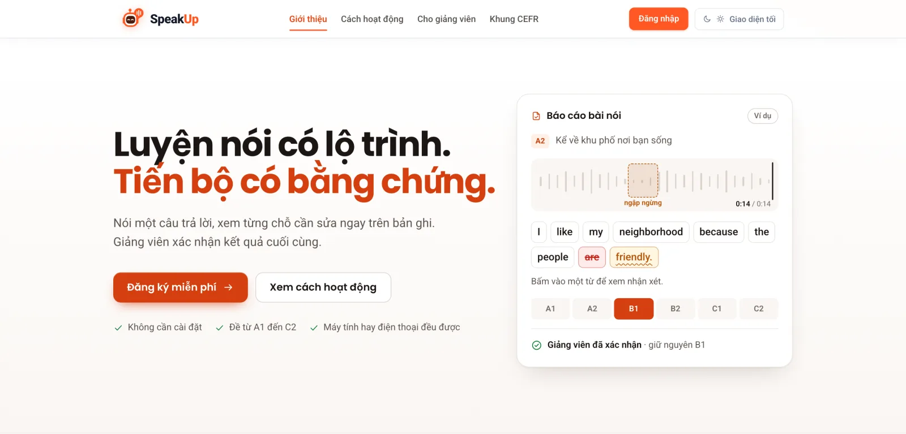
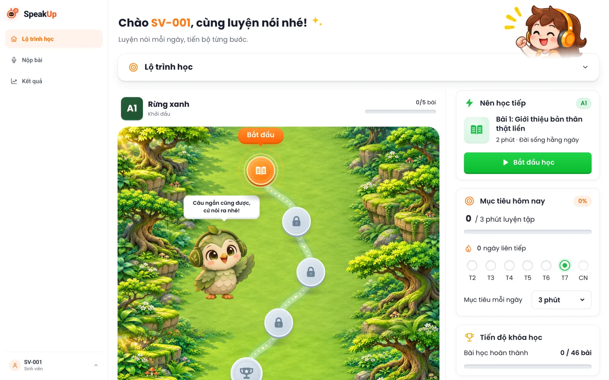
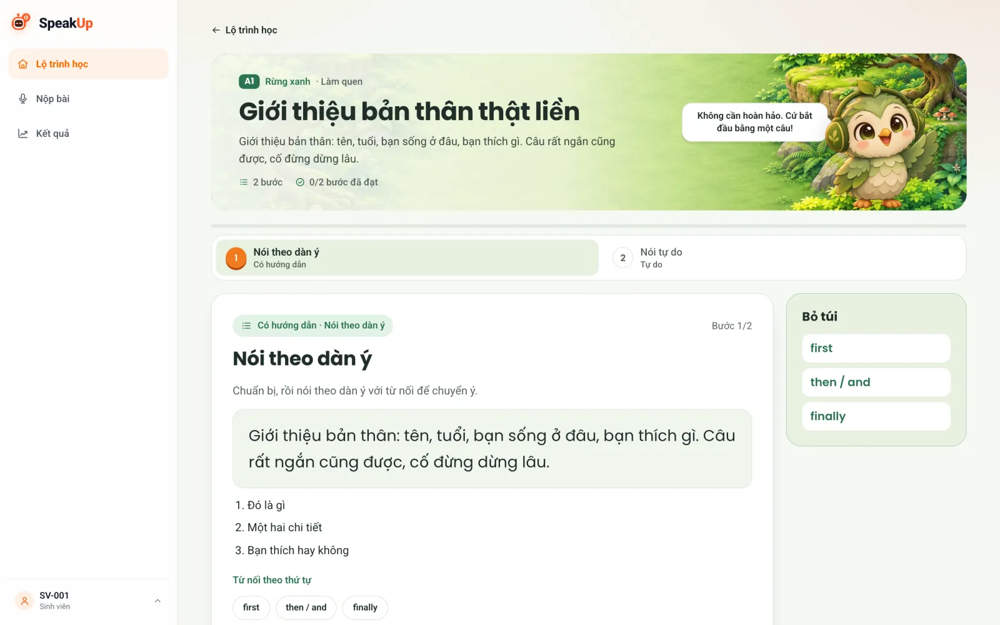
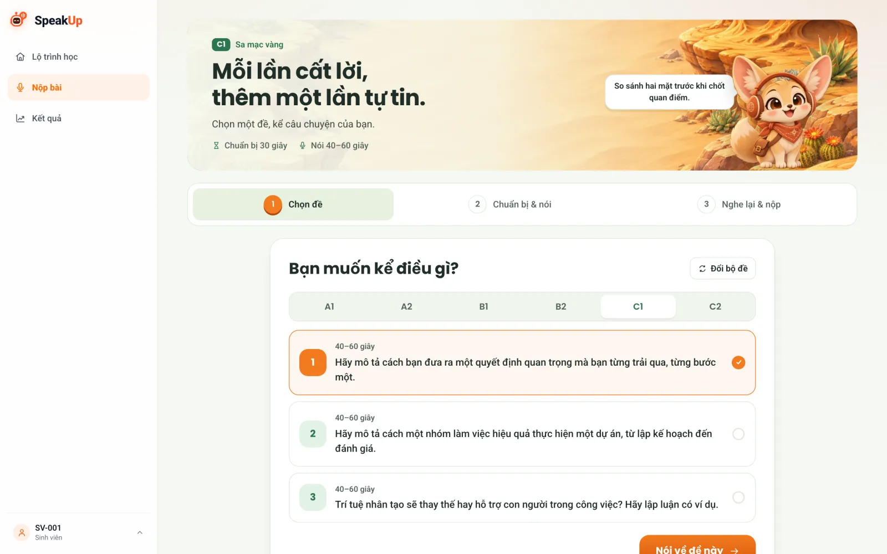
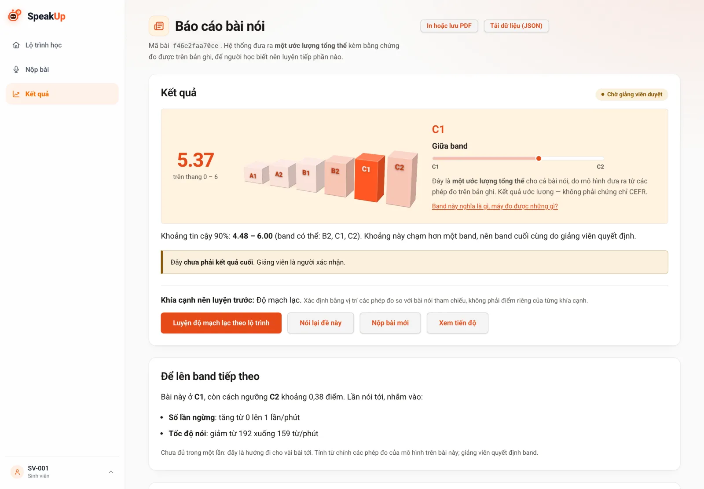
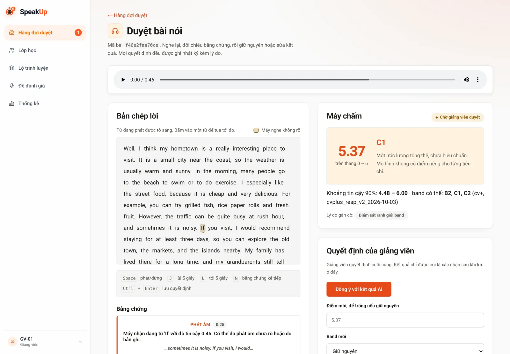
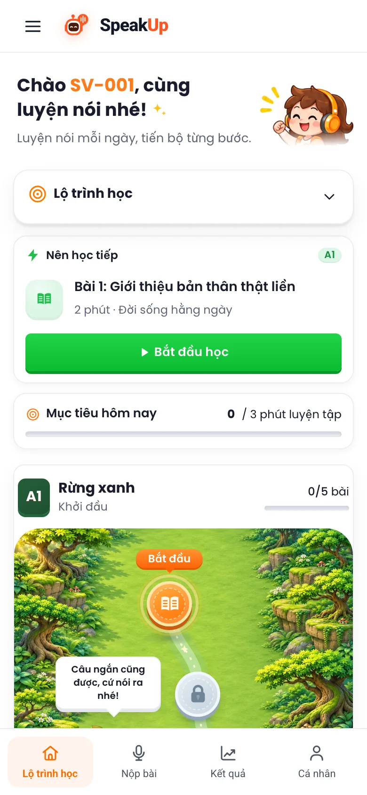
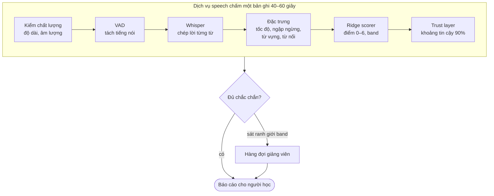
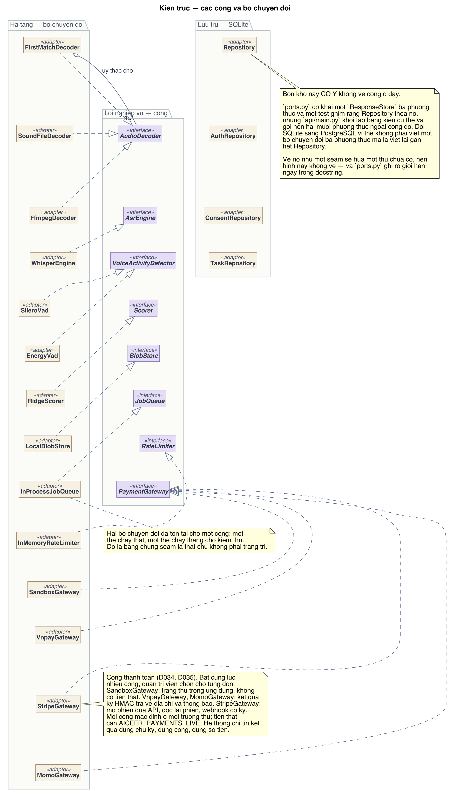
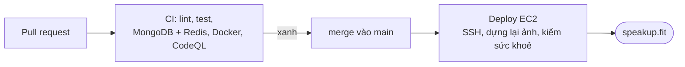

<div align="center">

<a href="https://speakup.fit"></a>

# SpeakUp

**Luyện nói tiếng Anh có lộ trình. Tiến bộ có bằng chứng.**

Ước lượng band CEFR A1–C2 cho bài nói tiếng Anh, chỉ ra đúng giây ngập ngừng và từ chưa rõ ngay trên bản ghi,
rồi biến việc luyện tập thành một lộ trình bài học ngắn. Giảng viên luôn là người xác nhận kết quả cuối cùng.

[](https://speakup.fit)

[](https://github.com/ThanhSangLouis/ai-assessor-cefr/actions/workflows/ci.yml)
[](https://github.com/ThanhSangLouis/ai-assessor-cefr/actions/workflows/deploy.yml)
[](https://github.com/ThanhSangLouis/ai-assessor-cefr/actions/workflows/codeql.yml)


[Dùng thử](https://speakup.fit) · [Tính năng](#tính-năng) · [Kiến trúc](#kiến-trúc) · [Chạy cục bộ](#chạy-cục-bộ) · [Tài liệu](#tài-liệu)

</div>

<br>

<picture>
  <source media="(prefers-color-scheme: dark)" srcset="docs/assets/readme/landing-dark.webp">
  
</picture>

> [!NOTE]
> SpeakUp là công cụ hỗ trợ học tập, **không cấp chứng chỉ**. Band và điểm là ước lượng của máy;
> kết quả chỉ được coi là chính thức khi giảng viên đã nghe lại và xác nhận.

## Vì sao có SpeakUp

Sinh viên Việt Nam muốn luyện nói tiếng Anh một mình, giữa giờ học hay ở nhà, nhưng ít khi có người nghe và chỉ ra
cần sửa gì. Giảng viên thì không đủ thời gian nghe từng bài. SpeakUp đứng giữa hai phía:

- **Sinh viên** nói một câu trả lời ngay trên trình duyệt, nhận band ước lượng kèm bằng chứng đo được trên chính bản ghi,
  rồi luyện tiếp theo lộ trình, từ nói theo mẫu tới nói tự do.
- **Giảng viên** chỉ cần nghe những bài máy chưa chắc chắn, giữ nguyên hoặc sửa band, mọi quyết định đều có nhật ký.
- **Quản trị viên** cấp tài khoản, quản lý lớp, đặt giá lượt chấm và theo dõi hệ thống.

## Tính năng

<table>
  <tr>
    <td width="50%" valign="top">
      
      <h3>Lộ trình A1 → C2</h3>
      Sáu bậc, mỗi bậc là một vùng đất trên bản đồ. Bài học ngắn vài phút, mục tiêu mỗi ngày, chuỗi ngày học và gợi ý bài nên học tiếp.
    </td>
    <td width="50%" valign="top">
      
      <h3>Bài học rút dần gợi ý</h3>
      Mỗi bài đi qua các bước nghe mẫu, nói theo khung, nói có hướng dẫn rồi nói tự do. Gợi ý ít dần cho tới khi người học tự nói được.
    </td>
  </tr>
  <tr>
    <td width="50%" valign="top">
      
      <h3>Nộp bài trong trình duyệt</h3>
      Chọn đề theo band, có thời gian chuẩn bị rồi ghi âm ngay trên máy tính hay điện thoại, không cần cài đặt. Có thể tải file lên nếu micro gặp sự cố.
    </td>
    <td width="50%" valign="top">
      
      <h3>Báo cáo có bằng chứng</h3>
      Điểm trên thang 0–6, band CEFR, khoảng tin cậy 90%, việc cần làm để lên band tiếp theo. Bấm vào một từ để nghe lại đúng chỗ đó trong bản ghi.
    </td>
  </tr>
  <tr>
    <td width="50%" valign="top">
      
      <h3>Giảng viên quyết định</h3>
      Bài máy chưa chắc chắn tự vào hàng đợi. Giảng viên nghe lại, đối chiếu bằng chứng, giữ hoặc sửa band. Có chấm mù kép để đo độ đồng thuận.
    </td>
    <td width="50%" valign="top" align="center">
      
      <h3>Chạy tốt trên điện thoại</h3>
      Giao diện sáng và tối, dùng được trên điện thoại Android cấu hình thấp lẫn máy tính phòng lab.
    </td>
  </tr>
</table>

<details>
<summary><b>Toàn bộ tính năng</b></summary>

<br>

| Nhóm | Có gì |
| --- | --- |
| Đánh giá | Ước lượng band A1–C2, khoảng tin cậy conformal 90%, gắn cờ bài cần người duyệt, nhận xét theo năm tiêu chí Range, Accuracy, Fluency, Coherence, Phonology |
| Bằng chứng | Bản chép lời đồng bộ với âm thanh, từ máy nghe chưa rõ, chỗ ngập ngừng, tốc độ nói, từ nối, xuất PDF và JSON |
| Luyện tập | Lộ trình sáu bậc, bài học nhiều bước, ôn tập, nói lại, luyện từ khó, đọc đoạn văn do AI viết, cụm từ hay dùng, thành tựu và chuỗi ngày học |
| Giảng viên | Hàng đợi duyệt, chấm mù kép, lớp học, soạn đề và bài học, lộ trình riêng cho lớp, thống kê lớp |
| Tài khoản | Đăng nhập bằng mật khẩu hoặc Google (OAuth PKCE), đồng thuận dữ liệu, xoá dữ liệu theo yêu cầu, nhật ký kiểm toán |
| Tính lượt | Lượt chấm theo phút nói (1 lượt = 2.000 IDPoint), lượt miễn phí mỗi tháng, bản ghi miễn phí mỗi ngày trong lộ trình, gói lượt qua payOS (chuyển khoản VietQR), email biên nhận. Mặc định tắt (`AICEFR_METERING`) |
| Vận hành | Ba dịch vụ tách rời, hàng đợi Redis, lưu bản ghi trên S3 tương thích, chỉ số Prometheus và Grafana, sao lưu MongoDB |

</details>

## Cách chấm một bài nói



Mô hình chấm được huấn luyện trên bộ dữ liệu Speak & Improve (giấy phép phi thương mại) và nằm ngoài repo.
Với bài độc thoại, tiêu chí Interaction luôn để trống vì không đủ bằng chứng.

## Kiến trúc

<a href="docs/sdd/images/02b_kien_truc.png"></a>

| Dịch vụ | Việc chính | Lưu trữ |
| --- | --- | --- |
| `core` | Tài khoản, phiên, Google OAuth PKCE, đồng thuận, bài nộp và đánh giá, duyệt bài, chấm mù kép, lộ trình, tính lượt NetID IDPoint, thanh toán | MongoDB `aicefr`, `aicefr_learning`, `aicefr_metering` |
| `speech` | Xử lý âm thanh độc lập, nhận việc qua Redis BullMQ, trả kết quả qua Redis Streams | Không giữ khoá hay dữ liệu người dùng |
| `web` | Giao diện Jinja2, tệp tĩnh, BFF gọi `core` qua HTTP nội bộ | Không có |

Chi tiết: [SDD](docs/sdd/SDD.md) · [sơ đồ triển khai](docs/sdd/images/06_deployment.png)

## Công nghệ

| Lớp | Công nghệ |
| --- | --- |
| Backend | Python 3.12, FastAPI, Pydantic, Uvicorn |
| Giọng nói | Whisper (`mlx-whisper` trên Apple Silicon, `faster-whisper` nơi khác), Silero VAD, Ridge regression, conformal prediction |
| Dữ liệu | MongoDB 7 (pymongo), Redis 7 (BullMQ, Streams), S3 tương thích (MinIO) |
| Giao diện | Jinja2, JavaScript thuần, CSS tự viết, font tự host (Roboto, Poppins), PWA và thông báo đẩy |
| Tích hợp | Google OAuth PKCE, payOS (VietQR), Resend (email), Gemini (AI viết lại) |
| Hạ tầng | Docker Compose, Caddy, Nginx, AWS EC2, Prometheus, Grafana |
| Chất lượng | pytest, Playwright, Ruff, CodeQL, quét lộ khoá bí mật |

## Chạy cục bộ

Cần Python 3.12 và Docker (để chạy MongoDB).

```bash
git clone https://github.com/ThanhSangLouis/ai-assessor-cefr.git
```

```bash
cd ai-assessor-cefr && python3.12 -m venv .venv && .venv/bin/pip install -e '.[dev,vad]'
```

```bash
./demo.sh
```

`demo.sh` tự chạy MongoDB trong Docker, tạo bốn tài khoản demo và mở http://localhost:8000.

| Tài khoản | Vai trò | Mật khẩu |
| --- | --- | --- |
| `SV-001`, `SV-002` | Sinh viên | `matkhau123` |
| `GV-01` | Giảng viên | `matkhau123` |
| `QT-01` | Quản trị viên | `matkhau123` |

Muốn chấm thật bằng Whisper:

```bash
.venv/bin/pip install -e '.[dev,asr,vad]' && AICEFR_ASR=whisper ./demo.sh
```

> [!IMPORTANT]
> Artifact mô hình chấm nằm ngoài repo ở `../aicefr-models` vì giấy phép Speak & Improve.
> Thiếu thư mục này, `demo.sh` dùng artifact giả lập và điểm không có ý nghĩa.

<details>
<summary><b>Chạy đủ ba dịch vụ bằng Docker Compose</b></summary>

<br>

Chép `.env.example` thành `.env`, điền các biến bắt buộc của phần dịch vụ, rồi:

```bash
docker compose up -d --build
```

Hướng dẫn từng bước kèm lệnh kiểm tra: [CHAY_TREN_LOCALHOST.md](docs/plan/CHAY_TREN_LOCALHOST.md) (cho người đọc)
và [CHAY_DU_AN_CHO_AI.md](docs/plan/CHAY_DU_AN_CHO_AI.md) (cho AI agent).

</details>

<details>
<summary><b>Quản lý tài khoản bằng dòng lệnh</b></summary>

<br>

Hệ thống không cho tự đăng ký tự do: tài khoản do quản trị viên cấp, hoặc vào qua mã lớp, NetID hay Google.

```bash
python -m aicefr.accounts_cli liet-ke
python -m aicefr.accounts_cli doi-mat-khau --but-danh SV-001 --mat-khau-moi MatKhauMoi456
python -m aicefr.accounts_cli khoa --but-danh SV-001
python -m aicefr.accounts_cli mo-khoa --but-danh SV-001
```

</details>

## Triển khai

Bản chạy thật ở **[speakup.fit](https://speakup.fit)** trên AWS EC2.



`main` có branch protection: mọi thay đổi đi qua pull request, CI xanh mới được merge, merge xong thì tự triển khai.
Cấu trúc máy chủ, luồng deploy và lỗi hay gặp: [TRIEN_KHAI_CHO_AI.md](docs/plan/TRIEN_KHAI_CHO_AI.md).
Dựng lại máy chủ từ đầu: [TRIEN_KHAI_EC2.md](docs/plan/TRIEN_KHAI_EC2.md).

## Kiểm thử và chất lượng

Khoảng 1.700 bài kiểm thử đơn vị và tích hợp, chạy thêm trên MongoDB và Redis thật, cùng bộ kiểm thử trình duyệt bằng Playwright.

```bash
ruff format --check src tests tools && ruff check src tests tools scripts
```

```bash
pytest -m "not e2e" -q
```

```bash
python3 scripts/ci/check_forbidden_files.py && python3 scripts/ci/check_md_links.py
```

CI còn chặn commit file âm thanh, trọng số mô hình, `.env` và khoá bí mật, kiểm liên kết Markdown, đòi độ phủ tối thiểu 70%
và giữ cho yêu cầu, tiêu chí chấp nhận và kế hoạch kiểm thử luôn khớp nhau.

## Cấu trúc thư mục

```text
src/aicefr/
├── services/
│   ├── core/       định danh, đánh giá, học tập, tính lượt, thanh toán
│   ├── speech/     worker nhận việc chấm từ Redis
│   └── web/        BFF và các trang
├── qc/ asr/ features/ scoring/ pronunciation/ report/
│                   chuỗi chấm: kiểm chất lượng, chép lời, đặc trưng, điểm, báo cáo
├── lessons/ practice/ coach/
│                   lộ trình, bài học, luyện tập, gợi ý
├── billing/ metering/
│                   cổng thanh toán, bảng giá và quy đổi lượt
├── storage/        kho MongoDB
└── api/            templates Jinja2 và static (JS, CSS, ảnh)
tests/              kiểm thử đơn vị, tích hợp, e2e
docs/               SRS, SDD, kế hoạch, minh chứng, sơ đồ
deploy/             Caddy, Nginx gateway, MongoDB, giám sát, script máy chủ
```

## Tài liệu

| Tài liệu | Nội dung |
| --- | --- |
| [SRS](docs/srs/SRS.md) | Đặc tả yêu cầu, FR-01 tới FR-99 và tiêu chí chấp nhận |
| [SDD](docs/sdd/SDD.md) | Thiết kế kiến trúc, sơ đồ lớp, tuần tự, ERD, triển khai |
| [Nhật ký quyết định](docs/sources/research-preparation/21_week1_decision_log.md) | Các quyết định kiến trúc và sản phẩm D001–D094 |
| [Từ điển dữ liệu](docs/db/TU_DIEN_DU_LIEU.md) | Các collection MongoDB và trường dữ liệu |
| [Tính giá theo lượt](docs/plan/TINH_GIA_THEO_TOKEN.md) | Cách tính lượt, IDPoint và bảng giá |
| [Kiểm kê giấy phép](docs/license_inventory.md) | Giấy phép của mô hình, dữ liệu và thư viện |
| [Hướng dẫn cho AI agent](AGENTS.md) | Quy trình làm việc, ranh giới phê duyệt, bảo mật |

## Bản quyền và giới hạn

- Mô hình chấm dùng dữ liệu Speak & Improve theo giấy phép **phi thương mại**: các gói trả phí chỉ chạy ở chế độ thử.
- Điểm số là ước lượng để luyện tập, không thay thế kỳ thi hay chứng chỉ CEFR.
- Repo không chứa bản ghi của người học, trọng số mô hình hay khoá bí mật.

## Nhóm phát triển

Đồ án môn Công nghệ Phần mềm, 2026.

<a href="https://github.com/ThanhSangLouis/ai-assessor-cefr/graphs/contributors">
  
</a>

<div align="center">
<br>
<a href="https://speakup.fit"><b>speakup.fit</b></a> · Nói một câu, thấy mình tiến bộ.
</div>
