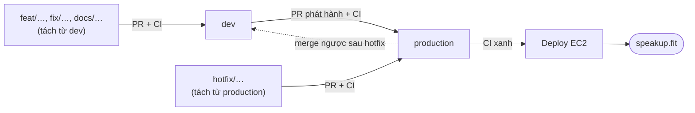

# Quy trình nhánh và CI/CD

> Áp dụng từ 28/11/2026. Trước đó repo chỉ có `main`; `main` được đổi tên thành `production`.
> Máy chủ, secret và lỗi deploy: [TRIEN_KHAI_CHO_AI.md](TRIEN_KHAI_CHO_AI.md).

## Hai nhánh cố định

| Nhánh | Vai trò | Ai được đưa code vào | Deploy |
|---|---|---|---|
| `dev` | Nhánh tích hợp, **nhánh mặc định** của repo. Mọi PR tính năng mở vào đây | PR từ nhánh tính năng, CI xanh | Không |
| `production` | Bản đang chạy ở [speakup.fit](https://speakup.fit) | Chỉ PR từ `dev` (phát hành) hoặc `hotfix/*` (sửa gấp), CI xanh | Có: CI xanh trên `production` → `Deploy EC2` |

Cả hai nhánh có branch protection: bắt buộc qua PR với các job CI xanh, chặn force push và chặn xoá nhánh.

## Luồng



1. **Làm tính năng:** `git switch -c feat/<tên>/<việc> origin/dev`, commit, push, mở PR vào `dev`.
2. **CI trên PR:** tài liệu và tệp bị cấm, ruff + pytest (độ phủ ≥ 70 %), MongoDB + Redis, dựng ảnh Docker + Trivy, ESLint, quét bí mật, CodeQL. Đỏ thì không merge được.
3. **Merge vào `dev`:** CI chạy lại trên `dev`. Không deploy.
4. **Phát hành:** mở PR `dev` → `production`, đặt tên `release: <ngày>` và liệt kê các PR có trong đợt. Job `Nhanh nguon cua PR vao production` từ chối mọi PR vào `production` không xuất phát từ `dev` hoặc `hotfix/*`.
5. **Deploy:** merge vào `production` → CI chạy trên `production` → xanh thì `Deploy EC2` sao lưu, dựng lại ảnh và kiểm `/healthz`. CI đỏ hoặc bị huỷ thì không deploy.
6. **Sửa gấp production:** `git switch -c hotfix/<việc> origin/production`, PR vào `production`. Merge xong, mở PR `production` → `dev` để `dev` không thiếu bản sửa.

## Quy tắc

- Không đẩy thẳng lên `dev` hay `production`. Không force push, không xoá hai nhánh này.
- PR vào `production` chỉ từ `dev` hoặc `hotfix/*`.
- Dependabot mở PR vào `dev` (nhánh mặc định).
- Chạy lại deploy không cần commit mới: **Actions → Deploy EC2 → Run workflow**, chọn `production`.
- Môi trường GitHub `production` (secret SSH của EC2) chỉ cho nhánh `production` dùng.

## Máy của teammate sau khi đổi tên

```bash
git fetch origin --prune
git branch -m main production
git branch -u origin/production production
git switch -c dev origin/dev
```

PR đang mở vào `main` được GitHub tự chuyển sang `production`. PR tính năng nên đổi base sang `dev`
(nút **Edit** cạnh tiêu đề PR).
