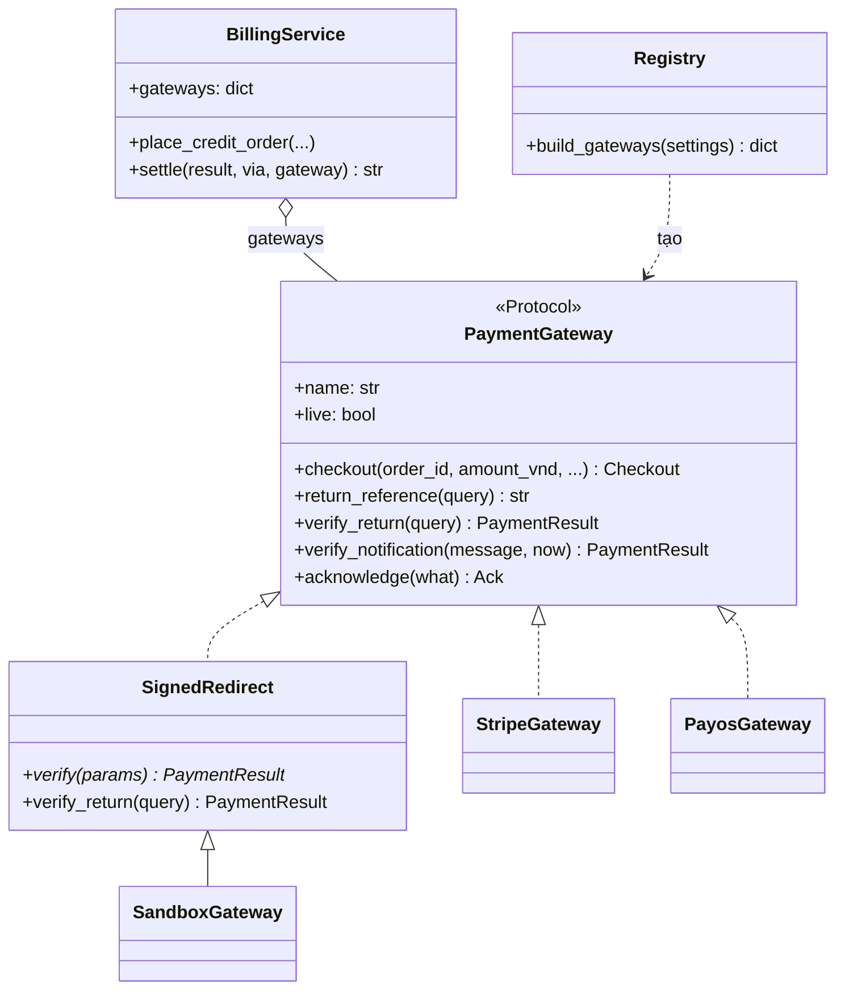
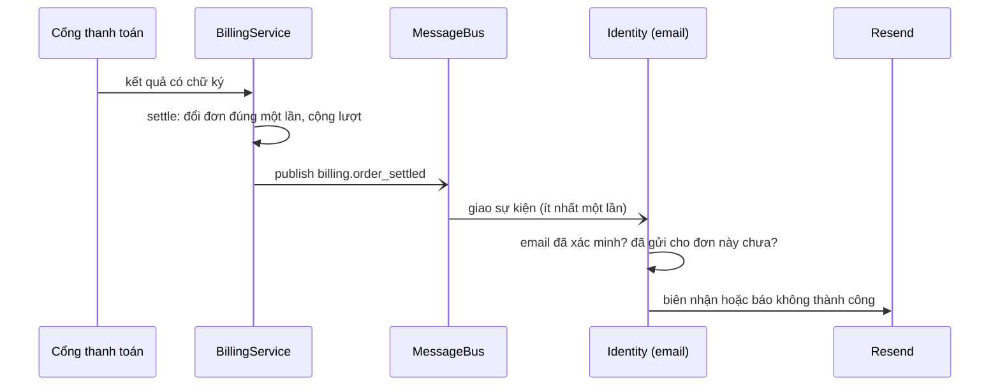

# Mẫu thiết kế trong SpeakUp

Tài liệu này liệt kê các mẫu thiết kế **đang có trong mã**, mỗi mẫu kèm nơi dùng, lý do chọn và lợi ích đo được (thường là kiểm thử không cần mạng, mô hình hay GPU). Mục cuối là các mẫu **đề xuất thêm**, chưa cài. Đối chiếu với mã ngày 07/11/2026 (sau D095).

## 1. Tổng quan

| Nhóm | Mẫu | Nơi dùng chính |
| --- | --- | --- |
| Kiến trúc | Ports and Adapters (Hexagonal) | `src/aicefr/ports.py` |
| Kiến trúc | API Gateway, Backend for Frontend | `deploy/gateway/`, `src/aicefr/services/web/bff.py` |
| Kiến trúc | Database per Service | `aicefr`, `aicefr_learning`, `aicefr_metering` (D051) |
| Kiến trúc | Pipes and Filters | `src/aicefr/pipeline.py` (`ResponseProcessor`) |
| Kiến trúc | Producer–Consumer qua hàng đợi | `JobQueue` trong `ports.py`, `platform/redis_bus.py` (BullMQ, Redis Streams) |
| Cấu trúc (GoF) | Adapter | `billing/stripe_gateway.py`, `billing/payos_gateway.py`, `asr/whisper_adapter.py`, `asr/vad.py` |
| Cấu trúc (GoF) | Facade | `services/core/*/facade.py` |
| Cấu trúc (GoF) | Proxy (Remote Proxy) | `platform/rpc.py` (`RemoteFacade`) |
| Hành vi (GoF) | Strategy | cổng thanh toán chọn theo đơn; VAD `EnergyVad`/`SileroVad` |
| Hành vi (GoF) | Template Method | `billing/gateways.py` (`SignedRedirect`) |
| Khởi tạo (GoF) | Factory (Registry) | `billing/registry.py` (`build_gateways`), `asr/vad.py` (`default_vad`) |
| Khởi tạo (GoF) | Singleton (cấu hình) | `config.py` (`get_settings`, `lru_cache`) |
| Dữ liệu | Repository | `storage/*_repository.py` |
| Dữ liệu | Value Object | `billing/payments.py` (`PaymentResult`, `Checkout`, `Incoming`, `Ack`) |
| Tích hợp | Idempotent Receiver | `BillingService.settle`, sổ lượt `hold`/`settle` theo `(key, action)`, email thanh toán (`notify/payments.py`) |
| Hành vi (GoF) | Observer (Domain Event) | `billing.order_settled`: `billing/service.py` phát, `services/core/identity/app.py` nhận và gửi email (D096) |
| Nguyên lý | Dependency Injection | `ResponseProcessor`, `Transport` của cổng thanh toán |

## 2. Mẫu theo phần của hệ thống

### 2.1. Thanh toán: Adapter, Strategy, Factory, Template Method

`PaymentGateway` (`ports.py`) là cổng chung. Mỗi nhà cung cấp là một **Adapter** dịch giao thức riêng của họ sang cùng một giao diện: `checkout`, `verify_return`, `verify_notification`, `acknowledge`.

- `StripeGateway`: Checkout Session, chữ ký `Stripe-Signature`.
- `PayosGateway` (D095): link VietQR, chữ ký HMAC trên `data` xếp theo tên.
- `SandboxGateway`: trang thử trong ứng dụng.

Người mua chọn cổng cho từng đơn: đó là **Strategy**. `BillingService` không biết mình đang nói chuyện với Stripe hay payOS; luật chốt đơn (`settle`) viết một lần cho mọi cổng.

`registry.build_gateways` là **Factory** dựng các cổng từ cấu hình. Nó cũng là nơi duy nhất giữ hai luật an toàn: cổng tiền thật chỉ chạy khi `AICEFR_PAYMENTS_LIVE` bật, và cổng thử không chạy cạnh cổng tiền thật.

`SignedRedirect` là **Template Method**: lớp cha cố định các bước (trả về và thông báo đều gọi `verify`), lớp con chỉ viết `verify`.

**Lợi ích đo được.** Thêm payOS là thêm một lớp, vài dòng ở registry và một tên hiển thị trong `GATEWAY_TITLES`; không sửa đơn, gói lượt hay luật chốt. Mỗi adapter nhận một `Transport` qua hàm khởi tạo (Dependency Injection), nên 10 test của payOS chạy với một payOS giả, không chạm mạng.

### 2.2. Chấm bài nói: Pipes and Filters, Ports and Adapters, Strategy

`ResponseProcessor` cho bản ghi đi qua chuỗi bộ lọc: kiểm chất lượng → VAD → nhận dạng tiếng nói → trích đặc trưng → chấm điểm → khoảng tin cậy. Mỗi bộ lọc nhận đầu ra của bộ trước (**Pipes and Filters**).

Ba bộ lọc chạm ra ngoài lớp nghiệp vụ được khai báo là cổng (`AsrEngine`, `VoiceActivityDetector`, `Scorer`). Mã thật là các Adapter: `WhisperEngine` bọc mlx-whisper hoặc faster-whisper, `SileroVad` và `EnergyVad` bọc hai cách phát hiện tiếng nói. Chọn VAD nào là một **Strategy**, do `default_vad()` (Factory) quyết định theo máy đang chạy.

**Lợi ích đo được.** Test dùng `FakeAsrEngine` và `EnergyVad` nên chạy đúng luồng thật mà không cần mô hình hay GPU. `ResponseProcessor` không nhắc tên Whisper, Silero hay Ridge.

### 2.3. Ba dịch vụ: Facade, Remote Proxy, API Gateway, BFF, Database per Service

- **Facade.** Mỗi phần của `core` (định danh, đánh giá, học tập, tính lượt, thanh toán) chỉ mở ra ngoài một lớp `*Facade`. Phần khác gọi qua facade, không đọc database của nhau.
- **Remote Proxy.** `RemoteFacade` (`platform/rpc.py`) đứng thay một facade ở dịch vụ khác: gọi `client.method(**kwargs)` như gọi hàm cục bộ, phía dưới là HTTP nội bộ (`__getattr__` tạo hàm gọi lúc chạy).
- **API Gateway và BFF.** Nginx là địa chỉ duy nhất nhìn ra ngoài. Dịch vụ `web` là Backend for Frontend: dựng trang và gọi `core` thay cho trình duyệt.
- **Database per Service.** Mỗi phần có database riêng (D051). Việc chấm đi qua hàng đợi Redis (BullMQ) và kết quả về qua Redis Streams (**Producer–Consumer**). Nhờ vậy dịch vụ `speech` chạy riêng và không giữ dữ liệu người dùng.

### 2.4. Dữ liệu và tiền: Repository, Value Object, Idempotent Receiver

- **Repository.** Mọi truy cập MongoDB nằm trong `storage/*_repository.py`. Lớp nghiệp vụ không viết truy vấn.
- **Value Object.** Kết quả cổng thanh toán và các thông điệp qua lại là `dataclass(frozen=True)`, không sửa được sau khi tạo.
- **Idempotent Receiver.** Cổng thanh toán có thể báo cùng một kết quả nhiều lần, qua trình duyệt lẫn webhook, theo thứ tự bất kỳ. `settle` chỉ đổi đơn một lần; lượt chỉ cộng một lần cho mỗi đơn; sổ lượt giữ và chốt theo cặp `(key, action)`. Test gửi lại webhook và mở lại địa chỉ trả về để chứng minh điều đó.

### 2.5. Email thanh toán: Observer (Domain Event)

Khi một đơn chốt **đã thanh toán** hoặc **không thành công**, `BillingService` phát sự kiện `billing.order_settled` lên bus (`MessageBus.publish`). Dịch vụ định danh đăng ký nhận (`subscribe`) và gửi email cho người mua (D096). Bên phát không biết ai nghe; bên nghe không gọi ngược bên phát. Tên sự kiện nằm trong `contracts.py`, nên hai dịch vụ chỉ chung một hợp đồng chứ không import lẫn nhau.

**Lợi ích đo được.** Thêm thông báo đẩy hay thành tựu cho thanh toán sau này chỉ là thêm một bên nghe, không sửa `BillingService`. Test giao lại cùng sự kiện để chứng minh mỗi đơn chỉ có một email.

### 2.6. Cấu hình: Singleton

`get_settings()` đọc biến môi trường một lần và giữ lại (`lru_cache(maxsize=1)`). Test xoá bộ nhớ đệm (`cache_clear`) để nạp cấu hình khác cho từng ca.

## 3. Đề xuất thêm (chưa cài)

| Mẫu | Đặt ở đâu | Được gì | Công sức |
| --- | --- | --- | --- |
| **State** | Đơn thanh toán (`OrderStatus`): bảng chuyển trạng thái tường minh thay cho tập `SETTLEABLE` | Sơ đồ trạng thái trong báo cáo khớp 1:1 với mã; chuyển sai bị chặn tại một chỗ | Nhỏ |
| **Circuit Breaker** | Bọc `Transport` của Stripe và payOS | Cổng sập thì ngừng gọi một lúc, báo ngay cho người mua thay vì chờ hết 15 giây mỗi lần | Vừa |
| **Observer / Domain Event** (mở rộng) | Sự kiện "bài đã duyệt" cho thông báo đẩy và thành tựu, như D096 đã làm cho thanh toán | Bỏ các lời gọi chéo giữa phần chấm, thông báo và thành tựu | Vừa |
| **Decorator** | Bọc `Scorer` để ghi thời gian chạy và số liệu Prometheus | Đo hiệu năng mà không sửa mô hình chấm | Nhỏ |
| **Specification** | Điều kiện mở khoá bài học, thành tựu | Luật đọc như câu, ghép được, test riêng từng luật | Vừa |

Gợi ý cho báo cáo: trình bày mục 2.1 (thanh toán) làm ví dụ chính vì có đủ Adapter, Strategy, Factory, Template Method trên cùng một sơ đồ. Nêu số liệu: thêm cổng payOS không sửa phương thức nào của `BillingService`.
