# Tài liệu Thiết kế Phần mềm (SDD)

## Hệ thống AI hỗ trợ đánh giá năng lực nói tiếng Anh theo CEFR (A1–C2) cho sinh viên đại học Việt Nam

| Thuộc tính | Giá trị |
| --- | --- |
| Mã tài liệu | `SDD-AI-ASSESSOR-CEFR` |
| Phiên bản | 1.6 |
| Trạng thái | DRAFT — chờ GVHD duyệt |
| Ngày | 07/10/2026 (bản 1.0 ngày 12/09/2026) |
| Nhóm thực hiện | 3 sinh viên (SV1 mô hình/đặc trưng, SV2 đánh giá/dữ liệu, SV3 hệ thống/API) |
| Thời gian còn lại | 12 tuần (W4–W15 của tổng 15 tuần) |
| Tài liệu liên quan | `docs/srs/SRS.md` (đang viết song song), `markdown/week_03/01_vertical_slice_draft_spec.md`, `coordination/work_items/WI-2026-001-w3-vertical-slice/02_specification.md` và `04_research.md`, `markdown/week_01/16_data_management_plan.md`, `markdown/week_02/04_ai_pedagogical_candidate_package.md` |

> **Ghi chú đồng bộ.** Bản 1.0 được viết khi `docs/srs/SRS.md` chưa tồn tại trong repository, nên các mã `FR-xx` khi đó đặt theo quy ước thống nhất trước với nhóm. SRS nay đã có và mục 7 đã được rà soát lại theo nó.
>
> **Bản 1.2 (14/09/2026)** ghi thêm: cơ chế chấm bài dài bằng cách cắt cửa sổ (mục 4.5a), bảng reason code **thật** đang chạy trong mã bên cạnh bảng thiết kế ban đầu lấy từ SRS, bốn endpoint mới, và hai màn hình tổng hợp. Mọi mục đánh dấu "chưa hiện thực" trong tài liệu này đều đã được đối chiếu với mã nguồn tại ngày ghi trên, không chép lại từ bản trước.
>
> **Bản 1.3 (07/10/2026)** ghi thêm ba nhóm thiết kế đã có trong mã: tài khoản, mật khẩu tạm và hồ sơ cá nhân (D028, D029 — mục 4.11, ADR-09), đăng nhập Google cho tài khoản đã liên kết (D029 — mục 4.12, ADR-07) và chấm mù hai người cho khảo sát thực địa (D030 — mục 4.13, ADR-08). Lần đối chiếu mã để viết bản này tìm ra bốn chỗ hở của chấm mù; chúng đã được sửa trong cùng nhánh (bảng `machine_seen`, quy tắc BR-27 của SRS) và mục 4.13 mô tả mã sau khi sửa. Kèm theo: hình 5c vẽ lại với các cột và hai bảng mới, hình 5d mới cho bốn bảng chấm mù (mục 3.5b; lược đồ dự kiến chuyển xuống mục 3.5c), UC-21 và UC-22 ở mục 3.1, một câu ở mục 1.3 nói đăng nhập Google nay nằm trong phạm vi, mục 5.4 về bảng, chỉ mục và luật xoá, mục 6.1 về endpoint mới, các dòng 56–73 ở mục 7, và phụ lục mục 10. Với D022–D027, bản này **chỉ** sửa đúng những chỗ nó chạm tới: hình 5 thêm cột `response.purpose` và bảy cột mới của `task` (D022, D023) và được kết xuất lại — ảnh cũ còn ghi `ProcessingReport` trong khi tệp nguồn đã ghi `Response`; đoạn "Ánh xạ sang mã nguồn" của mục 3.1 viết lại theo mã use case của SRS và theo các router đang có; các dòng 23–25, 28–30, 32, 33 của mục 7 sửa theo cùng lần đối chiếu đó. Phần còn lại của D022–D027 không được rà lại trong bản này.

>
> **Bản 1.4 (07/10/2026)** ghi thêm thành tựu và nhịp luyện của chính người học (D032 — mục 4.14, ADR-10): mô-đun thuần `practice/achievements.py`, hai hàm mới của `practice/streak.py`, bảng `achievement` (mục 5.4), hai endpoint (mục 6.1) và các dòng 74–77 của mục 7. Lần đếm lại để viết bản này cũng sửa hai con số cũ: kho có **hai mươi bốn** bảng (dòng 24 của mục 7 còn ghi 22 và 14, nay là 24 và 15), và router khai báo **129** đường dẫn (bản 1.3 ghi 126 trước khi có route giao lại phiếu `/replace`).

>
> **Bản 1.5 (07/10/2026)** ghi thêm gói dịch vụ của trường và thanh toán (D034 — mục 4.15, ADR-11): gói `aicefr.billing` (luật gói, mã giấy phép, cổng thanh toán, dịch vụ), cổng mới `PaymentGateway` với hai bộ chuyển đổi `SandboxGateway` và `VnpayGateway` (hình 2b vẽ lại), bốn bảng `billing_*` (mục 5.4), mười một đường dẫn (mục 6.1), UC-23 với tác nhân ngoài là cổng thanh toán (hình 1c vẽ lại), các dòng 78–83 của mục 7.

>
> **Bản 1.6 (07/10/2026)** ghi thêm hai việc. Nhiều cổng thanh toán (D035 — mục 4.16, ADR-12): cổng `PaymentGateway` đổi hình — mở thanh toán có thể gọi cổng trước, trang trả về có thể phải hỏi lại cổng, thông báo đến bằng GET hay POST và được trả lời theo kiểu từng cổng chờ — với hai bộ chuyển đổi mới `StripeGateway` và `MomoGateway` (hình 2b vẽ lại), `billing/registry.py` dựng các cổng từ cấu hình, `billing/transport.py` gọi HTTPS bằng thư viện chuẩn, hai cột mới của `billing_order`, sơ đồ tuần tự mới cho Stripe (hình 8). Luồng đăng nhập Google không giả được (D036 — mục 4.12a, ADR-13): cookie của luồng có chữ ký theo khoá của bản triển khai giữ trong bảng mới `server_secret`, cookie `__Host-` sau TLS, khung cấu hình cho quản trị viên, sơ đồ tuần tự của luồng PKCE (hình 7). Kèm theo: mục 5.4, mục 6.1 (141 đường dẫn), các dòng 84–93 của mục 7, phụ lục mục 10.
>
> **Bản 1.7 (29/10/2026)** — D060: sơ đồ lớp chỉ gồm thực thể và enum, quan hệ thể hiện qua thuộc tính; collection theo aggregate root (17 nghiệp vụ + `session`, `system`), xem `thiet-ke-gon-so-do-lop-va-collection.md` và `docs/db/TU_DIEN_DU_LIEU.md`. Hình 5, 5c, 5d vẽ lại theo document MongoDB. Các mục mô tả bảng SQLite ở phần sau (ví dụ mục 4.11, 4.13, 5.3) giữ nguyên làm lịch sử thiết kế của từng quyết định; nơi lưu hiện tại của mỗi bảng cũ ghi ở cột "Gộp từ" của mục 4 tài liệu thiết kế.

---

## 1. Giới thiệu và phạm vi thiết kế

### 1.1. Mục đích tài liệu

Tài liệu này mô tả thiết kế phần mềm của hệ thống AI hỗ trợ đánh giá năng lực nói tiếng Anh theo khung CEFR ở dải A1–C2 (D059; ngưỡng A1/A2, B2/C1, C1/C2 chưa hiệu chuẩn). Tài liệu chuyển các yêu cầu trong SRS thành một kiến trúc thi hành được: ranh giới module, hợp đồng dữ liệu có kiểu, lược đồ cơ sở dữ liệu, hợp đồng API và bảng ánh xạ từ thành phần thiết kế sang đường dẫn mã nguồn dự kiến. Người đọc mục tiêu gồm: ba thành viên nhóm khi lập trình, giảng viên hướng dẫn khi duyệt thiết kế, và hội đồng bảo vệ khi đối chiếu sơ đồ với mã nguồn.

### 1.2. Bối cảnh bài toán

Sinh viên đại học Việt Nam, phần lớn ở dải A2–B2, thường thiếu cơ hội luyện nói có phản hồi. Một giảng viên chấm thủ công 40 bài nói mỗi lớp mất nhiều giờ, phản hồi đến chậm và không đồng nhất giữa các lần chấm. Hệ thống này không thay thế giảng viên: nó sinh ra một **ước lượng band có kèm bằng chứng**, tự động phát hiện các trường hợp rủi ro và định tuyến chúng sang giảng viên. Giảng viên là người ra quyết định cuối cùng; trường `teacher_verified` chỉ bằng `true` khi tồn tại bản ghi `review_action` thật.

### 1.3. Phạm vi thiết kế

**Trong phạm vi:**

- Luồng nghiệp vụ đầy đủ từ lúc sinh viên nộp file audio đến lúc nhận báo cáo có bằng chứng.
- Pipeline xử lý: Ingest → `AudioQualityChecker` → `AsrEngine` → `FeatureExtractor` → `Scorer` → `EvidenceBuilder` → `ReviewRouter` → duyệt của giảng viên → `Repository` → Report.
- Hai nhiệm vụ nói độc thoại: Task A (kể/mô tả) và Task B (nêu quan điểm).
- Giao diện web cho ba vai trò: Sinh viên, Giảng viên đánh giá, Quản trị viên.
- Lược đồ CSDL, chính sách xóa/ẩn danh và audit log.
- Đóng gói Docker, CI/CD bằng GitHub Actions, triển khai staging.

**Ngoài phạm vi (ghi rõ để tránh hiểu nhầm khi chấm):**

- Task C (hội thoại bán cấu trúc) và tiêu chí Interaction: luôn trả `insufficient_evidence` với `reason_code = INTERACTION_MISSING`.
- Phát hiện phát âm ở mức phoneme, chấm điểm Phonology định lượng.
- Đăng nhập SSO cấp trường, thanh toán, ứng dụng di động gốc. Riêng đăng nhập bằng Google cho tài khoản **đã có** và đã được chính chủ liên kết thì nằm trong phạm vi từ D029 (mục 4.12): nó không tạo tài khoản, không lấy vai trò từ Google và không thay đăng nhập bằng bút danh.
- Huấn luyện mô hình quy mô lớn; trong 12 tuần nhóm chỉ hiệu chỉnh trên tập dữ liệu pilot nhỏ.
- Triển khai production có người dùng thật ngoài lớp thí điểm.

### 1.4. Ràng buộc thiết kế then chốt

| Mã | Ràng buộc | Nguồn |
| --- | --- | --- |
| C-01 | Không PII, audio bytes hoặc transcript trong log ứng dụng | DMP mục 7 |
| C-02 | Raw audio bất biến; pipeline chỉ đọc, mọi chuẩn hóa ghi ra workspace tạm | Spec W3 mục 6 |
| C-03 | Mọi artifact phải có version + hash + provenance | DMP mục 3.1 |
| C-04 | Không sinh điểm mặc định khi thiếu dữ liệu; phải dùng status + reason code | Spec W3 mục 4 |
| C-05 | ASR adapter chỉ nhận thư mục model cục bộ, chặn tải ngầm từ Hub | Research mục 2 |
| C-06 | Chạy offline được; không phụ thuộc dịch vụ đám mây bên thứ ba | DMP mục 9 |
| C-07 | Python `>=3.11,<3.14`, Pydantic v2, không dùng `pydantic.v1` | Research |

### 1.5. Công nghệ đã chọn

Python 3.11; FastAPI 0.141.x; Pydantic v2 (2.13.x) cho mọi hợp đồng dữ liệu; SQLite cho phát triển; `faster-whisper` (và `mlx-whisper` trên Apple Silicon) sau nhóm phụ thuộc tuỳ chọn `asr`; `soundfile` để đọc wav/flac và `ffmpeg` (phụ thuộc hệ thống, chỉ cần cho FR-39 ghi âm trên trình duyệt) để chuyển mã webm/mp4/m4a/mp3; `numpy` cho phần tính toán tín hiệu và mô hình tuyến tính; pytest, Ruff, mypy.

Từ D043: PostgreSQL 16 qua `psycopg` 3 (từ D044 một schema `core`; SQLite vẫn dùng cho kiểm thử và một máy, cùng mã SQL nhờ lớp `src/aicefr/storage/db.py`), RabbitMQ 4 qua `pika`, nginx làm gateway, Docker và Docker Compose, GitHub Actions (bốn job). Các công nghệ sau **chưa hiện thực**, giữ lại vì là lựa chọn cho giai đoạn sau: SQLAlchemy 2.x ORM; scikit-learn (mô hình hiện được xuất ra JSON và suy luận bằng `numpy`); Hugging Face `transformers` cho BERT text grader; Docker, Docker Compose và GitHub Actions.

---

## 2. Kiến trúc tổng thể

### 2.1. Kiểu kiến trúc đã chọn

**Từ D044, hệ thống là ba dịch vụ** (microservice) sau một gateway: `core` (tài khoản, bài nộp, bài học, gói), `speech` (nhận dạng và chấm), `web` (trang) — ranh giới, dữ liệu và cách giao tiếp ở mục 4.18, ADR-15 và ADR-16. D043 từng tách sáu dịch vụ; D044 gộp bốn dịch vụ có dữ liệu thành `core`. **Bên trong mỗi dịch vụ** vẫn là kiến trúc phân lớp kết hợp Ports & Adapters mô tả dưới đây; các gói miền (`pipeline`, `scoring`, `lessons`, `billing`...) không biết mình chạy trong dịch vụ nào.

Mỗi dịch vụ dùng **kiến trúc phân lớp kết hợp Ports & Adapters (Hexagonal)**.

Bốn lớp:

1. **Lớp trình bày (Presentation).** Web UI dạng SPA và các router FastAPI. Lớp này chỉ làm ba việc: xác thực người dùng, kiểm tra hợp lệ ở mức truyền tải (kích thước file, content-type, định dạng token) và chuyển tiếp lời gọi xuống lớp ứng dụng. **Không có quy tắc nghiệp vụ nào ở đây.**
2. **Lớp ứng dụng (Application).** Nơi đặt `ResponseProcessor` — seam ngoài duy nhất của pipeline, là **một lớp cụ thể** ở `src/aicefr/pipeline.py` chứ không phải interface. Lớp này điều phối thứ tự các bước, quyết định status và tập hợp `Response`. Thiết kế còn dự kiến `TeacherReviewService` và `AdminService`; **cả hai chưa hiện thực** — chức năng duyệt hiện nằm rải ở các endpoint trong `src/aicefr/api/main.py` và ở `Repository.apply_review`, chưa gói thành lớp dịch vụ riêng.
3. **Lớp miền (Domain).** Các thành phần tính toán: `AudioQualityChecker`, `FeatureExtractor`, `Scorer` (port), `EvidenceBuilder`, `ReviewRouter`, cùng các entity và value object. Bốn thành phần đầu nay là **lớp thật** có trạng thái cấu hình (ngưỡng, version) chứ không còn là hàm thuần. Lớp này không biết gì về HTTP, về hệ thống tệp hay về cơ sở dữ liệu, nên kiểm thử được mà không cần fixture nặng.
4. **Lớp hạ tầng (Infrastructure).** Các adapter hiện thực hóa các port: `WhisperEngine` và `FakeAsrEngine` cho `AsrEngine`, `SileroVad`/`EnergyVad` cho `VoiceActivityDetector`, `RidgeScorer` cho `Scorer`, `Repository` (SQLite) cho `ResponseStore`, và ba adapter giải mã audio cho `AudioDecoder`: `SoundFileDecoder` (wav, flac — đọc trong tiến trình), `FfmpegDecoder` (webm, mp4, m4a, mp3 — cần `ffmpeg` trên máy chủ) và `FirstMatchDecoder`, adapter composite chọn adapter đầu tiên nhận định dạng, tất cả ở `src/aicefr/audio/decoder.py`. Thiết kế ban đầu còn nêu `ArtifactStore` (filesystem hoặc in-memory); khối này **chưa hiện thực** — tệp audio hiện ghi thẳng vào thư mục `uploads/`.

Năm **port** được khai báo là `Protocol` của Python trong `src/aicefr/ports.py`: `AsrEngine`, `VoiceActivityDetector`, `AudioDecoder`, `Scorer` và `ResponseStore`. Đây chính là seam nội bộ đã chốt trong đặc tả vertical slice tuần 3. Port dự kiến thêm là `ArtifactStore` **chưa hiện thực**, giữ lại trong tài liệu như phần thiết kế cho giai đoạn sau.

### 2.2. Lý do chọn

- **Thay được engine ASR mà không sửa nghiệp vụ.** Đây là rủi ro lớn nhất của đồ án: nhóm chưa chắc chạy được `faster-whisper` trên máy cá nhân trong 12 tuần. Với port `AsrEngine`, `FakeAsrEngine` trả transcript cố định cho phép toàn bộ pipeline và toàn bộ test chạy xanh ngay cả khi chưa có model. Nếu đến tuần 6 model vẫn không chạy, demo vẫn hoạt động.
- **Test nhanh và tất định.** Toàn bộ test đi qua một seam duy nhất `ResponseProcessor.process(request, pcm, sr) -> Response`. Cùng fixture, cùng config sẽ cho cùng output ở phần tất định. Điều này đáp ứng yêu cầu tính lặp lại của SRS và tiêu chí TC2.5 của rubric.
- **Chống rò rỉ dữ liệu cá nhân theo cấu trúc.** Vì lớp hạ tầng là nơi duy nhất chạm vào audio và transcript, việc kiểm tra ràng buộc C-01 chỉ cần soi một thư mục thay vì cả codebase.
- **Chia việc rõ cho ba người.** SV1 sở hữu `FeatureExtractor` và `RidgeScorer`; SV2 sở hữu `AudioQualityChecker`, `EvidenceBuilder`, `ReviewRouter` và bộ rubric; SV3 sở hữu API, Repository, adapter và CI/CD. Ranh giới module trùng với ranh giới phân công nên xung đột merge thấp.

### 2.3. Các phương án đã cân nhắc và lý do loại

| Phương án | Mô tả | Lý do loại |
| --- | --- | --- |
| Kiến trúc một khối theo script | Một file `main.py` gọi tuần tự các hàm | Không có seam để fake ASR; mọi test đều cần model thật; ba người sửa chung một file sinh xung đột liên tục. Loại vì rủi ro tiến độ. |
| Microservices (mỗi bước một service) | ASR service, feature service, scoring service riêng | Loại ở giai đoạn MVP vì chi phí vận hành. **Xem lại ở D043**: không tách theo từng bước của pipeline (ASR, đặc trưng, chấm điểm vẫn chạy chung trong `speech`, tránh độ trễ mạng giữa các bước) mà theo **miền dữ liệu** — sáu dịch vụ ở D043 (ADR-15), gộp còn ba ở D044 (ADR-16). |
| Event-driven thuần với message broker | Mọi bước giao tiếp qua Kafka/RabbitMQ | Không dùng thuần: đọc dữ liệu đồng bộ qua HTTP nội bộ. Từ D043 RabbitMQ chở việc chấm, kết quả chấm và câu hỏi đo bước bài học giữa `core` và `speech` — còn một máy vẫn chạy không cần broker (bus trong tiến trình). |
| Gọi thẳng API thương mại (OpenAI Whisper API, LLM chấm điểm) | Đẩy audio lên dịch vụ ngoài | Vi phạm DMP mục 9 (cấm upload audio lên dịch vụ ngoài chưa được consent/duyệt) và ràng buộc C-06. Loại vì lý do đạo đức và pháp lý. |
| Chấm điểm bằng LLM prompt thuần | Đưa transcript cho LLM và hỏi band | Không tái lập được, không giải thích được bằng đặc trưng đo được, khó bảo vệ trước hội đồng. Giữ BERT chỉ như một tín hiệu văn bản dự kiến hợp nhất với hồi quy tuyến tính trên đặc trưng có thể đo; nhánh BERT (`BertTextGrader`) **chưa hiện thực**, mã hiện tại chỉ có `RidgeScorer`. |

### 2.4. Nguyên tắc luồng dữ liệu

```
Web UI  →  FastAPI  →  ResponseProcessor
                          ├─ Ingest              (api/main.py: lưu raw, giải mã qua port AudioDecoder)
                          ├─ AudioQualityChecker (duration, silence, clipping, SNR)
                          ├─ AsrEngine           (port; WhisperEngine hoặc FakeAsrEngine)
                          ├─ VoiceActivityDetector (port; SileroVad hoặc EnergyVad)
                          ├─ FeatureExtractor    (19 đặc trưng có version)
                          ├─ Scorer              (port; RidgeScorer → 0–6 → band)
                          ├─ EvidenceBuilder     (trích dẫn + mốc thời gian)
                          ├─ ReviewRouter        (cờ chuyển giảng viên)
                          └─ ResponseStore       (port; Repository trên SQLite)
                                 ↓
                          Duyệt của giảng viên  →  Report
```

> **Từ D043.** Ingest và lưu trữ thuộc phần `assessment` (từ D044 nằm trong dịch vụ `core`); QC, nhận dạng, đặc trưng, chấm điểm, bằng chứng và cờ chuyển giảng viên chạy trong dịch vụ `speech`, nhận việc qua RabbitMQ và trả `Response` về `core` (mục 4.18).
>
> **Ghi chú đồng bộ với mã.** Bước Ingest trong sơ đồ trên gồm cả việc giải mã audio: `src/aicefr/api/main.py` gọi port `AudioDecoder` qua `FirstMatchDecoder`, adapter composite ở `src/aicefr/audio/decoder.py`. Khối `TeacherReviewService` **chưa hiện thực**: nhánh duyệt nằm ở các endpoint `/api/v1/review/*` và `Repository.apply_review`.

---

## 3. Các sơ đồ thiết kế

Tài liệu cung cấp **6 loại sơ đồ**, vượt ngưỡng "≥ 4 loại" của Mức 5 trong tiêu chí TC2.1. Mọi sơ đồ được lưu song song thành file `.mmd` trong `docs/sdd/diagrams/` và đã được kiểm tra cú pháp bằng bộ phân tích Mermaid v11.

### 3.1. Sơ đồ Use case

Sơ đồ use case tách theo tác nhân, mỗi tác nhân một hình. Bản gộp cả ba tác nhân
vào một hình đã bị bỏ: nó ra tỷ lệ 6,55 — rộng gấp sáu lần chiều cao — nên khi
fit vào khổ A4 thì mọi nhãn co lại không đọc được. Ba hình dưới đây có tỷ lệ
0,51 đến 1,24, in ra đọc được.

**Mã và tên use case lấy nguyên văn từ bảng SRS mục 4.1**, và có test ghim điều
đó (`test_every_usecase_drawn_exists_in_the_srs` cùng chiều ngược lại
`test_every_usecase_in_the_srs_is_drawn_somewhere`). Bản trước **tự đặt một hệ
đánh số riêng** — UC01…UC32 — trùng mã nhưng khác nghĩa với SRS: `UC05` trên
hình là *"Xem báo cáo và bằng chứng"* của sinh viên, còn `UC-05` trong SRS là
*"Giảng viên duyệt bài trong hàng đợi"*. Người đọc đối chiếu hai tài liệu sẽ
thấy chúng mâu thuẫn mà không biết tin cái nào.

**Chiều mũi tên `include` và `extend` ngược nhau, và bản trước vẽ sai.** Theo
UML: `include` đi từ use case **gốc** tới use case **được gộp** (luôn xảy ra);
`extend` đi từ use case **mở rộng** **ngược về** use case gốc (chỉ xảy ra khi có
điều kiện). Bản trước viết `UC30 -. extend .-> UC31`, đọc ra là *"kiểm tra chất
lượng audio là phần mở rộng của việc chuyển giảng viên"* — ngược hẳn ý định.

**Ba hình này là THIẾT KẾ, không phải bảng theo dõi tiến độ.** Bản trước tô màu
xanh/vàng theo trạng thái hiện thực và ghi "(chưa: …)" vào nhãn. Điều đó sai
loại: sơ đồ use case mô tả hệ thống **phải làm gì**, còn đã làm tới đâu là thông
tin khác — trộn vào sẽ khiến người đọc tưởng những ô chưa tô màu là chưa được
hoạch định. Trạng thái hiện thực nay nằm ở cột "Hiện thực" trong bảng use case
của báo cáo tuần (`docs/reports/bao_cao_tuan_01.md` mục 8.4), nơi nó thuộc về.

#### 3.1.1. Tác nhân Sinh viên

File: `docs/sdd/diagrams/01a_usecase_sinhvien.mmd`

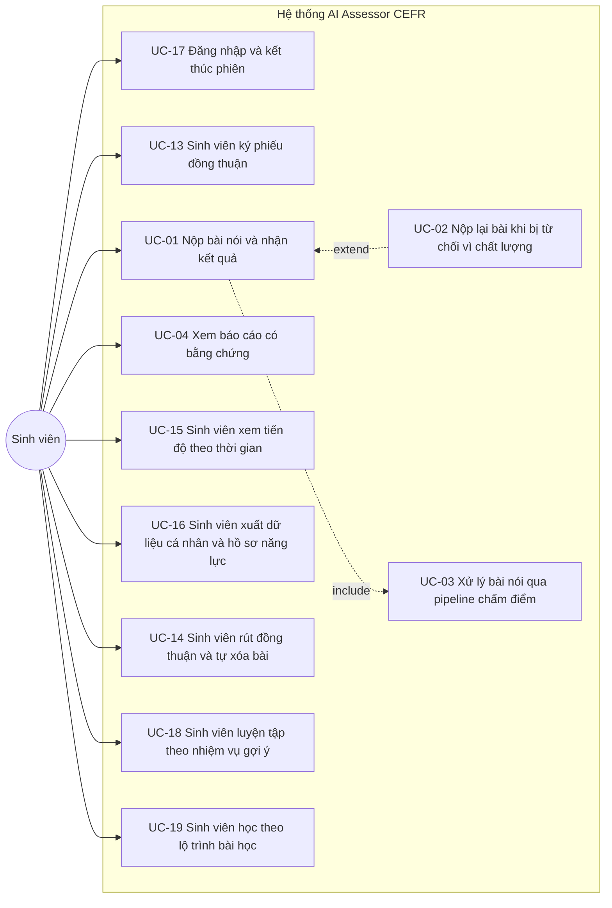

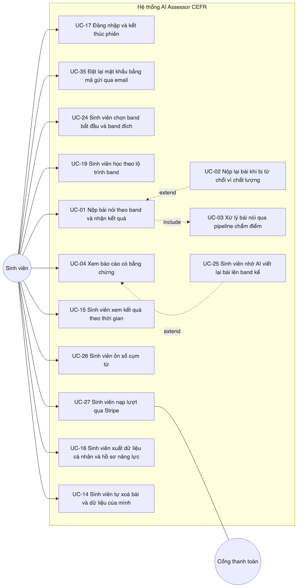

*Hình 1a. Use case cho tác nhân Sinh viên. Nguồn: `diagrams/01a_usecase_sinhvien.mmd`*

#### 3.1.2. Tác nhân Giảng viên đánh giá

File: `docs/sdd/diagrams/01b_usecase_giangvien.mmd`

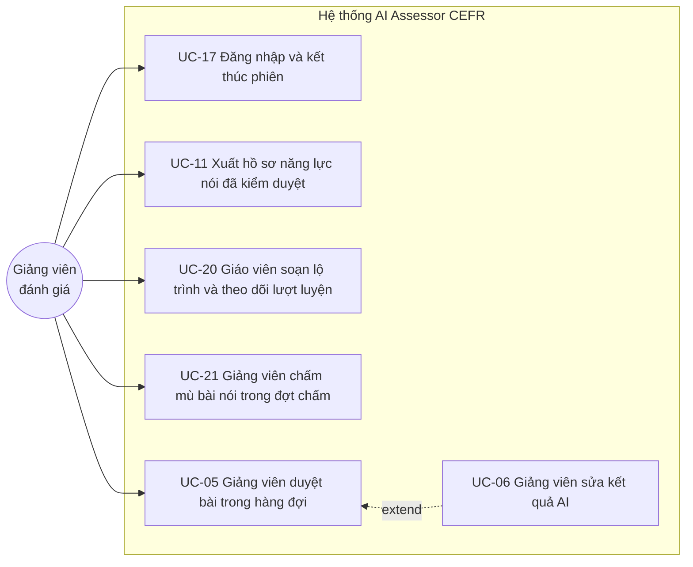

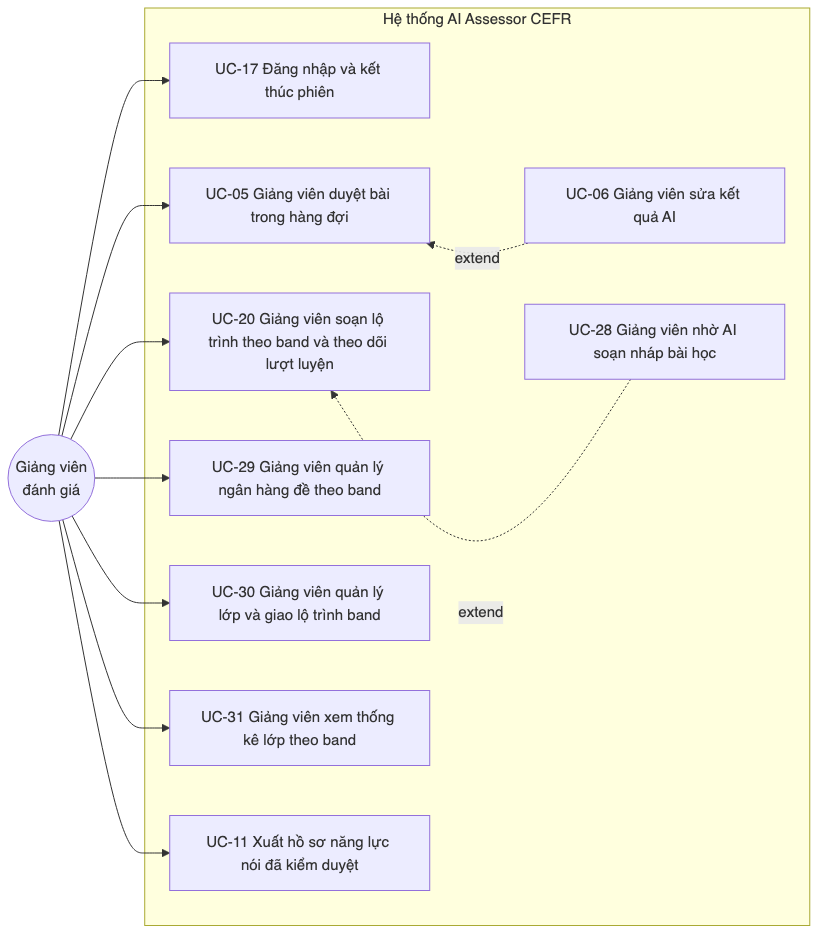

*Hình 1b. Use case cho tác nhân Giảng viên đánh giá. Nguồn: `diagrams/01b_usecase_giangvien.mmd`*

#### 3.1.3. Tác nhân Quản trị viên

File: `docs/sdd/diagrams/01c_usecase_quantri.mmd`

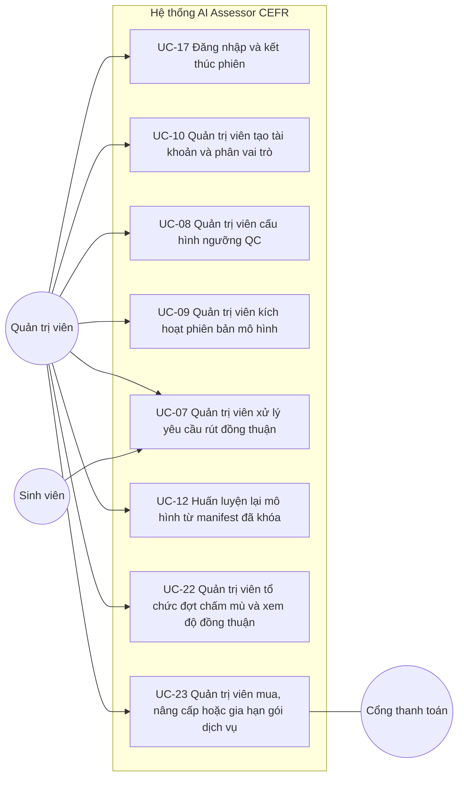

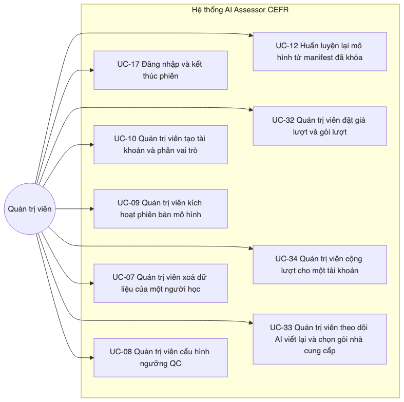

*Hình 1c. Use case cho tác nhân Quản trị viên. Nguồn: `diagrams/01c_usecase_quantri.mmd`*

**Cách đọc ba hình trên.** Hình tròn là **tác nhân**; khung chữ nhật lớn là **ranh giới hệ thống** — trong khung là thứ nhóm xây dựng, ngoài khung là tác nhân. Mũi tên liền từ tác nhân tới use case nghĩa là tác nhân đó **khởi tạo** use case — và **use case mở rộng không có mũi tên nào từ tác nhân**: tác nhân khởi tạo use case *cơ sở*, còn phần mở rộng được chèn vào giữa luồng đó khi có điều kiện. Phép thử là đọc to lên: *"sinh viên nộp lại bài"* mà chưa từng nộp thì lấy đâu ra bài mà nộp lại; *"giảng viên sửa kết quả"* mà chưa mở bài ra duyệt thì sửa của ai. Bản trước vẽ cả `SV --> UC-02` lẫn `GV --> UC-06`, và cả hai đều sai theo đúng lý do đó. Hai quan hệ nét đứt có **chiều ngược nhau**, và đây là chỗ bản trước vẽ sai: `include` đi **từ use case gốc tới use case được gộp** và nghĩa là gốc **luôn luôn** kéo theo đích — `UC-01` nộp bài luôn kéo theo `UC-03` chạy pipeline chấm điểm; `extend` đi **từ use case mở rộng ngược về use case gốc** và nghĩa là phần mở rộng **chỉ** chạy khi có điều kiện — `UC-02` nộp lại bài chỉ xảy ra khi QC từ chối bài trước, `UC-06` sửa kết quả chỉ xảy ra trong lúc giảng viên đang duyệt ở `UC-05`. **Sơ đồ chỉ có hai quan hệ `extend` và một `include`, và đó là có chủ ý** — quan hệ nào cũng phải qua được phép thử: hành vi của use case mở rộng có thật sự được chèn vào giữa luồng của use case cơ sở không. `UC-14` rút đồng thuận từng bị vẽ là `extend` của `UC-13` ký đồng thuận; sai, vì `withdraw_consent` là một tuyến độc lập có kích hoạt riêng, không nằm trong luồng của `sign_consent`. Việc ký đồng thuận là **tiền điều kiện** của `UC-01`, mà tiền điều kiện thì không vẽ thành quan hệ trên sơ đồ use case. Ba hình không tô màu theo tiến độ: đây là bản thiết kế, và trạng thái hiện thực nằm ở bảng use case trong báo cáo tuần.

**Hai use case chấm mù (D030): UC-21 ở hình 1b, UC-22 ở hình 1c.** `UC-21` *Giảng viên chấm mù bài nói trong đợt chấm* (FR-62, FR-63) là việc của giám khảo: mở phiếu, nghe bản ghi, chấm năm tiêu chí và điểm tổng, nộp một lần. `UC-22` *Quản trị viên tổ chức đợt chấm mù và xem độ đồng thuận* (FR-61, FR-63, FR-64) là việc của người điều phối: tạo đợt, giao phân xử, đọc báo cáo đồng thuận, tải bản xuất phiếu chấm. Cả hai **không nối với use case nào bằng `include` hay `extend`**, và với `UC-21` đó là chỗ cố ý nhất của hình 1b: chấm mù **không** phải một bước trong luồng duyệt `UC-05`. Màn hình duyệt cho thấy điểm và band của máy — đúng thứ phiếu chấm mù phải giấu — nên hai use case đi hai đường riêng (ADR-08), và trong lúc giảng viên còn phiếu mù về một bài thì `UC-05` trên bài đó bị khoá với chính họ. Quan hệ khoá lẫn nhau ấy, cũng như việc phải có đợt ở `UC-22` thì `UC-21` mới có phiếu, là **thứ tự theo thời gian và tiền điều kiện**, không phải `include` hay `extend` — cùng lý do ký đồng thuận không được vẽ thành quan hệ với `UC-01`. Phép thử vẫn là câu hỏi ở trên: hành vi của `UC-21` có được chèn vào giữa luồng của `UC-22` không? Không: giám khảo chấm vào lúc của mình, theo thứ tự riêng của mình. Mã cho phép chọn cả quản trị viên làm giám khảo, nhưng tác nhân chính của `UC-21` trong bảng SRS là giảng viên, nên hình 1c không vẽ lại use case đó — giống `UC-05`, việc mà quản trị viên cũng làm được.

**Ánh xạ sang mã nguồn (viết lại 07/10/2026).** Use case không còn nằm trong một tệp router duy nhất. `src/aicefr/api/main.py` vẫn giữ phần lớn luồng của bản đầu: nộp bài và báo cáo (`UC-01`…`UC-04`), hàng đợi và quyết định duyệt (`UC-05`, `UC-06`), đồng thuận, tự xoá bài, xoá dữ liệu theo yêu cầu và xuất dữ liệu (`UC-07`, `UC-13`, `UC-14`, `UC-16`), ngưỡng QC và mô hình (`UC-08`, `UC-09`), tiến độ (`UC-15`), luyện tập theo nhiệm vụ (`UC-18`), đăng nhập và đăng xuất (`UC-17`). Bốn router riêng được gắn vào cùng ứng dụng bằng `app.include_router`: `lessons_api.py` cho lộ trình bài học (`/api/v1/learn/*` của `UC-19`, `/api/v1/teach/*` của `UC-20`), `accounts_api.py` cho tài khoản của chính mình và quản trị tài khoản (`UC-17`, `UC-10`), `google_api.py` cho đăng nhập Google (`UC-17`), `rating_api.py` cho chấm mù (`UC-21`, `UC-22`). Nhánh duyệt vẫn dựa trên `Repository.apply_review` (`TeacherReviewService` **chưa hiện thực**) và nhóm quản trị vẫn là các endpoint rời dưới `/api/v1/admin/*` (`AdminService` **chưa hiện thực**). Ba quy tắc dùng chung — kiểm tra chất lượng audio, chuyển giảng viên, nhật ký kiểm toán — ở `src/aicefr/qc/audio_qc.py`, `src/aicefr/review/router.py` và bảng `audit_log` trong `src/aicefr/storage/repository.py`. Bản trước của đoạn này sai ba chỗ: nó dùng hệ đánh số cũ UC01…UC32 mà chính mục này đã bỏ; nó ghi các nhóm được tách bằng tag tiếng Việt, trong khi tag trong mã là `student`, `teacher`, `admin`, `auth`, `web`; và nó ghi "UC22 cấu hình ngưỡng" là chưa hiện thực, trong khi ngưỡng QC đổi được lúc chạy qua `/api/v1/admin/config` từ trước D028 — còn mã `UC-22` theo SRS nay là tổ chức đợt chấm mù, đúng kiểu trùng mã khác nghĩa đã nói ở trên.

### 3.2. Sơ đồ lớp (Class diagram)

**Một sơ đồ lớp duy nhất**, vẽ **các đối tượng nghiệp vụ** và thuộc tính đủ để
làm được tính năng. Bản trước tách làm ba khung nhìn với hơn năm mươi hộp, trong
đó có sáu lớp ngoại lệ, hai bộ thế kiểm thử và hơn ba mươi dòng chỉ để ép bố
cục — nhìn vào thấy phức tạp mà không thấy hệ thống.

Cổng và bộ chuyển đổi **không nằm trên sơ đồ lớp** mà tách sang một hình kiến
trúc riêng, vì chúng trả lời một câu hỏi khác: *hệ thống cắm vào thế giới bên
ngoài ở đâu*, chứ không phải *hệ thống có những đối tượng gì*. Các dịch vụ xử lý
(`ResponseProcessor`, `EvidenceBuilder`…) cũng không có mặt: chúng không mang
thuộc tính nghiệp vụ nào, và luồng chạy của chúng đã có sơ đồ tuần tự 03.

**Tiêu chí duy nhất để một lớp được vẽ: nó là một khái niệm của bài toán chấm
nói.** Đây là *domain model* theo nghĩa hẹp — vẽ thứ giảng viên và sinh viên nói
đến được, không vẽ thứ chỉ tồn tại vì hệ thống chạy trên máy tính. Quy tắc này
lấy từ hướng dẫn mô hình hoá miền của UML và từ tài liệu Domain-Driven Design
của Microsoft, và cả hai phát biểu nó gần như cùng một câu:

> "Technical Infrastructure: Exclude sessions, database locks, audit timestamps,
> surrogate keys, and database-specific data types. These belong in lower-level
> design, not domain models."

Phiên đăng nhập, khoá duyệt bài, dấu thời gian kiểm toán và bảng cấu hình **là
hạ tầng, không phải đối tượng nghiệp vụ**. Chúng vẫn có trong `contracts.py` và
vẫn được vẽ — nhưng ở sơ đồ ERD (mục 3.5), nơi câu hỏi là *dữ liệu nằm ở bảng
nào*, đúng tầng thiết kế của chúng.

| Khung nhìn | Tệp nguồn | Định dạng | Nội dung |
| --- | --- | --- | --- |
| Lớp | `docs/sdd/diagrams/02_class.drawio` | draw.io | Mô hình nghiệp vụ ngày 28/10/2026: 7 thực thể, 1 lớp trừu tượng, 8 đối tượng giá trị, 4 kiểu liệt kê, 32 quan hệ (sinh bằng `tools/gen_class_diagram.py`). Ánh xạ từ bản 37 hộp và kế hoạch 42 → 18 collection: [`thiet-ke-gon-so-do-lop-va-collection.md`](thiet-ke-gon-so-do-lop-va-collection.md); code đang chuyển theo |
| Lớp — thiết kế đích v3, bản gọn | `docs/sdd/diagrams/target/02_class_v3_overview.drawio` | draw.io | Mô hình đối tượng để rã xuống mã: 25 lớp (một lớp trừu tượng `Actor` với ba lớp con theo vai trò, một interface `PaymentGateway`), 3 kiểu liệt kê, 29 quan hệ; là trang "So do lop v3" trên Drive |
| Lớp — thiết kế đích v3, bản đầy đủ | `docs/sdd/diagrams/target/02_class_v3.drawio` | draw.io | Đủ thuộc tính: 78 hộp, 115 quan hệ; mỗi lớp của bản gọn là một lớp ở đây; mã chưa chuyển theo, xem `diagrams/target/README.md` (D021, D022, D023, bổ sung D025–D036) |
| Kiến trúc tổng thể | `docs/sdd/diagrams/02b_kien_truc.puml` | PlantUML | Ba dịch vụ sau gateway nginx, năm phần của core (mỗi phần một facade), bus Redis, ba database MongoDB, kho bản ghi âm, cổng thanh toán, giám sát |
| Cổng và bộ chuyển đổi | `docs/sdd/diagrams/02c_cong_va_bo_chuyen_doi.puml` | PlantUML | 9 cổng (8 cổng của `ports.py` trừ `ResponseStore`, cộng `MessageBus`), 19 bộ chuyển đổi, 13 kho kế thừa `MongoStore` |

**Vì sao sơ đồ lớp dùng draw.io chứ không phải PlantUML.** PlantUML tự đặt vị
trí các hộp; người đọc không sắp xếp lại được. Sơ đồ lớp là hình phải chỉnh tay
cho vừa mắt và vừa trang giấy, nên nguồn của nó là tệp `.drawio` — mở bằng
[app.diagrams.net](https://app.diagrams.net) không cần cài gì, hoặc bằng
extension *Draw.io Integration* trong VS Code. Tệp là XML nên vẫn nằm trong git
và vẫn diff được. Tệp `.drawio` được **sinh ra bằng script**, không gõ tay:

```bash
cd /Users/louisvo/Documents/Project/ai-assessor-cefr   # để tìm đúng .venv
.venv/bin/python tools/gen_class_diagram.py           # sinh lại .drawio từ đặc tả
./render.sh                                           # xuất PNG
```

Script cần **Python 3.10 trở lên** (dùng `zip(strict=)` và cú pháp kiểu
`X | None`); `python3` của hệ thống trên máy phát triển là 3.9 nên phải gọi
`.venv/bin/python`. Cả hai script tự xác định gốc kho mã nên chạy được từ thư
mục bất kỳ.

Lý do: chiều cao mỗi hộp phụ thuộc số dòng bên trong, và đường đi của cạnh phụ
thuộc toạ độ thật của mọi hộp. Gõ tay thì mỗi lần thêm một thuộc tính là phải
tính lại toàn bộ — đã hỏng ba lần vì lý do đó trước khi có script. Muốn sửa hình
thì sửa phần đặc tả ở đầu `tools/gen_class_diagram.py` rồi sinh lại, đừng sửa
hai nơi.

Hai hình kiến trúc giữ PlantUML vì bố cục tự động đã đủ dùng. Hình 2b trả lời "hệ thống gồm những dịch vụ nào, nói với nhau thế nào, dữ liệu nằm đâu"; hình 2c trả lời "hệ thống cắm ra bên ngoài ở đâu và thay được những gì". Cổng `ResponseStore` cố ý không vẽ (xem docstring của nó).

**Cú pháp thành viên: đủ kiểu, không rút gọn.** Mọi thuộc tính viết theo đúng
dạng UML `visibility name: Type`, mọi thao tác viết đủ `name(tham số: Type):
KiểuTrả`. Bản trước cố ý bỏ kiểu đi "cho gọn" — lý do khi đó là *"`str` hay
`float` không nói thêm điều gì về nghiệp vụ"*. Lý do đó sai ở một điểm quyết
định: **một sơ đồ lớp không có kiểu thì không rã xuống code được.** Người đọc
không biết `reasons` là một mã hay một danh sách (`List<ReasonCode>`), không
biết `values` khoá bằng gì (`Map<str, float>`), không biết `assessment` là một
đối tượng hay một khoá (`Assessment`). Kiểu chính là phần nói ra
những điều đó.

**Bội số nằm trên CẠNH, không nằm trong thuộc tính.** Thuộc tính viết kiểu
thuần: `- snrDb: float`, `- assessment: Assessment`, `- reasons:
List<ReasonCode>`, `- values: Map<str, float>`. Bội số (`1`, `0..1`, `0..*`,
`5`, `0..10`) chỉ xuất hiện ở hai đầu quan hệ.

Lý do: bội số là khái niệm của **một đầu liên kết**, không phải của kiểu. UML
2.5 mục 9.5.4 có cho phép ghi bội số trên thuộc tính (`float [0..1]`), nhưng
hầu như không ai dùng, và nó dễ bị đọc lẫn với bội số của quan hệ. Hai cách
viết từng bị thử và bỏ:

| Từng dùng | Vấn đề |
| --- | --- |
| `float \| None`, `list[ReasonCode]` | Cú pháp chú thích kiểu của **Python**, không phải UML |
| `float [0..1]`, `ReasonCode [*]` | Là UML hợp lệ nhưng bội số đặt sai chỗ, và gây nhiễu ở 24 thuộc tính |

Hệ quả phải nhận: hình **không còn nói** `snrDb` hay `withdrawnAt` có thể vắng
mặt. Thông tin đó nằm ở `contracts.py` và ở lược đồ ERD. Đổi lại, cột thuộc
tính đọc được ngay và khớp với quy ước mà nhóm đang dùng ở các sơ đồ khác.
Lưu ý kỹ thuật: draw.io vẽ nhãn bằng HTML, nên dấu `<` phải escape **hai lần**
trong tệp `.drawio` — nếu không, trình vẽ coi `<str, float>` là một thẻ và xoá
mất cả cụm, im lặng và không báo lỗi.

Khuôn dập kiểu
liệt kê dùng từ khoá chuẩn của UML là **«enumeration»**, không phải «enum».

Luật này được ghim bằng `test_every_member_on_the_class_diagram_carries_a_type`
trong `tests/test_diagrams.py`: nó đọc từng dòng của mọi hộp không phải kiểu
liệt kê và bắt buộc khớp cú pháp trên. Bỏ kiểu của một thuộc tính là đỏ test.

**Bốn chỗ sai lộ ra khi ghi đủ kiểu.** Việc này không chỉ là thêm chữ; phải đi
tra từng kiểu thật trong mã, và bốn chỗ lệch hiện ra:

1. `Task` thiếu hẳn `part: str` — trường phân biệt Part 1/2/3 của đề bài.
2. `QcResult` thiếu `sampleRateHz`, `channels` và `reasons: List<ReasonCode>`.
   Cái cuối còn kéo theo một quan hệ phụ thuộc chưa từng được vẽ.
3. `CriterionCoverage` cũng thiếu `reasons: List<ReasonCode>`, tương tự.
4. `Account.isTeacher()` từng bị cắt vì tưởng là `role == TEACHER`. Đọc mã thì
   nó là `role in (TEACHER, ADMIN)` — quản trị viên cũng duyệt được bài. Đó là
   một luật phân quyền thật, nên nó được vẽ lại.

**Hai thuộc tính của `Response` không nằm trên lớp Pydantic cùng tên.**
`audioPath` và `createdAt` là cột của bảng `response` (xem hình 5), không phải
trường của `contracts.Response`. Hình vẫn vẽ chúng vì đây là mô hình **miền**:
một bài nộp thì có bản ghi âm và có thời điểm nộp, bất kể hệ thống cất chúng ở
đâu. Người đọc đối chiếu với mã cần biết chỗ lệch này.

**Năm sửa đổi về mô hình hoá, so với bản trước.**

1. `CriterionScore` → **`CriterionCoverage`**, bỏ `score_0_6` và `band`. Mô hình
   chấm điểm có **một** đầu ra; `RidgeScorer` ghi đúng con số đó vào cả năm
   dòng, nên năm dòng đọc như năm phán xét độc lập trong khi chúng là một số
   chép năm lần. Màn hình báo cáo đã cố ý không in chúng. Thứ thật sự riêng cho
   từng tiêu chí là tỷ lệ phép đo tính được, và tên lớp nay nói đúng điều đó.
2. Quan hệ `Comment`–`Evidence` vẽ **thẳng thành nhiều–nhiều** với bội số hai
   đầu, thay cho thuộc tính `evidenceRefs: list<str>` cộng một mũi tên phụ
   thuộc. Nhét khoá vào thuộc tính là vẽ sơ đồ quan hệ thực thể rồi khoác áo sơ
   đồ lớp — chính đầu tệp cũ đã cấm điều đó rồi tự vi phạm.
3. `Window` (kế hoạch cắt) và `WindowScore` (kết quả) gộp thành
   **`AnalysisWindow`**. Chúng là cùng một đoạn thời gian ở hai thời điểm; giữ
   hai lớp bắt mọi chỗ dùng phải chuyển qua lại và phải nhớ đang cầm cái nào.
4. `ProcessingReport` → **`Response`**. Lớp này là *bài nói đã nộp* — nó giữ
   `audioPath`, `status`, thời điểm nộp và mọi kết quả sinh ra từ bài đó. Bảng
   SQLite của nó tên `response`, endpoint của nó là `/api/v1/responses`, và tài
   liệu yêu cầu gọi nó là "bài nộp". Chỉ sơ đồ lớp gọi nó là "báo cáo xử lý" —
   một cái tên nói về *việc hệ thống đã làm gì* thay vì *đối tượng nghiệp vụ nào
   đang được nói tới*. Đổi tên áp dụng cho 14 tệp mã nguồn, không chỉ cho hình.
5. `AsrResult` → **`Transcript`**, và trường `transcript` bên trong nó thành
   `text`. Cùng một lỗi như mục 4 ở quy mô nhỏ hơn: "AsrResult" nói *hệ thống
   con nào đã chạy*, là một sự thật về kiến trúc chứ không về bài nói. Bản chép
   lời vẫn là bản chép lời dù máy nhận dạng là Whisper, là một dịch vụ đám mây
   hay là một người gõ tay.

   Đối chiếu cho rõ: **cổng vẫn tên `AsrEngine`, và đó mới là đúng.** Cổng là
   một mảnh công nghệ — chỗ hệ thống cắm vào một máy nhận dạng — nên đặt tên
   theo công nghệ là chính xác. Nó nằm ở hình 2b, không nằm ở hình 2. Ranh giới
   giữa hai cái tên chính là ranh giới giữa hai hình.

   Trường đổi tên vì `transcript.transcript` là một cái tên lắp. Những hàng ghi
   trước lúc đổi vẫn còn khoá cũ trong `report_json`, nên `Transcript.text`
   nhận cả hai tên khi đọc (`AliasChoices`). Hai chỗ làm việc trên JSON thô
   phải sửa tay vì chúng không đi qua model: `retention.py` xoá bản chép theo
   cả hai khoá — tìm một khoá thì nửa số hàng không bao giờ được xoá, và đó là
   lỗi riêng tư chứ không phải lỗi hiển thị — và `pipeline.py` dùng
   `model_copy(update=...)`, vốn nhận **tên trường** chứ không nhận alias.

**Thực thể hay đối tượng giá trị: khác nhau ở chỗ có danh tính hay không.**
Mỗi hộp trên hình mang một khuôn dập («entity» hoặc «value object») chứ không
phải để trang trí — nó quyết định hộp đó được cấp mã định danh và được sửa, hay
được thay cả cục.

- **«entity»** (6 hộp: `Account`, `Consent`, `Review`, `Task`, `Response`,
  `Assessment`). Có danh tính riêng, tra cứu được, sống qua nhiều
  lần sửa. Hai `Review` cùng điểm cũ và điểm mới vẫn là hai lần duyệt khác nhau.
- **«value object»** (10 hộp: `QcResult`, `Transcript`, `Word`, `FeatureSet`,
  `Feature`, `Evidence`, `CriterionCoverage`, `AnalysisWindow`, `Comment`,
  `Priority`). Không có danh
  tính, so sánh bằng nội dung, **bất biến**. Hai `Word` cùng `text`, `startS`,
  `endS`, `prob` là *cùng một* từ — hỏi "từ nào" là câu hỏi vô nghĩa. Chạy lại
  nhận dạng thì `Transcript` cũ bị thay cả cục, không ai sửa từng trường.

Quy tắc này không phải nhãn dán vào sau: nó là lý do `Response` giữ hình thoi
đặc với bốn bộ phận (bộ phận là đối tượng giá trị, mất theo thể), còn `Account`
chỉ nối bằng mũi tên liền nét (hai thực thể, hai vòng đời).

**Một thao tác chỉ được vẽ khi nó mã hoá một luật đoán không ra từ thuộc
tính, **và có nơi gọi nó thật.** Bản trước vẽ mười lăm thao tác; mười cái
trong số đó chỉ là phép suy một dòng — `wasScored()` là `overall06 != null`,
`durationS()` là `endS - startS`, `changedBand()` là `oldBand != newBand`.
Người đọc nhìn thuộc tính là biết, nên dòng đó không nói thêm gì mà vẫn chiếm
chỗ. Năm cái còn lại mang luật thật, và mỗi cái đều có nơi gọi đếm được:

| Thao tác | Luật nó giữ | Nơi gọi |
| --- | --- | --- |
| `Account.isTeacher()` | `role ∈ {TEACHER, ADMIN}` — quản trị viên cũng duyệt được bài | `api/deps.py:70`, `base.html:45,46` |
| `Consent.maySubmit()` | đã ký **và** chưa rút **và** cho phép lưu audio | `api/main.py:448,558`, `consent.js`, `submit.js` |
| `QcResult.passed()` | `REVIEW` vẫn chạy tiếp, chỉ `REJECT` mới dừng | `pipeline.py:249` |
| `Word.isUncertain()` | `prob < 0.50` — từng được viết lại ở ba nơi | `report.js:528`, `review_one.js:81` |
| `Assessment.isCalibrated()` | từng là một biểu thức chính quy chép lại trong `report.js` | `report.js:279` |

Điều kiện "có nơi gọi thật" được thêm vào sau khi đếm lại và phát hiện hai
thao tác từng được vẽ mà không ai gọi. `FeatureSet.isComputable()` đã bị bỏ
khỏi hình: bốn nơi cần đọc đặc trưng (`scorer.py:128,153`, `evidence.py:111`,
`router.py:72`, `comments.py:137`) đều với tay vào `values` trực tiếp.
`Assessment.isNearBoundary()` cũng vậy, và lý do đáng ghi hơn: luật sát ranh
giới band **không** nằm ở đó mà ở hàm tự do `scoring/scorer.py:98`, còn thuộc
tính trên `Assessment` chỉ đọc lại `ReasonCode.SCORE_NEAR_BOUNDARY` do hàm ấy
gắn vào. Vẽ nó lên là gán cho thực thể một luật nó không giữ.

**`Feature` là hộp được thêm sau cùng, và lý do đáng ghi lại đầy đủ.** Trước
đó `FeatureSet` mang hai thuộc tính `- values: Map<str, float>` và
`- invalid: Map<str, ReasonCode>`. Cả hai đều hợp lệ về UML — UML 2.5 cho phép
kiểu có tham số — nhưng `Map` khoá bằng chuỗi là dấu hiệu của **một khái niệm
đang bị giấu dưới dạng cặp chuỗi–số**. Khái niệm đó là *một phép đo*, và nó nay
có tên: `Feature` với `name`, `value`, `reason`.

Ba điều cùng được sửa nhờ đặt tên cho nó:

1. **Hai bảng song song không còn.** `values` và `invalid` dùng cùng bộ khoá mà
   không có gì buộc chúng khớp nhau. Nay giá trị và lý do nằm trong cùng một
   đối tượng, nên sai lệch không tồn tại được.
2. **Một lỗi thật lộ ra.** `text_features` trả `asr_conf_mean = None` khi không
   từ nào mang xác suất, và **không ghi lý do vào đâu cả** — trong khi chú thích
   ngay trên dòng đó viết *"missing data returns None with a reason code"*. Lỗi
   này sống được đúng vì giá trị và lý do nằm ở hai bảng khác nhau. `Feature` có
   một `model_validator` từ chối phép đo vắng số mà không mang lý do, nên khe hở
   đó không mở lại được trong im lặng.
3. **`Map` biến mất khỏi sơ đồ**, thay bằng quan hệ hợp thành
   `FeatureSet ◆ 1..* Feature` — đúng ngôn ngữ của sơ đồ lớp. Bội số `1..*` là
   sự thật chứ không phải mong muốn: `items` khai `Field(min_length=1)`.

Còn lý do các đặc trưng là **một danh sách chứ không phải mười tám thuộc tính
có tên** thì không đổi: nguồn sự thật về việc có những đặc trưng nào là
`feature_order` trong tệp mô hình. Thêm một đặc trưng là phát hành tệp mô hình
mới, không phải sửa lớp này.

Hai thao tác trên `FeatureSet` đều mang luật và đều có nơi gọi:
`valueOf(name)` gộp hai trường hợp *"chưa từng có phép đo này"* và *"phép đo
thất bại"* thành một câu trả lời, vì với mọi nơi gọi chúng nghĩa như nhau;
`vector(order)` **báo lỗi** thay vì bỏ qua hay thay bằng 0 khi thiếu một ô, vì
một vector chấm điểm có lỗ sinh ra con số nhìn không khác gì mọi con số hợp lệ.

**`Priority` từng bị cắt rồi được đưa lại, và lý do đáng ghi.** Xét riêng cái
hình thì nó là hộp mỏng nhất: ba thuộc tính, không thao tác nào, một quan hệ
hợp thành duy nhất, không lớp nào khác trỏ tới — đủ tiêu chuẩn để cắt. Nhưng
phép thử không phải "hộp này có mỏng không", mà là **"xoá nó đi thì mất thông
tin gì"**. Cái mất ở đây là bội số `0..2`, và `0..2` chính là cái trần "tối đa
hai ưu tiên" của FR-26 — một tiêu chí nghiệm thu, không phải một chi tiết cài
đặt. Bỏ hộp là bỏ chỗ duy nhất trên hình nói ra con số đó.

Đối chiếu với bốn lớp hạ tầng ở dưới cho thấy hai phép cắt khác hẳn nhau: bốn
lớp kia bị loại vì chúng **không phải** khái niệm nghiệp vụ; `Priority` thì là,
và nó ở lại.

**Bốn lớp trong `contracts.py` cố ý không có mặt trên hình.** `AuthSession`
(FR-32, phiên đăng nhập), `ReviewLock` (FR-30, khoá bài để hai giảng viên không
ghi đè nhau), `AuditEntry` (FR-31, nhật ký kiểm toán), `AppConfig` (FR-08 và
FR-36, ngưỡng QC đổi được lúc chạy). Bản trước có vẽ cả bốn, và **đó là một lỗi
thiết kế**: một phiên đăng nhập hết hạn sau 8 giờ không phải khái niệm của việc
chấm nói — nó là hệ quả của việc hệ thống có màn hình đăng nhập. Vẽ nó cạnh
`Assessment` làm người đọc tưởng hai thứ cùng tầng.

Cả bốn vẫn là lớp Pydantic thật, có luật đi kèm dữ liệu
(`AuthSession.has_expired()`, `ReviewLock.has_expired()`) thay cho `dict` thô
trả về từ SQL như trước — thay đổi đó được giữ lại. Chúng chỉ chuyển sang đúng
hình: collection `session` ở `05c_erd_identity.mmd`, còn `response.review_lock`,
`audit_log` và `system` ở `05_erd.mmd` (D060).

**Hành vi về đúng chỗ dữ liệu.** `Word.is_uncertain` là ví dụ rõ nhất: luật
"máy nghe không rõ" (`prob < 0.50`) trước đây được viết lại ở **ba nơi** —
`report/evidence.py`, `report.js` và `review_one.js` — tức ba chỗ có thể lệch
nhau mà không ai biết. Nay nó là một `computed_field` trên `Word`, ra tới JSON,
và giao diện chỉ đọc. Tương tự với `Assessment.is_calibrated`, vốn là bản sao
thứ hai của một biểu thức chính quy trong `report.js`.

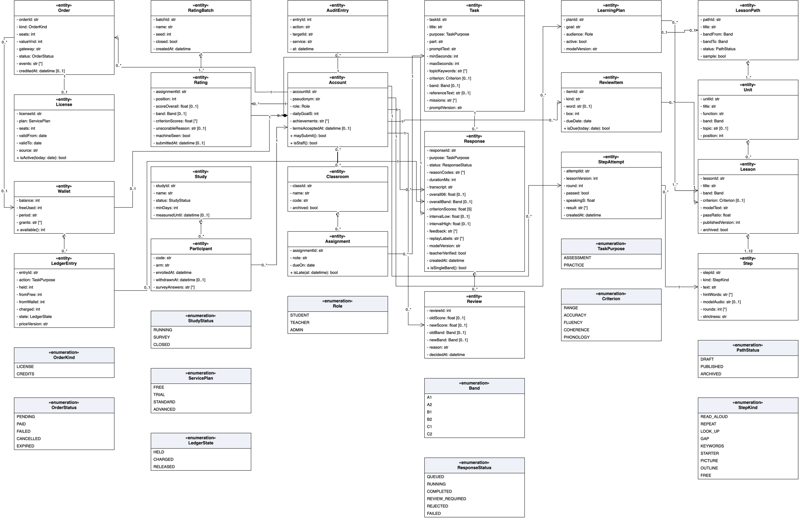

*Hình 2. Các đối tượng nghiệp vụ. Nguồn: `diagrams/02_class.drawio`*

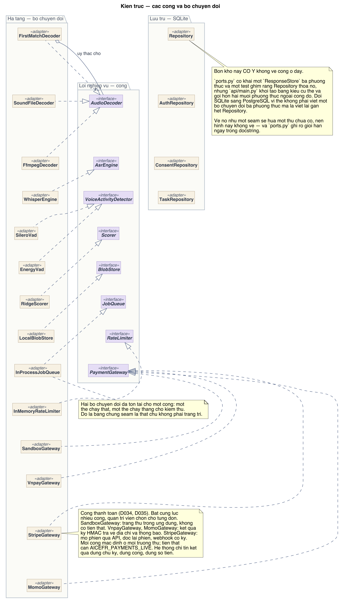

*Hình 2b. Kiến trúc tổng thể: ba dịch vụ, bus và kho dữ liệu. Nguồn: `diagrams/02b_kien_truc.puml`*

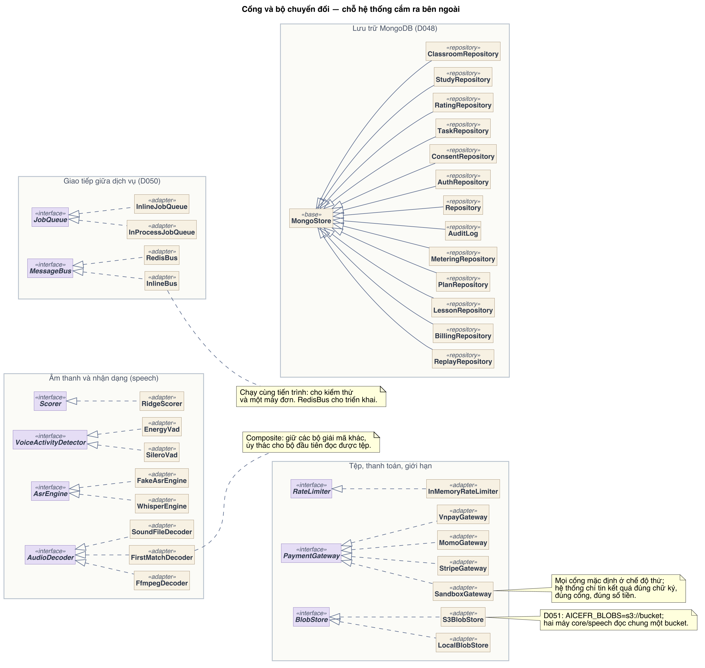

*Hình 2c. Cổng và bộ chuyển đổi. Nguồn: `diagrams/02c_cong_va_bo_chuyen_doi.puml`*

**Cách đọc sơ đồ lớp.** Hình thoi **đặc** (`◆`) là hợp thành: bộ phận thuộc về
đúng một thể, sinh ra cùng thể và mất theo thể. Dùng nó cho `Response`
và bốn bộ phận của nó vì luật vòng đời chứng minh được — không `QcResult` nào
được dùng chung giữa hai báo cáo, và không cái nào sống lâu hơn báo cáo sinh ra
nó. Bội số `0..1` ở mỗi bộ phận là cố ý: bài bị từ chối cho ra báo cáo chỉ có
`QcResult`; bài nhận dạng thất bại cho ra báo cáo không có `FeatureSet`. Mô hình
phải cho phép một báo cáo **dừng giữa chừng**, vì đó đúng là thứ pipeline sinh ra.

**Hợp thành phải có chỗ chứa thật, và hình phải chỉ ra chỗ đó.** Hình thoi đặc
không phải một mũi tên đẹp hơn liên kết: nó hứa rằng bộ phận nằm **bên trong**
thể. Hình chỉ ra chỗ chứa bằng **hai** cách cùng lúc:

1. **Thuộc tính tham chiếu trong hộp** — `Response` ghi `- assessment:
   Assessment`, `Assessment` ghi `- evidence: List<Evidence>`.
2. **Bội số ở đầu đích của quan hệ** — `0..1` cho `assessment`, `0..10` cho
   `evidence`, `5` cho `criteria`.

Chuẩn UML cho phép chọn *một trong hai*: một đầu liên kết đã **là** một thuộc
tính, nên về lý thuyết vẽ cả hai là thừa. Ở đây vẫn vẽ cả hai vì người đọc cần
thấy ngay *thể chứa bộ phận ở trường nào* — đó chính là điều phân biệt hợp thành
với kết hợp, và không nhìn ra được nếu bảng thuộc tính im lặng.

Định nghĩa hợp thành có **ba** điều kiện, và hai trong ba kiểm được tự động:

| Điều kiện | Kiểm thử | Kết quả hiện tại |
| --- | --- | --- |
| Thể **chứa** bộ phận | `test_every_composition_has_a_real_containing_field` | 10/10 có trường chứa thật |
| Bộ phận thuộc **đúng một** thể, không dùng chung | `test_every_composition_part_has_exactly_one_owner` | 10/10 chỉ có một lớp chứa |
| Vòng đời **trùng nhau** — xoá thể là mất bộ phận | Phần xét đoán, ghi bằng chữ ở đây | Cả 10 bộ phận đều được tuần tự hoá vào cột `report_json` của chính bài nộp; xoá dòng `response` là mất theo |

Điều kiện thứ nhất là **cần chứ chưa đủ**: một lớp chứa lớp khác cũng có thể là
**kết hợp** (hình thoi **rỗng**) nếu bộ phận sống độc lập hoặc bị dùng chung.
Phép phân biệt kinh điển: nếu xoá `Order` mà `Customer` vẫn còn thì đó là kết
hợp, không phải hợp thành.

**Mô hình này không có quan hệ kết hợp nào, và đó là kết luận có kiểm chứng:**
không lớp nào giữ *tham chiếu đối tượng* tới một thực thể sống độc lập. Mọi liên
kết tới `Account`, `Task`, `Consent`, `Review` đều đi qua khoá ở tầng lưu trữ,
không qua trường kiểu đối tượng — nên chúng là **liên kết**, và cả năm thực thể
đó không bị lớp nào chứa.

**Một lỗi đã bị bắt bằng chính luật đó.** `Response` từng được vẽ hợp thành với
`Review`. Nhưng `Review` **không** nằm trong `Response` — nó là bảng
`review_action` riêng, có vòng đời riêng, và cũng được `Account` trỏ tới. Đó là
**liên kết**, không phải hợp thành, và nay đã sửa. Mười quan hệ hợp thành còn
lại đều có trường chứa thật.

Mũi tên **liền nét đầu hở** (`→`) là liên kết có hướng, dùng khi hai đối tượng
có vòng đời riêng: `Account` tồn tại trước mọi bài nộp và sống lâu hơn chúng,
và một lần duyệt của giảng viên cũng vậy.

Đường **liền nét không đầu mũi tên, bội số hai đầu** là quan hệ nhiều–nhiều vẽ
thẳng: `Comment "0..*" — "1..*" Evidence`. Không có lớp nối, vì một lớp nối ở đây
sẽ không mang thêm thuộc tính nào ngoài chính cặp khoá — thêm nó vào là thêm một
đối tượng không có lý do tồn tại.

Đường **nét đứt đầu hở** là phụ thuộc vào kiểu liệt kê. Vẽ ra chứ không để ngầm:
bỏ chúng đi thì sơ đồ không trả lời được câu *"đổi một giá trị trong `Band` sẽ
ảnh hưởng tới những lớp nào"*.

**Mọi kiểu liệt kê mà một lớp trên hình nhắc tên đều được vẽ.** Sáu cái:
`Role`, `Status`, `QcStatus`, `Band`, `Criterion`, `ReasonCode`.

`ReasonCode` từng bị bỏ khỏi hình cho gọn — nó có 22 giá trị, cao 530 điểm, gấp
ba lần năm hộp kia cộng lại. Nhưng bỏ nó để lại một **kiểu mồ côi**: sáu thuộc
tính trên hình vẫn viết `List<ReasonCode>` và `Map<str, ReasonCode>`, trỏ tới
một kiểu không có ở đâu trên bản vẽ. Người chỉ đọc hình không biết nó là gì.

Chỉ có hai lựa chọn nhất quán, và lựa chọn được chốt bằng một phép kiểm:

| Lựa chọn | Điều kiện |
| --- | --- |
| Bỏ **sạch** — cả hộp lẫn sáu thuộc tính | Chỉ đúng nếu `ReasonCode` không quan trọng |
| **Vẽ ra** đầy đủ để lớp khác dùng được | Đúng nếu nó quan trọng |

Phép kiểm cho kết quả dứt khoát: **cả 22 mã đều có nhãn hiển thị cho người dùng**
trong `queue.js`, và **6 trong 15 lớp** mang trường `reasons` hoặc `invalid`. Bỏ
sạch nghĩa là xoá phần *"vì sao"* khỏi mô hình — mà đó chính là cơ chế làm mọi
phán xét của hệ thống kiểm tra được. Nên nó được vẽ.

Cái giá: hình cao thêm 530 điểm, tỷ lệ 1,28 → 1,12. Hộp đặt ở cột 3, ngay cạnh
năm trong sáu lớp dùng nó, nên không có đường nét đứt nào phải băng qua bản vẽ.

**Đã kiểm xem có rút gọn được không, và câu trả lời là không.** Ba phép đo:

| Phép đo | Kết quả |
| --- | --- |
| Số mã có nhãn hiển thị **khác nhau** cho người dùng | 22/22 — gộp hai mã là nói sai cho sinh viên việc cần sửa |
| Số mã được sinh ra ở một nhánh mã thật | 22/22 — không còn mã chết |
| Số mã nằm trong tập chuyển giảng viên | 10/22 — 12 mã còn lại có hành vi khác, không gộp được |

Cặp duy nhất về lý thuyết gộp được là `ASR_VERSION_MISMATCH` +
`VAD_VERSION_MISMATCH`. Không gộp: chính hai mã này đang làm tỷ lệ tự động hoàn
thành bằng 0, và biết *thành phần nào* lệch là thứ cần để sửa. Gộp lại tiết kiệm
đúng một dòng.

**Luật "không để kiểu mồ côi" được ghim bằng
`test_no_orphan_type_on_the_diagram`:** mọi kiểu của dự án mà một thuộc tính
trên hình nhắc tên đều phải có hộp. Kiểu có sẵn của ngôn ngữ (`str`, `int`,
`float`, `bool`) và tên bộ chứa (`List`, `Map`) được miễn.

**Cách đọc hình kiến trúc.** Mũi tên tam giác **nét đứt** (`<|..`) đọc là "hiện
thực hoá", và mọi mũi tên loại này đều đi **từ hạ tầng vào lõi**: `WhisperEngine`
hiện thực hoá `AsrEngine`, `RidgeScorer` hiện thực hoá `Scorer`. Không mũi tên
nào đi ngược lại. Đó chính là hình ảnh của nguyên tắc đảo ngược phụ thuộc:

> "Depend upon Abstractions. Do not depend upon concretions."
> — Robert C. Martin, *Design Principles and Design Patterns*, 2000

Bốn kho SQLite **cố ý không có cổng** trên hình đó. `ports.py` có khai một
`ResponseStore` ba phương thức và một test ghim rằng `Repository` thoả nó, nhưng
`api/main.py` khởi tạo bằng kiểu cụ thể và gọi hơn hai mươi phương thức ngoài
cổng ấy. Vẽ nó như một seam sẽ hứa rằng đổi SQLite sang PostgreSQL chỉ là viết
một bộ chuyển đổi ba phương thức — điều không đúng. Docstring của chính
`ResponseStore` ghi rõ giới hạn này.

**Ánh xạ sang mã nguồn.** Bảy port khai báo trong `src/aicefr/ports.py`. `ResponseProcessor` ở `src/aicefr/pipeline.py`. Các lớp dịch vụ nằm rải theo module: `src/aicefr/qc/audio_qc.py` (`AudioQualityChecker`), `src/aicefr/features/extract.py` (`FeatureExtractor`), `src/aicefr/scoring/scorer.py` (`RidgeScorer`), `src/aicefr/report/evidence.py` (`EvidenceBuilder`), `src/aicefr/review/router.py` (`ReviewRouter`). Hai adapter ASR ở `src/aicefr/asr/whisper_adapter.py` (`WhisperEngine`) và `src/aicefr/asr/fake.py` (`FakeAsrEngine`); hai adapter VAD ở `src/aicefr/asr/vad.py`. Adapter lưu trữ là `Repository` ở `src/aicefr/storage/repository.py`. Hai mươi trong hai mươi bốn lớp của sơ đồ lớp khai báo trong `src/aicefr/contracts.py`; **bốn lớp còn lại nằm ở tầng lưu trữ** — `Account` và `Role` ở `storage/auth_repository.py`, `Consent` ở `storage/consent_repository.py`, `Task` ở `storage/task_repository.py`. Câu trước đây ghi "mọi entity và enum khai báo một lần trong `contracts.py`" là sai, và sai theo hướng làm tầng nghiệp vụ trông sạch hơn thực tế; lược đồ SQLite nằm trong chính `repository.py` dưới dạng câu lệnh `CREATE TABLE`, **chưa** tách thành lớp ORM riêng như thiết kế ban đầu dự kiến.

#### 3.2.1. Đường nối: bất biến hình học, có test giữ

Bố cục đúng vẫn có thể đọc không ra. Bản đầu tiên có **19 cặp đường nối nằm
chồng lên nhau**, nặng nhất là `Assessment→CriterionCoverage` với
`Assessment→ReasonCode` chồng nhau 755 điểm, cộng **10 cạnh kẻ ngang qua lòng
chính hộp đầu mút của nó** — mỗi cạnh 300 điểm, đúng bề rộng một hộp.

Bốn bất biến hiện được giữ bằng test đọc trực tiếp toạ độ trong `.drawio`
(`tests/test_diagrams.py`), không bằng mắt:

1. không đoạn nào đi xuyên một hộp thứ ba;
2. không đoạn nào kẻ ngang quá 40 điểm qua lòng hộp đầu mút của chính nó;
3. không hai đoạn nào trùng nhau;
4. không hai đoạn song song nào cách nhau dưới 8 điểm.

Bộ định tuyến trong `tools/gen_class_diagram.py` cấp cho mỗi cạnh một **làn dọc
riêng** trong từng khe giữa hai cột mà nó đi qua, cộng một cổng ra và một cổng
vào riêng, cách nhau tối thiểu 22 điểm — bằng chiều cao một dòng chữ trong hộp.
Điểm quyết định là chỉ có **một** bộ cấp làn cho cả cạnh cùng cột lẫn cạnh khác
cột: hai bộ cấp độc lập chính là nguyên nhân của nhóm lỗi thứ hai.

Hai điều đáng ghi lại vì chúng không lộ ra khi nhìn:

- Phép kiểm "xuyên hộp" phải bỏ qua hai hộp đầu mút (đường buộc phải chạm vào
  chúng), nên nó **không thể** thấy lỗi "kẻ ngang qua lòng hộp đích". Cần một
  phép kiểm thứ hai, viết riêng.
- Bộ kiểm tra đã có lúc báo một lỗi **không tồn tại**, do giả định đoạn đầu tiên
  luôn đi ngang. Hướng của đoạn đầu do **cổng** quyết định: bước đi đầu tiên
  luôn vuông góc với cạnh hộp mà đường rời. Một dụng cụ đo sai còn tệ hơn không
  đo, vì nó làm mất lòng tin vào mọi con số nó đưa ra.

#### 3.2.2. Những điểm của mô hình còn phải bàn

Ghi ở đây thay vì để hội đồng tự tìm. Chi tiết và số dòng cụ thể nằm ở mục
10.4.1 của `docs/reports/bao_cao_tuan_01.md`.

| # | Điểm | Trạng thái |
| --- | --- | --- |
| 1 | `Evidence` dán nhãn «entity» nhưng không có bảng riêng, mã `ev-01` chỉ có nghĩa trong một báo cáo — theo đúng tiêu chí ở mục 3.2 thì nó là value object | **đã sửa** — nay là «value object» |
| 2 | `Assessment` dán nhãn «entity» mà không có thuộc tính định danh; nó mượn danh tính của `Response` | **giữ nguyên, có chủ ý** — nó **biến đổi** (giảng viên sửa điểm) nên không thể là value object. Ghi rõ ở đây thay vì đổi nhãn cho tiện |
| 3 | `Evidence.kind: str` chỉ nhận bốn giá trị, viết trần trong `report/evidence.py` | **đã sửa** — `EvidenceKind`, kế thừa `str` nên JSON không đổi |
| 4 | `Priority.feature: str` giữ **tên** đặc trưng dưới dạng chuỗi, không gì kiểm tên có thật | **đã sửa** — đổi tên thành `feature_name` để nói rõ đó là tham chiếu theo tên, và thêm test đối chiếu khoá `ADVICE` với `feature_order` của tệp mô hình |
| 5 | Bội số `1..*` giữa `Comment` và `Evidence` | **nhận định cũ của tôi chưa đủ.** Nó **có** được giữ trong mã sản xuất: `CommentBuilder.comments()` kết thúc bằng `return [c for c in out if c.evidence_refs]`, nên không nhận xét nào rỗng bằng chứng lọt vào `Assessment`. Mô hình vẫn cho phép một `Comment` rỗng tồn tại **riêng lẻ**, và đó là chủ ý đã ghi trong mã: *"a missing citation must cost the sentence, not the report"* |
| 6 | `Task.part: str` là tập đóng viết bằng kiểu mở | **đã sửa** — `TaskPart` với **ba** giá trị `P3`, `P4`, `P5`. Ba chứ không phải hai: `P5` là đề dài, **cố ý** nằm ngoài dải huấn luyện và đi theo nhánh cắt cửa sổ |
| 7 | `CriterionCoverage.confidence` là tỷ lệ đặc trưng tính được, **không** phải xác suất điểm đúng | **đã sửa** — đổi tên thành `coverage`, giữ `AliasChoices` để báo cáo cũ vẫn đọc được, và JS đọc `c.coverage ?? c.confidence` |
| 8 | Bốn lớp của mô hình miền nằm ở tầng lưu trữ; docstring của `Task` tự gọi nó là value object trong khi hình dán «entity» | **sửa một nửa** — docstring đã sửa (`Task` **là** entity: có `task_id`, có bảng riêng, tra cứu theo id). Việc bốn lớp nằm ở `storage/` thì giữ nguyên: dời chúng là một lần tái cấu trúc riêng |
| 9 | Sơ đồ không có quan hệ kết hợp (aggregation) nào | **đúng với mô hình này** — không có đối tượng nào dùng chung giữa hai thể. Nêu trước để phân biệt với bản tham khảo OneShop (16 kết hợp) |

### 3.3. Sơ đồ tuần tự (Sequence diagram)

File: `docs/sdd/diagrams/03_sequence.mmd`

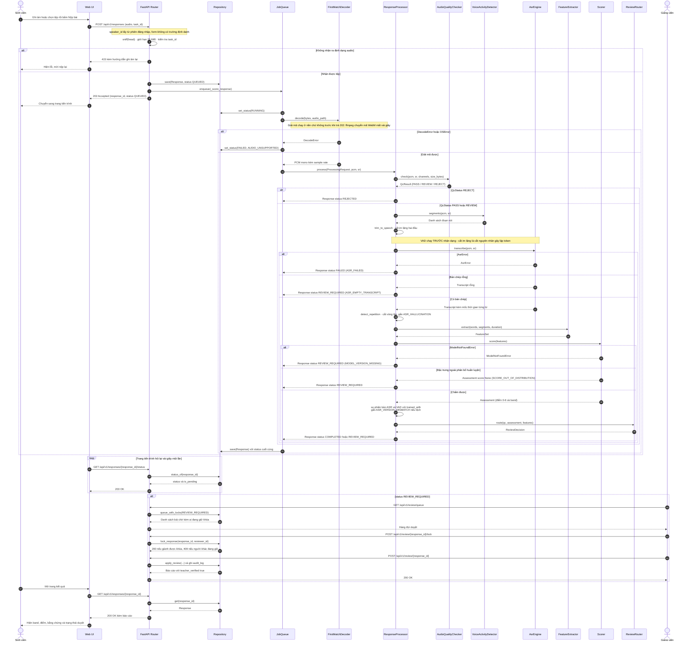

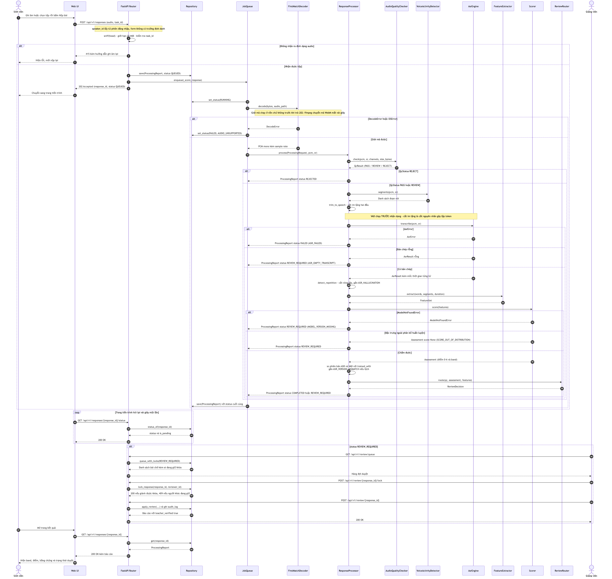

*Hình 3. Sơ đồ tuần tự. File nguồn: `diagrams/03_sequence.mmd`*

**Cách đọc.** Trục dọc là thời gian, chảy từ trên xuống. Mỗi cột là một đối tượng tham gia. Mũi tên đặc là lời gọi đồng bộ, mũi tên nét đứt là giá trị trả về. Số thứ tự do `autonumber` sinh ra giúp hội đồng chỉ đúng bước cần hỏi. Các khối `alt/else` lồng nhau là những điểm rẽ nhánh quan trọng: khối ngoài cùng tách audio không giải mã được khỏi audio giải mã được; bên trong lần lượt là ba mức `QcStatus` (REJECT dừng hẳn, PASS và REVIEW đều chấm tiếp), rồi ASR lỗi / bản chép rỗng / có bản chép, rồi nhánh không nạp được mô hình. Điểm thiết kế cần nhấn: `submit_response` **không** giải mã audio trước khi trả lời — nó chỉ đoán định dạng từ byte đầu tệp, lưu báo cáo ở `QUEUED` và trả `202 Accepted` **ngay**, rồi đẩy việc chấm qua cổng `JobQueue`. Giải mã nằm ở nền vì `ffmpeg` chuyển mã một bản WebM dài mất vài giây, đủ để phá cam kết 202 trong 300 ms; nền chuyển `QUEUED → RUNNING` rồi ghi trạng thái cuối (`COMPLETED`, `REVIEW_REQUIRED`, `REJECTED` hoặc `FAILED`). Vì vậy sinh viên không phải chờ, và khối `loop` cho thấy trang tiến trình hỏi lại bằng `GET /api/v1/responses/{response_id}/status`. Khối `alt` áp chót là nhánh cờ chuyển giảng viên: chỉ sau khi giảng viên gửi quyết định thì `teacher_verified` mới thành `true`.

> **Khác biệt so với mã hiện tại.** Cột `FirstMatchDecoder` là adapter composite hiện thực port `AudioDecoder`; nó được gọi **ở nền, sau khi đã trả 202** (trong `_score_one`), chứ không phải trong tay request handler. Vì vậy tệp không giải mã được cho ra `status FAILED` kèm `AUDIO_UNSUPPORTED` chứ không còn là HTTP 415; 415 nay chỉ dành cho tệp mà `sniff` không nhận ra là audio. Cột `AsrAdapter` cũ nay là port `AsrEngine` với hai adapter `WhisperEngine` và `FakeAsrEngine`; cột `AudioQC` cũ nay là lớp `AudioQualityChecker`; cột `DefaultResponseProcessor` cũ nay là lớp cụ thể `ResponseProcessor`; cột `Repository` là adapter hiện thực port `ResponseStore`. Cột `ArtifactStore` đã bị bỏ khỏi sơ đồ vì **chưa hiện thực**: tệp audio hiện ghi thẳng vào thư mục `uploads/` và chưa tính SHA-256. Hàng đợi Redis và container `worker` riêng vẫn **chưa hiện thực**, nhưng khớp nối đã có: pipeline chạy qua cổng `JobQueue`, hiện dùng adapter `InProcessJobQueue` trong cùng tiến trình (xem `_score_response` trong `api/main.py` và `src/aicefr/infra/queues.py`).

**Ánh xạ sang mã nguồn.** Bước `POST /api/v1/responses` nằm ở hàm `submit_response` trong `src/aicefr/api/main.py`; hàm này ghi tệp raw ra `uploads/` theo từng khối (không đọc cả tệp vào bộ nhớ) rồi dừng lại ở đó. Giải mã qua port `AudioDecoder` — `decoder.decode(bytes, audio_path)` với `decoder = FirstMatchDecoder()` ở `src/aicefr/audio/decoder.py` — và toàn bộ pipeline nằm ở `_score_one`, chạy ở nền sau khi phản hồi 202 đã gửi đi; `_score_one_guarded` bọc ngoài để không lỗi nào thoát vào luồng nền mà bỏ bài kẹt ở `RUNNING`. Lời gọi `process` là `ResponseProcessor.process` tại `src/aicefr/pipeline.py`; các bước bên trong gọi lần lượt `src/aicefr/qc/audio_qc.py` (`AudioQualityChecker`), `src/aicefr/asr/whisper_adapter.py` hoặc `src/aicefr/asr/fake.py` (`AsrEngine`), `src/aicefr/asr/vad.py` (`VoiceActivityDetector`), `src/aicefr/features/extract.py` (`FeatureExtractor`), `src/aicefr/scoring/scorer.py` (`RidgeScorer`), `src/aicefr/report/evidence.py` (`EvidenceBuilder`), `src/aicefr/review/router.py` (`ReviewRouter`). Nhánh duyệt của giảng viên nằm ở các endpoint `/api/v1/review/*` trong `src/aicefr/api/main.py` và ở `Repository.apply_review` (`src/aicefr/storage/repository.py`); lớp dịch vụ `TeacherReviewService` **chưa hiện thực**. Bước cuối `GET /api/v1/responses/{response_id}` cũng ở `src/aicefr/api/main.py`.

### 3.4. Sơ đồ hoạt động (Activity diagram)

File: `docs/sdd/diagrams/04_activity.mmd`

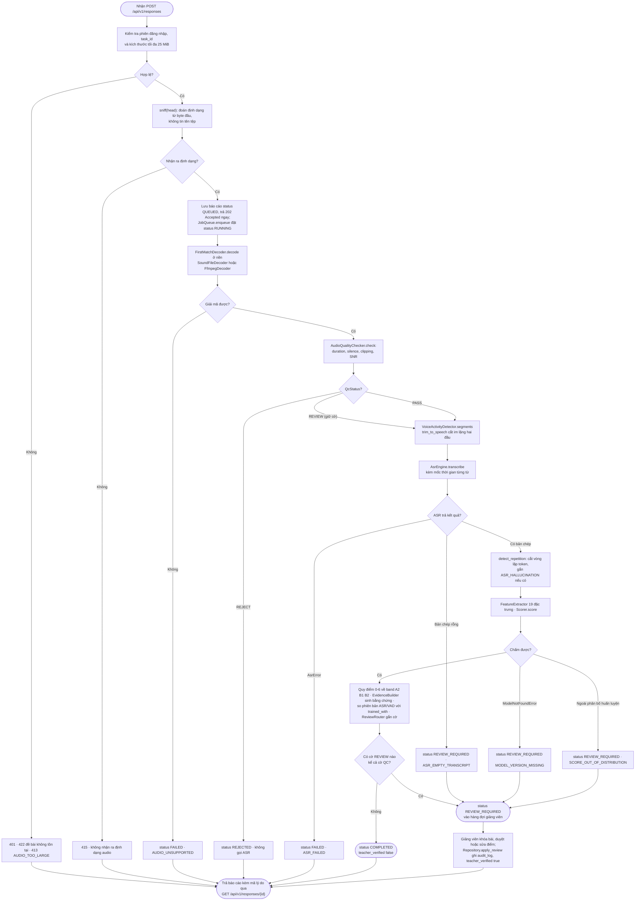

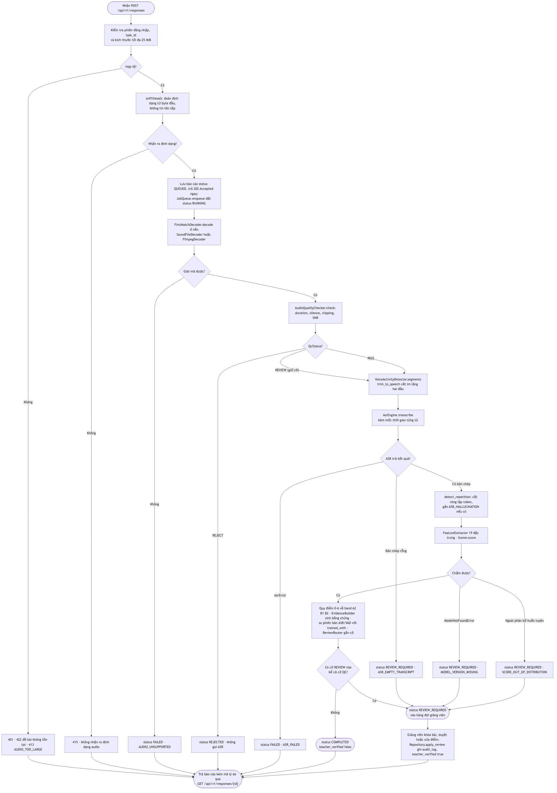

*Hình 4. Sơ đồ hoạt động. File nguồn: `diagrams/04_activity.mmd`*

**Cách đọc.** Hình bo tròn là điểm bắt đầu và kết thúc; hình chữ nhật là hoạt động; hình thoi là điểm quyết định với nhãn trên cạnh. Sơ đồ đi đúng theo máy trạng thái thật: `A3` lưu báo cáo ở `QUEUED` và trả `202 Accepted` ngay, `JobQueue` đặt `RUNNING`, và mọi nhánh đều kết thúc ở một trong bốn trạng thái `COMPLETED`, `REVIEW_REQUIRED`, `REJECTED`, `FAILED`. Điểm mấu chốt để phân biệt hai nhóm nhánh: các ô `E1`–`E4` là **nhánh dừng cứng** — pipeline không chạy tiếp, không có điểm, không có transcript giả; còn nhánh `REVIEW` của `D3` và các cờ gắn ở `A7` là **cờ mềm** — chúng không dừng pipeline mà tích lũy vào `ReviewDecision` và chỉ được tổng hợp một lần tại `D6`. Đây chính là lý do `QcResult` phải có **ba** mức: `REJECT` dừng hẳn và **không gọi ASR** (tiết kiệm tính toán, tránh sinh đặc trưng vô nghĩa), `REVIEW` vẫn chấm nhưng bắt buộc qua giảng viên, `PASS` đi thẳng. Gộp mức giữa vào `PASS` sẽ mất đúng lớp cảnh báo đó.

**Ánh xạ sang mã nguồn.** `A1` và `D1` là `Depends(require_login)` cùng các kiểm tra kích thước và `task_id` ở đầu hàm `submit_response` — bút danh **không** được kiểm ở đây nữa, vì nó đến từ phiên đăng nhập chứ không từ form; `validate_pseudonym` (`src/aicefr/auth/pseudonyms.py`) chạy lúc tạo tài khoản. `A2` và `D2` là `sniff(head)` ở `src/aicefr/audio/decoder.py`: không nhận ra định dạng thì HTTP 415. `A3` là `repo.save(... Status.QUEUED)` rồi `job_queue.enqueue(_score_response)`, còn `repo.set_status(RUNNING)` và `A3b` `FirstMatchDecoder.decode` nằm ở `_score_one`; `DecodeError` ở đó cho `status FAILED` kèm `AUDIO_UNSUPPORTED`. `A4` và `D3` ở `src/aicefr/qc/audio_qc.py` (`AudioQualityChecker`, enum `QcStatus` ba mức), đọc ngưỡng từ `QcThresholds` trong cùng tệp — **chưa** tách thành `src/config/qc_config.py`. `A5` là `src/aicefr/asr/vad.py` (`SileroVad.segments`) cùng `trim_to_speech` ở `src/aicefr/pipeline.py` — VAD chạy **trước** nhận dạng; `A5b`, `D4` ở `src/aicefr/asr/` (`AsrEngine`, `AsrError`). `A6` là `detect_repetition` ở `src/aicefr/asr/hallucination.py`, `A6b` là `src/aicefr/features/extract.py` và `Scorer.score` ở `src/aicefr/scoring/scorer.py`; `D5` là `ModelNotFoundError` và nhánh ngoài phân bố huấn luyện của cùng tệp đó. `A7` gộp việc quy band và `EvidenceBuilder` (`src/aicefr/report/evidence.py`) với các cờ do `ReviewRouter` gắn; nhánh `BertTextGrader` và bước hợp nhất hai nhánh vẫn **chưa hiện thực**, điểm hiện chỉ được kẹp về `[1.0, 6.0]`. `D6` là `ReviewRouter.route` ở `src/aicefr/review/router.py`. `A8` ở các endpoint `/api/v1/review/*` trong `src/aicefr/api/main.py` và `Repository.apply_review`; lớp `TeacherReviewService` **chưa hiện thực**. Bước dọn workspace tạm trong thiết kế ban đầu đã bỏ khỏi sơ đồ vì **chưa hiện thực**.

### 3.5. Sơ đồ thực thể – quan hệ (ERD)

File: `docs/sdd/diagrams/05_erd.mmd`

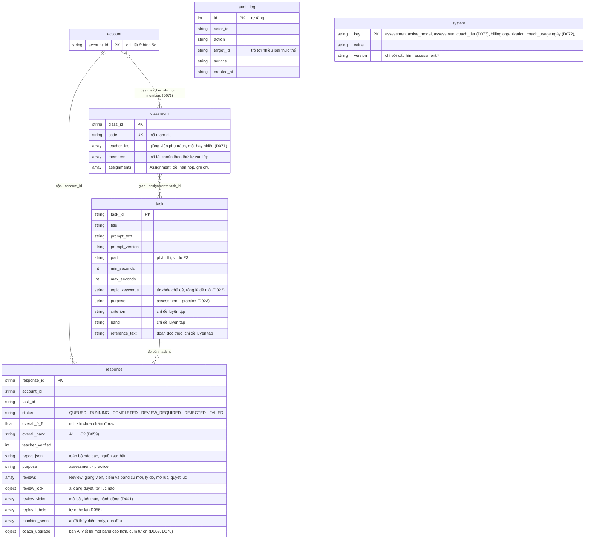

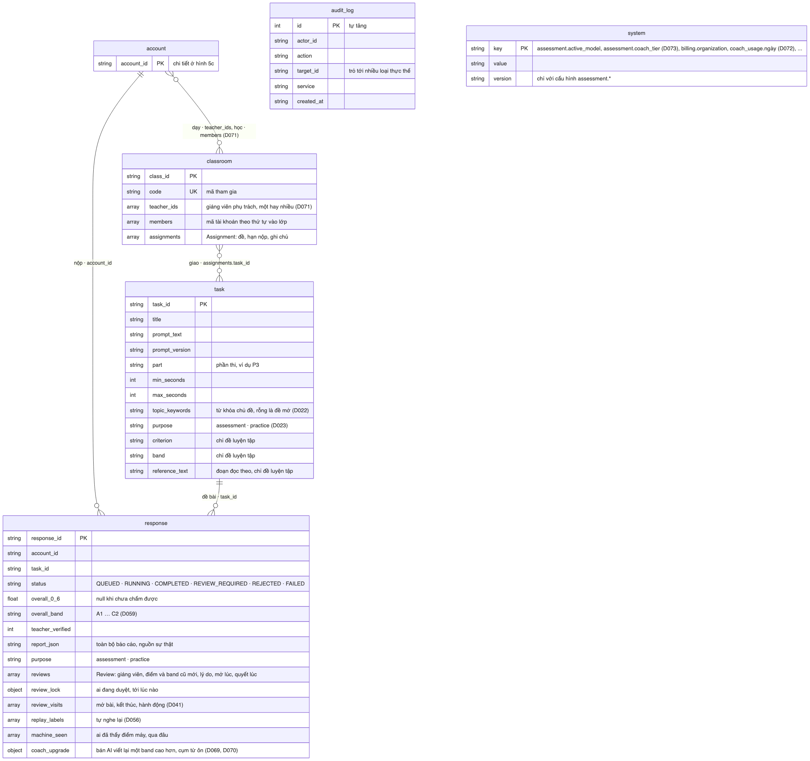

*Hình 5. Các collection đang chạy (D060) — phần chấm điểm, lớp học và vận hành. Nguồn: `diagrams/05_erd.mmd`*

#### 3.5a. Định danh, đồng thuận và trạng thái theo tài khoản

Các collection đang chạy (D060, mục 5.3a) được vẽ thành ba hình: hình 5 ở trên (chấm điểm, lớp học và vận hành), hình 5c dưới đây (định danh) và hình 5d (chấm mù và thực nghiệm, mục 3.5b). Tách ba hình để mỗi hình in A4 được (tỷ lệ không quá 2,0). Collection dùng chung chỉ vẽ đầy đủ ở một hình: `account` đầy đủ ở hình 5c, ở hai hình kia chỉ còn khoá chính; `response` đầy đủ ở hình 5, ở hình 5d chỉ còn khoá chính và danh sách người đã xem điểm máy. Lộ trình, bài học, gói dịch vụ và tính lượt vẽ ở `docs/db/erd_core.mmd`.

Từ D060 mỗi aggregate root của sơ đồ lớp là một collection, và phần hợp thành nằm trong document của gốc dưới dạng trường kiểu mảng hoặc document con: trong hình, `array` và `object` là những phần đó. Liên kết Google (`identities`) và mốc "đã xem" (`seen_markers`) nay nằm trong `account`; phiên đăng nhập vẫn là collection riêng `session` vì cần chỉ mục TTL tự xoá phiên hết hạn.

File: `docs/sdd/diagrams/05c_erd_identity.mmd`

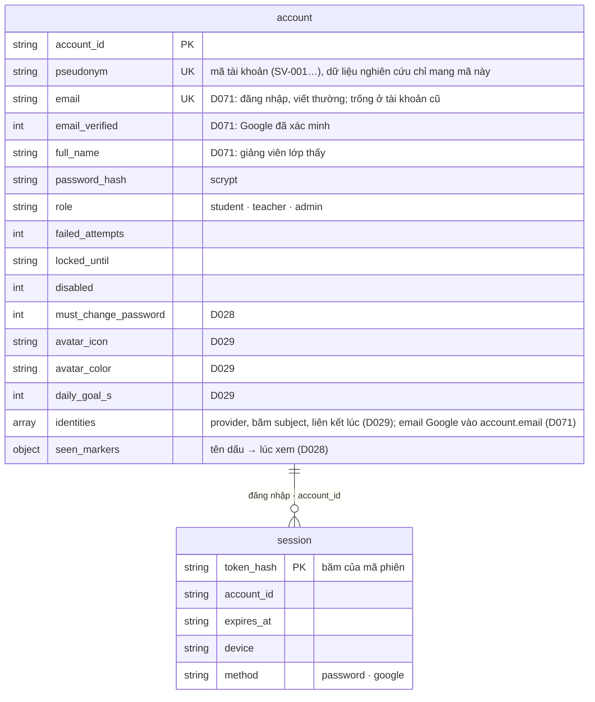

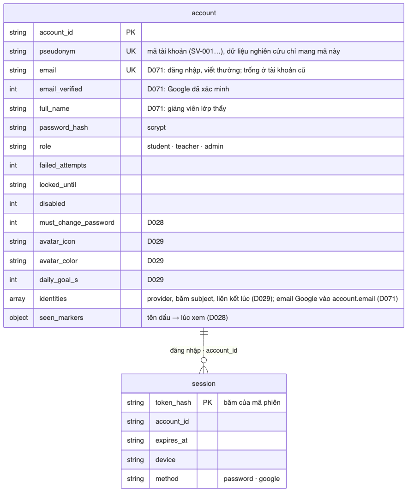

*Hình 5c. Tài khoản (liên kết Google và mốc "đã xem" nằm trong tài khoản) và phiên đăng nhập. Nguồn: `diagrams/05c_erd_identity.mmd`*

**Cách đọc.** Ký hiệu chân quạ ở hai đầu quan hệ cho biết bội số: `||` là chính xác một, `o{` là không hoặc nhiều, `o|` là không hoặc một. Quan hệ giữa hai collection là tham chiếu do mã giữ (`account_id`, `task_id`): MongoDB không ép khoá ngoại. Kiểu ghi trong hình là kiểu của document (`string`, `int`, `float`, `bool`, `array`, `object`); thời điểm là chuỗi ISO-8601 UTC. `response` giữ toàn bộ báo cáo ở `report_json`, còn `overall_0_6`, `overall_band`, `status` là bản sao phẳng để truy vấn mà không phải mở JSON; lịch sử duyệt (`reviews`) nằm cạnh báo cáo chứ không trong nó. Không collection nào có trường họ tên, email hay MSSV; `identities` chỉ giữ băm của mã người dùng Google.

**Ánh xạ sang mã nguồn.** Mỗi collection có một lớp miền cùng tên với thực thể trên sơ đồ lớp và một repository: `response` ở `src/aicefr/storage/repository.py` (`Response.reviews: list[Review]`), `task` ở `task_repository.py`, `classroom` ở `classroom_repository.py` (`Classroom`, `Assignment`), `account` và `session` ở `auth_repository.py`, `rating_batch` ở `rating_repository.py` (`RatingBatch`, `Rating`), `study` ở `study_repository.py` (`Study`, `Participant`). Danh sách đầy đủ 19 collection, phần nhúng và khoá ở `docs/db/TU_DIEN_DU_LIEU.md`; dữ liệu của bản trước D060 chuyển sang bằng migration 7 (`src/aicefr/storage/migrations.py`). Lược đồ nghiên cứu đầy đủ — `speaker`, `audio_file`, `qc_result`, `transcript`, `feature_set`, `assessment`, `criterion_score`, `evidence` — **chưa hiện thực**, tách hẳn sang hình 5b.

#### 3.5b. Chấm mù hai người (D030)

Chấm mù của khảo sát thực địa (mục 4.13) và thực nghiệm phản hồi (D040). Mỗi đợt chấm là một document `rating_batch` chứa các phiếu `Rating`; mỗi thực nghiệm là một document `study` chứa người tham gia. Không collection nào ở đây ghi vào `response`: luồng duyệt vận hành giữ nguyên, kể cả `teacher_verified`.

File: `docs/sdd/diagrams/05d_erd_rating.mmd`

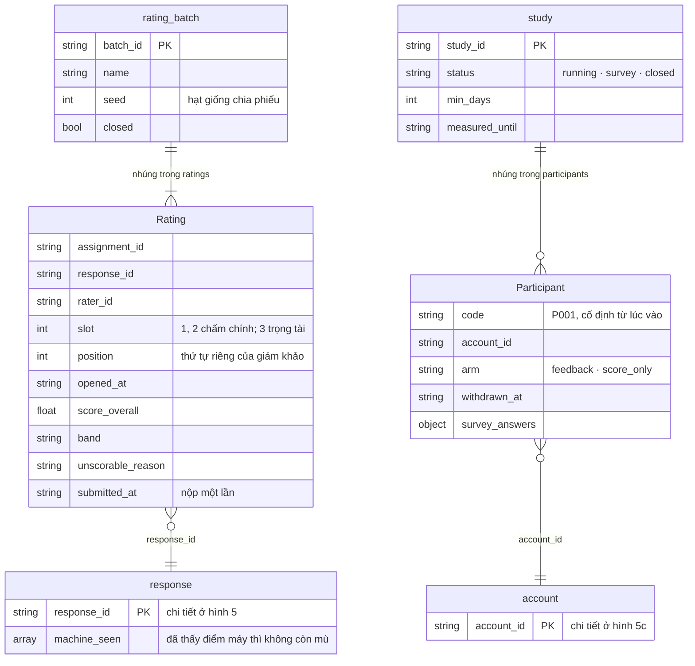

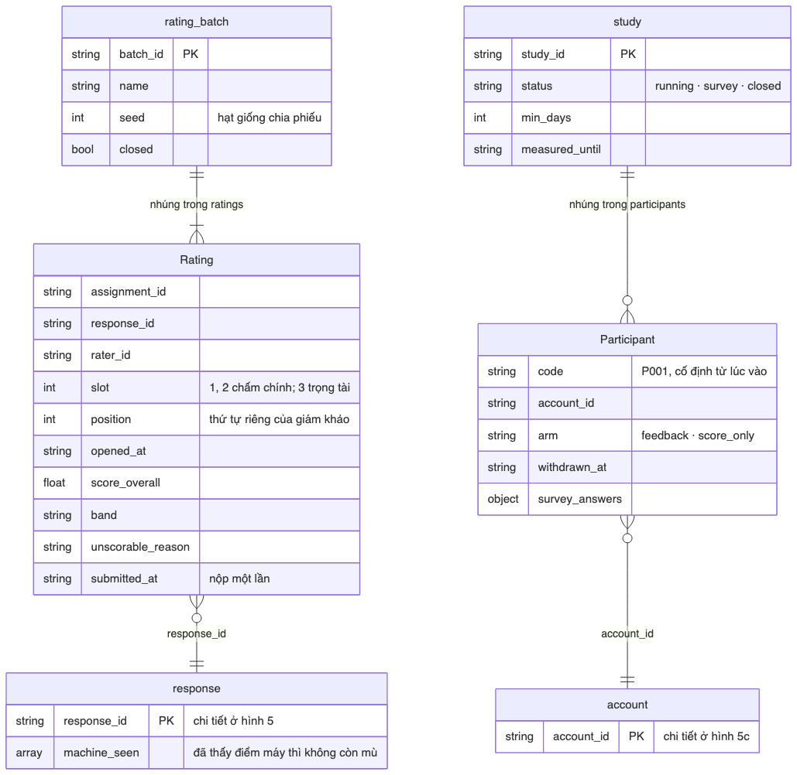

*Hình 5d. Đợt chấm với các phiếu `Rating` nhúng (phiếu và điểm là một), ai đã xem kết quả của máy, và thực nghiệm với người tham gia nhúng. Nguồn: `diagrams/05d_erd_rating.mmd`*

**Cách đọc.** Một đợt (`rating_batch`) gồm nhiều phiếu (`Rating`, nhúng trong `ratings`); mỗi phiếu là một cặp bài–giám khảo, mang `slot` 1 hoặc 2 cho hai giám khảo chính và 3 cho người phân xử, và `position` là chỗ của bài trong thứ tự **riêng** của giám khảo đó. Phiếu và điểm là một: phiếu chưa nộp có `submitted_at` rỗng, và lần nộp là một cập nhật có điều kiện "`submitted_at` còn rỗng", nên phiếu đã nộp là cuối cùng. Điểm từng tiêu chí, điểm tổng và band đều có thể rỗng: phiếu "không chấm được" để trống tất cả. `response.machine_seen` ghi ai đã mở kết quả của máy cho bài đó, lần đầu; cùng với người đã duyệt bài (`response.reviews`) nó quyết định ai không còn mù với một bài (mục 4.13, bất biến 4b).

**Ánh xạ sang mã nguồn.** `RatingBatch` và `Rating` ở `src/aicefr/storage/rating_repository.py`; `Study` và `Participant` ở `study_repository.py`. Điều kiện chọn bài của `RatingRepository.eligible`: `purpose = 'assessment'`, `status` là `COMPLETED` hoặc `REVIEW_REQUIRED`, có bản ghi âm, chủ bài đã đồng ý điều khoản (D058). Điểm của máy dùng để so **không** có trường riêng: `_machine` đọc `old_score`, `old_band` của lần duyệt đầu trong `response.reviews` nếu bài đã được duyệt, nếu chưa thì đọc `overall_0_6`, `overall_band` — vì quyết định của giảng viên ghi đè hai trường đó. Cùng hàm dựng cờ `flagged` (bài đang `REVIEW_REQUIRED` hoặc đã có lần duyệt) mà báo cáo dùng cho câu hỏi về định tuyến (RQ4).

#### 3.5c. Lược đồ nghiên cứu dự kiến (chưa hiện thực)

Hình dưới là thiết kế mục tiêu cho đợt thu dữ liệu nghiên cứu, vẽ theo mục 7 của SRS. **Không bảng nào trong hình này tồn tại trong mã nguồn hôm nay.** Giữ nó ở một hình riêng là có chủ ý: gộp chung với lược đồ thật thì người đọc không còn phân biệt được cái gì đã làm và cái gì mới là dự định — và rubric coi tài liệu mâu thuẫn với mã là lỗi nặng.

File: `docs/sdd/diagrams/05b_erd_target.mmd`

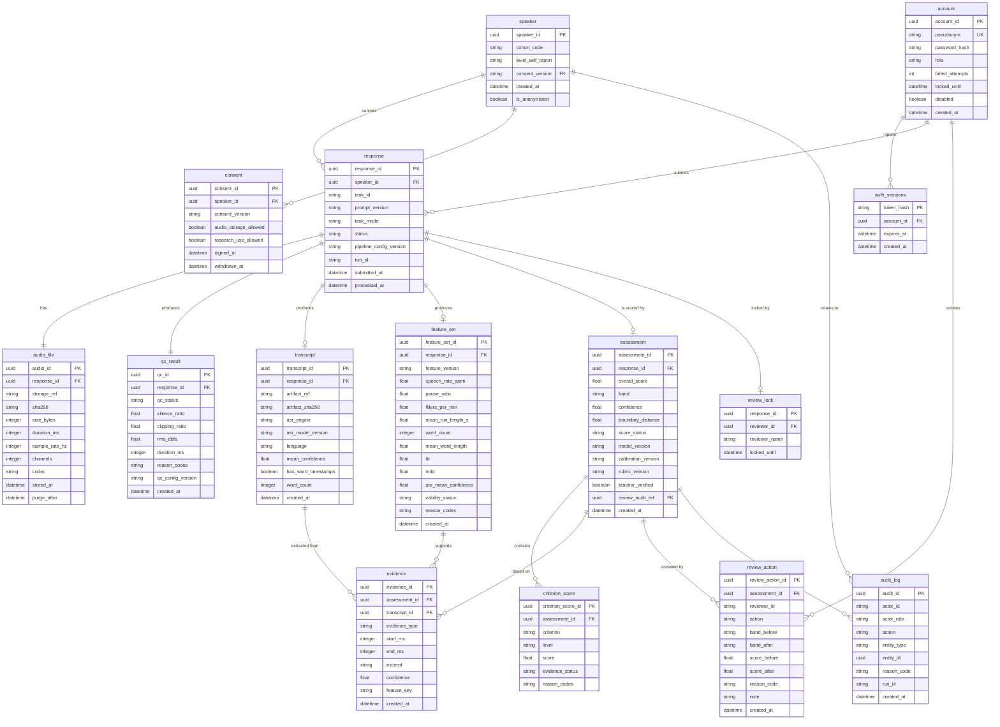

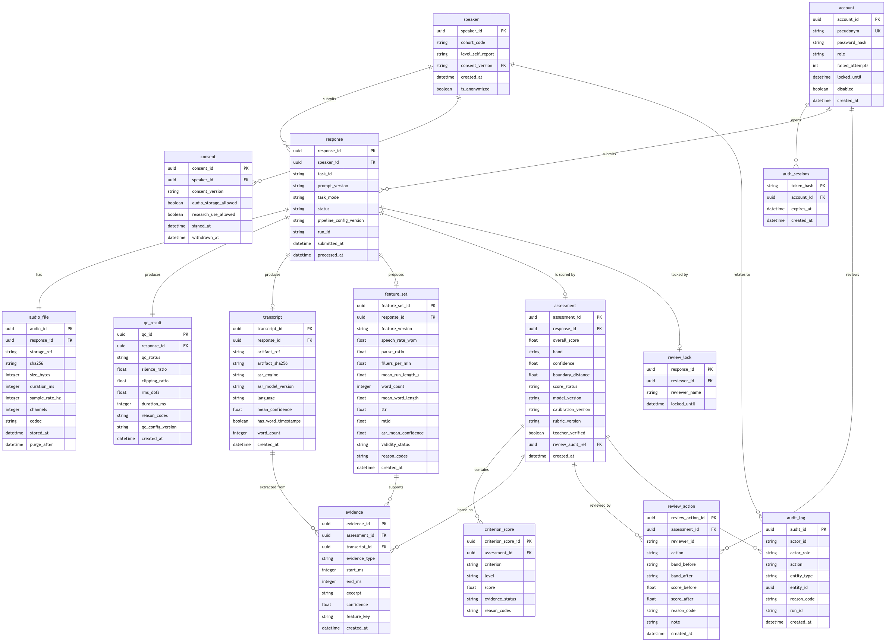

*Hình 5b. Lược đồ nghiên cứu dự kiến, chưa hiện thực. Nguồn: `diagrams/05b_erd_target.mmd`*

### 3.6. Sơ đồ thành phần và triển khai

File: `docs/sdd/diagrams/06_deployment.mmd`

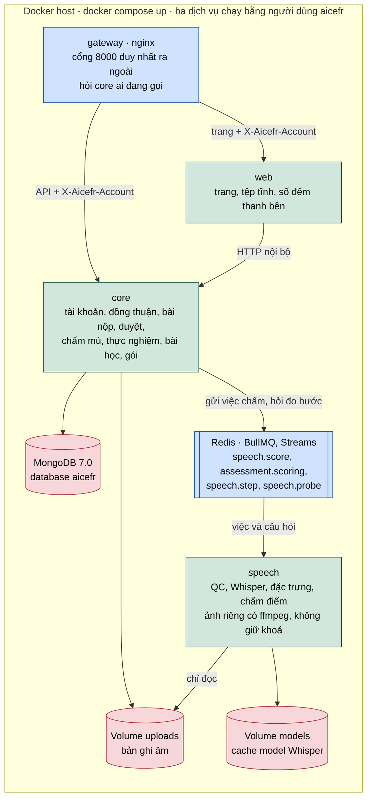

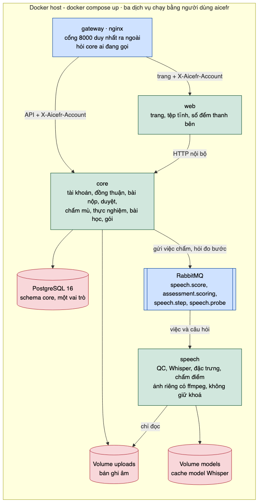

*Hình 6. Sơ đồ thành phần và triển khai. File nguồn: `diagrams/06_deployment.mmd`*

**Cách đọc.** Sau D044 hệ thống chạy thành ba dịch vụ trong một máy Docker. Chỉ **gateway** (nginx) mở cổng ra ngoài; với mỗi yêu cầu, gateway hỏi `core` ai đang gọi (`/internal/identity/session`) rồi chuyển yêu cầu tới dịch vụ sở hữu đường dẫn — API cho `core`, trang cho `web` — kèm tài khoản trong tiêu đề `X-Aicefr-Account` và khoá gateway `X-Aicefr-Gateway`. `core` giữ mọi bảng trong **một schema PostgreSQL** `core`, với **một vai trò** chỉ có quyền trên schema đó. `web` không có kho dữ liệu: muốn hiển thị gì thì hỏi `core` qua HTTP nội bộ (khoá `X-Aicefr-Internal`). `speech` là nơi duy nhất chạy bộ nhận dạng, không có kho dữ liệu và không giữ khoá nào, nhận việc qua **RabbitMQ**: bài cần chấm (`speech.score`, hàng đợi bền), bước bài học cần đo (`speech.step`) hoặc âm thanh mẫu cần thử (`speech.probe`), và trả kết quả về `assessment.scoring`. Volume `uploads` (màu đỏ: dữ liệu cá nhân) gắn vào `core` để ghi và vào `speech` chỉ để đọc; volume `models` chỉ gắn vào `speech`.

**Ánh xạ sang mã nguồn.** Hình 6 vẽ đúng `docker-compose.yml`, `Dockerfile` (hai ảnh: `service` cho `core` và `web`, `speech` có thêm ffmpeg và faster-whisper), `deploy/gateway/default.conf.template` (sinh từ `src/aicefr/platform/gateway.py` bằng `tools/gen_gateway.py`) và `deploy/postgres/init-services.sh`. Mỗi dịch vụ là một gói ở `src/aicefr/services/`; `services/core/` chứa bốn phần `identity`, `assessment`, `learning`, `billing`, mỗi phần vẫn có facade riêng. Ứng dụng một tiến trình `aicefr.api.main` dựng cả ba dịch vụ trong một tiến trình với cùng mã, dùng cho kiểm thử và cho một máy (mục 4.18). `tools/compose_smoke.py` đi qua gateway của hệ thống đang chạy và kiểm từng điểm, kể cả việc vai trò `core` không tạo được bảng ngoài schema của mình.

---

## 4. Thiết kế chi tiết từng module

### 4.0. Bảng liệt kê reason code đầy đủ (enum `ReasonCode`)

Toàn bộ enum khai báo một lần duy nhất tại `src/aicefr/contracts.py`; không module nào được tự tạo chuỗi lý do rời.

| Nhóm | Reason code | Ý nghĩa | Ảnh hưởng status |
| --- | --- | --- | --- |
| Audio/QC | `AUDIO_UNSUPPORTED` | Không giải mã được hoặc codec không hỗ trợ | `REJECTED` |
| | `AUDIO_TOO_LARGE` | Vượt 26.214.400 byte | `REJECTED` |
| | `AUDIO_TOO_LONG` | Vượt 300.000 ms | `REJECTED` |
| | `AUDIO_TOO_SHORT` | Dưới 15.000 ms | cờ `REVIEW` |
| | `HIGH_SILENCE` | `silence_ratio >= 0.80` | cờ `REVIEW` |
| | `CLIPPING` | `clipping_ratio >= 0.01` | cờ `REVIEW` |
| | `NOISE_HIGH` | SNR ước lượng thấp | cờ `REVIEW` |
| | `VAD_FAILED` | Không tách được đoạn nói | cờ `REVIEW` |
| ASR | `ASR_FAILED` | Adapter ném lỗi hoặc timeout | `FAILED` |
| | `ASR_LOW_CONFIDENCE` | `mean_confidence < 0.60` | cờ `REVIEW` |
| | `TRANSCRIPT_INCOMPLETE` | Thiếu đoạn so với thời lượng | cờ `REVIEW` |
| | `ALIGNMENT_FAILED` | Không có word timestamps | cờ `REVIEW` |
| Task/Evidence | `TASK_OFF_TOPIC` | Nội dung lệch đề | cờ `REVIEW` |
| | `RESPONSE_TOO_SHORT` | Dưới 30 token hợp lệ | `validity INVALID` |
| | `INTERACTION_MISSING` | Không có bằng chứng tương tác | `insufficient_evidence` |
| | `CONTINGENCY_MISSING` | Thiếu lượt phản hồi phụ thuộc | `insufficient_evidence` |
| | `SYSTEM_LATENCY_UNKNOWN` | Không xác định được độ trễ hệ thống | ghi chú |
| Scoring/Review | `NEAR_BAND_BOUNDARY` | `boundary_distance < 0.25` | cờ `REVIEW` |
| | `MODEL_LOW_CONFIDENCE` | `confidence < 0.65` | cờ `REVIEW` |
| | `MODEL_NOT_AVAILABLE` | Chưa nạp được mô hình | `REVIEW_REQUIRED` |
| | `HUMAN_REVIEW_REQUIRED` | Cờ tổng hợp | `REVIEW_REQUIRED` |
| | `RATER_DISAGREEMENT` | Hai rater lệch band | `REVIEW_REQUIRED` |
| | `ADJUDICATION_REQUIRED` | Cần người phân xử | `REVIEW_REQUIRED` |
| | `CONFIG_VERSION_MISMATCH` | Version cấu hình không khớp | `FAILED` |
| Data/Privacy | `IDENTITY_FIELD_REJECTED` | Bút danh chứa thông tin định danh thật. Kiểm tra ở **lúc tạo tài khoản** (`auth/pseudonyms.py`), không ở lúc nộp bài: từ khi `speaker_id` lấy từ phiên đăng nhập, form không còn trường định danh nào để từ chối | — |
| | `UNAPPROVED_DATA_ROOT` | Đường dẫn ngoài vùng đã duyệt | `FAILED` |
| | `PROVENANCE_MISSING` | Thiếu version hoặc hash bắt buộc | `FAILED` |
| | `CONSENT_WITHDRAWN` | Người học đã rút đồng ý | `REJECTED` |

Enum `ProcessingStatus` gồm bốn giá trị: `COMPLETED`, `REVIEW_REQUIRED`, `REJECTED`, `FAILED`.

> **Mức độ hiện thực (cập nhật 19/09/2026).** Bảng trên là bộ mã **thiết kế ban đầu** lấy từ SRS.
> Enum đang chạy trong `src/aicefr/contracts.py` có **22 mã** và không trùng tên với bảng trên ở
> nhiều chỗ, nên phải đọc bảng trên như ý định thiết kế chứ không phải như mã nguồn. Danh sách
> thật, chia theo sáu nhóm, đúng thứ tự khai báo:
>
> | Nhóm | Mã |
> | --- | --- |
> | Đầu vào và điều kiện được nộp | `AUDIO_UNSUPPORTED`, `AUDIO_TOO_LARGE`, `AUDIO_TOO_LONG`, `AUDIO_TOO_SHORT`, `CONSENT_MISSING` |
> | Chất lượng âm thanh | `HIGH_SILENCE_RATIO`, `CLIPPING_DETECTED`, `LOW_SNR`, `WRONG_SAMPLE_RATE` |
> | Nhận dạng tiếng nói | `ASR_FAILED`, `ASR_EMPTY_TRANSCRIPT`, `ASR_LOW_CONFIDENCE`, `ASR_HALLUCINATION` |
> | Đặc trưng và chấm điểm | `FEATURE_NOT_COMPUTABLE`, `TOO_FEW_WORDS`, `SCORE_NEAR_BOUNDARY`, `SCORE_AGGREGATED`, `MODEL_VERSION_MISSING`, `OUT_OF_DISTRIBUTION` |
> | Vận hành và lệch phiên bản | `PROCESSING_INTERRUPTED`, `ASR_VERSION_MISMATCH`, `VAD_VERSION_MISMATCH` |
>
> **Ba mã bị bỏ ngày 19/09/2026 vì không nơi nào sinh ra chúng.** `IDENTITY_FIELD_REJECTED` hết
> nghĩa từ khi `speaker_id` lấy từ phiên đăng nhập — form không còn trường định danh nào để từ
> chối; `PROVENANCE_MISSING` và `TEACHER_REVIEW_REQUESTED` chưa bao giờ được gắn ở đâu. Cả ba vẫn
> có nhãn hiển thị trong `queue.js`, tức giao diện sẵn sàng in ra một thông báo mà hệ thống không
> bao giờ tạo. Nhãn đã được gỡ cùng lúc.
>
> **Hai mươi hai mã có phải là quá nhiều không.** Một enum lớn là dấu hiệu thiết kế xấu **khi
> người tiêu thụ nó phải rẽ nhánh theo từng giá trị**. Ở đây thì không: `ReviewRouter` chỉ lấy
> giao của tập lý do với một tập kích hoạt (`trigger` trong `review/router.py`), còn giao diện tra
> `REASON_NAMES` như một từ điển. Thêm một mã là thêm một dòng vào hai cấu trúc **dữ liệu**, không
> dòng nào vào luồng điều khiển. Ngược lại, gộp chúng lại mới là hỏng: sinh viên sẽ đọc "có lỗi"
> thay vì "âm thanh quá ngắn", trong khi cả hệ thống tồn tại để mọi phán xét đều có lý do kiểm tra
> được. Độ phân giải của lý do chính là sản phẩm.
>
> Ba khác biệt đáng chú ý so với thiết kế ban đầu:
>
> * Các mã về **phiên bản bộ nhận dạng** (`ASR_VERSION_MISMATCH`, `VAD_VERSION_MISMATCH`) và về
>   **ảo giác của bộ nhận dạng** (`ASR_HALLUCINATION`) không có trong thiết kế ban đầu vì khi viết
>   SRS chưa ai chạy mô hình thật. Cả ba đều sinh ra từ sự cố đo được trên dữ liệu thật.
> * `SCORE_AGGREGATED` đánh dấu bài dài được chấm bằng cách **cắt cửa sổ** (mục 4.5a). Nó luôn
>   chuyển bài cho giảng viên, vì phép gộp chưa được kiểm định.
> * `CONSENT_MISSING` chặn **trước khi ghi byte nào xuống đĩa**, chứ không phải từ chối sau khi đã
>   lưu — khác với `CONSENT_WITHDRAWN` trong bảng thiết kế, vốn giả định dữ liệu đã nằm trong hệ thống.
>
> Enum `Status` đang chạy có **sáu** giá trị chứ không phải bốn: thêm `QUEUED` và `RUNNING`, vì
> hệ thống trả `202 Accepted` rồi chấm bất đồng bộ (ADR-06), nên hai trạng thái trung gian đó có
> thật và màn hình tiến trình đọc chúng.

### 4.0.1. Ma trận truy vết SRS ↔ SDD ↔ mã nguồn

Bảng này nối mã yêu cầu trong `docs/srs/SRS.md` với module thiết kế ở mục 4 và đường dẫn mã nguồn ở mục 7.
Hội đồng dùng bảng này khi đối chiếu ngẫu nhiên giữa tài liệu và code (tiêu chí TC2.1).

| Module SRS | FR | Module SDD (mục 4) | Đường dẫn mã nguồn |
| --- | --- | --- | --- |
| M1 Quản lý phiên và nộp bài | FR-01 … FR-05 | 4.1 Ingest | `src/aicefr/api/main.py` (module `src/aicefr/ingest/` riêng **chưa hiện thực**) |
| M2 Kiểm tra chất lượng audio | FR-06 … FR-09 | 4.2 `AudioQualityChecker` | `src/aicefr/qc/audio_qc.py` |
| M3 Nhận dạng tiếng nói | FR-10 … FR-13 | 4.3 `AsrEngine` (port) · `WhisperEngine` · `FakeAsrEngine` | `src/aicefr/ports.py`, `src/aicefr/asr/whisper_adapter.py`, `src/aicefr/asr/fake.py` |
| M4 Trích đặc trưng | FR-14 … FR-17 | 4.4 `FeatureExtractor` | `src/aicefr/features/extract.py` |
| M5 Chấm điểm và quy band | FR-18 … FR-23 | 4.5 `Scorer` (port) · `RidgeScorer` (adapter) | `src/aicefr/ports.py`, `src/aicefr/scoring/scorer.py` |
| M6 Báo cáo có bằng chứng | FR-24 … FR-27 | 4.6 `EvidenceBuilder` | `src/aicefr/report/evidence.py` |
| M7 Cờ chuyển giảng viên và duyệt | FR-28 … FR-31 | 4.7 `ReviewRouter` · 4.8 TeacherReview (`TeacherReviewService` **chưa hiện thực**) | `src/aicefr/review/router.py`; nhánh duyệt ở `src/aicefr/api/main.py` và `Repository.apply_review` |
| M8 Quản trị, dữ liệu, quyền riêng tư | FR-32 … FR-38 | 4.9 `ResponseStore` (port) · `Repository` (adapter) và Report | `src/aicefr/ports.py`, `src/aicefr/storage/repository.py` (module `src/aicefr/admin/` **chưa hiện thực**) |
| 3.9c Tài khoản, việc đang chờ, thang band, chuẩn bị (D028) | FR-51 … FR-55 | 4.11 Tài khoản và hồ sơ | `src/aicefr/api/accounts_api.py`, `src/aicefr/storage/auth_repository.py`, `src/aicefr/auth/passwords.py`, `src/aicefr/api/deps.py`, `src/aicefr/report/bands.py`, `src/aicefr/api/static/submit.js` |
| 3.9d Hồ sơ cá nhân, đăng nhập Google, quản lý tài khoản (D029) | FR-56 … FR-60 | 4.11 (FR-56, FR-57, FR-58, FR-60) · 4.12 Đăng nhập Google (FR-59) | `src/aicefr/api/accounts_api.py`, `src/aicefr/auth/sessions.py`, `src/aicefr/auth/google.py`, `src/aicefr/api/google_api.py`, `src/aicefr/config.py` |
| 3.9e Chấm mù kép và báo cáo đồng thuận (D030) | FR-61 … FR-64 | 4.13 Chấm mù hai người | `src/aicefr/storage/rating_repository.py`, `src/aicefr/research/assign.py`, `src/aicefr/research/agreement.py`, `src/aicefr/api/rating_api.py`, `_blind` trong `src/aicefr/api/main.py`, `tools/agreement_report.py` |

Ba dòng cuối thêm ở bản 1.3. SRS không đặt mã module `Mx` cho ba nhóm này, nên cột đầu ghi số mục của SRS. Module M9 (FR-40 … FR-44, D023) và M10 (FR-45 … FR-50, D025) **chưa có mục thiết kế** trong tài liệu này, nên chưa có dòng.

Quy ước đồng bộ: khi một FR đổi nội dung trong SRS thì phải cập nhật module tương ứng ở mục 4 của tài liệu này
trong cùng một Pull Request; người review Pull Request có trách nhiệm kiểm tra bảng trên còn đúng.

### 4.1. Module Ingest — hiện thực FR-01…FR-05

**Trách nhiệm.** Nhận file audio từ HTTP, kiểm tra kích thước và content-type, tính SHA-256, lưu bất biến vào `audio_raw`, tạo bản ghi `response` và `audio_file`, phát job vào hàng đợi. Không giải mã, không chạm nghiệp vụ.

> **Khác biệt so với mã hiện tại.** Không có module `src/aicefr/ingest/` riêng: toàn bộ bước này nằm trong hàm `submit_response` của `src/aicefr/api/main.py`. Hàm này **không** giải mã audio tại chỗ nữa: việc đó chuyển sang nền để giữ cam kết 202 trong 300 ms, và vẫn đi qua port `AudioDecoder` (`decoder.decode(bytes, audio_path)` với `decoder = FirstMatchDecoder()`) chứ không gọi thẳng thư viện; tệp được lưu vào thư mục `uploads/` thay vì qua `ArtifactStore` (**chưa hiện thực**), ghi một bản ghi `response` ở trạng thái `QUEUED` rồi đẩy việc chấm qua cổng `JobQueue`, hiện là adapter `InProcessJobQueue` thay vì hàng đợi Redis (**chưa hiện thực**). Việc tính SHA-256 và bảng `audio_file` cũng **chưa hiện thực**.

**Giải mã audio — port `AudioDecoder` (đã hiện thực).** Port khai báo ở `src/aicefr/ports.py` với ba phương thức `name`, `can_decode(filename)` và `decode(data, filename) -> (pcm, sr)`; ba adapter ở `src/aicefr/audio/decoder.py`:

| Adapter | Định dạng nhận | Cách làm |
| --- | --- | --- |
| `SoundFileDecoder` | `.wav`, `.flac` (và `.ogg`, `.aiff`, `.au`) | Đọc thẳng bằng `soundfile`/libsndfile, không cần tiến trình ngoài |
| `FfmpegDecoder` | `.webm`, `.mp4`, `.m4a`, `.mp3` (và `.aac`, `.opus`, `.3gp`) | Gọi `ffmpeg` chuyển mã về WAV 16 kHz mono; **cần `ffmpeg` trên máy chủ** |
| `FirstMatchDecoder` | hợp của hai adapter trên | Composite: giao file cho adapter đầu tiên nhận định dạng, nên endpoint chỉ biết một đối tượng |

`submit_response` trong `src/aicefr/api/main.py` gọi `decoder.decode(data, filename)` với `decoder = FirstMatchDecoder()`, trước khi lưu bản ghi ở trạng thái `QUEUED`; `DecodeError` được đổi thành HTTP 415 kèm thông báo tiếng Việt cho sinh viên.

**Vì sao phải có `FfmpegDecoder`.** `MediaRecorder` của trình duyệt sinh **WebM/Opus trên Chrome và Firefox**, **MP4/AAC trên Safari**. `soundfile` (libsndfile) **không đọc được** hai định dạng đó, nên nếu chỉ có `SoundFileDecoder` thì mọi bản ghi từ nút ghi âm trong trình duyệt đều hỏng. Vì vậy `ffmpeg` là **điều kiện cần của FR-39** (ghi âm trực tiếp trên trình duyệt) và chỉ của riêng FR-39: thiếu nó thì luồng tải tệp `.wav`/`.flac` vẫn chạy đầy đủ.

**Khi máy chủ thiếu `ffmpeg`.** `ffmpeg_available()` trả `false`, nên `FfmpegDecoder.can_decode` trả `false` với mọi định dạng; `GET /api/v1/health` trả `recording_enabled: false`; và giao diện **ẩn nút ghi âm ngay từ lúc render trang**, thay vì để sinh viên nói hai phút rồi mới báo lỗi. Đây là suy giảm có kiểm soát: hệ thống mất tính năng ghi âm nhưng không mất luồng nộp bài.

**Input.** `multipart/form-data` gồm file và các trường metadata. **Output.** `ProcessingRequest`.

```json
{
  "$schema": "https://json-schema.org/draft/2020-12/schema",
  "title": "ProcessingRequest",
  "type": "object",
  "required": ["response_id", "speaker_id", "task_id", "audio_ref",
               "prompt_version", "pipeline_config_version", "task_mode"],
  "additionalProperties": false,
  "properties": {
    "response_id":  { "type": "string", "format": "uuid" },
    "speaker_id":   { "type": "string", "pattern": "^SPK-[0-9A-F]{8}$" },
    "task_id":      { "type": "string", "pattern": "^TASK-[AB][0-9]{1,2}$" },
    "audio_ref":    { "type": "string", "pattern": "^local://audio_raw/.+$" },
    "prompt_version":          { "type": "string", "pattern": "^v[0-9]+\\.[0-9]+$" },
    "pipeline_config_version": { "type": "string" },
    "qc_config_version":       { "type": "string" },
    "task_mode":    { "type": "string", "enum": ["MONOLOGUE", "INTERACTION"] },
    "consent_version": { "type": "string" }
  }
}
```

**Thuật toán và ngưỡng.** Từ chối trước khi ghi đĩa nếu `size > 26214400`. Chỉ chấp nhận `audio/wav`, `audio/mpeg`, `audio/mp4`, `audio/webm`. `audio_ref` phải khớp tiền tố `local://audio_raw/`; mọi URL từ xa bị từ chối với `UNAPPROVED_DATA_ROOT`. Regex chặn `speaker_id` chứa chuỗi giống MSSV.

**Xử lý lỗi.** `AUDIO_TOO_LARGE` → 413; `AUDIO_UNSUPPORTED` → 415; `IDENTITY_FIELD_REJECTED`, `UNAPPROVED_DATA_ROOT`, `PROVENANCE_MISSING` → 422; `CONSENT_WITHDRAWN` → 403.

### 4.2. Module `AudioQualityChecker` — hiện thực FR-06…FR-09

**Trách nhiệm.** Đo các chỉ số kỹ thuật trên PCM 16 kHz mono và sinh cờ chất lượng. Trong mã là **lớp** `AudioQualityChecker` (`src/aicefr/qc/audio_qc.py`) chứ không phải hàm thuần: bộ ngưỡng `QcThresholds` và `qc_config_version` là trạng thái của đối tượng, nhưng phương thức `check` vẫn không chạm I/O.

**Input.** `PcmBuffer` (mảng float32 chuẩn hóa về [-1, 1]) và `AudioMeta`. **Output.** `QcResult`.

```json
{
  "title": "QcResult",
  "type": "object",
  "required": ["qc_status", "duration_ms", "silence_ratio",
               "clipping_ratio", "reason_codes", "qc_config_version"],
  "properties": {
    "qc_status":      { "type": "string", "enum": ["PASS", "REVIEW", "FAIL"] },
    "duration_ms":    { "type": "integer", "minimum": 0 },
    "silence_ratio":  { "type": "number", "minimum": 0, "maximum": 1 },
    "clipping_ratio": { "type": "number", "minimum": 0, "maximum": 1 },
    "rms_dbfs":       { "type": "number" },
    "sample_rate_hz": { "type": "integer", "const": 16000 },
    "channels":       { "type": "integer", "const": 1 },
    "reason_codes":   { "type": "array", "items": { "type": "string" } },
    "qc_config_version": { "type": "string" }
  }
}
```

**Thuật toán và ngưỡng.** Chia tín hiệu thành khung 20 ms không chồng lấp. Một khung là *im lặng* khi RMS của khung dưới `-45 dBFS`; `silence_ratio` = số khung im lặng / tổng khung. Một mẫu là *clipped* khi `abs(x) >= 0.999`; `clipping_ratio` = số mẫu clipped / tổng mẫu. Ngưỡng lấy từ `04_research.md`: `max_upload_bytes = 26214400`, `max_duration_ms = 300000`, `review_below_duration_ms = 15000`, `target_sample_rate_hz = 16000`, `target_channels = 1`, `high_silence_ratio = 0.80`, `clipping_peak_threshold = 0.999`, `high_clipping_ratio = 0.01`. Tất cả là **ngưỡng candidate**, chưa kiểm định trên người học, nên mọi báo cáo phải ghi `qc_config_version`.

**Xử lý lỗi.** `duration_ms > 300000` → `FAIL` + `AUDIO_TOO_LONG`. `duration_ms < 15000` → `REVIEW` + `AUDIO_TOO_SHORT`. `silence_ratio >= 0.80` → `REVIEW` + `HIGH_SILENCE`. `clipping_ratio >= 0.01` → `REVIEW` + `CLIPPING`. Các cờ **cộng dồn**, không dừng ở cờ đầu tiên.

### 4.3. Module `AsrEngine` — hiện thực FR-10…FR-13

**Trách nhiệm.** Chuyển PCM thành transcript có mốc thời gian cấp từ và độ tin cậy cấp từ. Là port `AsrEngine` (khai báo ở `src/aicefr/ports.py`), có hai adapter hiện thực: `WhisperEngine` và `FakeAsrEngine`.

**Output.** `Transcript`.

```json
{
  "title": "Transcript",
  "type": "object",
  "required": ["text", "words", "mean_confidence", "engine", "model_version"],
  "properties": {
    "text":     { "type": "string" },
    "language": { "type": "string", "default": "en" },
    "engine":        { "type": "string", "enum": ["faster-whisper", "fake"] },
    "model_version": { "type": "string" },
    "mean_confidence": { "type": "number", "minimum": 0, "maximum": 1 },
    "has_word_timestamps": { "type": "boolean" },
    "words": {
      "type": "array",
      "items": {
        "type": "object",
        "required": ["w", "start_ms", "end_ms", "conf"],
        "properties": {
          "w":        { "type": "string" },
          "start_ms": { "type": "integer", "minimum": 0 },
          "end_ms":   { "type": "integer", "minimum": 0 },
          "conf":     { "type": "number", "minimum": 0, "maximum": 1 }
        }
      }
    }
  }
}
```

**Thuật toán và cấu hình.** `WhisperEngine` (`src/aicefr/asr/whisper_adapter.py`) chọn backend theo máy: `mlx-whisper` trên Apple Silicon, `faster-whisper` ở nơi khác. Ở nhánh `faster-whisper` nó gọi `WhisperModel(self.model, device="auto", compute_type="int8")` rồi `transcribe(pcm, word_timestamps=True, language="en")`; ở nhánh `mlx` nó gọi `mlx_whisper.transcribe(..., path_or_hf_repo=self.model, word_timestamps=True, language="en")`. Độ tin cậy cấp từ lấy thẳng từ `word.probability` và lưu vào `Word.prob`. Ràng buộc C-05 (**chỉ nhận đường dẫn thư mục model cục bộ**, ném `ConfigError` ở constructor khi nhận tên model trên Hub) **chưa hiện thực**: mặc định hiện nay vẫn là tên repo trên Hub, thư viện sẽ tự tải về lần chạy đầu. Thuộc tính `is_verbatim` ghi lại việc model có giữ từ ngập ngừng hay không. `FakeAsrEngine` (`src/aicefr/asr/fake.py`) trả một transcript cố định với mốc thời gian chia đều theo độ dài audio, hoàn toàn tất định.

**Xử lý lỗi.** Timeout mặc định 120 giây → `ASR_FAILED`. Ngoại lệ bất kỳ từ thư viện được bọc thành `AsrError` mang `run_id` và reason code, **không chứa đường dẫn hệ thống hay nội dung transcript**. Nếu `words` rỗng nhưng `text` khác rỗng → `ALIGNMENT_FAILED`. Tuyệt đối không trả transcript rỗng rồi coi là thành công.

### 4.4. Module `FeatureExtractor` — hiện thực FR-14…FR-17

**Trách nhiệm.** Tính các đặc trưng định lượng có version. Trong mã, `FeatureExtractor.extract(words, segments, total_dur_s)` (`src/aicefr/features/extract.py`, `feature_version = "v3"`) nhận danh sách `Word` từ `Transcript` **và các đoạn nói từ `VoiceActivityDetector`** — không nhận `QcResult` — rồi trả 19 đặc trưng: 9 đặc trưng văn bản và 10 đặc trưng dựa trên VAD. Danh sách 10 đặc trưng dưới đây là bản thiết kế ban đầu; tên và công thức thực tế xem `TEXT_FEATURES` và `VAD_FEATURES` trong mã.

> **Vì sao phải có VAD.** Mốc thời gian của Whisper **không** dùng để đo khoảng ngừng được: đo trên tập dev cho thấy 92.7% khoảng cách giữa hai từ đúng bằng 0.00 giây. Mọi đặc trưng về pause vì vậy phải lấy từ VAD chạy trên sóng âm, và phải là **cùng** một detector với lúc huấn luyện mô hình.

**Output.** `FeatureSet`.

```json
{
  "title": "FeatureSet",
  "type": "object",
  "required": ["feature_version", "validity_status", "values"],
  "properties": {
    "feature_version": { "type": "string" },
    "validity_status": { "type": "string", "enum": ["VALID", "PARTIAL", "INVALID"] },
    "reason_codes":    { "type": "array", "items": { "type": "string" } },
    "values": {
      "type": "object",
      "properties": {
        "speech_rate_wpm":    { "type": ["number", "null"], "minimum": 0 },
        "pause_ratio":        { "type": ["number", "null"], "minimum": 0, "maximum": 1 },
        "fillers_per_min":    { "type": ["number", "null"], "minimum": 0 },
        "mean_run_length_s":  { "type": ["number", "null"], "minimum": 0 },
        "word_count":         { "type": ["integer", "null"], "minimum": 0 },
        "mean_word_length":   { "type": ["number", "null"], "minimum": 0 },
        "ttr":                { "type": ["number", "null"], "minimum": 0, "maximum": 1 },
        "mtld":               { "type": ["number", "null"], "minimum": 0 },
        "asr_mean_confidence":{ "type": ["number", "null"], "minimum": 0, "maximum": 1 },
        "articulation_rate_wps": { "type": ["number", "null"], "minimum": 0 }
      }
    }
  }
}
```

**Thuật toán.**

| Đặc trưng | Công thức | Ghi chú |
| --- | --- | --- |
| `speech_rate_wpm` | `word_count / (duration_ms/60000)` | Tính trên tổng thời lượng kể cả khoảng lặng |
| `articulation_rate_wps` | `word_count / tổng thời gian nói` | Loại khoảng lặng ≥ 250 ms |
| `pause_ratio` | tổng thời gian pause ≥ 250 ms / `duration_ms` | Ngưỡng pause 250 ms theo chuẩn nghiên cứu fluency |
| `fillers_per_min` | số filler / phút | Danh sách filler: `uh, um, er, ah, eh, hmm, like, you know, I mean` |
| `mean_run_length_s` | trung bình độ dài các đoạn nói liên tục giữa hai pause | Đơn vị giây |
| `word_count` | số token chữ cái sau khi bỏ filler | |
| `mean_word_length` | trung bình số ký tự / token | Đại diện thô cho độ phức tạp từ vựng |
| `ttr` | `số type / số token` | Nhạy với độ dài; luôn báo kèm `word_count` |
| `mtld` | MTLD chuẩn với ngưỡng TTR 0.72, trung bình hai chiều | Ổn định hơn TTR |
| `asr_mean_confidence` | trung bình `conf` cấp từ | Cầu nối sang `ReviewRouter` |

**Xử lý lỗi.** Nếu `word_count < 30` → `validity_status = INVALID`, reason `RESPONSE_TOO_SHORT`, mọi giá trị từ vựng đặt `null`. Nếu thiếu word timestamps → `pause_ratio`, `mean_run_length_s`, `articulation_rate_wps` đặt `null`, `validity_status = PARTIAL`, reason `ALIGNMENT_FAILED`. **Nguyên tắc bất di dịch: đặc trưng không tính được là `null` kèm reason code, không bao giờ là 0.**

### 4.5. Module `Scorer` / `RidgeScorer` — hiện thực FR-18…FR-23

**Trách nhiệm.** Sinh điểm tổng và band CEFR. `Scorer` là **port** (`src/aicefr/ports.py`, phương thức `score(features) -> Assessment`); `RidgeScorer` (`src/aicefr/scoring/scorer.py`) là adapter duy nhất hiện có. Lõi nghiệp vụ chỉ nhắc tới `Scorer`, không bao giờ nhắc `RidgeScorer`.

**Input.** `FeatureSet` (mã hiện tại **không** nhận transcript, vì nhánh văn bản chưa hiện thực). **Output.** `Assessment`.

```json
{
  "title": "Assessment",
  "type": "object",
  "required": ["score_status", "model_version", "calibration_version", "teacher_verified"],
  "properties": {
    "overall_score": { "type": ["number", "null"], "minimum": 0, "maximum": 6 },
    "band":          { "type": ["string", "null"], "enum": ["A2", "B1", "B2", null] },
    "confidence":    { "type": ["number", "null"], "minimum": 0, "maximum": 1 },
    "boundary_distance": { "type": ["number", "null"], "minimum": 0 },
    "score_status":  { "type": "string",
                       "enum": ["scored", "insufficient_evidence", "not_scored"] },
    "model_version":       { "type": "string" },
    "calibration_version": { "type": "string" },
    "rubric_version":      { "type": "string" },
    "teacher_verified":    { "type": "boolean", "default": false },
    "review_audit_ref":    { "type": ["string", "null"] },
    "criteria": {
      "type": "object",
      "propertyNames": { "enum": ["range", "accuracy", "fluency",
                                  "interaction", "coherence", "phonology"] },
      "additionalProperties": {
        "type": "object",
        "properties": {
          "level":  { "type": ["string", "null"], "enum": ["A2", "B1", "B2", null] },
          "score":  { "type": ["number", "null"] },
          "evidence_status": { "type": "string" },
          "evidence_ids":    { "type": "array", "items": { "type": "string" } }
        }
      }
    }
  }
}
```

**Thuật toán.** Thiết kế ban đầu dự kiến hai nhánh song song rồi hợp nhất. **Mã hiện tại chỉ có nhánh số**; các bước đánh dấu bên dưới **chưa hiện thực**.

1. *Nhánh số (đã hiện thực):* `RidgeScorer` nạp một mô hình hồi quy tuyến tính đã hiệu chỉnh từ tệp JSON người đọc được (`$AICEFR_MODEL_DIR/ridge_resp_v1.json`, nằm ngoài repo và được kiểm SHA-256 ghim sẵn — W7-S01) thay vì tệp pickle, rồi chuẩn hóa z-score bằng `mean`/`scale` lưu ngay trong tệp đó. Cho ra `s_num`, kẹp về [1.0, 6.0]. Lớp `RidgeModel` riêng **chưa hiện thực** — trọng số, `feature_order`, ngưỡng band và mọi version provenance đều đọc từ tệp JSON.
2. *Nhánh văn bản (**đã huấn luyện ngoài app, chưa tích hợp** — cập nhật 15/09/2026):* thiết kế ban đầu ghi `bert-base-uncased`, cắt ở 256 token. Mô hình thực tế đã huấn luyện là **`microsoft/deberta-v3-base`**, hồi quy một điểm đầu ra, `max_length = 512`, 3 epoch, lr `2e-5`, batch hiệu dụng 16, trên phần train của P1/P3/P4/P5; đã đánh giá trên dev (số đo không công bố khi CUP&A chưa cho phép). Lớp `BertTextGrader` trong mã **chưa có**: mô hình mới sống trong `notebooks/`, chưa thành adapter của cổng `Scorer`. Cách đọc con số và những gì phải làm trước khi tích hợp: `docs/plan/SPEC_HOAN_THIEN.md` mục 4b.
3. *Hợp nhất (**chưa hiện thực**):* `s = w * s_num + (1 - w) * s_txt`, với `w = 0.6` (ưu tiên đặc trưng đo được vì giải thích được trước hội đồng). Hiện `s = s_num`.
4. *Ánh xạ band (đã hiện thực):* hàm `to_band` đọc `band_thresholds` từ tệp mô hình: dưới ngưỡng `A2_B1` → A2; dưới `B1_B2` → B1; còn lại → B2.
5. *Gần ranh giới (đã hiện thực):* hàm `near_boundary` gắn `SCORE_NEAR_BOUNDARY` khi `abs(s - ngưỡng) <= boundary_margin`. Trường `boundary_distance` dạng số **chưa hiện thực**.
6. *Độ tin cậy (khác thiết kế):* mỗi tiêu chí nhận `confidence` bằng **tỷ lệ đặc trưng của tiêu chí đó tính được**, không phải độ lệch giữa hai nhánh — vì chỉ có một nhánh. Đây **không** phải xác suất điểm đúng.
7. *Chống ngoại suy (có trong mã, không có trong thiết kế gốc):* hàm `out_of_distribution` từ chối chấm khi đặc trưng nằm quá xa dải đã thấy lúc huấn luyện, trả `OUT_OF_DISTRIBUTION` và `overall = null`. Thiếu bất kỳ đặc trưng nào trong `feature_order` cũng cho `FEATURE_NOT_COMPUTABLE` thay vì một điểm đoán.

Tiêu chí `interaction` **luôn** trả `level = null`, `evidence_status = insufficient_evidence`, reason `INTERACTION_MISSING` vì phạm vi đồ án chỉ có bài độc thoại. Trong mã, enum `Criterion` hiện chỉ gồm năm tiêu chí `RANGE`, `ACCURACY`, `FLUENCY`, `COHERENCE`, `PHONOLOGY` — tiêu chí `interaction` **chưa hiện thực**.

**Giới hạn phải nêu kèm mọi kết quả.** Mô hình được huấn luyện trên nhãn điểm **tổng** của một bài nói, không phải nhãn từng tiêu chí; điểm từng tiêu chí là suy ra từ điểm tổng cộng với các đặc trưng liên quan (bảng `CRITERION_FEATURES` trong `scorer.py`), **không** phải năm mô hình riêng.

**Xử lý lỗi.** Thiếu đặc trưng bắt buộc hoặc đặc trưng ngoài phân phối → `overall = null`, reason `FEATURE_NOT_COMPUTABLE` hoặc `OUT_OF_DISTRIBUTION`, `ReviewRouter` đẩy sang `REVIEW_REQUIRED`. Không nạp được tệp mô hình → `RidgeScorer` ném `ModelNotFoundError`, `ResponseProcessor` bắt lại và trả `REVIEW_REQUIRED` kèm `MODEL_VERSION_MISSING`. Kiểm tra `model_version` không khớp `calibration_version` đã đăng ký (`CONFIG_VERSION_MISMATCH` → `FAILED`) **chưa hiện thực**.

### 4.5a. Module `scoring/windows` — chấm bài dài bằng cách cắt cửa sổ

**Vì sao module này tồn tại.** `ridge_resp_v2` được khớp trên các bài dài **26,7–60,7 giây**, và
hàm chống ngoại suy ở mục 4.5 từ chối mọi bài vượt khoảng 77,8 giây. Giới hạn đó là thật, không
tranh luận được: một mô hình chưa bao giờ thấy bài ba phút thì không có căn cứ nào để chấm bài ba
phút. Nhưng hệ quả của nó thì vô lý với người học — một bản ghi 94 giây trả về báo cáo **không có
điểm nào**, nghĩa là nói lâu hơn lại nhận được ít hơn nói ngắn.

Module này giải quyết bằng cách chấm **các phần**, mỗi phần đúng bằng độ dài mà mô hình biết, rồi
nói thẳng ra rằng phép gộp chưa được kiểm định.

**Ba quy tắc cắt**, mỗi quy tắc chặn một cách ra số sai:

1. **Cắt ở khoảng lặng, không cắt giữa từ.** Một biên rơi vào giữa từ sẽ cắt cụt từ đó ở cửa sổ
   này và bỏ rơi nó ở cửa sổ kia, làm lệch mọi đặc trưng đếm. Điểm cắt lấy từ chính các khoảng
   lặng mà bộ tách tiếng đã tìm được, và chỉ dịch tối đa `SNAP_TOLERANCE_S = 8` giây so với điểm
   cắt lý tưởng — xa hơn thì thà cắt đều còn hơn kéo một cửa sổ dài vượt tầm mô hình.
2. **Mọi cửa sổ đều nằm trong dải huấn luyện.** Cửa sổ 12 giây không phải là "cửa sổ ngắn", nó là
   cửa sổ **ngoài** kinh nghiệm của mô hình — đúng cái lỗi mà cả cơ chế này sinh ra để tránh. Đuôi
   ngắn dưới `MIN_TAIL_S = 20` giây được gộp ngược vào cửa sổ trước.
3. **Các cửa sổ không chồng nhau và không bỏ sót.** Hợp của chúng đúng bằng cả bản ghi, nên người
   nói không thể mất một câu ở chỗ giáp ranh hay bị đếm hai lần.

| Hằng số | Giá trị | Lý do |
| --- | --- | --- |
| `TARGET_WINDOW_S` | 45 s | Giữa dải huấn luyện, chừa chỗ cho biên dịch tới khoảng lặng gần nhất |
| `MIN_WINDOW_S` | 30 s | Dưới mức này các số đo ngừng nghỉ không ổn định |
| `MAX_WINDOW_S` | 60 s | Trần trên của dải huấn luyện |
| `MIN_TAIL_S` | 20 s | Đuôi ngắn hơn thì gộp ngược, không chấm riêng |
| `MAX_WINDOWS` | 10 | 300 s ÷ 30 s; quá số này thì bài không còn là một bài nói cho một đề |

**Gộp điểm.** Điểm cuối là **trung vị** các cửa sổ chấm được, không phải trung bình: trung vị không
bị một cửa sổ hỏng kéo đi. `Assessment.window_spread` ghi khoảng cách giữa cửa sổ cao nhất và thấp
nhất — câu hỏi đầu tiên của giảng viên là các phần có đồng ý với nhau không, hay người nói đổi
phong độ giữa chừng. Mỗi cửa sổ giữ lại nguyên vẹn trong `Assessment.windows` (`WindowScore`) để
đọc lại được, và cả màn hình báo cáo lẫn màn hình duyệt đều vẽ dải cửa sổ **theo đúng tỷ lệ**.

**Điều bắt buộc phải nói ra.** Kết quả gộp luôn mang `SCORE_AGGREGATED`, và `ReviewRouter` để mã
này trong tập kích hoạt: **mọi bài dài đều qua giảng viên**. Lý do không phải là thận trọng chung
chung mà là một sự thật cụ thể — không có nghiên cứu nào nói trung vị điểm các cửa sổ dự đoán được
đánh giá của người chấm cho cả bài. Đó là một quy tắc có lý lẽ, chưa phải một quy tắc đã đo. Khảo
sát tuần 10–11 (`docs/plan/KE_HOACH_KHAO_SAT.md`) mới trả lời được, và cho tới lúc đó điểm gộp là
**điểm tạm ghi rõ chưa kiểm định**.

Lần chấm nguyên bài vẫn được chạy một lần nữa, nhưng **chỉ để lấy provenance** — phiên bản mô hình
nào đã chạm vào bản ghi này. Lần chạy đó tự nhiên trả `OUT_OF_DISTRIBUTION`, vì "bài quá dài" đúng
là lý do ta phải cắt cửa sổ ngay từ đầu; mã xoá mã lý do đó khỏi kết quả gộp, ở cả `reasons`,
`out_of_range` lẫn từng tiêu chí. Giữ lại sẽ là báo cáo tự mâu thuẫn: một con số điểm nằm ngay
cạnh dòng chữ "bài dài quá nên không chấm được".

**Đề bài dùng cơ chế này.** `P5 — Thuyết trình ngắn`, 120–300 giây (`task_repository.py`). Sàn 120
giây là cố ý: dưới mức đó việc cắt chỉ tạo ra hai cửa sổ ngắn mà không thêm thông tin gì so với
một bài 60 giây, trong khi vẫn phải chịu sai số của phép gộp. `/api/v1/tasks` gắn cờ `windowed`
cho từng đề, suy ra từ chính tệp mô hình, nên giao diện cảnh báo được **trước** khi người học nói
năm phút chứ không phải sau.

**Kiểm thử.** `tests/test_windows.py` — 27 ca, trong đó các bất biến "mọi cửa sổ trong dải mô
hình", "phủ kín không chồng lấn" và "điểm gộp luôn qua giảng viên" được kiểm trực tiếp.

### 4.6. Module `EvidenceBuilder` — hiện thực FR-24…FR-27

**Trách nhiệm.** Sinh các mẩu bằng chứng nối điểm số với dữ liệu quan sát được, để sinh viên hiểu **vì sao** và giảng viên kiểm chứng nhanh.

**Output.** Mảng `Evidence`.

```json
{
  "title": "Evidence",
  "type": "object",
  "required": ["evidence_id", "evidence_type", "start_ms", "end_ms"],
  "properties": {
    "evidence_id":   { "type": "string" },
    "evidence_type": { "type": "string",
      "enum": ["TRANSCRIPT_QUOTE", "LONG_PAUSE", "FILLER_CLUSTER",
               "LOW_CONFIDENCE_WORD", "FEATURE_HIGHLIGHT", "LEXICAL_RANGE"] },
    "start_ms":   { "type": "integer", "minimum": 0 },
    "end_ms":     { "type": "integer", "minimum": 0 },
    "excerpt":    { "type": ["string", "null"], "maxLength": 240 },
    "confidence": { "type": ["number", "null"] },
    "feature_key":{ "type": ["string", "null"] },
    "criterion":  { "type": ["string", "null"] }
  }
}
```

**Thuật toán.** Bốn bộ quy tắc chạy tuần tự. (a) *Trích dẫn:* chọn tối đa 3 đoạn dài 8–20 từ có `conf` trung bình cao nhất, ưu tiên phân bố đều đầu/giữa/cuối bài. (b) *Khoảng ngừng dài:* mọi pause ≥ 1000 ms, tối đa 5 mẩu, sắp theo độ dài giảm dần. (c) *Từ confidence thấp:* mọi từ có `conf < 0.45`, gộp các từ liền kề thành một span, tối đa 10 mẩu — đây là chỉ dấu cho giảng viên biết chỗ nào ASR có thể sai và **không được suy Accuracy từ đó nếu chưa nghe lại**. (d) *Điểm nhấn đặc trưng:* mỗi đặc trưng lệch quá 1.5 độ lệch chuẩn so với trung bình nhóm sinh một mẩu `FEATURE_HIGHLIGHT` kèm `feature_key`.

**Xử lý lỗi.** Không có word timestamps → chỉ sinh được `FEATURE_HIGHLIGHT`; các loại còn lại bỏ qua và ghi `ALIGNMENT_FAILED`. `excerpt` bị cắt cứng ở 240 ký tự và được lọc qua bộ nhận diện PII đơn giản (email, chuỗi số dài ≥ 8) trước khi lưu.

### 4.7. Module `ReviewRouter` — hiện thực FR-28…FR-31

**Trách nhiệm.** Tổng hợp toàn bộ cờ và quyết định bài có phải chuyển giảng viên hay không, kèm mức ưu tiên.

**Output.** `ReviewDecision`.

```json
{
  "title": "ReviewDecision",
  "type": "object",
  "required": ["requires_review", "reason_codes", "priority", "policy_version"],
  "properties": {
    "requires_review": { "type": "boolean" },
    "reason_codes":    { "type": "array", "items": { "type": "string" } },
    "priority":        { "type": "string", "enum": ["LOW", "NORMAL", "HIGH"] },
    "policy_version":  { "type": "string" },
    "explanation":     { "type": "string", "maxLength": 300 }
  }
}
```

**Thuật toán và ngưỡng.** `ReviewRouter.route(qc, assessment, features)` trả `ReviewDecision(status, reasons)`. `REJECTED` khi `qc.qc_status = REJECT`. Ngược lại `REVIEW_REQUIRED` khi thỏa **bất kỳ** điều kiện: (1) `qc.qc_status = REVIEW`; (2) chưa có `assessment` hoặc `overall_0_6` là `null`; (3) `asr_conf_mean < 0.65` (thuộc tính `lowAsrConf` của `ReviewRouter`, tham số khởi tạo `low_asr_conf`); (4) có reason thuộc tập kích hoạt: `SCORE_NEAR_BOUNDARY`, `HIGH_SILENCE_RATIO`, `CLIPPING_DETECTED`, `FEATURE_NOT_COMPUTABLE`, `OUT_OF_DISTRIBUTION`, `ASR_LOW_CONFIDENCE`, `ASR_HALLUCINATION`, `ASR_VERSION_MISMATCH`, `VAD_VERSION_MISMATCH` hoặc `SCORE_AGGREGATED`. Còn lại là `COMPLETED`.

Bốn mã cuối đáng nói riêng vì chúng không nói về người học mà nói về **dụng cụ đo**. `ASR_HALLUCINATION` nghĩa là bản chép lời có chữ máy tự sinh ra, nên mọi thứ đếm từ nó đều không đáng tin. Hai mã `*_VERSION_MISMATCH` nghĩa là bộ nhận dạng hoặc bộ tách tiếng đang chạy khác với bộ đã dùng lúc huấn luyện, nên điểm lệch vì lý do không liên quan gì tới người nói. `SCORE_AGGREGATED` nghĩa là điểm là trung vị các cửa sổ (mục 4.5a) — một quy tắc chưa được kiểm định, nên mọi bài dài đều qua người, kể cả khi không cửa sổ nào phàn nàn gì.

> **Chưa hiện thực.** Lớp cấu hình `ReviewPolicy` (và tệp `src/config/review_policy.py` kèm `policy_version`) **chưa hiện thực**: ngưỡng duy nhất hiện nay là thuộc tính `lowAsrConf` của chính `ReviewRouter`, truyền vào lúc khởi tạo. Trường `priority` (`LOW`/`NORMAL`/`HIGH`) và `explanation` trong JSON ở trên cũng **chưa hiện thực**: `ReviewDecision` trong mã (`src/aicefr/review/router.py`) là một value object chỉ gồm `status`, `reasons` và thuộc tính dẫn xuất `needs_teacher`.

**Xử lý lỗi.** Nếu `assessment` là `null` (pipeline dừng sớm ở QC) router vẫn chạy được với hai tham số còn lại và luôn trả `requires_review = true`. Nguyên tắc an toàn: **khi nghi ngờ thì chuyển người.**

### 4.8. Module TeacherReview — hiện thực FR-28…FR-31

**Trách nhiệm.** Cung cấp hàng đợi, cho phép giảng viên nghe lại, đọc transcript và bằng chứng, rồi duyệt hoặc sửa band; ghi bản ghi bất biến `review_action` và `audit_log`.

> **Chưa hiện thực dưới dạng lớp dịch vụ.** Không có lớp `TeacherReviewService` trong mã. Chức năng duyệt hiện chia làm hai chỗ: các endpoint `/api/v1/review/queue`, `/api/v1/review/{response_id}`, `/api/v1/review/{response_id}/lock` trong `src/aicefr/api/main.py`, và phương thức `Repository.apply_review` (cùng `lock_response`, `unlock_response`, `review_history`) trong `src/aicefr/storage/repository.py`. Việc gói lại thành một lớp dịch vụ là phần thiết kế cho giai đoạn sau.

**Input.** `ReviewActionRequest`.

```json
{
  "title": "ReviewActionRequest",
  "type": "object",
  "required": ["assessment_id", "action", "reason_code"],
  "properties": {
    "assessment_id": { "type": "string", "format": "uuid" },
    "action":      { "type": "string",
                     "enum": ["APPROVE", "OVERRIDE", "REJECT", "REQUEST_RESUBMIT"] },
    "band_after":  { "type": ["string", "null"], "enum": ["A2", "B1", "B2", null] },
    "score_after": { "type": ["number", "null"], "minimum": 0, "maximum": 6 },
    "reason_code": { "type": "string" },
    "note":        { "type": "string", "maxLength": 1000 }
  }
}
```

**Thuật toán.** Hàng đợi sắp theo `priority` giảm dần rồi `submitted_at` tăng dần. Khi `action = OVERRIDE`, hệ thống **bắt buộc** có `band_after` và `reason_code`; giá trị cũ được chép vào `band_before`/`score_before` để giữ vết. Sau khi ghi thành công, `assessment.teacher_verified = true` và `assessment.review_audit_ref` trỏ tới `review_action_id`. Bản ghi `review_action` chỉ thêm mới, **không cho sửa hay xóa**; muốn đổi quyết định thì tạo bản ghi mới.

**Xử lý lỗi.** `OVERRIDE` thiếu `band_after` → 422. Giảng viên không thuộc lớp của bài → 403. Assessment đã `teacher_verified` → 409 kèm gợi ý tạo bản ghi mới.

### 4.9. Module `ResponseStore` / `Repository` và Report — hiện thực FR-32…FR-38

**Trách nhiệm.** `ResponseStore` là port lưu trữ duy nhất (khai báo ở `src/aicefr/ports.py`), `Repository` ở `src/aicefr/storage/repository.py` là adapter hiện thực nó trên SQLite; `Report` tổng hợp dữ liệu đọc thành `Response`.

```json
{
  "title": "Response",
  "type": "object",
  "required": ["response_id", "task_id", "status", "provenance"],
  "properties": {
    "response_id": { "type": "string" },
    "task_id":     { "type": "string" },
    "status": { "type": "string",
                "enum": ["COMPLETED", "REVIEW_REQUIRED", "REJECTED", "FAILED"] },
    "reason_codes": { "type": "array", "items": { "type": "string" } },
    "provenance": {
      "type": "object",
      "required": ["run_id", "audio_sha256", "pipeline_config_version"],
      "properties": {
        "run_id":        { "type": "string" },
        "audio_sha256":  { "type": "string", "pattern": "^[0-9a-f]{64}$" },
        "pipeline_config_version": { "type": "string" },
        "qc_config_version":       { "type": "string" },
        "asr_model_version":       { "type": "string" },
        "feature_version":         { "type": "string" },
        "model_version":           { "type": "string" },
        "calibration_version":     { "type": "string" },
        "processing_ms":           { "type": "integer" }
      }
    },
    "qc":         { "$ref": "#/$defs/QcResult" },
    "features":   { "$ref": "#/$defs/FeatureSet" },
    "assessment": { "$ref": "#/$defs/Assessment" },
    "evidence":   { "type": "array", "items": { "$ref": "#/$defs/Evidence" } },
    "review": {
      "type": "object",
      "properties": {
        "teacher_verified":  { "type": "boolean" },
        "review_audit_ref":  { "type": ["string", "null"] },
        "requires_review":   { "type": "boolean" }
      }
    }
  }
}
```

**Xử lý lỗi.** Không tìm thấy `response_id` → 404. Sinh viên truy cập báo cáo của người khác → 404 (cố ý không trả 403 để tránh rò rỉ sự tồn tại của bản ghi). Lỗi kết nối CSDL → 503 kèm `run_id` để tra log.

---

### 4.10. Module `CommentBuilder` — hiện thực FR-25, FR-26

Thêm sau bản thiết kế đầu, khi rà soát phát hiện báo cáo mới chỉ có con số và
bằng chứng mà **chưa có câu nào nói cho người học biết nên làm gì**.

**Vào.** `FeatureSet`, danh sách `Evidence` của chính báo cáo đó, độ tin cậy
(`asr_conf_mean` — cùng con số mà `ReviewRouter` dùng để quyết định có chuyển
giảng viên hay không), và danh sách mã lý do.

**Ra.** Tối đa bốn `Comment`, mỗi câu mang `evidenceRefs` trỏ tới id bằng chứng
có thật trong báo cáo; và tối đa hai `Priority`.

**Bất biến 1 — không có bằng chứng thì không sinh câu.** Sinh bốn câu trôi chảy
cho bất kỳ bản ghi nào là việc dễ; chính sự trôi chảy đó làm người đọc không
phân biệt được câu nào đo được và câu nào chỉ là văn. Hàm lọc bỏ mọi câu có
`evidenceRefs` rỗng trước khi trả về, nên báo cáo ba câu thật tốt hơn báo cáo
bốn câu có một câu trang trí. `tests/test_comments.py` kiểm mọi id được trích
dẫn đều tồn tại.

**Bất biến 2 — ưu tiên đến từ chính số học của mô hình.** Mô hình tuyến tính,
điểm bằng `intercept + Σ coefᵢ · zᵢ`, nên phép đo kéo điểm xuống nhiều nhất
đúng là phép đo có `coefᵢ · zᵢ` âm nhất. Con số đó (đơn vị: điểm trên thang 0–6)
hiển thị luôn cho giảng viên thấy vì sao chọn đặc trưng này chứ không phải đặc
trưng khác. Dữ liệu này lấy qua cổng `Scorer.contributions`, **không** đọc tệp
mô hình — tầng đưa lời khuyên không được biết artifact có hình dạng gì.

**Bất biến 3 — độ tin cậy thấp thì im lặng.** Dưới 0,50 thì danh sách ưu tiên
rỗng. Lời khuyên dựa trên phép đo mà hệ thống không tin là tệ hơn không nói gì,
vì người học không phân biệt được hai loại.

**Khác đặc tả ban đầu.** SRS FR-26 mô tả chọn ưu tiên theo khoảng cách tới
trung vị của band cao hơn. Tệp mô hình không lưu phân bố đặc trưng theo từng
band nên không tính được trung vị đó; cách đang dùng trả lời đúng câu hỏi ấy
bằng số liệu thật sự có.

---

### 4.11. Module tài khoản và hồ sơ — hiện thực FR-51…FR-58, FR-60 (D028, D029)

**Vì sao module này tồn tại.** Trước D028, tạo tài khoản, cấp lại mật khẩu và gỡ khoá chỉ làm được bằng `accounts_cli.py` trên máy chủ, và người dùng không tự đổi được mật khẩu của mình. FR-32 cấm tự đăng ký, FR-33 cấm lưu tên thật hay thông tin liên lạc, nên cũng không có đường "quên mật khẩu" qua thư: mọi lần cấp và cấp lại phải đi qua quản trị viên, và hệ thống chỉ được biết bút danh (ADR-09).

**Thành phần.**

| Thành phần | Tệp | Việc |
| --- | --- | --- |
| Router | `src/aicefr/api/accounts_api.py` | trang `/account`; nhóm `/api/v1/me/*` cho tài khoản của chính mình; nhóm `/api/v1/admin/accounts*` cho quản trị viên |
| Kho | `src/aicefr/storage/auth_repository.py` | cột mới của `account` và `auth_sessions`; `create_with_temporary_passwords`, `change_password`, `set_temporary_password`, `set_disabled`, `unlock`, `revoke_sessions`, `sessions`, `revoke_session`, `update_profile`, `set_role` |
| Mật khẩu | `src/aicefr/auth/passwords.py` | `check_new_password`, `temporary_password` |
| Phụ thuộc dùng chung | `src/aicefr/api/deps.py` | `PASSWORD_CHANGE_PATHS` trong `require_login`, `ROLE_HOME`, `set_session_cookie` |
| Phiên | `src/aicefr/auth/sessions.py` | `device_label` |
| Lịch sử và con số | `src/aicefr/storage/repository.py` | `account_activity`; bảng `seen_marker`, `count_reviewed_since`, `count_waiting_review` |

Router không import `main`: nó nhận một `Services` (hàm ghi kiểm toán, `Repository`, hai hàm đếm) qua `configure` lúc khởi động, cùng cách với `lessons_api`.

**Bất biến 1 — mật khẩu tạm không mở gì ngoài việc đổi mật khẩu (FR-52).** Tài khoản do quản trị viên tạo hoặc cấp lại mang `must_change_password = 1`. `AuthRepository.account_for_token` đọc cờ này cùng với phiên, và `require_login` trả 403 cho mọi đường dẫn ngoài `PASSWORD_CHANGE_PATHS`: `/api/v1/me`, `/api/v1/me/account`, `/api/v1/me/password`, `/api/v1/auth/logout`. Vì `require_role` dựng trên `require_login`, mọi endpoint có kiểm vai trò — kể cả của `lessons_api` và `rating_api` — thừa hưởng cổng này mà không phải viết lại. Trang HTML không đi qua `require_login` (chúng dùng `optional_account`), nên được chặn bằng cách khác: `templates/base.html` chèn thẻ `<meta http-equiv="refresh">` về `/account?first=1` cho mọi trang trừ trang tài khoản, còn dữ liệu của trang vẫn lấy qua API đã bị chặn. Đăng nhập bằng mật khẩu trả `home = /account?first=1`; đăng nhập bằng Google cũng chuyển về đó (mục 4.12). Chỉ `change_password` đặt cờ về 0. Test: `test_a_temporary_password_opens_nothing_but_the_password_change`, `test_a_temporary_password_still_has_to_be_replaced_after_google`.

**Bất biến 2 — mật khẩu tạm chỉ tồn tại ở dạng rõ trong đúng một phản hồi.** `temporary_password()` sinh 12 ký tự từ bảng 31 ký hiệu đã bỏ `i`, `l`, `o`, `0`, `1` — những ký tự dễ đọc nhầm trên giấy — theo dạng `xxxx-xxxx-xxxx`. CSDL chỉ giữ băm bcrypt; giá trị rõ chỉ có trong kết quả trả về của `create_with_temporary_passwords` và `set_temporary_password`, và hai endpoint trả nó gắn `Cache-Control: no-store` để trình duyệt và proxy không giữ lại. Dòng kiểm toán `account.create` ghi bút danh và vai trò, `account.reset_password` không ghi chi tiết; không dòng nào chứa mật khẩu. Phiếu in có một dòng trống để **ghi tay** họ tên và được cất ngoài hệ thống — đó là chỗ FR-33 đặt mối nối giữa bút danh và người thật. Test: `test_a_series_continues_the_numbering_with_one_time_passwords`, `test_temporary_passwords_avoid_characters_people_confuse`.

**Bất biến 3 — tạo theo dãy là tất cả hoặc không.** `create_with_temporary_passwords` kiểm từng bút danh bằng `validate_pseudonym`, từ chối danh sách có tên trùng nhau, rồi trong cùng một kết nối từ chối nếu bất kỳ bút danh nào đã tồn tại — trước khi chèn dòng nào. Một lần tạo tối đa 200 tài khoản (`MAX_BATCH`). `next_pseudonyms` đánh số tiếp sau số lớn nhất đang có của tiền tố — `SV`, `GV`, `QT` theo vai trò, hoặc một tiền tố 1–6 chữ cái do quản trị viên nhập. Băm bcrypt cost 12 chạy song song trên tối đa tám luồng để quản trị viên không phải chờ cả lớp được băm lần lượt. Test: `test_creating_accounts_is_all_or_nothing_and_checks_names`.

**Bất biến 4 — đổi mật khẩu cần mật khẩu hiện tại, và đổi xong thì mọi phiên khác kết thúc (FR-51).** `change_password` kiểm mật khẩu hiện tại; sai thì gọi `_record_failure` như một lần đăng nhập sai (NFR-07) — nếu không, một phiên bị lấy cắp thành đường đoán mật khẩu không giới hạn — và đang bị khoá thì báo `AccountLocked` (429). Mật khẩu mới phải qua `check_new_password`: từ 8 ký tự, không quá 72 byte (bcrypt chỉ đọc 72 byte đầu), không trùng bút danh, khác mật khẩu đang dùng; sai luật nào thì 422 kèm câu nói rõ luật đó. Cố ý không có luật thành phần kiểu "một chữ hoa, một ký hiệu". Xong thì `revoke_sessions(account_id, keep_token)` xoá mọi phiên trừ phiên đang gọi. Test: `test_password_change_needs_the_current_password_and_ends_other_sessions`, `test_a_wrong_current_password_is_refused_and_counts_towards_the_lockout`, `test_the_password_policy_says_what_is_wrong`.

**Bất biến 5 — quản trị viên không thao tác lên chính mình.** Cấp lại mật khẩu, tắt tài khoản, đổi vai trò và đăng xuất mọi thiết bị đều trả 409 khi `account_id` là của chính người gọi (`reset_password`, `disable_account`, `change_role`, `revoke_account_sessions`). Hệ quả có chủ ý: muốn tắt hay hạ vai trò một quản trị viên thì phải có một quản trị viên **khác** đang bật làm việc đó, nên qua giao diện web hệ thống không thể rơi vào trạng thái không còn ai quản trị. Test: `test_a_reset_ends_the_sessions_and_issues_a_new_one_time_password`, `test_an_administrator_changes_a_role_but_not_their_own`, `test_an_administrator_signs_an_account_out_everywhere`.

**Bất biến 6 — tắt là đăng xuất ngay, dữ liệu giữ nguyên.** `set_disabled(True)` xoá mọi phiên của tài khoản; `account_for_token` và `get_by_pseudonym` chỉ nhận dòng có `disabled = 0`, nên phiên cũ trả 401 và đăng nhập lại thất bại. Mã không có đường xoá tài khoản; xoá dữ liệu vẫn là thao tác riêng của FR-35 (mục 5.4). Test: `test_a_disabled_account_is_signed_out_and_cannot_sign_in`, `test_an_administrator_lifts_a_lockout`.

**Bất biến 7 — hồ sơ không có ô chữ tự do (FR-56).** `update_profile` chỉ nhận giá trị trong ba danh sách: 15 biểu tượng (`AVATAR_ICONS`), 10 màu (`AVATAR_COLORS`), mục tiêu 60, 120, 180, 300 hoặc 600 giây nói mỗi ngày (`DAILY_GOALS`, mặc định 180); giá trị khác trả 422, và mỗi lần sửa ghi `account.profile` kèm tên các trường đã đổi. Không có ảnh tải lên và không có "tên hiển thị", vì một ô tên mời người dùng gõ tên thật (FR-33). Giao diện sáng/tối và cỡ chữ lưu ở `localStorage` của trình duyệt (`static/common.js`), không vào CSDL. Test: `test_a_profile_takes_only_listed_avatars_and_goals`.

**Bất biến 8 — phiên xem được và kết thúc được, nhưng danh sách không mở được phiên nào (FR-57).** `sessions()` trả mỗi phiên với `session_id` là 16 ký tự hex đầu của băm token — đủ để phân biệt và kết thúc, vô dụng để mở phiên. `revoke_session(account_id, session_id)` chỉ xoá trong đúng tài khoản đang gọi, nên mã phiên của tài khoản khác trả 404. Cột `device` giữ nhãn thô "trình duyệt · hệ điều hành" do `device_label` suy từ user-agent; chuỗi user-agent đầy đủ không được lưu, để danh sách phiên không thành dấu vân tay thiết bị. Cột `method` ghi `password` hoặc `google`. Test: `test_a_person_sees_their_sessions_and_ends_one`, `test_sessions_of_one_account_cannot_be_ended_by_another`, `test_a_session_gets_a_coarse_device_name_not_a_fingerprint`.

**Bất biến 9 — lịch sử chỉ ghi sự kiện về bút danh có thật (FR-58).** `/api/v1/me/activity` đọc `audit_log` theo `target_id` với 14 hành động liệt kê trong `ACTIVITY_ACTIONS`, và chỉ trả cờ `by_self` chứ không trả bút danh của quản trị viên đã thao tác. Hàm `login` trong `main.py` chỉ ghi `auth.login_failed` khi bút danh gõ vào khớp một tài khoản: chuỗi không khớp tài khoản nào là dữ liệu do người tấn công gõ và không được vào nhật ký. Test: `test_the_history_shows_sign_ins_failed_attempts_and_changes`, `test_what_an_administrator_did_shows_as_an_administrator`, `test_an_unknown_pseudonym_leaves_nothing_in_the_audit_log`.

**Ba phần nhỏ đi cùng D028.**

- *Con số việc đang chờ (FR-53).* `GET /api/v1/me/badges` trả cho sinh viên số bài có quyết định của giảng viên sau mốc `seen_marker(account_id, 'results')` (`count_reviewed_since`, chỉ bài đánh giá) và số mục ôn đến hạn hôm nay (`lessons_api.reviews_due`); cho giảng viên và quản trị viên, số bài đánh giá đang chờ duyệt (`count_waiting_review`) và số phiếu chấm mù chưa nộp trong đợt đang mở (`ratings_open`, nối tới `RatingRepository.open_count` ở D030). Mở "Bài của tôi" gọi `POST /api/v1/me/badges/results/seen`, ghi đè mốc bằng `INSERT … ON CONFLICT … DO UPDATE`. Đây chỉ là con số trên thanh điều khiển; không gửi thư, không gửi gì ra ngoài. Test: `test_a_teacher_decision_is_new_until_the_student_opens_their_list`, `test_a_teacher_sees_how_many_responses_wait_for_review`.
- *Trang band (FR-54).* `GET /bands`, mở cho cả khách, dựng từ `src/aicefr/report/bands.py`: mỗi mặt nói mang một trong ba nhãn `Provenance` — máy đo gián tiếp, máy không đo, không đánh giá (Tương tác) — và hai ngưỡng band đọc từ `band_thresholds` của mô hình đang kích hoạt, đúng con số mà `to_band` dùng. Mô tả band là bản diễn đạt lại, chờ giảng viên Ngoại ngữ duyệt. Test: `test_the_band_page_labels_what_the_machine_does_not_measure`.
- *Chuẩn bị 30 giây (FR-55).* `PREP_SECONDS = 30` trong `main.py` đi vào thuộc tính `data-prep-seconds` của biểu mẫu nộp bài; đồng hồ chạy trong `static/submit.js`, hết giờ thì gọi `startNow()` của `static/recorder.js` để bắt đầu ghi âm; bấm ghi âm, "Nói ngay" hay "Huỷ" lúc nào cũng được. Máy chủ không đổi gì ngoài con số đó. Test: `test_the_submit_page_offers_thirty_seconds_of_preparation`.

### 4.12. Module đăng nhập Google — hiện thực FR-59 (D029)

**Trách nhiệm.** Cho người đã có bút danh đăng nhập bằng tài khoản Google mà họ đã tự liên kết, theo OpenID Connect luồng mã uỷ quyền có PKCE. Luật nằm ở `src/aicefr/auth/google.py`, gồm các hàm thuần không phụ thuộc FastAPI; hai đường dẫn trình duyệt ở `src/aicefr/api/google_api.py` — `/auth/google/start` và `/auth/google/callback` — không xuất hiện trong OpenAPI (`include_in_schema=False`). Tham số `mode` chọn một trong hai chế độ: `link`, bắt đầu từ trang Tài khoản khi đang đăng nhập bằng bút danh, và `login`, bắt đầu từ trang đăng nhập.

**Luồng.** `start` sinh ba giá trị ngẫu nhiên — `state`, `nonce` và bộ xác minh PKCE — cất trong cookie `aicefr_oauth` (HttpOnly, `SameSite=Lax`, đường dẫn `/auth/google`, sống 600 giây, `Secure` khi bật `AICEFR_HTTPS_ONLY`), rồi chuyển trình duyệt tới Google với `scope=openid email`, `code_challenge_method=S256`, `prompt=select_account`, và `hd` nếu có giới hạn tên miền. `callback` đọc lại cookie, so `state` bằng `secrets.compare_digest`, đổi mã lấy ID token ở `TOKEN_ENDPOINT` (kèm `client_secret` và bộ xác minh PKCE), kiểm ID token, rồi hoặc liên kết, hoặc mở phiên. Mọi lần từ chối quay về `/login` hoặc `/account` với `?google=<mã>`, và trang chỉ in câu cố định trong `google.MESSAGES` ứng với mã đó: không chữ nào lấy từ URL được in ra trang.

**Bất biến 1 — Google chỉ tạo tài khoản sinh viên (D063 thay bản cũ "không bao giờ tạo").** Khi bật `AICEFR_GOOGLE_SIGNUP`, tài khoản Google chưa liên kết tạo một sinh viên bút danh ngẫu nhiên (`create_with_identity`); không bao giờ tạo giảng viên hay quản trị viên. Khi tắt, quy tắc cũ dưới đây áp dụng. Không đường nào trong hai module chèn dòng vào `account`. Ở chế độ `login`, `AuthRepository.login_with_identity` chỉ mở phiên cho tài khoản đã có dòng trong `account_identity`; tài khoản Google chưa liên kết nhận mã `not_linked`. Vai trò lấy từ dòng `account`, không bao giờ từ Google. Test: `test_with_sign_up_off_an_unlinked_google_account_cannot_sign_in_or_create_one`.

**Bất biến 2 — không lưu email, tên hay ảnh.** *(Thay bởi D071 ngày 31/10/2026: email Google đã xác minh là email đăng nhập của tài khoản, tên Google điền vào họ tên còn trống; ảnh vẫn không lấy. Đoạn dưới giữ làm lịch sử.)* Thứ duy nhất được lưu là `subject_hash`, SHA-256 của chuỗi `google|<sub>`, trong đó `sub` là định danh ổn định mà Google cấp cho tài khoản: đủ để nhận lại đúng tài khoản Google đó, vô dụng để liên lạc với ai. Trường `email` có được giải mã vào `GoogleIdentity.email`, nhưng `google_api` không dùng và không ghi nó vào CSDL hay nhật ký; `email_verified` chỉ được đọc khi có giới hạn tên miền. Test: `test_a_good_token_gives_a_hash_of_the_subject_and_the_verified_email`, `test_linking_then_signing_in_with_google`.

**Bất biến 3 — một tài khoản Google ứng với một bút danh.** Khoá chính (`provider`, `subject_hash`) cộng `UNIQUE (account_id, provider)`: một danh tính Google chỉ thuộc một tài khoản, một tài khoản có nhiều nhất một liên kết Google. `link_identity` báo `IdentityTaken` (mã `taken`) khi danh tính đã thuộc tài khoản khác — nếu không, một người có thể nói với tư cách hai người tham gia. Liên kết lại từ chính tài khoản đó thì thay liên kết cũ. Test: `test_one_google_account_links_to_one_pseudonym`.

**Bất biến 4 — vòng khứ hồi không giả được và không bị dẫn đi nơi khác.** `state` chứng minh lần quay về thuộc một luồng mà chính trình duyệt này đã bắt đầu; `nonce` chứng minh ID token được cấp cho luồng đó; bộ xác minh PKCE bảo đảm chỉ người bắt đầu luồng mới đổi được mã. Cookie quá 600 giây bị bỏ (`decode_flow`). Ở chế độ `link`, người kết thúc phải là đúng tài khoản đã bắt đầu (`flow.account_id`), không thì trả mã `signin`. Tham số `next` chỉ giữ đường dẫn cùng trang (`safe_next` bỏ `//…` và đường có `\`). Test: `test_a_forged_or_stale_round_trip_is_refused`, `test_a_callback_without_its_cookie_or_after_cancel_is_refused`, `test_the_link_must_be_finished_by_the_account_that_started_it`, `test_only_same_site_paths_are_kept_as_where_to_go_next`.

**Bất biến 5 — các claim được kiểm theo OIDC Core 1.0 §3.1.3.7, không cần thư viện JWT.** `verify_id_token` kiểm: `iss` là `https://accounts.google.com` hoặc `accounts.google.com`; `aud` chứa `client_id`, và khi có nhiều audience thì `azp` phải là `client_id`; `exp` chưa qua và `iat` không nằm ở tương lai, cho phép lệch đồng hồ 120 giây; `nonce` khớp (so bằng `compare_digest`); `sub` không rỗng; khi đặt `AICEFR_GOOGLE_DOMAIN` thì `hd` phải đúng tên miền đó và `email_verified` phải là `true`. Chữ ký **không** được kiểm: ID token đến thẳng từ điểm cuối token qua TLS, và §3.1.3.7 cho phép dùng việc xác thực máy chủ TLS thay cho kiểm chữ ký trong đúng trường hợp đó. Điều kiện để lựa chọn này còn đúng ghi ở ADR-07. Test: `test_each_wrong_claim_is_refused`, `test_both_spellings_of_the_google_issuer_are_accepted`, `test_a_token_for_several_audiences_needs_us_as_authorised_party`, `test_the_domain_rule_needs_the_hd_claim_and_a_verified_email`, `test_the_domain_restriction_requires_a_verified_school_account`.

**Bất biến 6 — Google không vượt các luật khác của tài khoản.** Tài khoản đã tắt không đăng nhập được (`login_with_identity` trả `None`, mã `disabled`). Tài khoản còn mật khẩu tạm vẫn bị đưa về `/account?first=1`: Google chứng minh ai đang đăng nhập, chứ không làm cho một mật khẩu mà quản trị viên đã thấy bớt bị biết. Khoá sau năm lần sai mật khẩu không áp cho Google, vì không có gì để đoán. Phiên mở bằng Google dùng chung `set_session_cookie` với đăng nhập mật khẩu, cột `method` ghi `google`, nhật ký ghi `auth.login` với `method=google`; liên kết và gỡ liên kết ghi `account.google_link` và `account.google_unlink`. Test: `test_a_disabled_account_cannot_sign_in_with_google`, `test_a_temporary_password_still_has_to_be_replaced_after_google`, `test_unlinking_google_by_the_person_or_an_administrator`.

**Bất biến 7 — tắt cho tới khi được cấu hình.** `Settings.google_enabled` chỉ đúng khi có cả `AICEFR_GOOGLE_CLIENT_ID` và `AICEFR_GOOGLE_CLIENT_SECRET` (`src/aicefr/config.py`); thiếu một trong hai thì trang đăng nhập không có nút Google và cả hai đường dẫn trả mã `not_configured`. `AICEFR_GOOGLE_DOMAIN` (tuỳ chọn) giới hạn theo tên miền Google Workspace của trường; `AICEFR_PUBLIC_URL` dựng `redirect_uri` khi chạy sau proxy, không đặt thì dùng địa chỉ của chính request. Vì mặc định tắt và đăng nhập bằng bút danh luôn còn, hệ thống vẫn chạy offline được (C-06). Test: `test_google_is_off_until_configured`, `test_start_sends_the_browser_to_google_with_state_nonce_and_pkce`.

### 4.12a. Luồng Google có chữ ký và khung cấu hình — hiện thực FR-74 (D036)

**Vì sao có mục này.** Chủ dự án hỏi đăng nhập Google có dùng OAuth PKCE không và nhờ thiết kế sẵn để đưa khoá sau. Luồng ở mục 4.12 đã là luồng mã uỷ quyền có PKCE S256, đúng khuyến nghị dùng PKCE cả cho client bí mật của RFC 9700 (01/2025, mục 2.1.1), và Google công bố hỗ trợ S256 trong tài liệu discovery (`code_challenge_methods_supported`, truy cập 07/10/2026). Rà lại để trả lời câu hỏi đó thấy một chỗ hở ở bất biến 4: cookie `aicefr_oauth` chỉ là JSON mã hoá base64, không có chữ ký. Một cookie có thể được viết bởi người khác ngoài máy chủ — một tên miền con đặt cookie cho tên miền cha, một mạng HTTP chèn cookie — nên ai làm được việc đó có thể ghép phiên đang đăng nhập của nạn nhân với một luồng do mình viết: luồng `link` mang `account_id` của nạn nhân và verifier của kẻ tấn công liên kết tài khoản Google của kẻ tấn công vào bút danh của nạn nhân, rồi kẻ tấn công đăng nhập bằng Google như nạn nhân.

**Thiết kế.**

| Phần | Tệp | Việc |
| --- | --- | --- |
| Cookie có chữ ký | `src/aicefr/auth/google.py` (`encode_flow`, `decode_flow`) | Giá trị cookie là `<nội dung base64url>.<HMAC-SHA256>`, chữ ký trên `google-flow|<nội dung>` theo khoá của bản triển khai. `decode_flow` bỏ giá trị không phải ASCII, kiểm chữ ký bằng `hmac.compare_digest` **trước** khi giải mã, rồi mới xét hạn mười phút |
| Khoá của bản triển khai | `src/aicefr/storage/auth_repository.py` (`secret`), bảng `server_secret` | 32 byte ngẫu nhiên tạo lần đầu cần tới bằng `INSERT OR IGNORE`, đọc lại và giữ trong bộ nhớ; mọi tiến trình dùng chung một CSDL thì dùng chung một khoá, khởi động lại không làm hỏng luồng đang dở |
| Tên và đường dẫn cookie | `src/aicefr/api/google_api.py` (`_cookie`) | Sau TLS (`AICEFR_HTTPS_ONLY`): `__Host-aicefr_oauth`, `Secure`, `Path=/`, không `Domain` — trình duyệt không nhận cookie mang tiền tố đó từ tên miền con. Trên localhost tiền tố không dùng được, nên giữ `aicefr_oauth` ở `Path=/auth/google`. Cả hai `HttpOnly`, `SameSite=Lax` |
| Khung cấu hình | `google_api.google_status` (`GET /api/v1/admin/google`), `static/admin.js` (`loadGoogleSetup`) | Đang bật hay chưa; địa chỉ chuyển hướng tính đúng như luồng tính; Client ID (công khai, vốn nằm trong mọi địa chỉ tới Google); client secret chỉ là "đã đặt" hay "chưa"; phạm vi; tên miền giới hạn; số tài khoản đã liên kết; danh sách việc còn thiếu |

**Bất biến 8 — không luồng nào máy chủ không viết được đi tiếp.** Cookie sai chữ ký, thiếu chữ ký hay bị sửa cho ra `None`, và lần quay về nhận mã `state` **trước** khi điểm cuối token của Google được gọi: hệ thống không đổi mã hộ một luồng lạ, nên cũng không thành cái loa gọi Google theo lệnh người ngoài. Test: `test_the_flow_cookie_is_signed_and_any_change_breaks_it`, `test_a_flow_cookie_this_server_did_not_sign_is_ignored`.

**Bất biến 9 — cookie `__Host-` sau TLS, và không TLS thì không bắt đầu.** Chữ ký chặn được cookie viết tay, nhưng không chặn một kẻ đặt cookie lấy một luồng **thật** do chính hắn bắt đầu rồi ném sang trình duyệt nạn nhân để nạn nhân đăng nhập vào tài khoản của hắn — rồi ghi âm bài nói vào tài khoản đó. Với luồng `link` điều đó vô hại — `flow.account_id` là tài khoản của kẻ tấn công nên bị từ chối ở bất biến 4 — còn với luồng `login` thì tiền tố `__Host-` là thứ chặn: tên miền con không đặt được cookie đó. Vì vậy `/auth/google/start` từ chối với mã `insecure` khi địa chỉ chuyển hướng là `https` mà chưa bật `AICEFR_HTTPS_ONLY`; trên `http://localhost`, nơi tiền tố không dùng được, không có tên miền con nào để ném cookie. Bản đầu của D036 tin rằng chữ ký đủ cho cả hai luồng; lần rà bảo mật độc lập trước khi merge chỉ ra là không. Test: `test_behind_tls_the_flow_cookie_is_a_host_cookie`, `test_the_administrator_sees_what_to_register_with_google`.

**Bất biến 10 — khung cấu hình không lộ bí mật.** Câu trả lời của `google_status` không bao giờ chứa client secret; chỉ quản trị viên gọi được. Các việc còn thiếu được kiểm theo luật địa chỉ chuyển hướng của Google (tài liệu "Using OAuth 2.0 for Web Server Applications", truy cập 07/10/2026): `https` trừ localhost, không địa chỉ IP trần trừ địa chỉ loopback; thêm Client ID phải có dạng `….apps.googleusercontent.com`, và `https` thì phải bật `AICEFR_HTTPS_ONLY` để cookie phiên có cờ `Secure`. Test: `test_the_administrator_sees_what_to_register_with_google`, `test_the_config_tab_shows_what_to_register_with_google`.

**PKCE đúng chuẩn.** `_challenge` là BASE64URL(SHA-256(verifier)) không đệm; test đối chiếu với ví dụ ở Phụ lục B của RFC 7636 thay vì tin chính hàm. Verifier sinh bằng `secrets.token_urlsafe(48)`: 64 ký tự trong bảng chữ không dành riêng, nằm trong khoảng 43–128 của RFC. Test: `test_the_pkce_challenge_is_s256_as_rfc_7636_shows`, `test_the_google_button_leaves_with_a_pkce_challenge`.

File: `docs/sdd/diagrams/07_sequence_google_pkce.mmd`

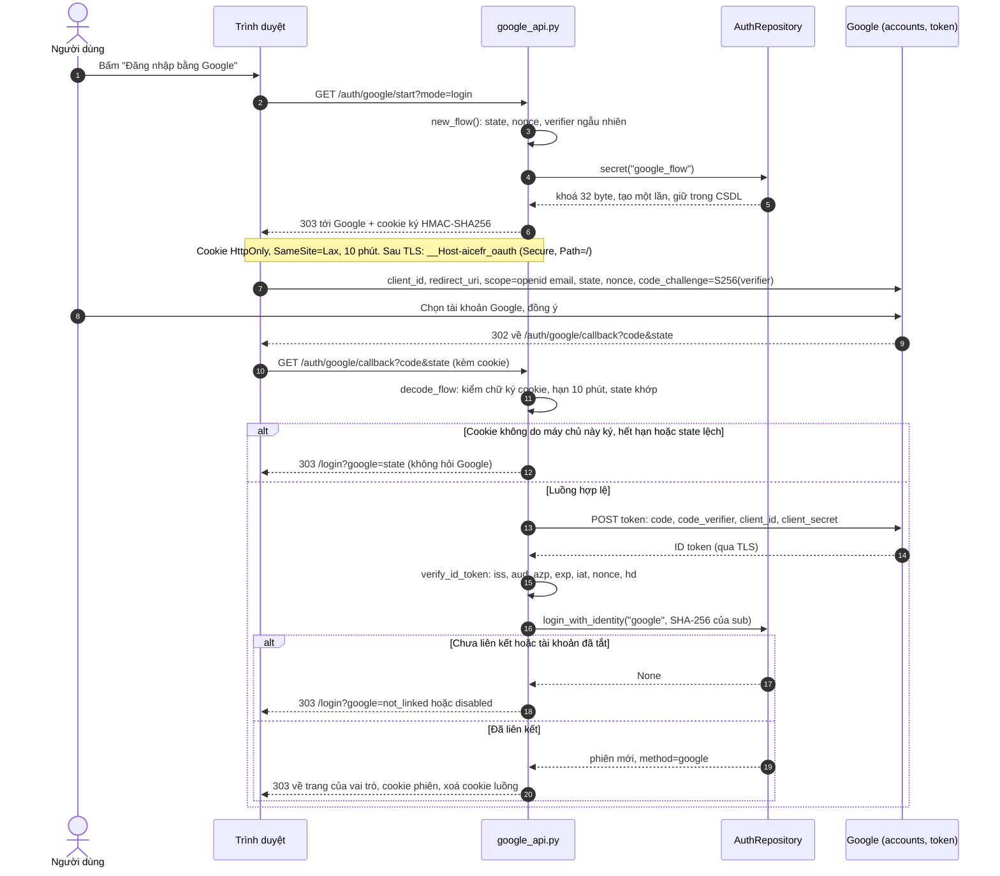

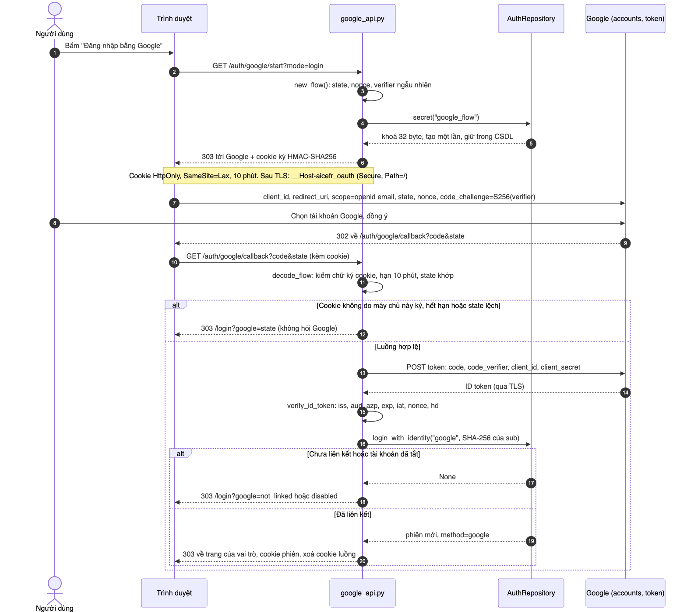

*Hình 7. Đăng nhập Google, luồng mã uỷ quyền có PKCE và cookie có chữ ký. File nguồn: `diagrams/07_sequence_google_pkce.mmd`*

**Cách đọc.** Bước 3–6 là việc của `/auth/google/start`: ba giá trị ngẫu nhiên, khoá của bản triển khai, cookie có chữ ký và chuyển hướng 303. Bước 7 cho thấy thứ duy nhất của PKCE rời máy là **thử thách** S256; verifier ở lại trong cookie HttpOnly và chỉ đi tới Google ở bước 13, qua kết nối từ máy chủ tới điểm cuối token. Khối `alt` ngoài là bất biến 8: luồng không do máy chủ viết dừng ở bước 12, trước khi Google được hỏi. Khối `alt` trong là bất biến 1 và 6 của mục 4.12: Google không tạo tài khoản, tài khoản đã tắt không vào được.

### 4.13. Module chấm mù hai người — hiện thực FR-61…FR-64 (D030)

**Vì sao module này tồn tại.** Khảo sát thực địa cần điểm người mà điểm máy chưa neo trước (`docs/plan/KE_HOACH_KHAO_SAT.md` §6.1, `docs/plan/HUONG_PHAT_TRIEN_TIEP.md` §2.1). Luồng duyệt không cho được điểm đó: màn hình duyệt (`static/review_one.js`) in điểm và band của máy, ô nhập điểm lấy chính điểm máy làm chữ gợi ý (`placeholder`), có nút "Đồng ý với kết quả AI", và hàng đợi in band máy cạnh từng bài; `apply_review` chỉ nhận bài đang `REVIEW_REQUIRED` rồi chuyển nó sang `COMPLETED`, nên giám khảo thứ hai không còn chỗ nộp. Vì vậy chấm mù là một đường riêng (ADR-08). Mục này mô tả mã tại ngày ghi và không báo con số đồng thuận nào: chưa có đợt chấm thật.

**Thành phần.**

| Thành phần | Tệp | Việc |
| --- | --- | --- |
| Chia phiếu | `src/aicefr/research/assign.py` | `sample`, `plan`, `adjudication`: hai giám khảo mỗi bài, cặp xoay vòng, thứ tự riêng cho từng người, một hạt giống |
| Độ đồng thuận | `src/aicefr/research/agreement.py` | `Rating`, `RatedResponse`, QWK, ICC(2,1) và ICC(1,1), Pearson, RMSE, recall và precision từng band, `needs_adjudication`, `reference`, `cluster_bootstrap_ci`, `agreement_report`; hàm thuần, chỉ dùng numpy |
| Kho | `src/aicefr/storage/rating_repository.py` | bốn bảng của hình 5d; `eligible`, `create_batch`, `add_adjudication`; sổ "đã xem kết quả của máy" (`saw_machine`, `seen_by`, biểu thức `_SEEN`); cách đọc cho giám khảo (`rater_view`) tách khỏi cách đọc cho phân tích (`analysis_rows`) |
| API và trang | `src/aicefr/api/rating_api.py` | trang `/rate`, `/rate/{assignment_id}`; nhóm `/api/v1/rate/*` cho giám khảo; nhóm `/api/v1/admin/ratings/*` cho quản trị viên |
| Chặn neo | `src/aicefr/api/main.py`, `src/aicefr/api/rating_api.py` | `_blind` trên năm endpoint của luồng duyệt; `review_queue` và danh sách bài của quản trị viên lọc bài đang chấm mù; `_saw` ghi ai đã mở kết quả của máy; bản xuất nghiên cứu, báo cáo và CSV của đợt chờ quản trị viên nộp xong (`_not_while_owed`) |
| Dòng lệnh | `tools/agreement_report.py` | cùng báo cáo, xuất Markdown và JSON |

**Luồng.** Quản trị viên xem `setup` (số bài đủ điều kiện, danh sách giám khảo có thể chọn) rồi tạo đợt. Giám khảo mở `/rate`, chấm từng phiếu theo thứ tự riêng; con số phiếu chưa nộp hiện trên thanh điều khiển. Quản trị viên theo dõi tiến độ từng giám khảo, giao phân xử cho bài lệch, đóng đợt, đọc báo cáo và tải CSV.

**Bất biến 1 — chỉ bài đánh giá có bản ghi, của người đã đồng ý điều khoản (FR-61, D058).** `RatingRepository.eligible` lấy bài có `purpose = 'assessment'` (bài luyện tập không phải dữ liệu đánh giá, D023), `status` là `COMPLETED` hoặc `REVIEW_REQUIRED`, `audio_path` khác NULL và tệp còn trên đĩa, và chủ bài thuộc `AuthRepository.accounts_with_terms()`; mặc định bỏ những bài đã nằm trong một đợt (`only_new`). Tập người được dùng dữ liệu được hỏi **lại** mỗi lần đọc báo cáo hay bản xuất (`analysis_rows(batch_id, allowed)`): người bị xoá dữ liệu sau khi bài đã được chấm thì bài đó ra khỏi báo cáo và CSV, và báo cáo đếm nó ở `withdrawn`. Test: `test_a_batch_gives_every_eligible_response_two_raters_each_in_their_own_order`.

**Bất biến 2 — hai giám khảo khác nhau cho mỗi bài, tải đều, thứ tự riêng, tái lập được từ một hạt giống (FR-61).** `assign.plan` từ chối khi có dưới hai giám khảo. Nó xáo danh sách bài và danh sách mọi cặp giám khảo, giao bài thứ *i* cho cặp thứ *i* mod số cặp — hai giám khảo thì cả hai chấm mọi bài, nhiều hơn thì tải chia đều và các cặp gặp nhau xấp xỉ như nhau — bốc thăm ai giữ `slot` 1, ai giữ `slot` 2, rồi xáo thứ tự riêng của từng giám khảo. Mọi phép bốc đi từ **một** `random.Random(seed)`; hạt giống do quản trị viên nhập hoặc sinh bằng `secrets.randbelow(2**31)`, lưu ở `rating_batch.seed` và trong dòng kiểm toán `rating.batch_create`, nên cùng tập bài, cùng giám khảo, cùng hạt giống cho cùng một kế hoạch. Giám khảo phải là tài khoản giảng viên hoặc quản trị viên đang bật, không thì 422. `create_batch` truyền cho `plan` danh sách người đã xem kết quả của máy về từng bài (`seen_by`, bất biến 4b): bài đó đi tới cặp kế tiếp không có người ấy; không còn cặp nào thì bài ra khỏi đợt và được đếm ở `skipped_seen`; không còn bài nào thì 422. Không có ai bị loại thì kế hoạch đúng như hạt giống vẫn cho trước đây. Ở tầng CSDL, hai ràng buộc `UNIQUE` của `rating_assignment` chặn việc một chỗ chấm của một bài có hai người, hay một người chấm cùng một bài hai lần trong một đợt. Test: `tests/test_assign_unit.py`, `test_a_batch_needs_two_raters_and_something_to_rate`, `test_a_teacher_who_opened_the_machine_result_is_not_drawn_to_rate_that_response`.

**Bất biến 3 — phiếu mù: không bút danh, không mã bài, không điểm máy, không điểm người khác (FR-62).** `_sheet` dựng phiếu **từng trường một**, không chuyển tiếp gì: mã phiếu, tên và trạng thái mở của đợt, vị trí và tổng số phiếu, cờ phân xử, đề bài (tên, nội dung, thời lượng), `audio_url`, và điểm của chính giám khảo nếu đã nộp. `rater_view` có trả `response_id` và `audio_path`, nhưng chỉ để máy chủ dùng — tra đề, phát tệp. Bản ghi phát qua `/api/v1/rate/assignments/{assignment_id}/audio` với tên tệp trung tính `bai-{position}.wav`, và mỗi lần nghe ghi `AUDIO_ACCESS` với chi tiết `blind_rating`. Phiếu của người khác trả 404 chứ không phải 403, để không xác nhận rằng phiếu đó tồn tại. Phiếu phân xử mù như mọi phiếu. Test: `test_the_rating_sheet_carries_no_pseudonym_response_id_or_machine_score` ghim tập khoá của phiếu và dò trong JSON mã bài, bút danh, điểm và band của máy, `assessment`, `evidence`, `comments`, `overall_0_6`; `test_a_rater_cannot_open_another_raters_sheet`.

**Bất biến 4 — đường vòng cũng đóng: chống neo (FR-62).** Trong lúc một giảng viên còn nợ một phiếu mù về một bài, trong một đợt đang mở (`RatingRepository.has_open`; "nợ" là chưa nộp và chưa xem kết quả của máy, bất biến 4b), `_blind` trong `main.py` trả 403 cho chính người đó ở năm endpoint cho thấy kết quả của máy hoặc dùng để ra quyết định trên bài: `GET /api/v1/responses/{id}`, `GET /api/v1/responses/{id}/history`, `POST /api/v1/review/{id}/lock`, `POST /api/v1/review/{id}`, `POST /api/v1/review/{id}/close`; `review_queue` bỏ khỏi hàng đợi của họ mọi bài trong `blinded_responses`. Quản trị viên cũng có thể là giám khảo, nên màn quản trị chịu cùng luật: `GET /api/v1/responses` bỏ những bài đó như hàng đợi; bản xuất nghiên cứu, báo cáo và CSV của đợt có bài đó trả 409 cho tới khi nộp xong — từ chối chứ không bớt dòng, vì một bản xuất lặng lẽ thiếu dòng tệ hơn một bản xuất phải chờ. Con số `queue` trên thanh điều khiển (`count_waiting_review(exclude=…)`) trừ những bài bị che, để khớp số dòng người đó thấy. Nộp phiếu xong thì mọi thứ mở lại. Test: `test_the_machine_result_stays_closed_to_a_rater_until_they_have_rated`, `test_an_administrator_who_rates_stays_blind_on_the_administration_screens`, `test_the_waiting_count_leaves_out_what_the_teacher_rates_blind`.

**Bất biến 4b — đã xem kết quả của máy là hết mù với bài đó (BR-27; FR-61, FR-62, FR-63).** Bảng `machine_seen (account_id, response_id)` ghi lần đầu một giảng viên hay quản trị viên mở báo cáo (`report`), lịch sử (`history`) hoặc màn duyệt (`review`, lúc nhận khoá) của một bài, qua `_saw` gọi ngay sau `_blind`; sinh viên không bao giờ là giám khảo nên không được ghi. Cùng với tác giả các quyết định duyệt (`review_action.reviewer_id`, đã có từ trước khi bảng này tồn tại), nó trả lời câu hỏi "ai không còn mù với bài này" — biểu thức `_SEEN` trong `rating_repository.py`. Hệ quả: (1) không ai được giao chấm mù hay phân xử bài mà mình đã xem (`seen_by` trong `create_batch` và `add_adjudication`, bỏ qua được đếm ở `skipped_seen`); (2) phiếu đang nợ của người đã xem không nhận điểm nữa — `submit` kiểm `_SEEN` trong cùng giao dịch và ném `SeenMachine` (409), phiếu hiện trạng thái `seen` ("không còn mù"), không tính vào `open_count`, không còn che bài khỏi hàng đợi, và danh sách đợt đếm nó ở `voided`. Đây là thứ đóng lỗ "đóng đợt, xem điểm máy, mở lại đợt": đóng đợt vẫn gỡ chặn để luồng duyệt chạy tiếp, nhưng ai đã xem trong lúc đó thì phiếu của họ không còn được nhận. Danh sách (hàng đợi, danh sách bài) và bản xuất in band hay điểm của nhiều bài mà không phát bản ghi bên cạnh; chúng bị che hay từ chối trong lúc còn nợ phiếu, nhưng không được tính là "đã xem" — tính vào thì gần như mọi bài chờ duyệt sẽ mất hết giám khảo, và nhóm bài máy chuyển giảng viên mà RQ4 cần so sánh sẽ rỗng. Test: `test_a_teacher_who_opened_the_machine_result_is_not_drawn_to_rate_that_response`, `test_a_sheet_goes_void_once_its_rater_has_seen_the_machine_result`, `test_an_adjudicator_who_opened_the_machine_result_is_passed_over`, `test_a_rater_who_has_seen_the_machine_result_never_gets_that_response`.

**Bất biến 5 — phiếu đã nộp là cuối cùng, và không chạm luồng duyệt (FR-62).** `research_rating.assignment_id` là khoá chính, nên lần nộp thứ hai vi phạm ràng buộc và `submit` đổi lỗi đó thành `AlreadyRated` (409); không có lệnh `UPDATE` hay `DELETE` nào trên bảng này. Đợt đã đóng không nhận phiếu (409). `_to_rating` giữ luật phiếu chấm ở phụ lục B của kế hoạch khảo sát: chấm được thì cần điểm tổng, band và đủ năm tiêu chí, mỗi điểm trong 0–6 theo bước 0,5, cùng một dòng lý do từ 3 ký tự (tối đa 300); không chấm được thì cần một lý do trong `broken`, `inaudible`, `off_task` và không được có điểm nào. `Rating.__post_init__` kiểm lại các luật đó ở tầng hàm thuần. `RatingRepository` chỉ **đọc** `response` và `review_action`, nên `teacher_verified` và lịch sử duyệt không đổi vì chấm mù. Test: `test_a_rating_follows_the_rating_sheet_rules`, `test_an_unscorable_recording_is_rated_as_such`, `test_open_sheets_are_counted_in_the_sidebar_and_a_closed_batch_takes_no_more`.

**Bất biến 6 — phân xử theo một luật, và không ai phân xử bài mình đã chấm (FR-63).** `needs_adjudication` trả đúng khi hai điểm tổng lệch từ 1,0 trở lên (có dung sai 1e-9, để 4,1 − 3,1 vẫn tính là 1,0), khi hai band khác nhau, hoặc khi đúng một trong hai người thấy bài không chấm được. `add_adjudication` tạo phiếu `slot` 3 cho mọi bài cần phân xử chưa có người thứ ba, bỏ qua và đếm (`skipped_own`) những bài người phân xử đã chấm ở vai giám khảo chính, và (`skipped_seen`) những bài họ đã xem kết quả của máy, xếp thứ tự riêng tiếp sau các phiếu sẵn có của họ, với hạt giống `seed + 1`. Test: `test_a_disagreement_goes_to_a_third_rater_who_did_not_rate_it`, `test_needs_adjudication`.

**Bất biến 7 — điểm đối chiếu và điểm máy là những thứ đã định nghĩa trước (FR-64).** `reference` làm theo §6.5 của kế hoạch khảo sát: không cần phân xử thì lấy trung bình hai điểm tổng; đã phân xử thì lấy trung vị ba điểm và trung vị thứ bậc của sáu band (A1 < A2 < B1 < B2 < C1 < C2, D059); còn chờ người thứ ba thì là `pending` và bị loại khỏi mọi chỉ số máy–người; hai người cùng thấy không chấm được thì là `unscorable`. Điểm máy là kết quả **trước** mọi quyết định của giảng viên (biểu thức `_MACHINE`, mục 3.5b), và chỉ được nhận khi đủ cả điểm trong 0–6 lẫn một trong sáu band; thiếu thì bài được đếm là không có điểm máy chứ không bị đoán. Test: `test_the_report_puts_humans_first_and_compares_the_machine_before_any_review` — RMSE tính so với điểm của máy, không so với điểm giảng viên đã sửa.

**Bất biến 8 — người với người đứng trước máy với người, và mỗi chỉ số nói nó dựa trên bao nhiêu bài (FR-64).** `agreement_report` trả các khoá theo đúng thứ tự `counts`, `human_human`, `machine_human`, `routing`, `notes`, `bootstrap`. Khối người–người gồm kappa trọng số bậc hai trên band, tỷ lệ trùng band, kappa trên điểm tổng làm tròn tới nửa điểm (giữa hai mức thì làm tròn lên), ICC(2,1) khi cùng một cặp chấm mọi bài và ICC(1,1) khi cặp thay đổi, Pearson, chênh lệch tuyệt đối trung bình, Pearson từng tiêu chí, ma trận nhầm lẫn. Khối máy–người gồm Pearson, RMSE, kappa band, ma trận nhầm lẫn, recall và precision từng band, và số bài theo từng loại điểm đối chiếu. Khối `routing` (RQ4) so sai số tuyệt đối trung bình của nhóm bài máy đã chuyển giảng viên với nhóm còn lại. Khoảng tin cậy 95% là bootstrap phân vị lấy mẫu lại **theo người nói** (2000 vòng, hạt giống 20261007), vì hai bài của cùng một sinh viên không độc lập với nhau; dưới ba người nói, hoặc khi quá nửa số vòng cho chỉ số không xác định, thì không có khoảng. Chỉ số không xác định là `None` kèm một dòng giải thích trong `notes`, không bao giờ là NaN hay một số thay chỗ. Màn hình hiện mốc của kế hoạch (`PLAN_TARGETS`: kappa band 0,70, ICC 0,75) cạnh giá trị đo như mốc tham khảo chưa ký, không phải kết luận. Test: `tests/test_agreement.py`, `test_the_command_line_report_gives_the_numbers_of_the_screen`.

**Bất biến 9 — xoá dữ liệu người học thì xoá luôn phiếu về bài của họ (FR-64).** Bốn bảng đi theo `response` bằng `ON DELETE CASCADE`; chi tiết ở mục 5.4. Test: `test_erasing_a_participant_erases_what_raters_said_about_them`.

**Bản xuất và nhật ký.** CSV của một đợt có một dòng cho mỗi phiếu đã nộp, với bút danh người học và bút danh giám khảo, điểm từng tiêu chí, thời điểm mở và nộp, điểm máy trước mọi quyết định và cờ `flagged`; bài của người đã rút đồng thuận bị bỏ ra. Nhật ký ghi `rating.batch_create` (số bài, số giám khảo, hạt giống), `rating.submit` (không kèm điểm), `AUDIO_ACCESS` (`blind_rating`), `rating.adjudicate`, `rating.batch_close`, `rating.batch_reopen`, `rating.report` và `export.ratings`.

**Giới hạn đã biết của mã tại ngày ghi.** Ghi ở đây thay vì để hội đồng tự tìm. Bốn chỗ hở mà lần đối chiếu đầu của bản 1.3 tìm ra — chặn chỉ bắt đầu khi bài vào đợt; đóng rồi mở lại đợt nhận phiếu đã bị neo; màn quản trị không qua `_blind`; con số chờ duyệt đếm cả bài bị che — đã sửa ở bất biến 4 và 4b (TEST_PLAN_D030, D030-B6..B9). Còn lại:

1. Sổ `machine_seen` chỉ biết những lần mở **từ khi nó có**. Trước đó chỉ quyết định duyệt để lại dấu, nên một giảng viên từng mở báo cáo mà không duyệt vẫn có thể được giao chấm mù bài đó.
2. "Đã xem" là mở báo cáo, lịch sử, màn duyệt hoặc đã duyệt. Người chỉ lướt hàng đợi hay danh sách bài trước khi có đợt — thấy band của nhiều bài, không nghe bản ghi — vẫn được giao (bất biến 4b giải thích vì sao).
3. Phiếu "không còn mù" không tự được bù: quản trị viên phải giao lại (`POST …/batches/{id}/replace`, `RatingRepository.replace_void`) cho một giám khảo chưa chấm và chưa xem bài đó, ở đúng chỗ chấm cũ; phiếu cũ không có điểm nên được xoá. Trước khi giao lại, bài đó chỉ có một phiếu và báo cáo bỏ nó ra (chỉ dùng bài đủ hai phiếu).
4. Việc chặn và ghi vẫn là danh sách liệt kê tay: endpoint mới nào cho thấy kết quả máy mà quên gọi `_blind` và `_saw` sẽ mở lại đường vòng (ADR-08).

---

### 4.14. Module thành tựu và nhịp luyện — hiện thực FR-65, FR-66 (D032)

**Vì sao module này tồn tại.** Mục tiêu ngày và chuỗi ngày của D023 giữ được thói quen trong vài ngày đầu nhưng không cho người học thấy những gì họ đã tích luỹ. Các ứng dụng học hiện nay bù chỗ đó bằng thành tựu, kỷ lục và bảng xếp hạng; module này lấy hai thứ đầu và bỏ thứ ba, đồng thời không để thành tựu nào đọc điểm hay band (BR-28, ADR-10).

**Thành phần.**

| Thành phần | Tệp | Việc |
| --- | --- | --- |
| Danh mục và dữ kiện | `src/aicefr/practice/achievements.py` | `Take` (một lượt luyện như thành tựu cần), `Facts` (mười một con số công sức), `count` (đếm từ các lượt, ngày theo giờ Việt Nam), `CATALOG` (17 `Achievement` trong 5 nhóm `GROUPS`), `standings`, `reached`, `nearest`; hàm thuần, không đọc CSDL |
| Chuỗi ngày | `src/aicefr/practice/streak.py` | `streak_length` nay đi qua `_walk`, hàm trả cả độ dài lẫn những ngày nghỉ đã dùng; thêm `rest_days` và `longest_streak` |
| Hôm nay | `src/aicefr/lessons/progress.py` | `seconds_per_day`; `Today` thêm `best_streak`, `rest_days`, `week_seconds`, `last_week_seconds` |
| Kho | `src/aicefr/storage/lesson_repository.py` | bảng `achievement`; `achievements`, `unlock` (`INSERT OR IGNORE`, trả mã thật sự vừa lưu), `mark_seen`; `erase_account` xoá theo |
| API | `src/aicefr/api/lessons_api.py` | `_takes`, `_completed` (bài và chặng xong trên mọi lộ trình đã xuất bản), `_facts`, `_award`, `_just_reached`, `_achievement_view`, `_achievement_summary`; route `GET /api/v1/me/achievements`, `POST /api/v1/me/achievements/seen`; `learn_home`, `learn_attempt`, `learn_review_attempt` trả thêm khối thành tựu |
| Giao diện | `static/practice_path.js` (`todayCard`, `achievementsCard`, `fitSide`), `static/my_progress.js` (`achievementList`), `static/lesson.js` (`celebrate`) | thẻ Hôm nay, thẻ Thành tựu, danh sách ở trang Tiến độ, thông báo sau lượt nói |

**Luồng.** Mỗi lần người học ghi một lượt (`learn_attempt`, `learn_review_attempt`), mở trang Luyện tập (`learn_home`) hay mở danh sách (`my_achievements`), `_award` đọc mọi lượt của tài khoản, đếm `Facts`, so `reached(facts)` với những mã đã lưu và lưu phần chênh. Lượt luyện trả về những mã **chính lần gọi đó** lưu được, nên hai yêu cầu đồng thời không chúc mừng hai lần. Thành tựu không tính sẵn theo lịch: không có tác vụ nền nào, và một thành tựu đến từ bài đánh giá xử lý ở hàng đợi sẽ hiện ở lần mở trang kế tiếp.

**Bất biến.**

1. **Chỉ công sức.** `Facts` có đúng mười một trường, không trường nào là điểm, band, tỷ lệ đạt hay số liệu của người khác; mọi `measure` của danh mục chỉ đọc `Facts`. Số bài đánh giá là **số bài có kết quả** (`Repository.progress_series`), không phải điểm của chúng. `test_no_achievement_reads_a_score_a_band_or_anyone_else` giữ điều này.
2. **Chỉ lượt máy đo được tiếng nói.** Lượt im lặng, sai ngôn ngữ hay bị từ chối có `speaking_s = 0` và không vào bất kỳ con số nào — giống mục tiêu ngày của D023.
3. **Đã đạt thì giữ.** Danh sách lấy trạng thái "đã đạt" từ bảng `achievement`, không tính lại từ lượt luyện; ô đã đạt luôn ghi giá trị bằng mức cần. Xoá lượt, sửa nhận định của giáo viên, đổi mục tiêu ngày hay lưu trữ dọn bản ghi đều không lấy lại thành tựu.
4. **Ngày Việt Nam, mục tiêu của chính người học.** Ngày lấy qua `local_day` (UTC+7), mục tiêu từ `account.daily_goal_s`.
5. **Không ai khác đọc được.** Hai route chỉ trả dữ liệu của người gọi; không màn hình giảng viên hay quản trị nào đọc bảng `achievement`.
6. **Không để thành tựu làm hỏng lượt luyện.** `_just_reached` chạy sau khi lượt đã lưu và nuốt lỗi kèm ghi log: một lỗi ở đây không được biến lượt đã ghi thành lỗi 500 khiến người học ghi lại.

### 4.15. Module gói dịch vụ và thanh toán — hiện thực FR-67…FR-70 (D034)

**Vì sao module này tồn tại.** Chủ dự án cần một cơ chế mua gói để sản phẩm có đường vận hành bền vững. Phân tích ở `docs/plan/DE_XUAT_GOI_DICH_VU.md` (D033) cho thấy bên mua tự nhiên là trường: hệ thống đã không cho tự đăng ký (BR-03), chỉ biết bút danh (BR-02) và không được đặt người tham gia khảo sát vào hai mức khác nhau. Module này bán gói cho trường; sinh viên không thấy gì của nó.

**Thành phần.**

| Thành phần | Tệp | Việc |
| --- | --- | --- |
| Luật gói | `src/aicefr/billing/plans.py` | `Plan` (Miễn phí, Dùng thử, Chuẩn, Nâng cao), `PlanFeature` (ba công cụ của giảng viên), `License`, `Standing` và `standing` (gói đang dùng theo ngày, ân hạn, về Miễn phí), `Quote` và `quote` (mua mới, gia hạn, nâng cấp có trừ phần chưa dùng, hạ gói, giảm theo năm, phần miễn), `add_months`; hàm thuần |
| Mã giấy phép | `src/aicefr/billing/keys.py` | `issue`, `read`: `AICEFR1.<nội dung>.<HMAC-SHA256>` cho hợp đồng trả ngoài hệ thống |
| Đơn và kết quả | `src/aicefr/billing/payments.py` | `OrderStatus`, `PaymentResult` (chỉ mã giao dịch, mã kết quả, mã ngân hàng, thời điểm — BR-32) |
| Cổng thanh toán | `src/aicefr/ports.py` (`PaymentGateway`), `src/aicefr/billing/gateways.py` | `SandboxGateway`: trang thanh toán ngay trong ứng dụng, ký kết quả như cổng thật, không có tiền; `VnpayGateway`: địa chỉ thanh toán ký HMAC-SHA512 theo VNPay 2.1.0, kiểm chữ ký của kết quả trả về và thông báo, bảng mã kết quả, trả lời thông báo theo dạng VNPay chờ. Từ D035 thêm `StripeGateway`, `MomoGateway` và nhiều cổng một lúc — mục 4.16 |
| Dịch vụ | `src/aicefr/billing/service.py` | `BillingService`: bắt đầu dùng thử một lần, gói đang dùng, mức đang dùng (bỏ người đồng thuận nghiên cứu), `check_new_students`, `require`, báo giá, đặt đơn, `settle` (một lần, đúng số tiền), cài mã, bảng so sánh cho màn hình |
| Kho | `src/aicefr/storage/billing_repository.py` | bốn bảng `billing_*`; `start_trial` và `settle` trong một giao dịch có điều kiện trạng thái |
| API và trang | `src/aicefr/api/billing_api.py` | tab quản trị, API gói cho giảng viên, địa chỉ thông báo của cổng, trang kết quả, trang cổng thử, biên nhận |
| Chỗ áp gói | `accounts_api.py` (`_seats`), `lessons_api.py` (`AUTHORING`, `_plan_allows`), `rating_api.py` (`create_batch`), `main.py` (`cohort_stats`) | số sinh viên; soạn lộ trình; thống kê lớp và theo dõi bài học; tạo đợt chấm mù |
| Giao diện | `static/admin_billing.js`, `templates/billing_*.html`, `static/teach_paths.js`, `static/teach_insights.js` | bảng so sánh, mua, đơn hàng, biên nhận; lời báo gói ở trang soạn bài và trang thống kê |

**Luồng mua.** Quản trị viên chọn gói, số sinh viên, thời hạn → báo giá (`quote`) → đặt đơn (đơn chờ 15 phút, thay đơn đang chờ, ghi nhật ký) → trình duyệt tới trang của cổng → cổng gọi `/api/v1/billing/notify/{cổng}` từ máy chủ của nó và đưa trình duyệt về `/billing/return/{cổng}` → cả hai đường gọi `gateway.verify` rồi `settle`; `settle` đổi trạng thái đơn và cài giấy phép trong một giao dịch có điều kiện, nên đường nào tới trước thì ghi nhận, đường sau không đổi gì → biên nhận.

**Bất biến.**

1. **Không chạm việc học.** `PLAN_FEATURES` chỉ chứa công cụ của giảng viên; không route nào của người học gọi tới module này. Tắt thu phí thì mọi kiểm tra đều qua và không bảng nào được ghi.
2. **Chỉ chặn việc mới.** Giới hạn sinh viên chỉ ở tạo, bật lại, đổi vai trò sang sinh viên; công cụ của gói chỉ chặn soạn lộ trình, xem thống kê, tạo đợt chấm mù mới; lộ trình đã xuất bản, đợt đã tạo, báo cáo và bản xuất vẫn mở.
3. **Một kết quả, một lần.** `settle` chỉ áp kết quả đúng chữ ký và đúng số tiền, chỉ từ trạng thái chờ hoặc hết hạn chờ; mọi thông điệp có chữ ký về một đơn được lưu ở `billing_event` kèm cờ đã áp dụng.
4. **Không dữ liệu thanh toán cá nhân.** Không bảng nào có số thẻ, tài khoản ngân hàng hay tên người trả.
5. **Cổng thử không bán thật.** Ai có địa chỉ trang cổng thử thì đánh dấu được đơn đã trả; tab quản trị luôn hiện cảnh báo khi cổng là cổng thử.

### 4.16. Nhiều cổng thanh toán: Stripe và MoMo — hiện thực FR-71…FR-73 (D035)

**Vì sao có mục này.** Chủ dự án muốn dùng Stripe vì Stripe có môi trường thử đầy đủ, và để ngỏ MoMo, VNPay "cho đa dạng". Stripe khác VNPay ở chỗ cốt lõi: không có gì được ký vào địa chỉ của trình duyệt. Hệ thống phải gọi API của Stripe để **mở** phiên thanh toán, và khi trình duyệt quay về chỉ mang theo mã phiên — một lời khai, không phải bằng chứng — nên phải gọi API lần nữa để **đọc lại** phiên. Cổng `PaymentGateway` của D034 (`checkout_url` trả chuỗi, `verify` đọc tham số địa chỉ) không chứa được cách làm đó, nên được đổi hình. D034 chưa phát hành, nên đổi thẳng, không giữ tên cũ.

**Cổng `PaymentGateway` sau D035.**

| Thành phần | Việc |
| --- | --- |
| `name`, `title`, `methods`, `live`, `note` | Tên trong địa chỉ và trên đơn; tên quản trị viên đọc; cách người trả trả tiền; **có tiền thật hay không**; cách trả ở môi trường thử. `live` của VNPay và MoMo suy từ địa chỉ (địa chỉ thử thì không), của Stripe suy từ khoá (`sk_test_` thì không) |
| `checkout(...) -> Checkout` | Địa chỉ trang của cổng và mã của cổng cho lần thanh toán (mã Checkout Session của Stripe, lưu ở `billing_order.checkout_ref`). Nhận cả địa chỉ trả về lẫn địa chỉ thông báo, vì MoMo cần địa chỉ IPN trong từng yêu cầu. Cổng từ chối thì ném `GatewayError` với câu tiếng Việt và mã của cổng; `place_order` ghi đơn không thành công rồi báo `PaymentUnavailable` (502) |
| `return_reference(query)` | Mã phiên mà địa chỉ trả về nêu, khi kết quả phải hỏi lại cổng (Stripe); `None` khi địa chỉ tự mang kết quả có chữ ký. Trang trả về chỉ hỏi Stripe khi mã đó là của một đơn (`order_by_checkout`) — người ngoài không tiêu được hạn mức gọi API của hệ thống bằng mã bịa |
| `verify_return(query)` | Kết quả trình duyệt mang về; có thể gọi cổng và ném `GatewayError` khi không gọi được — trang khi đó nói "chưa xác nhận được", không nói thất bại |
| `verify_notification(Incoming, now)` | Kết quả máy chủ của cổng gửi: `Incoming` giữ nguyên tham số, tiêu đề và **byte thân** như đã nhận, vì chữ ký của Stripe là trên byte thân. GET cho IPN của VNPay, POST cho webhook của Stripe và IPN của MoMo, cùng một đường dẫn `/api/v1/billing/notify/{cổng}`, thân tối đa 256 KiB |
| `acknowledge(what) -> Ack` | Câu trả lời từng cổng chờ: VNPay và cổng thử luôn 200 kèm `RspCode`; Stripe 200, 400 khi sai chữ ký, 500 khi hệ thống lỗi để Stripe gửi lại; MoMo 204 không thân (tài liệu của MoMo yêu cầu 204 trong 15 giây) |

**Bộ chuyển đổi mới.**

| Bộ chuyển đổi | Tệp | Cách làm |
| --- | --- | --- |
| `StripeGateway` | `src/aicefr/billing/stripe_gateway.py` | `POST /v1/checkout/sessions` dạng form: `mode=payment`, một dòng hàng `price_data` VND với `unit_amount` bằng đúng số đồng (VND không có đơn vị lẻ), mã đơn ở `client_reference_id`, `metadata[order_id]` và metadata của PaymentIntent, `success_url` có `{CHECKOUT_SESSION_ID}`, `cancel_url` có `left=1`, `expires_at` sau 31 phút (Stripe nhận 30 phút tới 24 giờ), `locale=vi`, `Idempotency-Key: aicefr-<mã đơn>`. Đọc lại: `GET /v1/checkout/sessions/{id}`, chỉ tin `payment_status`, `amount_total`, `currency` của phiên. Webhook: tách `t` và mọi `v1` của `Stripe-Signature`, HMAC-SHA256 trên `<t>.<thân>` theo khoá `whsec_`, so bằng `compare_digest` với từng `v1`, lệch giờ tối đa 300 giây, bỏ sự kiện có `livemode` khác chế độ của khoá |
| `MomoGateway` | `src/aicefr/billing/momo_gateway.py` | `POST /v2/gateway/api/create` dạng JSON, `requestType=captureWallet`, chữ ký HMAC-SHA256 trên chuỗi `accessKey=…&amount=…&extraData=…&ipnUrl=…&orderId=…&orderInfo=…&partnerCode=…&redirectUrl=…&requestId=…&requestType=…`; số tiền ngoài 1.000–50.000.000 đ bị từ chối trước khi gọi. Kết quả (địa chỉ trả về và IPN) ký trên `accessKey … transId` theo thứ tự MoMo công bố; kiểm thêm mã đối tác |
| Gọi HTTPS | `src/aicefr/billing/transport.py` | `urllib.request`, hết giờ 15 giây, chỉ `https://`, **không đi theo chuyển hướng** (urllib sẽ mang `Authorization: Bearer sk_…` tới bất cứ máy nào chuyển hướng chỉ tới); mã lỗi HTTP và mã 3xx là một câu trả lời, không phải ngoại lệ; mất kết nối là `Unreachable`. Bộ chuyển đổi nhận `transport` qua hàm dựng, nên test thay bằng hàm giả mà không chạm mạng |
| Dựng từ cấu hình | `src/aicefr/billing/registry.py` (`build_gateways`) | Đọc `AICEFR_PAYMENT_GATEWAYS` theo thứ tự; mỗi cổng thiếu khoá, sai dạng hay tên lạ thành một câu lý do hiện trên tab; tên lặp bỏ qua; cổng `live` cần `AICEFR_PAYMENTS_LIVE`; có cổng thật thì bỏ mọi cổng ở môi trường thử |

**Bất biến 6 — một cổng chỉ ghi nhận đơn của chính nó, ở đúng chế độ tiền, về đúng phiên.** `settle(result, via, gateway)` so `order.gateway` với cổng đã ký kết quả, `order.live` với chế độ hiện tại của cổng, và `order.checkout_ref` với `result.checkout` (mã phiên Stripe, mã yêu cầu MoMo); lệch bất cứ điều nào thì ghi sự kiện `rejected` và trả `not_found`. Không có điều thứ nhất, một chữ ký hợp lệ của cổng thử — cổng mà ai giữ địa chỉ trang cũng bấm được "thành công" — sẽ đủ để đánh dấu một đơn Stripe đã trả; không có điều thứ hai, một khoá đổi từ thật sang thử cho phép trả đơn thật bằng thẻ thử; không có điều thứ ba, một phiên do tích hợp khác trên cùng tài khoản Stripe mở, mang mã đơn này, trả được đơn này. Test: `test_one_gateway_cannot_settle_another_gateways_order`, `test_the_stripe_webhook_alone_installs_the_plan`.

**Bất biến 7 — tiền thật không bao giờ là mặc định.** Mỗi cổng mặc định ở môi trường thử của nó; cổng có `live` chỉ được dựng khi bật `AICEFR_PAYMENTS_LIVE`, và khi có thì **mọi** cổng ở môi trường thử bị bỏ — không chỉ cổng thử trong ứng dụng: Stripe khoá thử cạnh trang thật của VNPay sẽ bán gói thật lấy thẻ thử. Bản đầu chỉ bỏ cổng thử; lần rà bảo mật độc lập trước khi merge chỉ ra chỗ hở này. Đơn ghi `live` lúc đặt, nên biên nhận của một đơn trả ở môi trường thử vẫn ghi "môi trường thử" dù sau này khoá đã đổi. Test: `test_real_money_is_never_a_default`, `test_real_money_needs_to_be_switched_on`.

**Bất biến 8 — kết quả chưa xong không đổi gì.** Kết quả `PENDING` (Stripe trước khi một phương thức chậm hoàn tất, MoMo 1000, 7000, 7002, 9000) được lưu như một sự kiện với `applied=false` và `settle` trả `pending`; đơn vẫn có thể được ghi nhận khi kết quả cuối tới. Sự kiện Stripe không nói về một Checkout Session được nhận 200 rồi bỏ. Test: `test_stripe_events_count_only_when_signed_and_fresh`, `test_momo_results_map_to_outcomes_and_forgeries_are_refused`.

**Bất biến 10 — phát lại không tốn gì của hệ thống.** Địa chỉ trả về và thông báo có chữ ký có thể bị ai giữ được nó gửi lại: trang trả về của một đơn Stripe đã xong hiện từ CSDL mà không gọi Stripe; một thông điệp y hệt thông điệp đã lưu được đếm trên dòng của nó (`billing_event.repeats`, `last_at`, chỉ mục duy nhất trên đơn, loại và nội dung) thay vì thêm dòng; thân thông báo bị từ chối khi `Content-Length` hay số byte đã nhận vượt 256 KiB, trước khi giữ hết trong bộ nhớ; tiêu đề, chữ ký hay thân sai dạng — ký tự không phải ASCII, chữ số lạ, JSON lồng quá sâu — cho ra "không có chữ ký" chứ không phải lỗi 500. Test: `test_paying_through_stripe_is_read_back_and_counted_once`, `test_the_stripe_webhook_alone_installs_the_plan`, `test_stripe_events_count_only_when_signed_and_fresh`, `test_momo_results_map_to_outcomes_and_forgeries_are_refused`.

**Bất biến 9 — không giữ gì của người trả.** Stripe giữ email và tên người trả trong `customer_details` của phiên; `StripeGateway` không đọc trường đó, `PaymentResult.details` chỉ có mã phiên. MoMo chỉ để lại `payType` và `responseTime` (BR-32). Test: `test_stripe_return_is_read_back_from_stripe`.

File: `docs/sdd/diagrams/08_sequence_stripe.mmd`

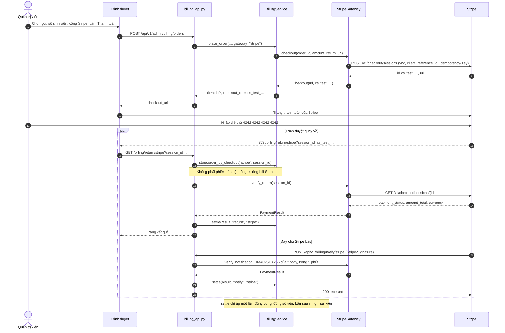

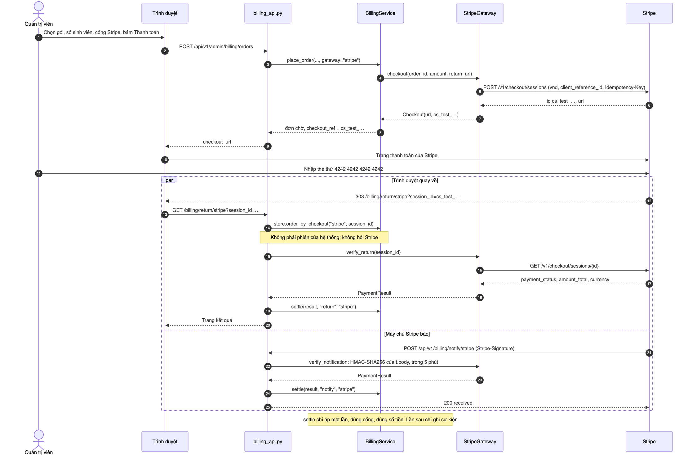

*Hình 8. Thanh toán qua Stripe Checkout ở chế độ thử. File nguồn: `diagrams/08_sequence_stripe.mmd`*

**Cách đọc.** Bước 4–8 khác VNPay: hệ thống gọi Stripe **trước** khi chuyển trình duyệt, và giữ mã phiên vào đơn. Khối `par` là hai đường báo kết quả chạy độc lập, đường nào tới trước cũng được: trình duyệt quay về với mã phiên (bước 12–20; ghi chú ở bước 14 là bất biến chỉ-hỏi-phiên-của-mình), và webhook có chữ ký (bước 21–25). Ghi chú cuối là bất biến 3 của mục 4.15 cộng bất biến 6 ở trên: `settle` áp một lần, đúng cổng, đúng số tiền; lần sau chỉ thêm sự kiện.

### 4.17. Bằng chứng học tập — hiện thực FR-75…FR-80 (D039–D042)

**Vì sao có mục này.** Bốn yêu cầu này đo những điều hệ thống trước đó chỉ khẳng định. Cả bốn là **hàm thuần** đặt cạnh nhau ở `research/` và `pronunciation/`; kho lưu và API chỉ gom dữ liệu rồi gọi chúng, nên mỗi con số kiểm được bằng test tầng 1 không cần CSDL.

| Thành phần | Tệp | Việc |
| --- | --- | --- |
| Luật năm lỗi | `pronunciation/vietnamese.py` | `opportunities(word)`, `classify(expected, said)`, `profile(attempts)`; phiên bản `vi-pron-v1`; `lessons/checks.py` gắn `WordMark.pattern` lúc chấm bước |
| Thực nghiệm phản hồi | `research/study.py`, `storage/study_repository.py`, `api/study_api.py` | `assign_arms`, `pre_post`, `bootstrap_difference`, `hedges_g`, `analyse`; ba bảng `study`, `study_participant`, `study_survey`; `gate_report` được `get_report` gọi trước khi trả báo cáo |
| Thời gian giảng viên | `research/teacher_time.py`, `storage/repository.py` | `session_minutes`, `wilson`, `kpi`; bảng `review_session` mở khi khoá bài, đóng khi quyết định hay đóng bài; `settled_counts` |
| Tiến bộ đáng tin | `research/reliable_change.py` | `retest_pairs`, `sem_from_pairs`, `reliable_change`; SEM đang dùng ở khoá cấu hình `measurement_error` |

**Bất biến.** (1) Phản hồi của nhóm "Chỉ điểm" bị bỏ ở máy chủ, chỉ cho chính người học, chỉ bài đánh giá, chỉ khi thực nghiệm đang chạy (BR-37). (2) Rút đồng ý nghiên cứu, ký lại không cho nghiên cứu, xoá dữ liệu đều đưa người học ra khỏi thực nghiệm. (3) Không con số nào của D039, D041, D042 được nêu dưới ngưỡng mẫu của nó (8 lần gặp, 5 phiên, 10 cặp). (4) RMSE của mô hình không thay SEM (BR-38).

### 4.18. Ba dịch vụ — D043, D044

**Vì sao có mục này.** Chủ dự án yêu cầu tách toàn bộ hệ thống thành kiến trúc microservice (11/10/2026) và chọn sáu dịch vụ theo miền, PostgreSQL mỗi dịch vụ một schema, RabbitMQ (D043). Ngày 13/10/2026 chủ dự án thấy sáu dịch vụ là nhiều và chọn gộp còn ba: `core` + `speech` + `web`, `core` dùng một schema (D044).

| Dịch vụ | Sở hữu | Schema | Gói mã |
| --- | --- | --- | --- |
| core | tài khoản, phiên, Google, đồng thuận; đề, bài nộp, duyệt, chấm mù, thực nghiệm phản hồi, cấu hình QC và mô hình; lộ trình, bài học, lượt luyện, ôn tập, thành tựu, phát âm; gói, đơn hàng, giấy phép, cổng thanh toán | `core` | `services/core` (bốn phần `identity`, `assessment`, `learning`, `billing`) |
| speech | QC, VAD, nhận dạng, đặc trưng, chấm điểm, đo bước bài học, thử âm thanh mẫu | không có | `services/speech` |
| web | mọi trang Jinja2, tệp tĩnh, số đếm thanh bên | không có | `services/web` |

**Giao tiếp.** (1) **Giữa các phần của `core`** vẫn qua *facade* (`facade.py`) của phần sở hữu — trong cùng tiến trình nên là lời gọi hàm thường; ranh giới phần giữ nguyên để có thể tách lại khi cần. (2) **`web` đọc đồng bộ** qua `RemoteFacade`: POST tới `/internal/<phần>/<phương thức>` của `core`, kèm khoá nội bộ `X-Aicefr-Internal`; chỉ phương thức đánh dấu `@exposed` gọi được; không ngoại lệ nào đi qua dây — phương thức có thể từ chối thì trả câu lý do (`plan_refusal`, `seat_refusal`). (3) **RabbitMQ** (`platform/bus.py`): `speech.score` (hàng đợi bền, một worker nhận), `assessment.scoring` (worker báo bắt đầu và kết quả), `speech.step` và `speech.probe` (hỏi–đáp có hạn giờ); sự kiện `consent.changed` vẫn đi qua bus. (4) **Gateway** (`platform/gateway.py`) hỏi `core` ai đang gọi rồi chuyển tiếp với tiêu đề tài khoản và khoá gateway `X-Aicefr-Gateway`; dịch vụ chỉ tin tiêu đề tài khoản khi có khoá đó (`platform/callers.py`), và gateway luôn xoá `X-Aicefr-Internal` do người ngoài gửi.

**Bất biến.** (1) Phần này không viết SQL vào bảng của phần khác dù chung schema; đọc chéo đi qua facade. (2) Kết quả máy chỉ ghi vào bài còn tồn tại và còn chờ; báo "bắt đầu" đến muộn không đưa bài đã xong về RUNNING (`Repository.mark_running`). (3) Nhật ký kiểm toán ghi trong cùng giao dịch với thay đổi, cột `service` ghi phần thực hiện, đóng dấu đến micro giây để ghép đúng thứ tự (`storage/audit_repository.py`). (4) Xoá dữ liệu một người bắt đầu ở `assessment` và tới `learning`; không tới được thì báo, không im lặng bỏ qua. (5) `speech` không giữ khoá nội bộ hay khoá gateway và chỉ đọc bản ghi âm.

**Một tiến trình.** `aicefr.api.main` dựng cả ba dịch vụ với facade cục bộ và bus trong tiến trình — cùng router, cùng quy tắc, chỉ khác dây nối. Kiểm thử chạy trên dạng này; `tests/test_services_split.py` chạy ba ứng dụng tách rời (web gọi core qua HTTP) sau một gateway giả lập; CI chạy thêm toàn bộ bộ kiểm thử trên PostgreSQL và bus trên RabbitMQ thật.

### 4.19. Lược đồ có phiên bản — D045 (đề xuất)

**Vì sao có mục này.** Chủ dự án yêu cầu "chốt database" (14/10/2026). Đến D044, mỗi repository tự tạo bảng của mình bằng `CREATE TABLE IF NOT EXISTS` và tự thêm cột lúc khởi động (`add_columns`). Cách đó không biết kho đang ở phiên bản nào, và một lần sửa chuỗi `SCHEMA` có thể lọt qua không ai thấy.

**Thiết kế.**
- **Migration và cách áp dụng.** `src/aicefr/storage/migrations.py` giữ danh sách `MIGRATIONS` đánh số liên tục. Phiên bản 1 là lược đồ của D044, dựng bằng chính các repository. Từ phiên bản 2 trở đi là câu SQL kiểu SQLite, dịch sang PostgreSQL như mọi câu khác. Mỗi migration chạy trong một giao dịch: lấy khoá ghi của kho (`BEGIN IMMEDIATE`, khoá advisory trên PostgreSQL), kiểm lại xem còn chờ không, rồi ghi vào `schema_migrations`. Dịch vụ `core` chạy `migrate` trước khi dựng bốn phần. Repository của bảng mới (`PlanRepository`) gọi `ensure_current` thay vì tự tạo bảng.
- **Bản chụp lược đồ.** Lược đồ chuẩn được commit ở `docs/db/schema_core.sql`, sinh bằng `python -m aicefr.db_cli snapshot`. `tests/test_schema.py` so kho mới với tệp này nên thay đổi thiếu migration sẽ làm kiểm thử đổ. Từ điển dữ liệu ở `docs/db/TU_DIEN_DU_LIEU.md`, sơ đồ ở `docs/db/erd_core.mmd`.
- **Phiên bản 2.** Thêm bảng `learning_plan` cho D046.

**Không dùng Alembic.** SDD từng dự kiến SQLAlchemy và Alembic. Chuyển sang ORM nghĩa là viết lại chín repository đang chạy trên hai phương ngữ (D043), rủi ro hồi quy lớn hơn lợi ích. Bộ chạy migration ở đây chỉ khoảng 150 dòng và dùng lại lớp dịch phương ngữ có sẵn.

**Cập nhật theo D048 (21/10/2026, đề xuất).** Kho chuyển sang MongoDB. Thiết kế phiên bản giữ nguyên ý: sổ `schema_migrations` (một document mỗi phiên bản, chỉ mục duy nhất), phiên bản 1 dựng bằng repository, phiên bản 2 tạo chỉ mục của `learning_plan`. Khác với SQL: cấu trúc của một collection là các chỉ mục của nó, nên bản chụp chuẩn là `docs/db/schema_core.json` (collection và chỉ mục). Không còn khoá ghi hay giao dịch: mọi migration phải chạy lại được (tạo chỉ mục đã có là không làm gì), hai tiến trình cùng nâng thì cả hai chạy nhưng chỉ một ghi sổ. Đoạn "không dùng Alembic" ở trên không còn áp dụng.

### 4.20. Model ghép lộ trình — D046 (đề xuất)

**Vì sao có mục này.** Chủ dự án yêu cầu "một model AI tạo lộ trình từ những lộ trình đã có, theo hướng giáo viên hoặc sinh viên muốn" (14/10/2026). D025 cam kết không model ngôn ngữ nào viết nội dung bài học. Vì vậy model **chọn và xếp thứ tự** bài đã xuất bản, không sinh câu chữ (BR-40).

**Ba phần** (`src/aicefr/lessons/composer.py`, hàm thuần, tất định):
1. **Mục tiêu.** Các ô của form, cộng một câu tự do. `parse_wish` đọc ra chủ đề, tiêu chí, âm cần luyện và band bằng một danh sách từ cố định, không phân biệt có dấu hay không. Cụm nhiều từ phải khớp nguyên từ, nên "ẩm thực" không bị hiểu là âm th.
2. **Mức phù hợp.** Trung bình có trọng số (`WEIGHTS`) của sáu tín hiệu: band, tiêu chí, chủ đề, từ khớp (TF-IDF giữa mục tiêu và nội dung bài), âm cần luyện (tỷ lệ từ có cơ hội luyện âm đó, theo `pronunciation.vietnamese.opportunities`) và tiến độ của sinh viên. Tín hiệu mà mục tiêu không nhắc tới cho 0,5 với mọi bài nên không làm đổi thứ hạng. Bài trùng giữa hai lộ trình chỉ tính một lần. Bài giống nhau được trải ra bằng maximal marginal relevance. Bài ngoài band đã chọn chỉ dùng để bù khi thiếu, và có cảnh báo.
3. **Thứ tự học từ lộ trình hiện có.** Mỗi cặp bài liền nhau trong một lộ trình là một ví dụ "bài này trước bài kia". Hồi quy logistic theo cặp, không hệ số tự do, chạy trên bốn đặc trưng: band, số bước, độ dài văn bản, độ khó. Độ khó lấy từ tỷ lệ đạt khi bài có ít nhất 10 lượt luyện. Model dùng quy tắc cố định (band rồi độ khó) khi chưa đủ 12 cặp, hoặc khi thứ tự học được không xếp đúng các cặp hiện có hơn quy tắc đó. Lộ trình nói rõ đã dùng cách nào và khớp bao nhiêu phần trăm.

**Hai lối vào** (`services/core/learning/plans_api.py`):
- **Người học** (FR-81). Ứng viên chỉ gồm bài đã xuất bản trong lộ trình đã xuất bản. Band bắt đầu từ bài đánh giá gần nhất. Tiêu chí yếu nhất đi qua cổng của thực nghiệm phản hồi (`study_api.latest_assessment`). Âm yếu lấy từ hồ sơ phát âm D039 (tỷ lệ lỗi ≥ 25 % khi đủ cơ hội). Lộ trình lưu trong `learning_plan`; mỗi người có một lộ trình đang dùng; nó có trong bản xuất cá nhân và bị xoá cùng dữ liệu.
- **Giảng viên** (FR-82). Ứng viên là bài đã xuất bản của mọi lộ trình chưa lưu trữ. Đề xuất được lưu để chỉ người tạo mới lưu được. Lưu thành lộ trình **nháp** gồm bản sao (mã mới, giữ khoá âm thanh và hình của cùng bản cài), nhóm theo band, có nhật ký `lesson.path.compose`.

**Giới hạn đã biết.** Trọng số relevance là hằng số có lý do, chưa được hiệu chỉnh trên dữ liệu người dùng thật. Tín hiệu từ khớp chỉ có ích khi mục tiêu chứa từ tiếng Anh có trong bài. Với lộ trình mẫu hiện có (31 bài, 30 cặp), thứ tự học được không tốt hơn quy tắc cố định nên model dùng quy tắc đó và nói rõ.

### 4.21. Triển khai lên máy chủ — D047 (đề xuất)

**Vì sao có mục này.** Chủ dự án yêu cầu "deploy web" (14/10/2026).

**Thiết kế.**
- **Cấu hình.** `docker-compose.prod.yml` chồng lên `docker-compose.yml`. Thêm Caddy làm lối vào duy nhất ở cổng 80 và 443, tự cấp chứng chỉ Let's Encrypt cho `AICEFR_DOMAIN`. Gateway không mở cổng nào và lấy địa chỉ người dùng từ Caddy (chỉ tin mạng nội bộ). `core` và `web` chạy với `AICEFR_HTTPS_ONLY=1` và `AICEFR_PUBLIC_URL` là địa chỉ https. Mọi dịch vụ xoay vòng nhật ký.
- **Kịch bản trong `deploy/vps/`.** `bootstrap.sh` cài Docker, tường lửa và swap cho Ubuntu 24.04. `deploy.sh` rsync mã lên máy chủ, không bao giờ chép `.env` hay dữ liệu, rồi dựng lại. `backup.sh` và `restore.sh` sao lưu và khôi phục PostgreSQL cùng volume `uploads`, có checksum, giữ 14 ngày.
- **Hướng dẫn:** `docs/plan/TRIEN_KHAI_VPS.md`.
- **Giới hạn.** Chỉ dùng phi thương mại vì mô hình chấm học từ Speak & Improve theo giấy phép nghiên cứu. Không mở đăng ký. Không thu tiền thật.

### 4.22. Tính lượt trên kênh NetID — D049 (đề xuất)

**Vì sao có mục này.** Chủ dự án muốn đưa phần AI lên NetID và thu theo lượt bằng IDPoint (21/10/2026). Thu theo lượt ngược với BR-29, BR-30 và FR-W7 của bản dành cho trường, nên chỉ bật trên một bản triển khai riêng cho kênh NetID.

**Thiết kế.**
- **Dịch vụ `metering`** (`services/core/metering`): facade `hold` / `settle` / `is_enabled`, trang `GET /api/v1/me/credits`, `POST /api/v1/admin/credits/grant`. Kho riêng theo `AICEFR_METERING_DB`, mặc định dùng kho của `core`.
- **Sổ lượt** (`storage/metering_repository.py`): `usage_ledger` duy nhất theo (`key`, `action`); `credit_wallet`; `free_quota` theo chu kỳ; `credit_grant` duy nhất theo (`source`, `ref`). Không có giao dịch nhiều document. Lượt miễn phí lấy bằng so-sánh-rồi-ghi trên số đã dùng; ví trừ bằng cập nhật có điều kiện `balance >= cần`. Chuyển `held` sang trạng thái khác bằng một cập nhật có điều kiện, nên chốt hai lần không đổi gì.
- **Móc vào `assessment`:** giữ chỗ sau khi tệp ghi âm qua kiểm định dạng, trước khi lưu bài; hết lượt thì 402 và xoá tệp tạm. `scoring.settle_charge` chạy sau mọi kết cục (có kết quả, lỗi, quá hạn) và không bao giờ làm hỏng việc lưu kết quả. Một vòng quét hoàn các chỗ giữ cũ hơn hai lần thời gian chạy tối đa của job.
- **Bảng giá** (`metering/pricing.py`): từ D057 là `price-v3-per-recording`, theo bài và phút, đo kèm token Whisper (mục 4.30); đơn vị là 1/1000 lượt, mỗi bút toán ghi phiên bản giá và số token.

**Chưa làm:** adapter API IDPoint của NetID, đối soát mỗi ngày, tính lượt cho bước luyện trong bài học và lộ trình, lối vào API riêng cho NetID, Redis/BullMQ.

### 4.23. Bus trên Redis và BullMQ — D050 (đề xuất)

**Vì sao có mục này.** Chủ dự án yêu cầu dùng job worker BullMQ/Redis (21/10/2026). Redis còn dùng được cho giới hạn tần suất và bộ nhớ đệm, nên một hạ tầng thay được hai.

**Thiết kế** (`platform/redis_bus.py`, cùng giao diện `MessageBus` với `InlineBus`):
- **Việc** (`send` / `consume`): một hàng đợi BullMQ cho mỗi tên. Thử lại 3 lần, giãn cách mũ từ 2 giây. `jobId` là mã bài với `speech.score`, nên nộp lại không chấm hai lần. Ưu tiên 1 cho bài đánh giá, 5 cho bài luyện tập. Handler chạy trên luồng riêng để vòng lặp asyncio của BullMQ vẫn gia hạn khoá trong lúc Whisper chạy; worker chết thì khoá hết hạn và worker khác nhận việc. Việc xong giữ 1.000 cái gần nhất, việc hỏng giữ 5.000.
- **Sự kiện** (`publish` / `subscribe`): mỗi chủ đề một Redis Stream, mỗi dịch vụ đăng ký là một consumer group, đọc xong thì `XACK`. Nhóm mới bắt đầu từ thời điểm đăng ký, không đọc lại lịch sử.
- **Hỏi đáp** (`call` / `serve`): yêu cầu đẩy vào danh sách kèm hạn chót, máy trả lời đẩy kết quả vào khoá riêng có hạn 60 giây; quá giờ thì `BusTimeout`. Máy trả lời lỗi thì trả `{"error": "internal"}` ngay, không bắt người gọi chờ hết giờ.
- **Triển khai:** `redis:7-alpine`, có mật khẩu, bật AOF để việc đang chờ còn sau khi khởi động lại, `maxmemory-policy noeviction` theo yêu cầu của BullMQ.

### 4.24. Kho riêng cho từng dịch vụ, object storage, giám sát — D051 (đề xuất)

**Kho dữ liệu riêng.** `learning` đọc `AICEFR_LEARNING_DB`, `metering` đọc `AICEFR_METERING_DB`; không đặt thì dùng kho của `core`. Compose dùng ba database `aicefr`, `aicefr_learning`, `aicefr_metering`. Người dùng `core` có `readWrite` trên ba database này và không có quyền ở đâu khác. Không dịch vụ nào đọc database của dịch vụ khác: xoá dữ liệu một người và xuất dữ liệu cá nhân đi qua facade như trước. `PlanRepository` tự tạo chỉ mục của mình, vì database riêng của `learning` không chạy migration của `core`. Sao lưu: một tệp `mongodump` cho mỗi database.

**Object storage.** Cổng `BlobStore` có thêm `size` và `keys`. Mọi chỗ trước đây làm việc thẳng với tệp đều đi qua cổng này: nộp bài, nghe lại (dùng `FileResponse` khi có tệp cục bộ, gửi byte khi không có), chấm mù, xoá dữ liệu, lưu trữ có thời hạn, dọn tệp mồ côi. Bài nộp lưu đường dẫn tệp khi kho là thư mục, lưu khoá khi kho là object storage; `key_of` đọc khoá từ cả hai dạng, nên bản ghi cũ vẫn dùng được. `S3BlobStore` dùng thư viện `minio` và tạo bucket ở lần dùng đầu. Hai instance `core` hoặc `speech` đọc chung một bucket.

**Giám sát.** `observability` có bộ đếm và histogram kèm nhãn, xuất theo định dạng Prometheus. Nhãn chỉ gồm giá trị hữu hạn, không có dữ liệu cá nhân: bước, hàng đợi, kết cục, route mẫu.
- **Số đo:** thời gian mỗi bước pipeline (`qc`, `vad`, `asr`, `features`, `scoring`), thời gian chờ trong hàng đợi chấm, thời gian xử lý mỗi việc chấm theo mục đích (cơ sở đặt giá một lượt, mục 4 của thiết kế D049), độ trễ HTTP, số đơn vị đã thu và đã hoàn.
- **Thu thập và hiển thị:** mỗi dịch vụ phục vụ `/metrics`; gateway trả 404 cho đường này. Prometheus có 4 luật cảnh báo: dịch vụ không trả lời, việc chấm lỗi, hàng đợi chậm, lỗi 5xx. Grafana có bảng dựng sẵn.

### 4.25. Hiệu chuẩn band tuỳ chọn — D052 (đề xuất)

Phép giãn `y' = mu + lambda * (y_hat - mu)` là tuyến tính, nên mô hình hiệu chuẩn vẫn là một mô hình ridge: hệ số nhân lambda, hệ số chặn dời theo mu. Vì vậy nó là một artifact bình thường (`ridge_resp_v2_cal.json`), đi qua `RidgeScorer` không đổi dòng nào; `contributions()` vẫn tính theo điểm hiển thị, và ngưỡng để kiểm điểm giảng viên sửa là ngưỡng của chính mô hình đã chấm. Khoảng CV+ đi kèm dùng năm mô hình fold giãn cùng lambda. Công cụ sinh: `tools/calibrate_bands.py`.

### 4.26. Gói lượt — D053 (đề xuất)

Đơn `kind = credits` dùng lại máy trạng thái đơn của D033/D035; khác ở bước cuối: thay vì cấp giấy phép, `BillingService.credit_order` gọi `metering.credit(account_id, runs, order_id)`. Metering cộng một lần nhờ chỉ mục duy nhất (`source`, `ref`) của `credit_grant`, còn billing ghi `credited_at` sau khi cộng xong. Nếu lời gọi lỗi, đơn vẫn đã thanh toán và được cộng ở lần gọi sau.

### 4.27. Lớp học và giao bài — D054 (đề xuất)

Ba collection mới trong `assessment` (`classroom`, `class_member`, `assignment`, migration 4). Không thêm trường vào `response`: trạng thái nộp tính bằng truy vấn bài đánh giá của đề đó, của các thành viên, từ lúc giao (`Repository.assessments_since`). Trang Nộp bài nhận `?task=` để mở đúng đề.

### 4.28. Nhắc việc — D055 (đề xuất)

`GET /api/v1/me/nudges` ở dịch vụ web (gateway chuyển như `/api/v1/me/badges`), gom số liệu từ `assessment` (bài được giao, mục tiêu hôm nay), `learning` (ôn tập) và `metering` (lượt còn lại), rồi áp quy tắc thuần `practice/nudges.py`.

### 4.29. Tự nghe lại có mốc đối chứng — D056 (đề xuất)

`report/replay.py` chọn đoạn từ evidence có mốc thời gian và từ bản chép (đoạn đối chứng cần ít nhất 3 từ, cách mọi cờ 1 giây); hạt giống là băm của mã bài nên mỗi lần mở đều ra cùng các đoạn. Nhãn lưu trong `replay_label` (migration 5) kèm nguồn đoạn, để phân tích không phải tính lại. API: `GET/POST /api/v1/responses/{id}/replay[/{moment}]`, `GET /api/v1/me/replay-labels`, `GET /api/v1/admin/replay/report`.

### 4.30. Bảng giá theo bài, đo kèm token — D057 (đề xuất)

`PriceList` gồm lượt cho bài tới 1 phút, lượt cho mỗi phút thêm, hệ số bài luyện tập và số IDPoint mỗi lượt. Các giá trị đọc từ `AICEFR_PRICE_FIRST_MINUTE_RUNS`, `AICEFR_PRICE_EXTRA_MINUTE_RUNS`, `AICEFR_PRICE_PRACTICE_FACTOR`, `AICEFR_IDPOINT_PER_RUN` (mặc định 1,0 / 0,7 / 0,5 / 2.000 theo bảng giá team chốt ngày 24/10/2026) và được truyền vào `MeteringFacade`.

- **Giữ chỗ:** `hold_for` tính theo thời lượng tối đa của đề; `GET /api/v1/me/credits/quote` trả giá đó để trang Nộp bài hiện trước khi ghi âm.
- **Chốt:** `scoring.settle_charge` gửi thời lượng, `Transcript.output_tokens` và số từ. Facade thu theo thời lượng thật và ghi `input_tokens`, `output_tokens`, `usage_estimated` vào bút toán, dùng để tính giá vốn và đối soát với NetID.

Chi tiết và cơ sở giá: `docs/plan/TINH_GIA_THEO_TOKEN.md`.

## 5. Thiết kế cơ sở dữ liệu

### 5.1. Bảng, khóa và ràng buộc

| Bảng | Khóa chính | Khóa ngoại | Ràng buộc nghiệp vụ chính |
| --- | --- | --- | --- |
| `speaker` | `speaker_id` (UUID) | — | `UNIQUE(speaker_id)`; không có cột PII; `CHECK(speaker_id LIKE 'SPK-%')` |
| `consent` | `consent_id` | `speaker_id → speaker` | `UNIQUE(speaker_id, consent_version)`; `withdrawn_at` cho phép null |
| `response` | `response_id` | `speaker_id → speaker` | `CHECK(status IN ('QUEUED','PROCESSING','COMPLETED','REVIEW_REQUIRED','REJECTED','FAILED'))`; `NOT NULL` với `prompt_version`, `pipeline_config_version` |
| `audio_file` | `audio_id` | `response_id → response` | `UNIQUE(response_id)`; `UNIQUE(sha256)` để chống nộp trùng; `CHECK(size_bytes <= 26214400)` |
| `qc_result` | `qc_id` | `response_id → response` | `UNIQUE(response_id, qc_config_version)`; `CHECK(silence_ratio BETWEEN 0 AND 1)` |
| `transcript` | `transcript_id` | `response_id → response` | `UNIQUE(response_id, asr_model_version)`; `NOT NULL artifact_sha256` |
| `feature_set` | `feature_set_id` | `response_id → response` | `UNIQUE(response_id, feature_version)`; `CHECK(validity_status IN ('VALID','PARTIAL','INVALID'))` |
| `assessment` | `assessment_id` | `response_id → response`, `review_audit_ref → review_action` | `UNIQUE(response_id, model_version, calibration_version)`; `CHECK(overall_score BETWEEN 0 AND 6)`; `CHECK(band IN ('A2','B1','B2') OR band IS NULL)`; ràng buộc bảo vệ: `CHECK(teacher_verified = false OR review_audit_ref IS NOT NULL)` |
| `criterion_score` | `criterion_score_id` | `assessment_id → assessment` | `UNIQUE(assessment_id, criterion)`; `CHECK(criterion IN ('range','accuracy','fluency','interaction','coherence','phonology'))` |
| `evidence` | `evidence_id` | `assessment_id → assessment`, `transcript_id → transcript` | `CHECK(end_ms >= start_ms)`; `CHECK(length(excerpt) <= 240)` |
| `review_action` | `review_action_id` | `assessment_id → assessment` | `CHECK(action IN ('APPROVE','OVERRIDE','REJECT','REQUEST_RESUBMIT'))`; `CHECK(action <> 'OVERRIDE' OR band_after IS NOT NULL)`; chỉ INSERT |
| `audit_log` | `audit_id` | — (lưu `entity_id` dạng lỏng) | Chỉ INSERT; không có UPDATE/DELETE ở tầng ứng dụng |

Ràng buộc `CHECK(teacher_verified = false OR review_audit_ref IS NOT NULL)` là chốt chặn ở tầng CSDL cho bất biến quan trọng nhất của đồ án: **không thể tồn tại một bài được đánh dấu "giảng viên đã xác nhận" mà không có bản ghi duyệt thật.**

### 5.2. Index

| Index | Bảng và cột | Mục đích |
| --- | --- | --- |
| `ix_response_speaker_time` | `response(speaker_id, submitted_at DESC)` | Trang lịch sử bài nộp của sinh viên |
| `ix_response_status` | `response(status, submitted_at)` | Hàng đợi worker và bộ lọc trạng thái |
| `ix_assessment_response` | `assessment(response_id)` | Join chính khi dựng báo cáo |
| `ix_assessment_review` | `assessment(teacher_verified, band)` | Hàng đợi giảng viên và thống kê lớp |
| `ix_evidence_assessment` | `evidence(assessment_id, start_ms)` | Hiển thị bằng chứng theo thứ tự thời gian |
| `ix_review_action_assessment` | `review_action(assessment_id, created_at DESC)` | Xem lịch sử duyệt |
| `ix_audit_entity` | `audit_log(entity_type, entity_id, created_at DESC)` | Truy vết theo thực thể |
| `ix_audio_sha` | `audio_file(sha256)` | Phát hiện nộp trùng |
| `ix_feature_response_ver` | `feature_set(response_id, feature_version)` | So sánh giữa các phiên bản đặc trưng |

### 5.3. Chính sách xóa và ẩn danh

Thiết kế dự kiến đặt ở `RetentionService`, chạy theo lịch và gọi thủ công được qua endpoint quản trị. **Toàn bộ mục 5.3 chưa hiện thực** — đây là phần thiết kế cho giai đoạn sau; mã hiện tại chưa có cơ chế xóa hay ẩn danh tự động.

1. **Ẩn danh theo lịch.** Khi `audio_file.purge_after` đến hạn, tệp âm thanh gốc bị xóa khỏi volume và cột `storage_ref` đặt `null`, nhưng `sha256`, `duration_ms` và các chỉ số QC được giữ để bảo đảm tính tái lập của kết quả nghiên cứu.
2. **Rút đồng ý.** Khi `consent.withdrawn_at` được điền, hệ thống tạo danh sách artifact liên quan tới `speaker_id`, xóa audio và transcript, đặt `speaker.is_anonymized = true`, thay `cohort_code` bằng `WITHDRAWN`, và giữ lại `assessment` ở dạng thống kê tổng hợp không nối ngược được. Ghi `deletion_log` không chứa PII.
3. **Cắt liên kết danh tính.** Identity map nằm ngoài CSDL; sau khi bảo vệ đồ án, custodian xóa map theo mốc đã duyệt. Hệ thống **không hứa** xóa dữ liệu khỏi mô hình đã huấn luyện; điểm cắt (cutoff) được ghi rõ trong phiếu đồng ý.
4. **Log.** Log ứng dụng chỉ chứa bút danh, version, status, thời gian và reason code. Test tự động `tests/privacy/test_log_no_pii.py` (đọc toàn bộ log sinh ra trong bộ test và fail nếu thấy email, chuỗi số dài hoặc chuỗi trùng nội dung transcript fixture) **chưa hiện thực**.
5. **Thời hạn lưu.** Giá trị hiện tại là `[CẦN PHÊ DUYỆT]` theo DMP mục 6; đề xuất 12 tháng sau ngày bảo vệ. Mã nguồn đọc giá trị này từ cấu hình, **không hard-code**.

### 5.4. Bảng đang chạy thêm ở D028–D036, chỉ mục và luật xoá

Khác 5.1 và 5.2 — lược đồ nghiên cứu dự kiến của hình 5b — mọi thứ trong mục này **có thật** trong mã: câu lệnh `CREATE TABLE` hoặc `ALTER TABLE` ở `src/aicefr/storage/`, vẽ ở hình 5c và 5d.

| Bảng | Khóa chính | Khóa ngoại | Ràng buộc và luật chính |
| --- | --- | --- | --- |
| `account` (thêm cột) | `account_id` | — | D028: `must_change_password INTEGER NOT NULL DEFAULT 0`, `last_login_at`, `password_changed_at`; D029: `avatar_icon`, `avatar_color`, `daily_goal_s INTEGER NOT NULL DEFAULT 180`. Thêm bằng `AuthRepository._upgrade_schema` (`PRAGMA table_info` rồi `ALTER TABLE … ADD COLUMN`). Ba giá trị hồ sơ chỉ nhận từ danh sách, giữ ở `update_profile` chứ không bằng `CHECK` |
| `auth_sessions` (thêm cột) | `token_hash` | `account_id → account` | D029: `device` (nhãn thô từ `device_label`), `method` (`password` hoặc `google`). Phiên tạo trước D029 không có `method` và được đọc là `password` |
| `account_identity` (mới, D029) | (`provider`, `subject_hash`) | `account_id → account` | `UNIQUE (account_id, provider)`; `subject_hash` là SHA-256 của định danh `sub` ghép với tên nhà cung cấp; không có cột email, tên hay ảnh |
| `seen_marker` (mới, D028) | (`account_id`, `marker`) | — (`account_id` không ràng buộc FK) | ghi đè bằng `INSERT … ON CONFLICT (account_id, marker) DO UPDATE`; `marker` hiện chỉ có `results`, vì endpoint chỉ nhận giá trị đó |
| `rating_batch` (mới, D030) | `batch_id` | — | `seed INTEGER NOT NULL`; `status` mặc định `open`, `set_status` chỉ nhận `open` hoặc `closed`; `created_by` là `account_id`, không ràng buộc FK |
| `rating_assignment` (mới, D030) | `assignment_id` | `batch_id → rating_batch`, `response_id → response`, cả hai `ON DELETE CASCADE` | `UNIQUE (batch_id, response_id, slot)`, `UNIQUE (batch_id, response_id, rater_id)`; `rater_id` là `account_id`, không ràng buộc FK |
| `machine_seen` (mới, D030) | (`account_id`, `response_id`) | `response_id → response`, `ON DELETE CASCADE` | ghi lần đầu bằng `INSERT OR IGNORE … SELECT … FROM response`, nên không có dòng cho bài không tồn tại; `via` là `report`, `history` hoặc `review`; `account_id` không ràng buộc FK |
| `research_rating` (mới, D030) | `assignment_id` | `assignment_id → rating_assignment`, `ON DELETE CASCADE` | khoá chính trùng khoá ngoại: mỗi phiếu tối đa một lần chấm. Thang 0–6 bước 0,5, đủ năm tiêu chí và luật "không chấm được thì không có điểm" giữ ở tầng ứng dụng (`_to_rating`, `Rating`), không bằng `CHECK` |
| `achievement` (mới, D032) | (`account_id`, `code`) | — (`account_id` không ràng buộc FK) | `unlocked_at TEXT NOT NULL`, `seen_at` NULL tới khi người học mở danh sách; ghi bằng `INSERT OR IGNORE` nên một mã chỉ có một ngày đạt; `code` là mã trong `CATALOG`, mã đã bỏ khỏi danh mục vẫn nằm trong bảng nhưng không hiện. Không có cột nào chứa bản ghi, bản chép hay điểm |
| `billing_license` (mới, D034) | `license_id` | — | `plan`, `seats`, `valid_from`, `valid_to`, `source` (`trial`, `order`, `key`), `order_id`, `value_vnd` (giá trị đã chiết khấu, dùng tính phần trừ khi nâng cấp), `license_key` khi cài từ mã; không xoá dòng nào — giấy phép sau thay giấy phép trước theo ngày bắt đầu và thứ tự cài |
| `billing_order` (mới, D034; thêm cột D035) | `order_id` | — | `list_vnd`, `discount_vnd`, `gross_vnd`, `credit_vnd`, `amount_vnd`; `status` đổi bằng `UPDATE … WHERE status IN ('pending','expired')` trong cùng giao dịch với lần cài giấy phép; `reference`, `result_code` của cổng; `created_by` là mã tài khoản quản trị; chỉ mục theo `created_at`. D035: `gateway` nhận `none`, `sandbox`, `vnpay`, `stripe`, `momo`; `live INTEGER NOT NULL DEFAULT 0` ghi có tiền thật hay không lúc đặt; `checkout_ref` là mã của cổng cho lần thanh toán (Checkout Session của Stripe), có chỉ mục `idx_billing_order_checkout`; hai cột thêm bằng `ALTER TABLE` cho CSDL cũ |
| `billing_event` (mới, D034; thêm cột D035) | `event_id` | — | mọi thông điệp có chữ ký của cổng về một đơn kèm `applied`; chỉ mã kết quả, mã giao dịch, mã ngân hàng, thời điểm. D035: `fingerprint` (nội dung trừ `applied`), `repeats`, `last_at`, chỉ mục duy nhất `idx_billing_event_once` trên (`order_id`, `kind`, `fingerprint`) — thông điệp lặp y hệt tăng `repeats` bằng `INSERT … ON CONFLICT DO UPDATE` thay vì thêm dòng; dòng cũ không có `fingerprint` không bao giờ trùng |
| `billing_setting` (mới, D034) | `key` | — | tên tổ chức; dấu đã bắt đầu dùng thử (`trial_started`, ghi cùng giao dịch với giấy phép dùng thử); chuỗi bí mật của cổng thử |
| `server_secret` (mới, D036) | `name` | — | `value_hex` là 32 byte ngẫu nhiên, ghi bằng `INSERT OR IGNORE` lần đầu được hỏi nên hai tiến trình cùng lúc vẫn ra một khoá; hiện chỉ có `google_flow`, khoá ký cookie luồng đăng nhập Google. Không phải dữ liệu của người nào; không xoá |

**Chỉ mục.** Một chỉ mục khai báo tường minh: `idx_rating_rater ON rating_assignment(rater_id, batch_id)`. Ba truy vấn theo giám khảo dùng nó, và cả ba chạy thường xuyên: `open_count` mỗi lần thanh điều khiển của giảng viên lấy con số, `blinded_responses` mỗi lần mở hàng đợi duyệt, `has_open` mỗi lần giảng viên gọi một trong năm endpoint có `_blind`. Khoá chính ghép và ràng buộc `UNIQUE` của `account_identity`, `seen_marker` và `rating_assignment` được SQLite tự tạo chỉ mục, nên tra danh tính Google theo (`provider`, `subject_hash`) hay tra mốc "đã xem" theo (`account_id`, `marker`) không cần chỉ mục riêng. `auth_sessions` đã có `idx_auth_account` từ trước.

**Luật xoá.** Năm luật dưới đây đối chiếu với ba thao tác xoá đang chạy — khác thiết kế `RetentionService` ở mục 5.3: `Repository.erase_speaker` (FR-35, quản trị viên xoá toàn bộ bài của một bút danh qua `POST /api/v1/admin/erase`), `Repository.erase_one_response` (người học tự xoá một bài qua `DELETE /api/v1/responses/{id}`) và `apply_retention` trong `src/aicefr/retention.py` (dọn theo hạn lưu trữ, chạy tay bằng `python -m aicefr.maintenance_cli retention`).

1. **Bốn bảng chấm mù đi theo bài nộp.** `rating_assignment.response_id` và `machine_seen.response_id` có `ON DELETE CASCADE` tới `response`, và `research_rating` có `ON DELETE CASCADE` tới `rating_assignment`. Xoá một dòng `response` bằng `erase_speaker` hay `erase_one_response` xoá luôn mọi phiếu và mọi điểm giám khảo về bài đó; phiếu về bài của người khác giữ nguyên, và dòng `rating_batch` còn lại với số bài giảm đi. Lý do: điểm của giám khảo về giọng nói của một người là dữ liệu về chính người đó, nên xoá bản ghi mà giữ điểm là xoá một nửa. Test: `test_erasing_a_participant_erases_what_raters_said_about_them`.
2. **Cascade chỉ chạy vì mọi kết nối bật khoá ngoại.** SQLite mặc định **tắt** kiểm khoá ngoại. `Repository._conn` và `RatingRepository._conn` đều chạy `PRAGMA foreign_keys=ON` trên mỗi kết nối, nên lệnh `DELETE FROM response` trong hai hàm xoá kéo theo các bảng chấm mù. Một đoạn mã sau này mở kết nối riêng mà thiếu dòng đó sẽ xoá bài và để lại phiếu mồ côi, không báo lỗi gì. `review_action` và `review_lock` không có `ON DELETE CASCADE`, nên hai hàm xoá vẫn xoá chúng tường minh trước khi xoá `response`.
3. **Rút đồng thuận không xoá phiếu, nhưng đưa bài ra khỏi phân tích.** Báo cáo và bản xuất lọc theo đồng thuận lúc đọc (mục 4.13, bất biến 1); xoá hẳn vẫn là thao tác riêng của FR-35.
4. **Dọn theo hạn lưu trữ không xoá phiếu.** `apply_retention` xoá tệp ghi âm và bản chép lời cũ nhưng giữ dòng `response`, nên phiếu và điểm còn nguyên; bài như vậy không còn đủ điều kiện vào đợt mới vì thiếu tệp, và phát bản ghi từ phiếu của nó trả 404.
5. **Tài khoản không bị xoá, chỉ bị tắt.** Mã không có lệnh xoá dòng `account`; `set_disabled` xoá phiên nhưng giữ `account_identity` và `seen_marker`. Vì vậy `rater_id`, `created_by` và `seen_marker.account_id` tuy không ràng buộc khoá ngoại vẫn không bị treo. Liên kết Google mất khi người dùng hoặc quản trị viên gỡ (`unlink_identity`): dòng bị xoá hẳn, không đánh dấu.

---

## 6. Thiết kế API

Base path `/api/v1`. Xác thực bằng JWT Bearer. Mọi phản hồi lỗi theo một khuôn dạng chung:

```json
{ "error": { "code": "AUDIO_TOO_LARGE", "message": "File vuot qua 25 MiB",
             "run_id": "run-7f3a...", "details": {} } }
```

| # | Method | Path | Vai trò | Request | Response 2xx | Mã lỗi |
| --- | --- | --- | --- | --- | --- | --- |
| 1 | POST | `/auth/login` | Tất cả | `{email, password}` | `200 {access_token, role, expires_in}` | 401 `INVALID_CREDENTIALS`, 429 |
| 2 | GET | `/tasks` | SV, GV | Query `?level=&mode=` | `200 [{task_id, title, prompt_version, duration_s}]` | 401 |
| 3 | POST | `/responses` | SV | `multipart` gồm `file`, `task_id`, `prompt_version` | `202 {response_id, status: QUEUED}` | 400, 403 `CONSENT_WITHDRAWN`, 413 `AUDIO_TOO_LARGE`, 415 `AUDIO_UNSUPPORTED`, 422 |
| 4 | GET | `/responses` | SV, GV | Query `?status=&page=&size=` | `200 {items: [...], total, page}` | 401 |
| 5 | GET | `/responses/{response_id}` | SV, GV | — | `200 {response_id, status, submitted_at, qc_summary}` | 404 |
| 6 | GET | `/responses/{response_id}/status` | SV | — | `200 {status, progress_step, reason_codes}` | 404 |
| 7 | GET | `/responses/{response_id}/report` | SV, GV | — | `200 Response` | 404, 409 `NOT_READY`, 503 |
| 8 | GET | `/responses/{response_id}/transcript` | GV | — | `200 {text, words: [...], mean_confidence}` | 403, 404 |
| 9 | DELETE | `/responses/{response_id}` | SV | — | `204` | 403, 404, 409 `ALREADY_REVIEWED` |
| 10 | GET | `/review/queue` | GV | Query `?priority=&band=&page=` | `200 {items: [{assessment_id, priority, reason_codes, band}], total}` | 403 |
| 11 | GET | `/review/{assessment_id}` | GV | — | `200 {assessment, evidence, transcript, qc, audio_url}` | 403, 404 |
| 12 | POST | `/review/{assessment_id}/decision` | GV | `ReviewActionRequest` | `201 {review_action_id, teacher_verified: true}` | 403, 404, 409 `ALREADY_REVIEWED`, 422 |
| 13 | GET | `/review/stats` | GV | Query `?cohort=&from=&to=` | `200 {band_distribution, review_rate, mean_score}` | 403 |
| 14 | GET | `/admin/config/qc` | QT | — | `200 QcConfig` | 403 |
| 15 | PUT | `/admin/config/qc` | QT | `QcConfig` mới | `200 {qc_config_version}` | 403, 422 `INVALID_THRESHOLD` |
| 16 | PUT | `/admin/config/review-policy` | QT | `ReviewPolicy` mới (**chưa hiện thực**, xem 4.7) | `200 {policy_version}` | 403, 422 |
| 17 | GET | `/admin/models` | QT | — | `200 [{model_version, calibration_version, active, loaded_at}]` | 403 |
| 18 | POST | `/admin/models/{model_version}/activate` | QT | — | `200 {active_model_version}` | 403, 404, 409 `MODEL_NOT_AVAILABLE` |
| 19 | GET | `/admin/audit-log` | QT | Query `?entity_type=&entity_id=&from=&to=` | `200 {items, total}` | 403 |
| 20 | POST | `/admin/retention/run` | QT | `{dry_run: bool}` | `200 {purged_audio, anonymized_speakers}` | 403 |
| 21 | GET | `/healthz` | Công khai | — | `200 {status: ok, version}` | 503 |
| 22 | GET | `/readyz` | Công khai | — | `200 {db: ok, storage: ok, asr: ok\|degraded}` | 503 |
| 23 | GET | `/me/consent` | SV | — | `200 {signed, consent_version, audio_storage_allowed, research_use_allowed}` | 401 |
| 24 | POST | `/me/consent` | SV | Form `{audio_storage_allowed, research_use_allowed}` | `200` trạng thái đồng thuận mới | 401 |
| 25 | POST | `/me/consent/withdraw` | SV | — | `200 {withdrawn}` | 401 |
| 26 | GET | `/me/export.json` | SV | — | `200 {fields, consent, responses}` | 401 |
| 27 | POST | `/admin/config` | QT | `{tên_ngưỡng: giá_trị}` | `200 {qc_config_version, thresholds}` | 403, 422 |
| 28 | GET | `/admin/export/research.json` | QT | — | `200 {accounts_allowing_research, rows}` | 403 |

> **Mức độ hiện thực (cập nhật 14/09/2026).** Bảng trên là thiết kế ban đầu; mã hiện tại có **47 endpoint** (33 thao tác dưới `/api/v1`, 11 trang HTML, 3 endpoint vận hành). Đã hiện thực: đăng nhập/đăng xuất/`me`, đồng thuận (23–26), nộp bài và tra cứu, `/tasks`, hàng đợi và duyệt của giảng viên kèm khoá bài, nhóm quản trị `/api/v1/responses`, `/stats`, `/audit`, `/admin/models` và **kích hoạt mô hình** (18), **đọc và sửa ngưỡng QC** (14, 15 — gộp vào `/admin/config` chứ không tách `/admin/config/qc`), xuất dữ liệu cá nhân (26), xuất dữ liệu nghiên cứu (28), `healthz`, `readyz`, `metrics`. **Chưa hiện thực:** `/admin/config/review-policy`, `/admin/retention/run` (chạy bằng `maintenance_cli` thay vì qua HTTP), và `/responses/{id}/transcript` tách riêng (bản chép lời nằm trong chính báo cáo). **Khác thiết kế ban đầu và cố ý:** xác thực bằng **cookie có chữ ký** tra bảng `auth_sessions` chứ không phải JWT Bearer, đăng nhập bằng **bút danh** chứ không phải email (QĐ-07), và đường dẫn duyệt bài dùng `response_id` chứ không phải `assessment_id`.
>
> **Thêm sau bản thiết kế gốc (14/09/2026):**
>
> | Method | Đường dẫn | Vai trò | Mục đích |
> | --- | --- | --- | --- |
> | GET | `/api/v1/me/progress` | SV | FR-27. Kết quả của chính người học theo thời gian, kèm nhận định xu hướng. Xu hướng chỉ được nêu từ **5 bài** trở lên, và chênh lệch nhỏ hơn RMSE của chính mô hình (0,53) thì báo là "chưa kết luận được" thay vì vẽ mũi tên đi lên — ngưỡng đọc thẳng từ tệp mô hình nên huấn luyện lại là ngưỡng đi theo. |
> | GET | `/api/v1/review/stats` | GV | FR-29. Thống kê cấp lớp. Con số quan trọng nhất là **tỷ lệ giảng viên giữ nguyên band của máy**, thứ chỉ lộ ra khi cộng dồn hàng chục quyết định. Chỉ đếm các lượt duyệt mà máy **có** đề xuất band; bài máy từ chối chấm rồi giảng viên tự chấm không phải là đồng ý hay không đồng ý với ai cả. Chưa có lượt duyệt nào thì `rate` là `null`, không phải `0.0` — hai câu hoàn toàn khác nhau. |
> | GET | `/my-progress` | SV | Trang HTML cho endpoint trên. |
> | DELETE | `/api/v1/responses/{id}` | SV | FR-35. Người học tự xoá một bài của mình, xoá cả tệp ghi âm chứ không chỉ dòng dữ liệu. Bài của người khác trả **404 chứ không phải 403** — 403 tự nó xác nhận mã bài đó có thật. Bài giảng viên đã xác nhận trả 409: kết quả đã xác nhận là bản ghi của một quyết định, và nhật ký kiểm toán đứng sau nó phải còn trỏ tới một thứ có thật. |
> | GET | `/review/stats` | GV | Trang HTML cho endpoint trên. **Phải khai báo trước** `/review/{response_id}`: FastAPI khớp route theo thứ tự khai báo, nên đặt sau thì đường dẫn này bị hiểu thành duyệt một bài có mã `stats`. `tests/test_web.py` ghim lại. |
>
> Ngoài ra `/api/v1/tasks` nay trả thêm cờ `windowed` cho từng đề (mục 4.5a), suy ra từ tệp mô hình
> chứ không lưu trên đề bài, để chỉ có **một** định nghĩa cho "dài quá không chấm một lần được".

Bảng gồm **28 endpoint** thiết kế, vượt yêu cầu tối thiểu 10; số đường dẫn mã nguồn khai báo tại ngày 07/10/2026 ghi ở mục 6.1. Endpoint 21 và 22 tách riêng: `healthz` chỉ nói tiến trình còn sống, `readyz` kiểm tra thật các phụ thuộc và trả `asr: degraded` khi model chưa nạp được — đây là tín hiệu để container orchestrator không đẩy traffic vào worker chưa sẵn sàng.

### 6.1. Endpoint thêm ở D028–D036 (cập nhật 07/10/2026)

Đếm decorator route trong sáu tệp router — `main.py`, `accounts_api.py`, `google_api.py`, `rating_api.py`, `lessons_api.py`, `billing_api.py` — mã tại ngày ghi khai báo **141 đường dẫn**: 109 thao tác dưới `/api/v1` (kể cả `/api/v1/health`), 26 trang HTML, một địa chỉ nhận biểu mẫu của cổng thanh toán thử, 3 endpoint vận hành (`/healthz`, `/readyz`, `/metrics`) và 2 đường dẫn `/auth/google/*` nằm ngoài OpenAPI; thư mục `/static` gắn riêng bằng `app.mount`. D028 và D029 thêm 24 đường dẫn trong số đó (20 API, trang `/account`, trang `/bands`, hai đường dẫn Google), D030 thêm 14 (12 API, 2 trang), D032 thêm 2 API, D034 thêm 11 (7 API, 3 trang, 1 biểu mẫu), D036 thêm 1 API; D035 không thêm đường dẫn mà cho địa chỉ thông báo nhận thêm POST. Các bảng dưới chia theo người gọi. Quyền giữ bằng dependency của FastAPI: `require_login` cho tài khoản của chính mình, `require_role(Role.TEACHER, Role.ADMIN)` cho giám khảo, `require_role(Role.ADMIN)` cho quản trị viên — và cả ba đều đi qua cổng mật khẩu tạm của mục 4.11.

**Mọi người đã đăng nhập — tài khoản của chính mình** (`accounts_api.py`, `require_login`)

| Method | Đường dẫn | Mục đích | Lỗi đáng chú ý | Quyết định |
| --- | --- | --- | --- | --- |
| GET | `/account` | Trang HTML: hồ sơ, bảo mật, hoạt động, và dữ liệu với sinh viên | chưa đăng nhập thì 303 về `/login?next=/account` | D028, D029 |
| GET | `/api/v1/me/account` | Bút danh, vai trò, các mốc thời gian, `must_change_password`, số phiên, hồ sơ, danh sách lựa chọn, trạng thái liên kết Google | 401 | D028, D029 |
| POST | `/api/v1/me/password` | Đổi mật khẩu; trả `sessions_ended` và `home` | 403 sai mật khẩu hiện tại, 422 trái luật mật khẩu, 429 đang khoá | D028 |
| POST | `/api/v1/me/sessions/revoke-others` | Đăng xuất mọi thiết bị khác | 401 | D028 |
| GET | `/api/v1/me/sessions` | Các phiên còn hạn; phiên đang gọi mang `current` | 401 | D029 |
| DELETE | `/api/v1/me/sessions/{session_id}` | Kết thúc một phiên của chính mình | 404 phiên không thuộc tài khoản | D029 |
| PATCH | `/api/v1/me/profile` | Biểu tượng, màu, mục tiêu nói mỗi ngày | 422 giá trị ngoài danh sách | D029 |
| GET | `/api/v1/me/activity` | Đăng nhập, lần sai, thay đổi tài khoản; cờ `by_self` | 401 | D029 |
| POST | `/api/v1/me/google/unlink` | Gỡ liên kết Google | 404 chưa liên kết | D029 |
| GET | `/api/v1/me/badges` | Con số việc đang chờ theo vai trò | 401 | D028; con số phiếu chấm mù từ D030 |
| POST | `/api/v1/me/badges/{marker}/seen` | Đặt mốc "đã xem"; `marker` chỉ nhận `results` | 422 | D028 |

Hai đường dẫn cũ đổi hành vi. `POST /api/v1/auth/login` nay trả thêm `must_change_password`, trả `home = /account?first=1` cho tài khoản dùng mật khẩu tạm, ghi `auth.login` hoặc `auth.login_failed` cho bút danh có thật, và ghi tên thiết bị thô vào phiên mới. Trang `/login` có nút Google khi tính năng được bật.

**Đường dẫn trình duyệt không qua `require_login`** (`main.py`, `google_api.py`)

| Method | Đường dẫn | Mục đích | Khi từ chối | Quyết định |
| --- | --- | --- | --- | --- |
| GET | `/bands` | Trang band A1 đến C2 theo năm mặt, mở cho cả khách | — | D028 |
| GET | `/auth/google/start` | `mode=login` từ trang đăng nhập, hoặc `mode=link` từ trang Tài khoản (cần đang đăng nhập); sinh `state`, `nonce`, PKCE, đặt cookie `aicefr_oauth` mười phút, chuyển tới Google | 303 về `/login` hoặc `/account` với `?google=<mã>` | D029 |
| GET | `/auth/google/callback` | Kiểm `state`, đổi mã, kiểm ID token; liên kết hoặc mở phiên | 303 với một mã cố định của `google.MESSAGES` | D029 |

**Giám khảo — giảng viên hoặc quản trị viên được giao phiếu** (`rating_api.py`, `require_role(Role.TEACHER, Role.ADMIN)`, D030)

| Method | Đường dẫn | Mục đích | Lỗi đáng chú ý |
| --- | --- | --- | --- |
| GET | `/rate` | Trang danh sách phiếu của mình | — |
| GET | `/rate/{assignment_id}` | Trang một phiếu: đề, bản ghi, biểu mẫu | — |
| GET | `/api/v1/rate/assignments` | Phiếu của mình theo đợt, trạng thái `new`, `opened`, `done` hoặc `seen` (không còn mù), phiếu kế tiếp | 403 với sinh viên |
| GET | `/api/v1/rate/assignments/{assignment_id}` | Phiếu mù (mục 4.13, bất biến 3); lần mở đầu ghi `opened_at` | 404 phiếu không phải của mình |
| GET | `/api/v1/rate/assignments/{assignment_id}/audio` | Bản ghi, tên tệp `bai-{position}.wav`, ghi `AUDIO_ACCESS` | 404 phiếu không phải của mình hoặc tệp đã bị dọn |
| POST | `/api/v1/rate/assignments/{assignment_id}` | Nộp phiếu, một lần | 409 đã nộp, đợt đã đóng hoặc người chấm đã xem kết quả của máy, 422 phiếu trái luật, 404 |

Hai trang HTML chỉ dựng khung; dữ liệu lấy qua các API có kiểm vai trò. Năm đường dẫn cũ đổi hành vi ở D030: `GET /api/v1/responses/{id}`, `GET /api/v1/responses/{id}/history`, `POST /api/v1/review/{id}/lock`, `POST /api/v1/review/{id}` và `POST /api/v1/review/{id}/close` trả 403 cho giảng viên còn phiếu mù về bài đó trong một đợt đang mở; `GET /api/v1/review/queue` không trả những bài ấy cho họ. Ba đường dẫn đầu còn ghi vào `machine_seen` khi mở được (mục 4.13, bất biến 4b). Với quản trị viên đang nợ phiếu mù: `GET /api/v1/responses` bỏ những bài ấy, `GET /api/v1/admin/export/research.json` trả 409, và `GET /api/v1/me/badges` không đếm chúng vào `queue`.

**Người học — thành tựu của chính mình** (`lessons_api.py`, `require_login`, D032)

| Method | Đường dẫn | Mục đích | Lỗi đáng chú ý |
| --- | --- | --- | --- |
| GET | `/api/v1/me/achievements` | 17 thành tựu theo nhóm, mỗi cái có `value`, `target`, `unit`, `unlocked`, `unlocked_at`, `new`; lưu luôn những cái vừa đạt; `best_streak` | 401 khi chưa đăng nhập |
| POST | `/api/v1/me/achievements/seen` | Đánh dấu đã xem: thân `{"codes": [...]}` (tối đa 17 mã) hoặc rỗng là mọi cái mới; trả `seen` | 422 khi quá 17 mã |

Ba đường dẫn cũ trả thêm dữ liệu, không đổi hành vi: `GET /api/v1/learn` có `today.best_streak`, `today.rest_days`, `today.week_seconds`, `today.last_week_seconds` và khối `achievements` (đã đạt, tổng, số mới, ba cái gần nhất, cái gần đạt nhất); hai API lượt luyện có `achievements`, danh sách những gì lượt đó vừa đạt; `GET /api/v1/me/export.json` có `achievements`.

**Gói dịch vụ và thanh toán** (`billing_api.py`, D034)

| Method | Đường dẫn | Ai gọi | Mục đích | Lỗi đáng chú ý |
| --- | --- | --- | --- | --- |
| GET | `/api/v1/plan` | Giảng viên, quản trị viên | Gói đang dùng và công cụ nó mở, cho trang soạn bài và thống kê | 403 với sinh viên |
| GET | `/api/v1/admin/billing` | Quản trị viên | Bảng so sánh, gói đang dùng, ân hạn, mức đang dùng, đơn hàng, cổng | — |
| POST | `/api/v1/admin/billing/quote` | Quản trị viên | Báo giá: loại, ngày chạy, giá, giảm, phần trừ, số phải trả | 409 khi tắt thu phí, 422 |
| POST | `/api/v1/admin/billing/orders` | Quản trị viên | Đặt đơn qua cổng chọn (`gateway`, mặc định cổng đầu); trả địa chỉ trang của cổng, hoặc kích hoạt ngay khi 0 đ | 409, 422 cổng không bật, 502 cổng không mở được thanh toán |
| POST | `/api/v1/admin/billing/license` | Quản trị viên | Cài mã giấy phép | 409 đã cài, 422 sai chữ ký, nội dung, hết hạn hay chưa đặt chuỗi bí mật |
| PATCH | `/api/v1/admin/billing/organization` | Quản trị viên | Tên tổ chức trên giấy phép và biên nhận | 422 |
| GET, POST | `/api/v1/billing/notify/{gateway}` | Máy chủ của cổng | Thông báo kết quả: IPN của VNPay (GET, trả `RspCode` 00, 01, 02, 04, 97, 99), webhook của Stripe (POST, kiểm `Stripe-Signature`, trả 200, 400 hoặc 500), IPN của MoMo (POST JSON, trả 204); chữ ký là thứ xác thực duy nhất; thông điệp không đọc được trả như sai chữ ký (D035) | 404 cổng không bật, 413 thân quá 256 KiB (xét `Content-Length` rồi số byte đã nhận, trước khi giữ hết) |
| GET | `/billing/return/{gateway}` | Trình duyệt quay về từ cổng | Áp kết quả cổng xác nhận — có chữ ký trong địa chỉ, hoặc đọc lại từ Stripe nếu mã phiên là của một đơn — và báo trạng thái đơn; `left=1` là người trả rời trang cổng, không đổi gì; chạy cả khi phiên đã hết | 404 cổng không bật |
| GET, POST | `/billing/sandbox/{order_id}`, `/billing/sandbox/{order_id}/pay` | Người trả, ở cổng thử | Trang cổng thử và lựa chọn kết quả; chỉ mở với mã của đơn | 404 khi không phải cổng thử hoặc sai mã |
| GET | `/billing/orders/{order_id}/receipt` | Quản trị viên | Biên nhận để in | 303 về đăng nhập, 403, 404 khi chưa thanh toán |

Năm đường dẫn cũ nay xét gói khi bật thu phí: tạo, bật lại, đổi vai trò tài khoản (`accounts_api.py`) trả 409 khi vượt số sinh viên; các thao tác ghi của soạn lộ trình (`lessons_api.py`, phụ thuộc `AUTHORING`), `/api/v1/teach/insights`, `/api/v1/review/stats` và `POST /api/v1/admin/ratings/batches` trả 403 kèm gói mở chúng.

**Quản trị viên** (`accounts_api.py`, `rating_api.py`, `require_role(Role.ADMIN)`)

| Method | Đường dẫn | Mục đích | Lỗi đáng chú ý | Quyết định |
| --- | --- | --- | --- | --- |
| GET | `/api/v1/admin/accounts` | Mọi tài khoản với trạng thái, số phiên, liên kết Google; không có băm mật khẩu | — | D028 |
| POST | `/api/v1/admin/accounts` | Tạo một bút danh hoặc một dãy tối đa 200; mật khẩu tạm trả một lần, `Cache-Control: no-store` | 409 bút danh đã có, 422 | D028 |
| POST | `/api/v1/admin/accounts/{account_id}/reset-password` | Mật khẩu tạm mới, mọi phiên kết thúc, `no-store` | 409 với chính mình, 404 | D028 |
| POST | `/api/v1/admin/accounts/{account_id}/disable` | Tắt tài khoản, mọi phiên kết thúc | 409 với chính mình, 404 | D028 |
| POST | `/api/v1/admin/accounts/{account_id}/enable` | Bật lại | 404 | D028 |
| POST | `/api/v1/admin/accounts/{account_id}/unlock` | Gỡ khoá đăng nhập, không phải chờ hết 15 phút | 404 | D028 |
| GET | `/api/v1/admin/accounts/{account_id}` | Chi tiết: phiên, liên kết Google, 20 dòng lịch sử gần nhất | 404 | D029 |
| POST | `/api/v1/admin/accounts/{account_id}/role` | Đổi vai trò; nhật ký ghi vai trò trước và sau | 409 với chính mình, 404 | D029 |
| POST | `/api/v1/admin/accounts/{account_id}/revoke-sessions` | Đăng xuất mọi thiết bị, giữ mật khẩu | 409 với chính mình, 404 | D029 |
| POST | `/api/v1/admin/accounts/{account_id}/unlink-google` | Gỡ liên kết Google | 404 | D029 |
| GET | `/api/v1/admin/google` | Trạng thái đăng nhập Google: bật hay chưa, địa chỉ chuyển hướng cần đăng ký, Client ID, client secret đã đặt hay chưa (không bao giờ giá trị), phạm vi, tên miền, số tài khoản đã liên kết, việc còn thiếu | — | D036 |
| GET | `/api/v1/admin/ratings/setup` | Số bài đủ điều kiện (chưa vào đợt nào, và tất cả), danh sách giám khảo có thể chọn | — | D030 |
| POST | `/api/v1/admin/ratings/batches` | Tạo đợt: tên, 2–20 giám khảo, `limit` (1–2000), `only_new`, `seed`; trả số bài và `skipped_seen` | 422 | D030 |
| GET | `/api/v1/admin/ratings/batches` | Các đợt, tiến độ từng giám khảo, số bài cần phân xử | — | D030 |
| POST | `/api/v1/admin/ratings/batches/{batch_id}/adjudicate` | Phiếu thứ ba cho mọi bài lệch; trả `created`, `skipped_own` và `skipped_seen` | 404, 422 | D030 |
| POST | `/api/v1/admin/ratings/batches/{batch_id}/replace` | Giao mọi phiếu không còn mù cho một giám khảo khác, giữ chỗ chấm; trả `created`, `skipped_own`, `skipped_seen` | 404, 422 | D030 |
| POST | `/api/v1/admin/ratings/batches/{batch_id}/close` và `/reopen` | Đóng hoặc mở lại đợt | 404 | D030 |
| GET | `/api/v1/admin/ratings/batches/{batch_id}/report` | Báo cáo đồng thuận, số bài bị bỏ vì rút đồng thuận, thời gian chấm trung vị, mốc tham khảo của kế hoạch | 404; 409 khi chính quản trị viên còn nợ phiếu mù trong đợt | D030 |
| GET | `/api/v1/admin/ratings/batches/{batch_id}/export.csv` | Mọi phiếu đã nộp, một dòng mỗi phiếu | 404; 409 như báo cáo | D030 |

Đóng và mở lại đợt dùng chung một route `/{batch_id}/{action}` với `action` chỉ nhận `close` hoặc `reopen`. Route `/adjudicate` **phải khai trước** route đó — cùng lý do với `/review/stats` ở trên: FastAPI khớp route theo thứ tự khai báo, nên khai sau thì `adjudicate` bị hiểu là một giá trị của `action` và bị từ chối.

---

## 7. Ánh xạ thiết kế ↔ mã nguồn

Bảng này là công cụ chính để hội đồng đối chiếu ngẫu nhiên 5 điểm giữa sơ đồ và mã nguồn (tiêu chí TC2.1, ngưỡng Mức 5 là khớp 100%). Mỗi dòng nêu rõ thành phần xuất hiện ở sơ đồ nào và nằm ở file nào.

| # | Thành phần thiết kế | Xuất hiện ở sơ đồ | Đường dẫn file dự kiến | Ghi chú |
| --- | --- | --- | --- | --- |
| 1 | `ResponseProcessor` | 02, 03, 04 | `src/aicefr/pipeline.py` | **Lớp cụ thể**, không phải port. Seam ngoài duy nhất; mọi cộng tác viên được tiêm vào |
| 2 | `AsrEngine` (port) | 02, 03 | `src/aicefr/ports.py` | `Protocol` |
| 3 | `VoiceActivityDetector` (port) | 02 | `src/aicefr/ports.py` | `Protocol`; phải trùng detector đã dùng khi huấn luyện |
| 4 | `AudioDecoder` (port) và `SoundFileDecoder`, `FfmpegDecoder`, `FirstMatchDecoder` | 03, 04 | `src/aicefr/ports.py`, `src/aicefr/audio/decoder.py` | Đã hiện thực và đã nối vào `submit_response` (`src/aicefr/api/main.py`); `FfmpegDecoder` cần `ffmpeg` trên máy chủ |
| 5 | `AudioQualityChecker` | 02, 03, 04 | `src/aicefr/qc/audio_qc.py` | Lớp có trạng thái `QcThresholds` + `qc_config_version` |
| 6 | `QcThresholds` và ngưỡng | 02, 04 | `src/aicefr/qc/audio_qc.py` | Value object trong cùng tệp; `src/config/qc_config.py` **chưa hiện thực** |
| 7 | `WhisperEngine` | 02, 03, 06 | `src/aicefr/asr/whisper_adapter.py` | Adapter của `AsrEngine`; backend `mlx` hoặc `faster-whisper` |
| 8 | `FakeAsrEngine` | 02 | `src/aicefr/asr/fake.py` | Adapter của `AsrEngine`; dùng trong test và demo |
| 9 | `SileroVad`, `EnergyVad` | 02 | `src/aicefr/asr/vad.py` | Adapter của `VoiceActivityDetector` |
| 10 | `FeatureExtractor` | 02, 03, 04 | `src/aicefr/features/extract.py` | Lớp thật; 19 đặc trưng, `feature_version = "v3"` |
| 11 | `Scorer` (port) | 02, 03, 04 | `src/aicefr/ports.py` | `Protocol`; lõi chỉ nhắc tên này |
| 12 | `RidgeScorer` (adapter) | 02, 03, 04 | `src/aicefr/scoring/scorer.py` | Hồi quy tuyến tính hiệu chỉnh; `RidgeModel` riêng **chưa hiện thực** |
| 13 | Trọng số mô hình | 04 | `$AICEFR_MODEL_DIR/ridge_resp_v1.json` (ngoài repo; SHA-256 ghim trong `src/aicefr/scoring/artifacts.py`) | JSON đọc được bằng mắt, không dùng pickle; test dùng bản tổng hợp `tests/fixtures/models` |
| 14 | `BertTextGrader` | 04 | `notebooks/deberta_cefr_thang.ipynb` | **Chưa hiện thực trong app.** Mô hình DeBERTa đã huấn luyện và bàn giao (mục 4.5 bước 2), nhưng chưa có adapter nào của cổng `Scorer`; bước hợp nhất cũng chưa |
| 15 | `EvidenceBuilder` | 02, 03, 04 | `src/aicefr/report/evidence.py` | Lớp thật; ngưỡng `lowProb`, `longPauseS`, `maxPerKind` |
| 16 | `ReviewRouter` | 02, 03, 04 | `src/aicefr/review/router.py` | Lớp thật; ngưỡng duy nhất là thuộc tính `lowAsrConf` |
| 17 | `ReviewDecision` | 02, 04 | `src/aicefr/review/router.py` | Value object `status` + `reasons` |
| 18 | `ReviewPolicy` và ngưỡng | 04 | — | **Chưa hiện thực**; ngưỡng hiện nằm ở `ReviewRouter.lowAsrConf` |
| 19 | `TeacherReviewService` | 02, 03 | — | **Chưa hiện thực**; duyệt nằm ở endpoint `/api/v1/review/*` và `Repository.apply_review` |
| 20 | `ArtifactStore` (port) và `FilesystemArtifactStore` | 03, 06 | — | **Chưa hiện thực**; tệp audio ghi thẳng vào thư mục upload |
| 21 | `ResponseStore` (port) | 02, 03 | `src/aicefr/ports.py` | `Protocol`; lõi chỉ nhắc tên này |
| 22 | `Repository` (adapter) | 02, 03, 06 | `src/aicefr/storage/repository.py` | SQLite; kèm `apply_review`, `lock_response`, `audit` |
| 23 | `AuthRepository` | 05c, 06 | `src/aicefr/storage/auth_repository.py` | Tài khoản, phiên đăng nhập, liên kết Google (mục 4.11, 4.12) |
| 24 | Bảng CSDL | 05, 05c, 05d, 06 | sáu tệp trong `src/aicefr/storage/`: `repository.py` và năm tệp `*_repository.py` | 24 bảng dưới dạng `CREATE TABLE`, 15 bảng có trên hình (mục 3.5); lược đồ nghiên cứu dự kiến (mục 5.1, hình 5b) và lớp ORM **chưa hiện thực** |
| 25 | Migration Alembic | 05 | — | **Chưa hiện thực**; nâng cấp lược đồ làm bằng `_upgrade_schema` trong `repository.py` và `auth_repository.py`, danh sách `_ADDED_COLUMNS` trong `task_repository.py` và một lệnh `ALTER TABLE` trong `lesson_repository.py` |
| 26 | Enum `ReasonCode`, `Status`, `QcStatus`, `Criterion`, `Band` | 02b, 03, 04 | `src/aicefr/contracts.py` | Nguồn duy nhất |
| 27 | Hợp đồng Pydantic | 02b, 04 | `src/aicefr/contracts.py` | `ProcessingRequest`, `Response`, `QcResult`, `Transcript`, `FeatureSet`, `Assessment`, … |
| 28 | Use case của Sinh viên (hình 1a) | 01a | `src/aicefr/api/main.py`; `UC-19` ở `src/aicefr/api/lessons_api.py`; `UC-17` thêm `accounts_api.py`, `google_api.py` | Mã use case theo SRS mục 4.1; chi tiết ở mục 3.1 |
| 29 | Use case của Giảng viên (hình 1b) | 01b, 03 | `src/aicefr/api/main.py` (`UC-05`, `UC-06`); `lessons_api.py` (`UC-20`); `rating_api.py` (`UC-21`) | |
| 30 | Use case của Quản trị viên (hình 1c) | 01c | `src/aicefr/api/main.py` (`UC-07`, `UC-08`, `UC-09`); `accounts_api.py` (`UC-10`); `rating_api.py` (`UC-22`) | Các đường dẫn `/admin/config/*` tách riêng của thiết kế gốc **chưa hiện thực**; ngưỡng QC đổi qua `/api/v1/admin/config` |
| 31 | Endpoint báo cáo | 01, 03 | `src/aicefr/api/main.py` (`GET /api/v1/responses/{response_id}`) | |
| 32 | Ghi audit | 01, 03 | `src/aicefr/storage/repository.py` (bảng `audit_log`) | Chỉ ghi thêm; lớp `AuditLogger` riêng **chưa hiện thực** |
| 33 | `RetentionService` | 01, 05 | — | **Chưa hiện thực** dưới dạng lớp dịch vụ; phần đang chạy là `apply_retention` trong `src/aicefr/retention.py`, gọi tay qua `maintenance_cli` (mục 5.4) |
| 34 | Điểm vào API | 06 | `src/aicefr/api/main.py` | Container `api` |
| 35 | Điểm vào Worker | 06 | `src/aicefr/infra/queues.py` | Chưa có tiến trình riêng; pipeline chạy qua `InProcessJobQueue` trong chính tiến trình `app` |
| 36 | Web UI | 01, 03, 06 | `src/aicefr/api/web.py` và thư mục template | Render phía máy chủ, chưa tách container `web-ui` |
| 37 | Cấu hình container | 06 | — | **Chưa hiện thực** |
| 38 | Pipeline CI/CD | 06 | `kiemtra.sh` (lint + test cục bộ) | Bốn job GitHub Actions **chưa hiện thực** |
| 39 | Cấu hình môi trường | 06 | Biến môi trường đọc trong `src/aicefr/api/main.py` | Không secret trong mã; `src/config/settings.py` **chưa hiện thực** |
| 40 | Test qua seam | 02 | `tests/test_pipeline.py` | Dùng `FakeAsrEngine` và `EnergyVad`, không cần model hay GPU |
| 41 | Test ranh giới port | 02 | `tests/test_ports.py` | Đọc mã nguồn để bảo đảm lõi không nhắc tên adapter |
| 42 | Đồng thuận tham gia | 05c | `src/aicefr/storage/consent_repository.py` | FR-01, FR-35; mỗi lần ký/rút là một dòng |
| 43 | Nhận xét và ưu tiên | 02, 02b | `src/aicefr/report/comments.py` | FR-25, FR-26; mọi câu phải trích được bằng chứng |
| 44 | Cấu hình lúc chạy | 05 | `app_config` trong `src/aicefr/storage/repository.py` | FR-08, FR-36; kèm người đổi và thời điểm |
| 45 | Xuất dữ liệu cá nhân | 06 | `GET /api/v1/me/export.json` trong `src/aicefr/api/main.py` | FR-34; kèm khối `fields` mô tả mục đích |
| 46 | Xuất dữ liệu nghiên cứu | 06 | `GET /api/v1/admin/export/research.json` | Lọc theo đồng thuận, không kèm bản chép lời |
| 47 | Dẫn xuất mô hình v2 | — | `tools/derive_model_v2.py` | FR-11; bỏ `filler_ratio`, cộng số hạng cũ vào intercept |
| 48 | Cắt cửa sổ cho bài dài | 02, 02b | `src/aicefr/scoring/windows.py` | Mục 4.5a; mọi cửa sổ nằm trong dải huấn luyện, phủ kín không chồng lấn |
| 49 | Điểm từng cửa sổ | 02b | `WindowScore` trong `src/aicefr/contracts.py` | Giữ lại từng đoạn để đọc lại được, kèm `window_spread` |
| 50 | Đề bài dài | 05 | `P5` trong `src/aicefr/storage/task_repository.py` | 120–300 giây; `/api/v1/tasks` gắn cờ `windowed` |
| 51 | Tiến độ của người học | 06 | `GET /api/v1/me/progress` | FR-27; không nêu xu hướng dưới 5 bài hoặc dưới RMSE mô hình |
| 52 | Thống kê lớp | 06 | `GET /api/v1/review/stats` | FR-29; tỷ lệ giảng viên giữ nguyên band của máy |
| 53 | In và lưu PDF báo cáo | — | `@media print` trong `src/aicefr/api/static/style.css` | Trình duyệt tự xuất PDF từ chính trang người học đã đọc, không thêm bộ dựng thứ hai |
| 54 | Đánh phiên bản tệp tĩnh | — | `asset()` trong `src/aicefr/api/web.py` | Tránh trình duyệt giữ bản JS cũ nói chuyện với API mới |
| 55 | Người học tự xoá bài | 06 | `Repository.erase_one_response`, `DELETE /api/v1/responses/{id}` | FR-35; xoá cả tệp ghi âm, 409 nếu giảng viên đã xác nhận |
| 56 | Tài khoản của chính mình: đổi mật khẩu, phiên, hồ sơ, lịch sử | 05c | `src/aicefr/api/accounts_api.py` (nhóm `/api/v1/me/*`), `src/aicefr/storage/auth_repository.py` | FR-51, FR-56, FR-57, FR-58; mục 4.11 |
| 57 | Cổng mật khẩu tạm | — | `PASSWORD_CHANGE_PATHS` và `require_login` trong `src/aicefr/api/deps.py`; thẻ `meta refresh` trong `src/aicefr/api/templates/base.html` | FR-52; ADR-09 |
| 58 | Chính sách mật khẩu và mật khẩu tạm | — | `check_new_password`, `temporary_password` trong `src/aicefr/auth/passwords.py` | Từ 8 ký tự tới 72 byte; mật khẩu tạm 12 ký tự không có `i`, `l`, `o`, `0`, `1` |
| 59 | Quản trị tài khoản trên web | 01c, 05c | `/api/v1/admin/accounts*` trong `src/aicefr/api/accounts_api.py`; `create_with_temporary_passwords`, `set_temporary_password`, `set_disabled`, `unlock`, `set_role` trong `auth_repository.py` | FR-52, FR-60; không thao tác lên chính mình |
| 60 | Tên thiết bị và cách đăng nhập của phiên | 05c | `device_label` trong `src/aicefr/auth/sessions.py`; cột `auth_sessions.device`, `auth_sessions.method` | FR-57; không lưu user-agent đầy đủ |
| 61 | Con số việc đang chờ | 05c | `my_badges`, `mark_badge_seen` trong `accounts_api.py`; bảng `seen_marker`, `count_reviewed_since`, `count_waiting_review` trong `src/aicefr/storage/repository.py`; `ratings_open` nối tới `RatingRepository.open_count` trong `main.py` | FR-53 |
| 62 | Trang band | — | `src/aicefr/report/bands.py`; `GET /bands` trong `src/aicefr/api/main.py` | FR-54; ngưỡng đọc từ mô hình đang kích hoạt |
| 63 | Chuẩn bị 30 giây | — | `PREP_SECONDS` trong `src/aicefr/api/main.py`; `src/aicefr/api/static/submit.js`; `startNow` trong `src/aicefr/api/static/recorder.js` | FR-55 |
| 64 | Luật OpenID Connect của đăng nhập Google | — | `src/aicefr/auth/google.py` | FR-59; ADR-07; không thư viện JWT |
| 65 | Hai đường dẫn của vòng khứ hồi Google | — | `src/aicefr/api/google_api.py` (`/auth/google/start`, `/auth/google/callback`) | FR-59; không tạo tài khoản |
| 66 | Liên kết danh tính ngoài | 05c | bảng `account_identity`; `link_identity`, `login_with_identity`, `unlink_identity` trong `auth_repository.py` | FR-59; chỉ lưu `subject_hash` |
| 67 | Cấu hình đăng nhập Google | — | `google_client_id`, `google_client_secret`, `google_allowed_domain`, `public_url`, `google_enabled` trong `src/aicefr/config.py` | Biến `AICEFR_GOOGLE_CLIENT_ID`, `AICEFR_GOOGLE_CLIENT_SECRET`, `AICEFR_GOOGLE_DOMAIN`, `AICEFR_PUBLIC_URL`; tắt khi thiếu một trong hai biến đầu |
| 68 | Bảng chấm mù | 05d | `src/aicefr/storage/rating_repository.py` | FR-61…FR-64; `ON DELETE CASCADE` từ `response` |
| 69 | Chia phiếu cho giám khảo | — | `src/aicefr/research/assign.py` | FR-61, FR-63; một hạt giống cho mẫu bài và thứ tự |
| 70 | Độ đồng thuận và điểm đối chiếu | — | `src/aicefr/research/agreement.py` | FR-63, FR-64; người–người đứng trước máy–người |
| 71 | API và trang chấm mù | 01b, 01c | `src/aicefr/api/rating_api.py` | FR-61…FR-64; `UC-21`, `UC-22` |
| 72 | Chặn neo trên luồng duyệt | 01b | `_blind` và `review_queue` trong `src/aicefr/api/main.py`; `has_open`, `blinded_responses` trong `rating_repository.py` | FR-62; ADR-08 |
| 73 | Báo cáo đồng thuận dạng dòng lệnh | — | `tools/agreement_report.py` | FR-64; cùng hàm với màn hình, xuất Markdown và JSON |
| 74 | Danh mục thành tựu và dữ kiện công sức | — | `src/aicefr/practice/achievements.py` | FR-65; BR-28; mục 4.14, bất biến 1, 2 |
| 75 | Kỷ lục và ngày nghỉ được tính | — | `longest_streak`, `rest_days` trong `src/aicefr/practice/streak.py`; `today_summary` trong `src/aicefr/lessons/progress.py` | FR-66 |
| 76 | Bảng thành tựu | — | bảng `achievement`; `achievements`, `unlock`, `mark_seen`, `erase_account` trong `src/aicefr/storage/lesson_repository.py` | FR-65; chưa có hình ERD |
| 77 | API và giao diện thành tựu | — | `_award`, `my_achievements`, `achievements_seen` trong `src/aicefr/api/lessons_api.py`; `static/practice_path.js`, `static/my_progress.js`, `static/lesson.js` | FR-65, FR-66; `UC-15`, `UC-19` |
| 78 | Luật gói, báo giá | — | `src/aicefr/billing/plans.py` | FR-67, FR-69; BR-29, BR-31 |
| 79 | Mã giấy phép | — | `src/aicefr/billing/keys.py` | FR-70 |
| 80 | Cổng thanh toán | 02b | `PaymentGateway` trong `src/aicefr/ports.py`; `SandboxGateway`, `VnpayGateway` trong `src/aicefr/billing/gateways.py`; từ D035 thêm dòng 84–87 | FR-69, FR-71; BR-32, BR-33; ADR-11, ADR-12 |
| 81 | Dịch vụ thanh toán | — | `BillingService` trong `src/aicefr/billing/service.py` | FR-67…FR-70 |
| 82 | Bảng gói và đơn | — | `src/aicefr/storage/billing_repository.py` | FR-69, FR-70; chưa có hình ERD |
| 83 | API, trang và chỗ áp gói | 01c | `src/aicefr/api/billing_api.py`; `_seats`, `AUTHORING`, `create_batch`, `cohort_stats`; `static/admin_billing.js`, `templates/billing_*.html` | FR-67…FR-70; `UC-23` |
| 84 | Bộ chuyển đổi Stripe | 02b, 08 | `StripeGateway` trong `src/aicefr/billing/stripe_gateway.py` | FR-72; BR-32, BR-35; ADR-12 |
| 85 | Bộ chuyển đổi MoMo | 02b | `MomoGateway` trong `src/aicefr/billing/momo_gateway.py` | FR-73; BR-32; ADR-12 |
| 86 | Dựng các cổng từ cấu hình | — | `build_gateways` trong `src/aicefr/billing/registry.py`; `payment_gateways`, `payments_live`, `stripe_*`, `momo_*` trong `src/aicefr/config.py` | FR-71; BR-34 |
| 87 | Gọi HTTPS tới cổng | — | `https`, `Reply`, `Unreachable` trong `src/aicefr/billing/transport.py` | FR-72, FR-73; ADR-12 |
| 88 | Chọn cổng, trả lời thông báo | 08 | `place_order`, `settle` (tham số `gateway`), `gateway` trong `src/aicefr/billing/service.py`; `billing_notify`, `billing_return` trong `src/aicefr/api/billing_api.py`; ô "Thanh toán qua" trong `static/admin_billing.js` | FR-71; BR-35 |
| 89 | Cột cổng của đơn | — | `live`, `checkout_ref`, `order_by_checkout`, `set_checkout_ref` trong `src/aicefr/storage/billing_repository.py` | FR-71, FR-72 |
| 90 | Cookie luồng Google có chữ ký | 07 | `encode_flow`, `decode_flow`, `cookie_name` trong `src/aicefr/auth/google.py`; `_cookie`, `_forget` trong `src/aicefr/api/google_api.py` | FR-74; BR-36; ADR-13 |
| 91 | Khoá ký của máy chủ | — | bảng `server_secret`; `secret` trong `src/aicefr/storage/auth_repository.py` | FR-74 |
| 92 | Khung cấu hình Google | — | `google_status` trong `src/aicefr/api/google_api.py`; `loadGoogleSetup` trong `static/admin.js`; khối `#google-setup` trong `templates/admin.html` | FR-74 |
| 93 | Mẫu cấu hình | — | `.env.example`; `docs/plan/CAU_HINH_KHOA_BEN_NGOAI.md` | FR-71..FR-74 |

---

## 8. Quyết định thiết kế (ADR rút gọn)

### ADR-01 — Ports & Adapters cho ASR và lưu trữ

- **Bối cảnh.** Nhóm chưa chắc chắn chạy được `faster-whisper` trên máy cá nhân trong 12 tuần; nếu pipeline phụ thuộc cứng vào thư viện này thì không viết được test nào trước khi model sẵn sàng.
- **Phương án.** (a) Gọi trực tiếp thư viện trong pipeline. (b) Định nghĩa port `AsrEngine` với hai adapter. (c) Tách ASR thành microservice riêng.
- **Chọn.** (b).
- **Hệ quả.** Tích cực: test chạy được ngay từ tuần 1, đổi engine không đụng nghiệp vụ, demo vẫn chạy nếu model hỏng. Tiêu cực: thêm một lớp gián tiếp và nguy cơ adapter fake lệch hành vi thật; giảm thiểu bằng một smoke test có marker chạy với model thật khi có.
- **Trạng thái hiện thực.** Đã hiện thực cho ASR (`AsrEngine` ← `WhisperEngine`, `FakeAsrEngine`), cho VAD (`VoiceActivityDetector` ← `SileroVad`, `EnergyVad`), cho chấm điểm (`Scorer` ← `RidgeScorer`) và cho lưu trữ (`ResponseStore` ← `Repository`). Port `AudioDecoder` nêu trong ADR này nay cũng đã hiện thực (`AudioDecoder` ← `SoundFileDecoder`, `FfmpegDecoder`, `FirstMatchDecoder`); riêng `ArtifactStore` **chưa hiện thực**. Test `tests/test_ports.py` đọc mã nguồn để bảo đảm lõi không nhắc tên adapter nào.

### ADR-02 — Hợp nhất Ridge và BERT với trọng số 0.6 / 0.4 (**nhánh văn bản đã huấn luyện, hợp nhất chưa hiện thực**)

- **Bối cảnh.** Cần điểm số vừa chính xác vừa giải thích được trước hội đồng.
- **Phương án.** (a) Chỉ Ridge trên đặc trưng. (b) Chỉ BERT trên transcript. (c) Hợp nhất tuyến tính có trọng số cố định. (d) Hợp nhất bằng mô hình stacking học được.
- **Chọn.** (c) với `w = 0.6` nghiêng về đặc trưng đo được.
- **Hệ quả.** Tích cực: mỗi điểm số truy ngược được tới các đặc trưng cụ thể; độ lệch giữa hai nhánh trở thành tín hiệu confidence hữu ích. Tiêu cực: trọng số cố định chưa tối ưu; (d) bị loại vì dữ liệu pilot quá nhỏ để học thêm một tầng nữa mà không overfit.
- **Trạng thái hiện thực (cập nhật 15/09/2026).** Mã **đang chạy** vẫn chỉ có nhánh (a): `RidgeScorer` chạy hồi quy tuyến tính đã hiệu chỉnh, nạp từ tệp JSON. `confidence` của từng tiêu chí vì thế vẫn là tỷ lệ đặc trưng tính được, **không** phải độ lệch giữa hai nhánh như phương án (c) mô tả.

  Nhánh (b) thì **đã có mô hình**: `deberta-v3-base` fine-tune trên bản chép lời, đã đánh giá trên dev (số đo không công bố khi CUP&A chưa cho phép; `docs/reports/deberta_cefr_finetune_thang.md`, hai notebook trong `notebooks/`). Trọng số và dự đoán từng mẫu **không** nằm trong repo — corpus Speak & Improve là phi thương mại, không được phát tán.

  Bước hợp nhất vẫn **chưa hiện thực**, và không phải vì thiếu thời gian. Trọng số `w = 0.6` chỉ có nghĩa khi đo được hai nhánh trên **cùng một tập mà cả hai đều chưa từng thấy**, và tập đó hiện **không tồn tại**: `ridge_resp_v2` huấn luyện trên chính các mẫu dev P3+P4 mà DeBERTa dùng làm tập đánh giá. Chốt một trọng số trước khi có tập so sánh thứ ba là chốt một con số không ai kiểm chứng được. Phân tích đầy đủ ở `docs/plan/SPEC_HOAN_THIEN.md` mục 4b.

### ADR-03 — SQLite cho phát triển, PostgreSQL cho staging

- **Bối cảnh.** Ba máy cá nhân cấu hình khác nhau, cần chạy test nhanh và không phụ thuộc dịch vụ nền.
- **Phương án.** (a) PostgreSQL ở mọi môi trường. (b) SQLite ở mọi môi trường. (c) SQLite dev + PostgreSQL staging qua cùng một lớp SQLAlchemy.
- **Chọn.** (c).
- **Hệ quả.** Tích cực: `pytest` chạy trên CSDL trong bộ nhớ, dưới 30 giây; staging vẫn có kiểu dữ liệu và ràng buộc đầy đủ. Tiêu cực: rủi ro khác biệt phương ngữ SQL (SQLite không thi hành mọi `CHECK` giống PostgreSQL); giảm thiểu bằng một job CI chạy lại toàn bộ test trên PostgreSQL thật.
- **Trạng thái hiện thực.** Mới có nhánh SQLite (`Repository` dùng `sqlite3` trực tiếp). Nhánh PostgreSQL, lớp SQLAlchemy và job CI đối chiếu **chưa hiện thực**.

### ADR-04 — Tách hai mô hình dữ liệu: Pydantic cho hợp đồng, SQLAlchemy cho lưu trữ

- **Bối cảnh.** Dùng chung một lớp cho cả validation và ORM là cách nhanh nhất nhưng khiến chi tiết lưu trữ rò rỉ vào lớp miền.
- **Phương án.** (a) Dùng chung lớp ORM. (b) Dùng SQLModel. (c) Hai mô hình riêng với mapper.
- **Chọn.** (c).
- **Hệ quả.** Tích cực: lớp miền test được mà không cần CSDL; đổi lược đồ bảng không phá vỡ hợp đồng API. Tiêu cực: viết thêm mapper và trùng lặp khai báo trường; chấp nhận vì chỉ có 12 bảng.
- **Trạng thái hiện thực.** **Chưa hiện thực** như mô tả: hiện chỉ có một mô hình Pydantic duy nhất trong `src/aicefr/contracts.py`; `Repository` tuần tự hóa `Response` thành cột `report_json` thay vì ánh xạ sang lớp ORM. Hệ quả tích cực về tách lớp vẫn giữ được, nhưng vì lý do khác với ADR này.

### ADR-05 — Chuyển giảng viên dựa trên ngưỡng tường minh thay vì mô hình học

- **Bối cảnh.** Cần quyết định bài nào phải qua người. Có thể học một bộ phân loại "cần review hay không".
- **Phương án.** (a) Luật ngưỡng tường minh trong file cấu hình. (b) Mô hình phân loại học từ dữ liệu. (c) Luôn chuyển người cho mọi bài.
- **Chọn.** (a).
- **Hệ quả.** Tích cực: giảng viên hiểu và tự chỉnh được ngưỡng, giải thích được trước hội đồng, kiểm thử dễ. Tiêu cực: ngưỡng chưa tối ưu, có thể chuyển dư; (b) bị loại vì chưa có nhãn "cần review" đáng tin; (c) bị loại vì triệt tiêu giá trị tự động hóa của đề tài.

### ADR-06 — Trả `202 Accepted` và xử lý bất đồng bộ qua hàng đợi

- **Bối cảnh.** ASR mất hàng chục giây; giữ kết nối HTTP suốt thời gian đó gây timeout và trải nghiệm xấu.
- **Phương án.** (a) Xử lý đồng bộ trong request. (b) Background task của FastAPI. (c) Hàng đợi Redis với worker riêng.
- **Chọn.** (c).
- **Hệ quả.** Tích cực: API phản hồi dưới 500 ms, worker co giãn độc lập, job không mất khi API khởi động lại. Tiêu cực: thêm một container và cần UI polling; (b) bị loại vì job mất khi tiến trình chết và không giới hạn được đồng thời.
- **Trạng thái hiện thực.** Mã hiện tại **dừng ở phương án (b)**: `POST /api/v1/responses` lưu bản ghi ở trạng thái `QUEUED`, trả `202` ngay, rồi chạy `ResponseProcessor` qua cổng `JobQueue` với adapter `InProcessJobQueue` trong cùng tiến trình (hàm `_score_response` ở `src/aicefr/api/main.py`). Hàng đợi Redis và container `worker` riêng **chưa hiện thực**; bù lại `Repository.fail_stuck` quét các bài kẹt ở `RUNNING` quá lâu để chúng không treo vĩnh viễn.

### ADR-07 — Đăng nhập Google bằng OpenID Connect, không dùng thư viện JWT

- **Bối cảnh.** D029 đưa đăng nhập Google vào phạm vi với ba điều kiện giữ FR-32 và FR-33 — không tự đăng ký, không lưu email, không lấy vai trò từ Google — và không thêm phụ thuộc. Cách thường gặp để tin một ID token là kiểm chữ ký RS256 bằng khoá công khai mà Google công bố (JWKS): việc đó cần một thư viện JWT cộng một thư viện mật mã, hoặc tự viết phần kiểm RSA — đúng loại mã mà một lỗi nằm im lặng và gây hậu quả nặng nhất.
- **Phương án.** (a) Thư viện OIDC hoặc JWT kiểm chữ ký theo JWKS. (b) Tự viết kiểm chữ ký RS256. (c) Luồng mã uỷ quyền có PKCE: lấy ID token trực tiếp từ điểm cuối token của Google qua TLS, kiểm các claim, và dựa vào OIDC Core 1.0 §3.1.3.7 — khi ID token nhận bằng kết nối trực tiếp giữa máy khách và điểm cuối token, việc xác thực máy chủ TLS được dùng thay cho kiểm chữ ký.
- **Chọn.** (c).
- **Hệ quả.** Tích cực: không thêm phụ thuộc; `auth/google.py` là các hàm thuần, và test thay Google bằng cách thay đúng một hàm `_post_form`; không có bộ khoá JWKS phải tải về và theo dõi việc xoay khoá. (a) bị loại vì trái điều kiện không thêm phụ thuộc của D029; (b) bị loại vì lý do ở phần bối cảnh. Tiêu cực, và cũng là điều kiện để lựa chọn này còn đúng: (1) ID token **chỉ** được nhận từ `TOKEN_ENDPOINT`, một URL `https` cố định, gọi bằng `urllib.request` với cấu hình TLS mặc định của Python, tức có kiểm chứng chỉ máy chủ; đường nào sau này nhận ID token từ trình duyệt — luồng implicit, token trong URL hay trong biểu mẫu — thì **bắt buộc** phải kiểm chữ ký, và ADR này không còn áp dụng; (2) token không được chuyển cho bên thứ ba như bằng chứng danh tính, vì chưa ai kiểm chữ ký của nó; (3) `client_secret` nằm trong biến môi trường của máy chủ và phải được giữ như mọi bí mật khác; (4) đăng nhập bằng Google cần mạng tới Google — vì tính năng mặc định tắt và đăng nhập bằng bút danh luôn còn, ràng buộc C-06 vẫn giữ.
- **Trạng thái hiện thực.** Đã hiện thực ở D029 (`src/aicefr/auth/google.py`, `src/aicefr/api/google_api.py`, mục 4.12). `tests/test_google_unit.py` kiểm các hàm thuần; `tests/test_profile.py` chạy cả vòng khứ hồi qua ứng dụng với `_post_form` được thay bằng hàm giả, nên không cần mạng. D036 thêm chữ ký cho cookie của luồng (ADR-13, mục 4.12a); ADR này không đổi.

### ADR-08 — Chấm mù là một đường riêng, không phải một chế độ của màn hình duyệt

- **Bối cảnh.** Khảo sát cần điểm người không bị điểm máy neo trước (`docs/plan/KE_HOACH_KHAO_SAT.md` §6.1). Luồng duyệt vận hành được xây cho việc ngược lại — sửa kết quả của máy: màn hình duyệt in điểm và band của máy, ô nhập điểm gợi ý chính điểm máy, hàng đợi in band máy; `apply_review` ghi đè điểm của bài, bật `teacher_verified`, và chỉ nhận bài đang `REVIEW_REQUIRED`, nên một bài chỉ có một quyết định. Điểm người tích luỹ qua luồng đó là điểm đã bị neo, và — như `docs/plan/HUONG_PHAT_TRIEN_TIEP.md` §2.1 đã chỉ ra — tỷ lệ "giảng viên giữ nguyên band của máy" ở `/review/stats` đo mức bị neo nhiều hơn đo độ đúng của máy.
- **Phương án.** (a) Thêm chế độ mù vào luồng duyệt: ẩn điểm máy khi bài thuộc đợt nghiên cứu. (b) Một đường riêng: bảng riêng, phiếu dựng từng trường, bản ghi phát dưới mã phiếu, và chặn các endpoint của luồng duyệt với chính giám khảo đó. (c) Đường lùi mà `docs/plan/HUONG_PHAT_TRIEN_TIEP.md` §2.1 đề nghị chuẩn bị trước: một danh sách bài đã xáo, giám khảo nghe bằng tài khoản giảng viên có sẵn và điền phiếu giấy hoặc CSV ngoài hệ thống.
- **Chọn.** (b).
- **Hệ quả.** Tích cực: mù do cấu trúc chứ không do giao diện — payload của phiếu không có trường nào để lộ, và một test ghim đúng điều đó; luồng duyệt cùng dữ liệu vận hành (`response`, `review_action`, `teacher_verified`) không đổi; phiếu nộp một lần và có nhật ký; số trên màn hình và số của `tools/agreement_report.py` ra từ cùng một hàm. (a) bị loại vì điểm máy đi qua nhiều đường hơn một màn hình — báo cáo, lịch sử, hàng đợi, khoá — và đường nào cũng phải nhớ nhánh "mù"; vì điểm nhập ở đó ghi đè kết quả của bài và bật `teacher_verified`, trộn điểm nghiên cứu vào quyết định vận hành; và vì luồng duyệt chỉ cho một quyết định trên một bài, trong khi giao thức cần hai. (c) bị loại làm đường chính vì mù chỉ dựa vào kỷ luật — cùng tài khoản đó mở được báo cáo có điểm máy — và điểm nằm ngoài hệ thống: không có luật nộp một lần, không có nhật ký, phải nhập lại bằng tay. Tiêu cực: thêm một đường phát bản ghi và một bộ trang; và việc chặn là một danh sách liệt kê tay — năm endpoint và hàng đợi gọi `_blind` — nên endpoint mới nào cho thấy kết quả máy mà quên gọi nó sẽ mở lại đường vòng, và chưa có phép kiểm tự động nào bắt được việc quên đó. Các giới hạn còn lại ghi ở mục 4.13.
- **Trạng thái hiện thực.** Đã hiện thực (D030, đã duyệt); mã như mô tả ở mục 4.13, gồm cả sổ `machine_seen` thêm sau lần đối chiếu đầu.

### ADR-09 — Mật khẩu một lần trên phiếu in, cổng đổi mật khẩu, chỉ bút danh

- **Bối cảnh.** Trước D028 tài khoản chỉ tạo được bằng `accounts_cli.py` trên máy chủ. FR-32 cấm tự đăng ký; FR-33 cấm lưu tên thật, email hay thông tin liên lạc, nên không có đường gửi mật khẩu hay đường "quên mật khẩu" qua thư. Quản trị viên vẫn phải trao cho từng sinh viên một cách đăng nhập, trong khi hệ thống không được biết sinh viên đó là ai.
- **Phương án.** (a) Tự đăng ký, hoặc khôi phục mật khẩu qua email trường. (b) Quản trị viên đặt một mật khẩu cố định cho mỗi tài khoản và trao tay. (c) Mật khẩu tạm ngẫu nhiên, hiện một lần, in thành phiếu có dòng họ tên ghi tay giữ ngoài hệ thống; tài khoản dùng mật khẩu tạm chỉ được đổi mật khẩu cho tới khi đặt mật khẩu riêng.
- **Chọn.** (c).
- **Hệ quả.** Tích cực: mật khẩu mà người khác đã thấy không bao giờ là mật khẩu dùng lâu dài, nên từ lần đổi đầu, mỗi dòng nhật ký kiểm toán gắn với người duy nhất biết mật khẩu; mối nối bút danh – người thật chỉ nằm trên giấy, đúng FR-33; cả lớp được tạo trong một lần, tất cả hoặc không. (a) bị loại vì email là dữ liệu định danh mà FR-33 cấm lưu, tự đăng ký trái FR-32, và gửi thư cần một dịch vụ ngoài. (b) bị loại vì khi người đặt mật khẩu vẫn biết nó thì nhật ký không chứng minh được ai đã làm gì, và không có gì buộc mật khẩu đó phải được thay. Tiêu cực: phiếu in là vật phải giữ — mất phiếu thì phải cấp lại; quên mật khẩu không tự khôi phục được mà luôn cần quản trị viên; và cổng phải phủ mọi đường dẫn — nó nằm ở một chỗ (`require_login`) nên mọi endpoint có kiểm đăng nhập đều thừa hưởng, còn trang HTML dựa vào thẻ chuyển hướng trong `base.html` và vào việc dữ liệu của trang chỉ đến qua API đã bị chặn. Một trang mới tự đọc dữ liệu ở máy chủ mà không qua API thì sẽ lọt cổng.
- **Trạng thái hiện thực.** Đã hiện thực ở D028 (mục 4.11, bất biến 1–3); đăng nhập Google không vượt được cổng này (mục 4.12, bất biến 6).

### ADR-10 — Thành tựu ghi công sức, lưu khi đạt, không bảng xếp hạng

- **Bối cảnh.** Chủ dự án muốn tăng mức gắn bó của người học bằng chuỗi ngày và thành tựu như các ứng dụng học phổ biến. Hai rủi ro đi kèm: thưởng theo điểm dạy người học rằng con số mới là mục tiêu, trong khi điểm của hệ thống có sai số cỡ nửa band trên thang 0–6; và so với bạn cùng lớp làm người đứng cuối nản lòng (Hanus và Fox 2015, khoá học có huy hiệu kèm bảng xếp hạng).
- **Phương án.** (a) Tính thành tựu mỗi lần xem, không lưu. (b) Lưu khi đạt, không bao giờ lấy lại. (c) Điểm kinh nghiệm và bảng xếp hạng theo lớp.
- **Chọn.** (b), chỉ trên dữ kiện công sức; loại (c).
- **Hệ quả.** Tích cực: ngày đạt có thật để ghi; xoá một lượt luyện — quyền của người học — hay một lần giảng viên sửa nhận định không làm người học mất gì, nên không ai bị phạt vì trung thực. Tiêu cực: một bảng nữa phải xoá khi xoá dữ liệu người học (đã nằm trong `erase_account`); thành tựu có thể còn sau khi dữ kiện của nó không còn, và điều đó được nói rõ ở BR-28 thay vì giấu.
- **Trạng thái hiện thực.** Đã hiện thực ở D032 (mục 4.14).

### ADR-11 — Thanh toán qua một cổng, cổng thử trong ứng dụng, VNPay là một bộ chuyển đổi

- **Bối cảnh.** Chủ dự án muốn có luồng thanh toán thật sự trong sản phẩm. Thu tiền thật cần pháp nhân, hợp đồng với một cổng (VNPay, MoMo, PayOS…), và gọi dịch vụ bên ngoài mà quy ước của đồ án chưa cho; mô hình chấm còn học từ dữ liệu giấy phép nghiên cứu (D033).
- **Phương án.** (a) Gắn thẳng VNPay vào mã đặt đơn. (b) Giả lập bằng một nút "đã thanh toán" không có chữ ký. (c) Một cổng `PaymentGateway`; một bộ chuyển đổi cổng thử trong ứng dụng ký kết quả như cổng thật, và một bộ chuyển đổi VNPay chỉ bật bằng biến môi trường.
- **Chọn.** (c).
- **Hệ quả.** Tích cực: luồng mua chạy trọn vòng trong đồ án mà không có tiền thật; mọi bước kiểm — chữ ký, số tiền, một lần, thông điệp lặp, tới muộn — chạy giống hệt với cổng thật và có test; đổi sang VNPay hay thêm cổng khác không sửa đơn, giấy phép hay luật gói. Tiêu cực: cổng thử là một lỗ hổng nếu bật trên bản bán thật (ai có địa chỉ trang thì đánh dấu được đơn đã trả), nên tab quản trị luôn cảnh báo; bộ chuyển đổi VNPay chưa chạy với VNPay thật — chỉ đúng tới mức mô tả công khai của VNPay 2.1.0 mà test đối chiếu.
- **Trạng thái hiện thực.** Đã hiện thực ở D034 (mục 4.15).

### ADR-12 — Nhiều cổng một lúc; Stripe và MoMo qua thư viện chuẩn; tiền thật phải bật riêng

- **Bối cảnh.** Chủ dự án muốn dùng Stripe vì có môi trường thử, và thêm MoMo, VNPay "cho đa dạng" (D035). Stripe không ký kết quả vào địa chỉ như VNPay: phải gọi API để mở phiên và để đọc lại phiên, và kết quả từ máy chủ đến bằng webhook POST ký trên byte thân. Stripe chưa có Việt Nam trong danh sách quốc gia mở được tài khoản bán hàng (truy cập 07/10/2026).
- **Phương án.** (a) Thư viện chính thức `stripe` cho Python cộng một thư viện cho MoMo. (b) Một cổng duy nhất mỗi bản triển khai, đổi bằng cấu hình như D034. (c) Đổi hình cổng `PaymentGateway` cho chứa được cổng phải gọi trước và cổng báo bằng POST; nhiều cổng một lúc, quản trị viên chọn; gọi HTTPS bằng `urllib`; tiền thật cần `AICEFR_PAYMENTS_LIVE`.
- **Chọn.** (c).
- **Hệ quả.** Tích cực: không thêm phụ thuộc chạy cùng ứng dụng (AGENTS.md); mọi cổng đi qua cùng `settle` — một lần, đúng cổng, đúng số tiền; test thay mạng bằng một hàm `transport`; đơn giữ cổng và chế độ tiền nên biên nhận không đổi nghĩa khi cấu hình đổi. (a) bị loại vì thêm phụ thuộc cho bốn lời gọi HTTP; (b) bị loại vì "đa dạng" là chọn được cổng. Tiêu cực, và điều kiện để lựa chọn còn đúng: bộ chuyển đổi tự viết phải đúng theo tài liệu của từng cổng, nên các chi tiết đã đối chiếu với tài liệu chính thức ngày 07/10/2026 (tham số Checkout Session, cách ký webhook, VND không có đơn vị lẻ; đường dẫn, thứ tự trường ký, mã kết quả và trả lời 204 của MoMo) và được giữ bằng test tính lại chữ ký độc lập; chưa bộ chuyển đổi nào chạy với cổng thật — chạy với khoá thử của Stripe và MoMo là việc của chủ dự án khi có khoá (`docs/plan/CAU_HINH_KHOA_BEN_NGOAI.md`).
- **Trạng thái hiện thực.** Đã hiện thực ở D035 (mục 4.16).

### ADR-13 — Ký cookie luồng Google thay vì cất luồng phía máy chủ

- **Bối cảnh.** Cookie luồng của D029 không có chữ ký (mục 4.12a). Cần chặn cookie viết tay mà không thêm phụ thuộc và không làm hỏng luồng khi ứng dụng chạy nhiều tiến trình hay khởi động lại.
- **Phương án.** (a) Giữ nguyên. (b) Cất luồng phía máy chủ, cookie chỉ mang một mã ngẫu nhiên, dùng một lần. (c) Ký cookie bằng HMAC-SHA256 theo khoá của bản triển khai giữ trong CSDL, cộng tiền tố `__Host-` sau TLS.
- **Chọn.** (c).
- **Hệ quả.** Tích cực: không bảng luồng phải dọn; mọi tiến trình đọc chung một khoá; luồng viết tay bị bỏ trước khi gọi Google. (b) chặn được cookie viết tay như (c) nhưng không chặn được việc ném một luồng **thật** do kẻ tấn công bắt đầu sang trình duyệt khác — thứ chặn việc đó là tiền tố `__Host-`, mà (c) có. Tiêu cực: trên `http://localhost` không dùng được `__Host-`, nên ở đó chỉ còn chữ ký, và bản triển khai `https` phải bật `AICEFR_HTTPS_ONLY` thì mới đăng nhập Google được (mã `insecure`); khoá bị lộ (ai đọc được CSDL) thì phải xoá dòng `google_flow` để sinh khoá mới — luồng đang dở phải bắt đầu lại, không gì khác mất. Ngoài phạm vi ADR này: cookie **phiên** chưa mang tiền tố `__Host-`, nên một tên miền con vẫn có thể ném một cookie phiên sang trình duyệt người khác; việc đó được ghi lại để làm riêng.
- **Trạng thái hiện thực.** Đã hiện thực ở D036 (mục 4.12a).

### ADR-14 — Giữ phản hồi của thực nghiệm ở máy chủ, không ở trang

- **Bối cảnh.** Thực nghiệm D040 so người nhận đủ phản hồi với người chỉ nhận điểm. Nếu nhóm "Chỉ điểm" vẫn nhận đủ dữ liệu và chỉ trang ẩn đi, một người mở công cụ của trình duyệt là thấy hết, và thực nghiệm mất ý nghĩa.
- **Phương án.** (a) Trang ẩn theo cờ. (b) Một API báo cáo riêng cho nhóm "Chỉ điểm". (c) `get_report` gọi `gate_report`, bỏ trường phản hồi khỏi câu trả lời khi người gọi là chính người học trong nhóm đó.
- **Chọn.** (c).
- **Hệ quả.** Một đường báo cáo duy nhất, trang chỉ đọc cờ `feedback_withheld` để giải thích; giảng viên đi qua cùng API và vẫn thấy đủ. Đổi lại, mọi đường khác trả phản hồi (bản in, hồ sơ JSON) phải được rà khi thêm: hồ sơ năng lực chỉ xuất kết quả giảng viên đã xác nhận nên không lộ phản hồi của máy.
- **Trạng thái hiện thực.** Đã hiện thực ở D040 (mục 4.17).

### ADR-15 — Tách theo miền dữ liệu thành sáu dịch vụ; PostgreSQL mỗi dịch vụ một schema; RabbitMQ

- **Bối cảnh.** Chủ dự án yêu cầu kiến trúc microservice (D043) sau khi bỏ quy tắc giữ modular monolith (D038). Pipeline chấm là phần nặng duy nhất; các phần còn lại là CRUD nhẹ.
- **Phương án.** (a) Tách theo bước pipeline (ASR, đặc trưng, chấm điểm riêng). (b) Ba dịch vụ: core, speech, web. (c) Sáu dịch vụ theo miền dữ liệu, mỗi dịch vụ một schema; đọc đồng bộ qua HTTP nội bộ; việc nặng và sự kiện qua RabbitMQ.
- **Chọn.** (c), theo lựa chọn của chủ dự án; RabbitMQ thay vì Redis cũng theo lựa chọn đó.
- **Hệ quả.** Tích cực: chỉ ảnh `speech` mang Whisper và ffmpeg; mỗi dịch vụ chỉ đọc được dữ liệu của mình (vai trò PostgreSQL); việc chấm sống qua khởi động lại của bất kỳ bên nào. Tiêu cực: thêm bốn thành phần phải vận hành (gateway, PostgreSQL, RabbitMQ, năm tiến trình web); đọc chéo dịch vụ thành lời gọi mạng; nhật ký kiểm toán ghép khi đọc. Giảm thiểu: cùng mã chạy được trong một tiến trình (`aicefr.api.main`) cho phát triển và kiểm thử.
- **Trạng thái hiện thực.** Đã hiện thực ở D043; **thay thế một phần bởi ADR-16** (D044): bốn dịch vụ có dữ liệu gộp thành `core`, một schema.

### ADR-16 — Gộp còn ba dịch vụ: core, speech, web; core một schema

- **Bối cảnh.** Sau D043, chủ dự án thấy sáu dịch vụ là nhiều so với quy mô đồ án (13/10/2026): bốn tiến trình web nhẹ, bốn schema và bốn vai trò PostgreSQL, nhiều lời gọi mạng giữa các dịch vụ chỉ để đọc vài dòng.
- **Phương án.** (a) Giữ sáu dịch vụ. (b) Ba dịch vụ `core` + `speech` + `web`, `core` giữ bốn schema cũ. (c) Ba dịch vụ, `core` một schema.
- **Chọn.** (c), theo lựa chọn của chủ dự án. Ranh giới miền giữ ở mức mã: bốn phần trong `services/core/`, mỗi phần một facade, không SQL chéo.
- **Hệ quả.** Tích cực: còn hai tiến trình web và một vai trò cơ sở dữ liệu; lời gọi giữa tài khoản, bài nộp, bài học, gói thành lời gọi hàm; `speech` vẫn tách riêng với ảnh nặng và không giữ khoá. Tiêu cực: một lỗi trong `core` ảnh hưởng mọi API; vai trò PostgreSQL không còn chặn phần này đọc bảng phần kia — chỉ quy ước mã chặn. Giảm thiểu: facade và kiểm thử ranh giới giữ nguyên, tách lại chỉ là đổi dây nối.
- **Trạng thái hiện thực.** Đã hiện thực ở D044 (mục 4.18, Hình 6).

### ADR-17 — Lược đồ có phiên bản bằng bộ chạy migration nhỏ, không Alembic (đề xuất)

- **Bối cảnh.** Phải "chốt database"; lược đồ do chín repository tự tạo, không có phiên bản (D045).
- **Phương án.** (a) Chỉ ghi tài liệu. (b) SQLAlchemy và Alembic. (c) Bộ chạy migration riêng: phiên bản 1 là lược đồ hiện có, sau đó là các migration SQL đánh số, kèm bản chụp lược đồ được kiểm thử.
- **Chọn.** (c). Đây là đề xuất, chờ chủ dự án xác nhận.
- **Hệ quả.** Tích cực: biết kho ở phiên bản nào, tự nâng cấp khi khởi động, không đổi lược đồ lén được. Tiêu cực: phiên bản 1 vẫn dựng bằng repository nên chuỗi `SCHEMA` cũ không được sửa nữa; chưa có migration lùi phiên bản. Giảm thiểu: sao lưu trước khi nâng (D047).
- **Trạng thái hiện thực.** Đã hiện thực (mục 4.19).

### ADR-18 — Model lộ trình chọn và xếp bài, không viết bài (đề xuất)

- **Bối cảnh.** Cần model tạo lộ trình theo ý giáo viên hoặc sinh viên. D025 cấm model ngôn ngữ viết nội dung bài; dự án ưu tiên chạy cục bộ và mô hình giải thích được (AGENTS.md).
- **Phương án.** (a) Ghép từ bài có sẵn: chấm mức phù hợp giải thích được, thứ tự học từ lộ trình hiện có. (b) LLM cục bộ viết bài mới. (c) LLM qua API.
- **Chọn.** (a): giữ D025, không thêm phụ thuộc hay dịch vụ ngoài (chỉ dùng `numpy` sẵn có), mỗi lựa chọn có lý do. Đây là đề xuất.
- **Hệ quả.** Lộ trình chỉ tốt bằng kho bài hiện có; ít bài thì có cảnh báo, không bịa bài. Trọng số cần hiệu chỉnh khi có dữ liệu người dùng thật.
- **Trạng thái hiện thực.** Đã hiện thực (mục 4.20).

### ADR-19 — Một máy chủ, Docker Compose, Caddy cấp HTTPS (đề xuất)

- **Bối cảnh.** Cần đưa hệ thống lên mạng cho GVHD, nhóm và sinh viên khảo sát (D047).
- **Phương án.** (a) Một VPS chạy đúng bộ compose hiện có, Caddy phía trước. (b) Máy cá nhân cộng Cloudflare Tunnel. (c) PaaS (Render, Railway, Fly.io).
- **Chọn.** (a): ít thay đổi nhất so với bộ đã kiểm (D044), chi phí dự đoán được, dữ liệu nằm trên một máy. Đây là đề xuất; nhà cung cấp và tên miền do chủ dự án chọn.
- **Hệ quả.** Một điểm hỏng duy nhất; sao lưu nằm trên cùng máy cho tới khi có nơi lưu ngoài.
- **Trạng thái hiện thực.** Bộ cấu hình và kịch bản đã có, đã chạy thử cục bộ; chưa triển khai lên máy chủ thật.

---

## 9. Rủi ro thiết kế và phương án dự phòng

| # | Rủi ro | Khả năng | Tác động | Dấu hiệu sớm | Phương án dự phòng |
| --- | --- | --- | --- | --- | --- |
| R-01 | Không chạy được `faster-whisper` trên máy nhóm trong thời hạn | Trung bình | Cao | Hết tuần 3 vẫn chưa có transcript thật | Dùng `FakeAsrEngine` với transcript cố định cho bộ bài fixture; demo vẫn đủ luồng. Đây chính là lý do tồn tại của port ASR (ADR-01). |
| R-02 | Dữ liệu pilot quá nhỏ, mô hình chấm không đáng tin | Cao | Cao | MAE trên tập kiểm tra vượt 1.0 điểm | Hạ mục tiêu từ "dự đoán band" xuống "gợi ý band kèm bằng chứng, luôn chuyển giảng viên"; đặt `ReviewRouter` ở chế độ chuyển 100% và trình bày rõ giới hạn trong báo cáo. |
| R-03 | Ngưỡng QC candidate sai với audio ghi bằng điện thoại của sinh viên Việt Nam | Cao | Trung bình | Tỷ lệ `HIGH_SILENCE` vượt 40% ở lô thử | Ngưỡng nằm trong `QcThresholds` ở `src/aicefr/qc/audio_qc.py` và có `qc_config_version`; chạy một buổi hiệu chỉnh với 30 bài thật, tạo `qc_config_version` mới, báo cáo cũ giữ nguyên provenance. |
| R-04 | Rò rỉ PII vào log hoặc vào `excerpt` của bằng chứng | Thấp | Rất cao | Test `test_log_no_pii.py` đỏ (test này **chưa hiện thực**) | Bộ lọc PII trước khi ghi `excerpt`; test tự động chạy trong CI ở job bắt buộc; nếu phát hiện sau khi đã chạy thì thi hành quy trình sự cố của DMP mục 8. |
| R-05 | Sinh viên nộp bài lệch đề khiến điểm cao giả | Trung bình | Trung bình | Giảng viên báo band không hợp lý | Thêm cờ `TASK_OFF_TOPIC` bằng độ tương đồng cosine giữa embedding transcript và embedding prompt; dưới ngưỡng thì chuyển giảng viên thay vì tự hạ điểm. |
| R-06 | Chậm tiến độ vì phạm vi quá rộng trong 12 tuần | Cao | Cao | Cuối tuần 4 chưa có luồng end-to-end chạy được | Cắt theo thứ tự đã định sẵn: bỏ `mtld` trước, rồi bỏ BERT (chỉ còn hồi quy tuyến tính — đây đúng là trạng thái hiện tại, `BertTextGrader` **chưa hiện thực**), rồi bỏ trang thống kê lớp. Luồng Ingest → QC → ASR → Feature → Report là phần tối thiểu **không được cắt**. |
| R-07 | Quá tải khi cả lớp nộp cùng lúc | Trung bình | Trung bình | Hàng đợi Redis dài trên 50 job | Giới hạn `MAX_CONCURRENT_JOBS = 2` mỗi worker; hiển thị vị trí hàng đợi cho sinh viên; nhân bản container `worker` theo chiều ngang. |
| R-08 | Khác biệt phương ngữ SQL giữa SQLite và PostgreSQL làm ràng buộc không được thi hành ở staging | Thấp | Trung bình | Bản ghi `teacher_verified = true` mà không có `review_audit_ref` | Job CI riêng chạy toàn bộ test trên PostgreSQL thật; bổ sung kiểm tra bất biến ở tầng ứng dụng thay vì chỉ dựa vào `CHECK`. |
| R-09 | Mất dữ liệu do hỏng volume | Thấp | Cao | Lỗi I/O trong log container | Hai bản sao mã hóa theo DMP mục 7; snapshot có checksum; kịch bản khôi phục được diễn tập một lần trước buổi bảo vệ. |
| R-10 | Giảng viên không dùng vì thao tác duyệt quá chậm | Trung bình | Cao | Thời gian duyệt trung bình vượt 3 phút/bài | Trang duyệt tải sẵn audio, transcript và bằng chứng trong một màn hình, có phím tắt duyệt nhanh; đo thời gian duyệt thực tế trong buổi thử nghiệm người dùng (tiêu chí TC2.7). |

---

## 10. Phụ lục — Danh mục file sơ đồ

| File | Loại sơ đồ | Cú pháp |
| --- | --- | --- |
| `docs/sdd/diagrams/01a_usecase_sinhvien.mmd` | Use case a | Mermaid `flowchart LR` |
| `docs/sdd/diagrams/01b_usecase_giangvien.mmd` | Use case b | Mermaid `flowchart LR` |
| `docs/sdd/diagrams/01c_usecase_quantri.mmd` | Use case c | Mermaid `flowchart LR` |
| `docs/sdd/diagrams/02_class.drawio` | Sơ đồ lớp | draw.io |
| `docs/sdd/diagrams/02b_kien_truc.puml` | Kiến trúc tổng thể | PlantUML |
| `docs/sdd/diagrams/02c_cong_va_bo_chuyen_doi.puml` | Cổng và bộ chuyển đổi | PlantUML |
| `docs/sdd/diagrams/03_sequence.mmd` | Sequence | Mermaid `sequenceDiagram` |
| `docs/sdd/diagrams/04_activity.mmd` | Activity | Mermaid `flowchart TD` |
| `docs/sdd/diagrams/05_erd.mmd` | ERD chấm điểm và vận hành | Mermaid `erDiagram` |
| `docs/sdd/diagrams/05c_erd_identity.mmd` | ERD định danh, đồng thuận và trạng thái theo tài khoản | Mermaid `erDiagram` (`direction LR`) |
| `docs/sdd/diagrams/05d_erd_rating.mmd` | ERD chấm mù hai người (D030) | Mermaid `erDiagram` |
| `docs/sdd/diagrams/05b_erd_target.mmd` | ERD dự kiến | Mermaid `erDiagram` |
| `docs/sdd/diagrams/06_deployment.mmd` | Component/Deployment | Mermaid `flowchart TB` |
| `docs/sdd/diagrams/07_sequence_google_pkce.mmd` | Sequence: đăng nhập Google có PKCE (D029, D036) | Mermaid `sequenceDiagram` |
| `docs/sdd/diagrams/08_sequence_stripe.mmd` | Sequence: thanh toán qua Stripe Checkout (D035) | Mermaid `sequenceDiagram` |

Thư mục hiện có mười hai tệp `.mmd`, và ngày 07/10/2026 cả mười hai đều kết xuất được bằng mermaid-cli 11.17.0 (mermaid 11.17.2); hai tệp 07 và 08 được thêm ở bản 1.6. Ba tệp 05, 05c và 05d được kết xuất lại vào `docs/sdd/images/` hôm đó, với cấu hình chung của thư mục, chạy từ gốc kho mã:

```bash
mmdc -i docs/sdd/diagrams/05d_erd_rating.mmd -o docs/sdd/images/05d_erd_rating.png \
     -c docs/sdd/mmdc-config.json -p docs/sdd/puppeteer-config.json -b white
```

`tests/test_diagrams.py` giữ năm luật cho các tệp `.mmd` và ảnh của chúng: bản dán trong tài liệu khớp từng byte với tệp nguồn; mọi tệp nguồn có ảnh và ảnh đó được nhúng; mọi ảnh được nhúng có thật; không ảnh nào trong `docs/sdd/images/` nằm ngoài tài liệu; và tỷ lệ rộng trên cao của mọi ảnh nhúng nằm trong khoảng 0,5–2,0 để in A4 còn đọc được.

---

*Hết tài liệu. Mọi thay đổi thiết kế sau ngày này phải được ghi lý do vào báo cáo tiến độ tuần tương ứng, theo yêu cầu của tiêu chí TC2.1.*
