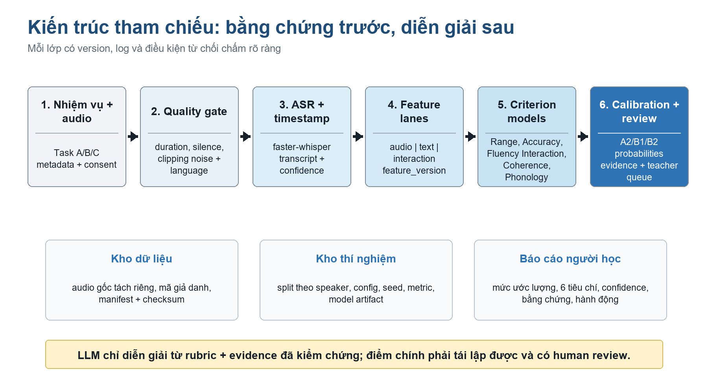

# Xây dựng hệ thống AI hỗ trợ đánh giá năng lực nói tiếng Anh theo CEFR cho sinh viên đại học Việt Nam ở trình độ A2-B2

> Bản Markdown được chuyển từ [`De_cuong_chi_tiet_AI_Assessor_CEFR_A2-B2.docx`](../artifacts/source/documents/De_cuong_chi_tiet_AI_Assessor_CEFR_A2-B2.docx). File gốc được giữ nguyên.

ĐỀ CƯƠNG NGHIÊN CỨU KHÓA LUẬN

Development of an AI-Assisted System for CEFR-Aligned English Speaking Assessment for Vietnamese University Students at A2-B2 Levels

Đề cương chốt phạm vi, dữ liệu, kiến trúc, phương pháp đánh giá và kế hoạch thực hiện trong 10 tuần

| Sinh viên: [Điền họ tên - MSSV] | Giảng viên hướng dẫn: [Điền họ tên] |
| --- | --- |
| Đối tượng: Người học Việt Nam, A2-B2 | Bối cảnh sử dụng: Formative / low-stakes |
| Thiết kế: Audio + transcript + interaction | Thẩm định: Hai giảng viên + human review |
| Phiên bản: 2.0 - 21/08/2026 | Thời gian: 10 tuần |

| QUYẾT ĐỊNH CHỐT Đề tài xây dựng một hệ thống hỗ trợ đánh giá, không phải giám khảo CEFR chính thức. Giá trị nghiên cứu nằm ở việc vận hành hóa rubric, thu và chấm dữ liệu người Việt, kiểm định AI-human agreement, phân tích lỗi ASR/accent và thiết kế human review. |
| --- |

Tài liệu này dùng để trao đổi với giảng viên hướng dẫn và làm khung viết đề cương/khóa luận; các ngưỡng metric là mục tiêu quản trị dự án, không phải chuẩn chính thức của Council of Europe.

## TÓM TẮT ĐIỀU HÀNH

Đề tài giải quyết bài toán chấm Speaking tốn thời gian và khó mở rộng bằng một pipeline AI có thể giải thích. Hệ thống thu bài nói, kiểm tra chất lượng, tạo transcript, trích xuất bằng chứng từ âm thanh - ngôn ngữ - tương tác, dự đoán xác suất A2/B1/B2 theo sáu tiêu chí CEFR và chuyển các trường hợp bất định cho giảng viên. Thiết kế không đồng nhất tốc độ nói, accent hoặc một điểm từ LLM với năng lực giao tiếp.

| KẾT LUẬN KHẢ THI Khả thi có điều kiện trong 10 tuần nếu khóa phạm vi A2-B2, chỉ phục vụ low-stakes, có hai rater, thu tối thiểu 40-60 người học, dùng mô hình tiền huấn luyện để trích đặc trưng và không mở rộng đồng thời sang LMS, thi chống gian lận, phỏng vấn việc làm hoặc chatbot tự do. |
| --- |

| Thành phần | Quyết định chốt |
| --- | --- |
| Construct | Range, Accuracy, Fluency, Interaction, Coherence, Phonology theo CEFR Companion Volume 2020. |
| Nhiệm vụ | Task A kể/mô tả; Task B nêu quan điểm; Task C hội thoại bán cấu trúc. |
| Dữ liệu chính | 40-60 người học Việt Nam; 100-150 response; nhãn từ hai giảng viên; split theo speaker. |
| Mô hình | Baseline audio-only, transcript-only, frozen rubric LLM; mô hình chính late fusion + calibration. |
| Đầu ra | Mức ước lượng, sáu tiêu chí, confidence, evidence, hai ưu tiên cải thiện và teacher review. |
| Đánh giá | Human-human trước AI-human; QWK, MAE band, macro-F1, adjacent accuracy, calibration, error analysis. |

## MỤC LỤC NỘI DUNG

- 1. Bối cảnh và vấn đề

- 2. Giải pháp đề xuất

- 3. Khảo sát sản phẩm tương tự và khoảng trống

- 4. Kiến trúc kỹ thuật

- 5. Tech stack và lý do chọn

- 6. Phạm vi đề tài

- 7. Dữ liệu: có sẵn và phải tự thu

- 8. Pháp lý và đạo đức

- 9. Kế hoạch thực hiện 10 tuần

- 10. Tiêu chí nghiệm thu và phương pháp đánh giá

- 11. Đóng góp khoa học

- 12. Đánh giá tính khả thi

- 13. Rủi ro và phương án dự phòng

- 14. Câu hỏi hội đồng và cách trả lời

- 15. Cấu trúc quyển khóa luận

- Tài liệu tham khảo

## 1. BỐI CẢNH VÀ VẤN ĐỀ

### 1.1. Bối cảnh

Đánh giá năng lực nói cần nhiều thời gian của giảng viên, chịu ảnh hưởng bởi tải chấm, cách hiểu rubric và độ khó của nhiệm vụ. Trong lớp học đông, người học thường nhận điểm tổng quát nhưng thiếu bằng chứng cụ thể để sửa. Các hệ thống tự động có thể giảm thời gian phản hồi, nhưng chỉ có giá trị khi điểm số được liên kết với construct rõ ràng, nhiệm vụ phù hợp và dữ liệu chấm bởi con người.

CEFR Companion Volume 2020 mô tả sáu đặc trưng định tính của ngôn ngữ nói: Range, Accuracy, Fluency, Interaction, Coherence và Phonology [1]. CEFR là khung tham chiếu, không phải một thuật toán chấm; vì vậy dự án phải chứng minh cách mỗi tiêu chí được tạo bằng chứng, chấm, hiệu chỉnh và kiểm định. Một nhãn do LLM sinh ra mà không có rater validation không đủ để tuyên bố hệ thống đánh giá theo CEFR.

### 1.2. Vấn đề nghiên cứu cốt lõi

- Thiếu phản hồi nhanh và nhất quán cho hoạt động luyện Speaking ở quy mô lớp học.

- ASR có thể nhận sai tiếng Anh mang accent Việt; lỗi transcript có thể bị hiểu nhầm thành lỗi từ vựng hoặc ngữ pháp.

- Các chỉ báo kỹ thuật như speech rate, pause hoặc ASR confidence chỉ phản ánh một phần construct, không thể thay thế toàn bộ rubric CEFR.

- Dữ liệu công khai có người Việt nhưng rất ít bộ vừa có audio tự nhiên, vừa có sáu nhãn CEFR, vừa có hai giảng viên chấm.

- Nhiều demo công khai tập trung vào UX hoặc prompt LLM, nhưng thiếu speaker-level split, calibration, human-human agreement và phân tích sai lệch theo accent/thiết bị.

### 1.3. Phát biểu bài toán

| BÀI TOÁN NGHIÊN CỨU Làm thế nào xây dựng một hệ thống AI có thể ước lượng mức Speaking A2-B2 của người học Việt Nam theo sáu tiêu chí CEFR, cung cấp bằng chứng và độ tin cậy, đồng thời đạt mức đồng thuận hữu ích với giảng viên trên dữ liệu được tách theo người nói? |
| --- |

### 1.4. Câu hỏi nghiên cứu

- RQ1. Điểm từng tiêu chí và mức overall của hệ thống đồng thuận với hai giảng viên ở mức nào?

- RQ2. Kết hợp audio + transcript + interaction có cải thiện so với audio-only và transcript-only không?

- RQ3. WER, độ ồn, thời lượng, thiết bị và prompt ảnh hưởng như thế nào đến sai số chấm?

- RQ4. Calibration và confidence threshold có phát hiện được các ca cần giảng viên duyệt không?

- RQ5. Phản hồi grounded bằng timestamp/transcript có rõ ràng và có thể hành động hơn phản hồi chung chung không?

## 2. GIẢI PHÁP ĐỀ XUẤT

### 2.1. Mô hình sản phẩm

Giải pháp là một vòng lặp Elicit - Assess - Explain - Review - Practice. Sinh viên hoàn thành các nhiệm vụ nói có blueprint; pipeline tạo điểm theo từng tiêu chí; báo cáo gắn điểm với bằng chứng; ca bất định vào hàng đợi giảng viên; hệ thống gợi ý một nhiệm vụ luyện tiếp theo. Đây là hệ thống hỗ trợ học tập, không cấp chứng chỉ và không tự quyết định kết quả học vụ.

| NGUYÊN TẮC Tách bằng chứng khỏi diễn giải. Audio/transcript/turn log tạo evidence có version; mô hình chấm tạo probability; lớp feedback chỉ được dùng rubric và evidence đã kiểm chứng. |
| --- |

### 2.2. Blueprint nhiệm vụ nói

| Nhiệm vụ | Cách thực hiện | Bằng chứng chính | Giới hạn |
| --- | --- | --- | --- |
| Task A - Kể/mô tả | 90-120 giây; chủ đề quen thuộc; 2 prompt tương đương. | Range, Fluency, Coherence, Phonology. | Không đủ bằng chứng cho Interaction. |
| Task B - Nêu quan điểm | Khoảng 120 giây; nêu lập trường, lý do, ví dụ. | Range, Accuracy, Fluency, Coherence, task relevance. | Cần kiểm soát độ khó và kiến thức nền. |
| Task C - Hội thoại | 3-5 lượt; follow-up bán cấu trúc; cùng mục tiêu giao tiếp. | Interaction, Fluency, relevance, clarification, turn management. | MVP chỉ triển khai khi task tree ổn định. |

### 2.3. Sáu tiêu chí đánh giá

| Tiêu chí | Ý nghĩa vận hành | Evidence máy có thể đo | Cảnh báo |
| --- | --- | --- | --- |
| Range | Phạm vi từ vựng/cấu trúc đủ để diễn đạt và paraphrase. | Lexical profile, MTLD/HD-D, cấu trúc câu, mức đa dạng cụm từ. | Không thưởng độ dài đơn thuần. |
| Accuracy | Mức kiểm soát ngữ pháp và khả năng tự sửa. | Lỗi trên AS-unit/clause, agreement, tense, preposition, repair. | ASR error không được tính thành lỗi người học. |
| Fluency | Duy trì lời nói với nhịp và pause phù hợp nhiệm vụ. | Articulation rate, pause ratio/count, mean run length, repetitions. | Không đồng nhất nói nhanh với giỏi. |
| Interaction | Khởi tạo, phản hồi, giữ lượt, làm rõ và phối hợp hội thoại. | Latency, turn completion, clarification, relevance, follow-up handling. | Chỉ chấm khi có task tương tác. |
| Coherence | Phát triển và liên kết ý rõ ràng. | Discourse markers, idea progression, semantic continuity, topic relevance. | Transcript sai có thể làm giảm điểm giả. |
| Phonology | Intelligibility, âm, trọng âm, nhịp và ngữ điệu. | Pronunciation proxy, prosody, rhythm, listener/rater evidence. | Không phạt accent nếu thông điệp vẫn dễ hiểu [1]. |

### 2.4. Báo cáo kết quả

- Mức overall ước lượng A2/B1/B2 và xác suất từng mức; hiển thị vùng ranh giới khi hai mức liền kề gần nhau.

- Điểm từng tiêu chí; Interaction được ghi 'chưa đủ bằng chứng' nếu người học không làm Task C.

- Evidence gồm timestamp, đoạn transcript, số liệu pause/rate và ghi chú rater/model có thể truy vết.

- Tối đa hai điểm mạnh, hai ưu tiên cải thiện và một nhiệm vụ luyện tiếp theo.

- Cờ invalid/low confidence/ASR risk và lý do chuyển sang teacher review.

- Hiển thị rubric_version, prompt_version, model_version và ngày chấm.

## 3. KHẢO SÁT SẢN PHẨM TƯƠNG TỰ VÀ KHOẢNG TRỐNG

### 3.1. Sản phẩm/dịch vụ đang vận hành

| Hệ thống | Cách tiếp cận | Điểm mạnh | Khoảng trống so với đề tài |
| --- | --- | --- | --- |
| ETS SpeechRater | ASR + tập feature phát âm, fluency, vocabulary, grammar; chấm spoken response [4]. | Có lịch sử vận hành, nghiên cứu validity và human scoring. | Đóng, theo ngữ cảnh TOEFL; không cung cấp dữ liệu/mô hình mở để kiểm định người Việt A2-B2. |
| Speak & Improve | Người học trả lời speaking test và nhận CEFR grade tự động [5]. | Trải nghiệm hoàn chỉnh; corpus nghiên cứu lớn; spontaneous speech. | Mô hình chấm đóng; không công bố sáu điểm CEFR cho người Việt; một clip không tương đương full test. |
| Azure Pronunciation Assessment | Điểm accuracy, fluency, prosody; scripted và unscripted [12]. | API rõ, word/phoneme granularity, dễ tích hợp. | Trọng tâm pronunciation; paid/closed; không thay thế construct CEFR sáu tiêu chí. |
| SpeechAce | API spontaneous speech: pronunciation, fluency, grammar, vocabulary, coherence, relevance; CEFR mapping [13]. | Gần với sản phẩm mong muốn và có feedback chi tiết. | Black box, trả phí; chưa có kiểm định độc lập trên dữ liệu sinh viên Việt Nam và rubric của đề tài. |

### 3.2. Nghiên cứu và mã nguồn công khai

| Công trình | Phạm vi | Kết quả/giá trị | Giới hạn cần xử lý |
| --- | --- | --- | --- |
| GOPT + SpeechOcean762 | Đánh giá pronunciation đa khía cạnh/đa mức; open code/data [7][8]. | Baseline tốt cho accuracy, fluency, prosody; có mô hình tiền huấn luyện. | Dữ liệu chủ yếu L1 Mandarin; không chấm Range, Coherence, Interaction hoặc overall CEFR. |
| EvalYaks | LoRA Mistral 7B chấm transcript bài thi Speaking B2; synthetic expert-validated data [3]. | Cho thấy LLM có thể bám rubric transcript; repo và dữ liệu instruction được public. | Chỉ B2 và transcript; không có âm thanh/intelligibility; số 96% không thể so trực tiếp với QWK trên dữ liệu thật Việt Nam. |
| Nebhi & Szaszak 2023 | Multimodal audio + text, multitask CEFR scoring/coherence/relevance [14]. | Ủng hộ hướng fusion đa phương thức. | Dữ liệu/mô hình không tạo benchmark công khai cho người Việt; kiến trúc nặng so với 10 tuần. |
| Cambridge spontaneous assessment | 994 candidates, sáu L1 gồm Vietnamese, nhiều mức CEFR; audio + linguistic features [15]. | Bằng chứng rằng confidence và back-off human là thiết kế hợp lý. | Dữ liệu thương mại/không công khai; không đủ để tái lập trực tiếp. |

### 3.3. Khoảng trống có thể bảo vệ

| KHOẢNG TRỐNG CHÍNH Chưa có một baseline công khai, dễ tái lập, được kiểm định trên sinh viên Việt Nam A2-B2 bằng sáu tiêu chí CEFR, có hai giảng viên chấm, speaker-level split, calibration, phân tích lỗi ASR/accent và teacher review. |
| --- |

- Không cạnh tranh trực tiếp với chất lượng sản phẩm thương mại trên mọi ngữ cảnh; đề tài cung cấp bằng chứng validity cục bộ và quy trình tái lập.

- EvalYaks được dùng làm related work/baseline transcript, không phải source code để sao chép thành sản phẩm.

- GOPT/Azure có thể dùng làm pronunciation baseline hoặc external feature, không được gọi là điểm CEFR holistic.

- Đóng góp tập trung vào đối tượng người Việt, task blueprint, rubric, rater protocol, uncertainty và error analysis.

## 4. KIẾN TRÚC KỸ THUẬT

Kiến trúc đề xuất là modular monolith cho MVP: một service Python điều phối ingest, ASR, feature, scoring và feedback; frontend mỏng để ghi âm/hiển thị; dữ liệu, model artifact và log được tách theo quyền truy cập. Cách này giảm chi phí tích hợp trong 10 tuần nhưng vẫn giữ ranh giới module để tái lập thí nghiệm.

Hình 1. Kiến trúc tham chiếu của hệ thống AI Assessor (tác giả đề xuất, 2026).

### 4.1. Luồng xử lý

- Tạo session: gán speaker_id giả danh, task_id, prompt_version và consent_version.

- Thu/nhận audio: lưu bản gốc ở kho hạn chế; tạo bản mono 16 kHz cho xử lý.

- Quality gate: duration, silence, clipping, noise proxy, language và response relevance sơ bộ.

- ASR: tạo transcript_raw, word timestamps, confidence và model_version; không chỉnh transcript test bằng tay.

- Feature lanes: audio, text và interaction được tạo độc lập với feature_version.

- Criterion scoring: mỗi tiêu chí trả probability A2/B1/B2; missing criterion được giữ missing.

- Calibration/aggregation: dùng dev set; overall là best-fit/ordinal model, không phải trung bình label máy móc.

- Evidence/feedback: chọn bằng chứng đã lưu; feedback template là mặc định, LLM chỉ là stretch.

- Human review: low confidence, ASR risk, audio invalid hoặc criterion conflict vào teacher queue.

- Audit: lưu rubric_version, prompt_version, model_version, threshold_version và decision log.

### 4.2. Feature lanes

| Lane | Feature bắt buộc | Dùng cho | Không được suy diễn |
| --- | --- | --- | --- |
| Audio | Duration, voiced ratio, articulation rate, pause count/ratio, run length, F0/rhythm summary. | Fluency, Phonology, quality diagnostics. | Không suy giới tính, cảm xúc, bệnh lý, tính cách hoặc nguồn gốc. |
| Text | Lexical diversity/profile, syntax/error proxy, discourse markers, semantic relevance. | Range, Accuracy, Coherence, relevance. | Không coi transcript ASR là ground truth tuyệt đối. |
| Interaction | Turn count, latency, completion, clarification, follow-up relevance, turn balance. | Interaction và task completion. | Không chấm nếu không có dialogue task. |
| Quality | SNR proxy, clipping, silence, duration, ASR confidence/estimated risk. | Reject/review rule và error analysis. | Không dùng trực tiếp làm điểm năng lực. |

### 4.3. API và dữ liệu đầu ra

| Endpoint | Mục đích | Đầu vào chính | Đầu ra chính |
| --- | --- | --- | --- |
| POST /sessions | Tạo phiên đánh giá. | speaker_id, task_id, versions. | session_id, upload policy. |
| POST /responses | Upload/ghi nhận audio. | session_id, audio, metadata. | response_id, QC status. |
| POST /score | Chạy pipeline bất đồng bộ. | response_id, model_version. | job_id, status. |
| GET /reports/{id} | Xem báo cáo người học. | response/session id. | criteria, overall, evidence, flags. |
| POST /reviews | Giảng viên xác nhận/sửa. | rater_id, rating, reason. | review record, adjudication status. |

## 5. TECH STACK VÀ LÝ DO CHỌN

| QUAN ĐIỂM CHỌN STACK Ưu tiên một ngôn ngữ Python cho ML và backend, giao diện mỏng, chạy local-first, tái lập thí nghiệm và ít dịch vụ vận hành. Không dùng microservices hoặc hạ tầng cloud phức tạp cho MVP. |
| --- |

| Lớp | Công nghệ chốt | Lý do chọn | Phương án dự phòng |
| --- | --- | --- | --- |
| Ngôn ngữ | Python 3.11+ | Hệ sinh thái speech/ML mạnh; giảm chuyển đổi ngôn ngữ trong 10 tuần. | Không tách backend Node nếu không có yêu cầu tích hợp. |
| API | FastAPI + Pydantic | Type hints, validation và OpenAPI tự động; phù hợp service ML [16]. | Chạy script batch nếu UI/API trễ tiến độ. |
| Frontend | Streamlit | Nhanh tạo recorder, report, teacher queue; frontend không phải đóng góp chính. | Gradio hoặc trang HTML tối giản. |
| Audio chuẩn hóa | FFmpeg | Ổn định trong chuyển mono/16 kHz, kiểm tra codec và batch processing. | soundfile/pydub cho trường hợp đơn giản. |
| VAD + ASR | Silero VAD + faster-whisper | Có timestamps/VAD, chạy local, nhiều cấu hình CPU/GPU [17]. | Whisper nhỏ hơn hoặc API đã được phép. |
| Acoustic features | librosa + Parselmouth; openSMILE nghiên cứu | Feature fluency/prosody minh bạch; dễ ablation. | Chỉ giữ feature tối thiểu nếu license/dependency gây rủi ro. |
| Text features | spaCy/Stanza + sentence-transformers | Syntax/discourse/relevance; không phụ thuộc hoàn toàn vào LLM. | Handcrafted lexical/surface baseline. |
| Scoring | scikit-learn + statsmodels/PyTorch | Baseline mạnh với dữ liệu nhỏ; ordinal model và calibration dễ giải thích. | Chọn mô hình đơn giản tốt nhất thay vì deep end-to-end. |
| Feedback | Template grounded bằng evidence | Tái lập, giảm hallucination và bảo vệ dữ liệu. | LLM local/API opt-in chỉ là stretch. |
| Storage | SQLite + encrypted filesystem | Đủ cho một nhóm nghiên cứu nhỏ; audio tách khỏi metadata. | PostgreSQL + MinIO khi nhiều rater/deploy. |
| Tracking | MLflow local + manifest/checksum | Log config, metric, artifact và dataset reference [18]. | CSV/JSON versioned nếu MLflow quá nặng. |
| Đóng gói | Docker Compose + pytest | Môi trường demo tái lập, có test schema/audio/API. | Virtualenv + script setup offline. |

### 5.1. Vì sao không dùng LLM end-to-end làm bộ chấm chính

- LLM transcript-only không nghe được intelligibility, prosody, pause hoặc interaction timing.

- Điểm và lời giải thích có thể thay đổi theo prompt/model version; khó tái lập nếu không khóa cấu hình.

- Lỗi ASR bị che giấu khi chỉ đưa transcript cho LLM.

- Dữ liệu audio/transcript gửi dịch vụ ngoài tạo rủi ro pháp lý và retention.

- LLM vẫn có giá trị như baseline B3 hoặc lớp diễn giải có evidence; không được tự tạo evidence.

## 6. PHẠM VI ĐỀ TÀI

### 6.1. Trong phạm vi

- Tiếng Anh L2 của người học Việt Nam trưởng thành/sinh viên; dải mục tiêu A2-B2.

- Ba loại nhiệm vụ A/B/C; Task C có thể thu trên tập con nhưng không được suy Interaction từ monologue.

- Sáu tiêu chí CEFR và overall ước lượng; low-stakes/formative.

- Audio quality, ASR, feature extraction, criterion scoring, calibration, evidence, feedback và teacher review.

- Hai rater, quy trình calibration/adjudication, human-human và AI-human evaluation.

- Web proof-of-concept chạy trên máy nghiên cứu; không yêu cầu SLA sản xuất.

### 6.2. Ngoài phạm vi

- Chứng chỉ CEFR, kỳ thi high-stakes hoặc quyết định học vụ tự động.

- A1, C1, C2; trẻ vị thành niên; ngôn ngữ khác tiếng Anh.

- Speaker identification, emotion/personality inference, phát hiện gian lận bằng sinh trắc học.

- LMS đầy đủ, payment, proctoring, mobile native, hệ thống tuyển dụng hoặc phỏng vấn việc làm.

- Chatbot hội thoại tự do không kiểm soát độ khó; recommender học máy dài hạn.

- Huấn luyện ASR hoặc foundation model từ đầu.

### 6.3. MVP và stretch

| Mức | Hạng mục | Điều kiện chấp nhận |
| --- | --- | --- |
| MVP bắt buộc | Task A/B, QC, ASR, audio/text features, 5 tiêu chí khả dụng, overall, confidence, report, rater form, baselines và evaluation. | Hoàn tất trước cổng G8; demo end-to-end; test theo speaker. |
| MVP mở rộng | Task C + Interaction + teacher queue. | Chỉ giữ nếu prompt tree và dữ liệu đủ ổn định sau pilot. |
| Stretch | LLM feedback grounded, task recommendation, hai phiên theo dõi tiến bộ. | Chỉ bắt đầu sau khi model/baseline/dữ liệu vượt G8. |
| Loại bỏ đầu tiên | LMS, chatbot tự do, interview simulator, dashboard phức tạp. | Cắt ngay khi một cổng tiến độ trễ. |

### 6.4. Giả định nguồn lực

Một sinh viên kỹ thuật làm 18-22 giờ/tuần; một giảng viên hướng dẫn; hai giảng viên tiếng Anh dành tổng 8-14 giờ/người cho calibration và chấm; máy 16 GB RAM, GPU là lợi thế nhưng không bắt buộc; có kênh tuyển 40-60 người và quy trình consent được trường cho phép.

## 7. DỮ LIỆU: CÓ SẴN VÀ PHẢI TỰ THU

| KẾT LUẬN DỮ LIỆU Có dữ liệu người Việt nói tiếng Anh, nhưng chưa có corpus công khai đủ lớn với sáu nhãn CEFR và protocol hai rater phù hợp đề tài. Public data chỉ hỗ trợ ASR/pronunciation/pretraining hoặc external sanity check; tập dữ liệu tự thu là bằng chứng kiểm định chính. |
| --- |

### 7.1. Dữ liệu có sẵn

| Nguồn | Quy mô/phủ | Nhãn | License/truy cập | Vai trò trong đề tài |
| --- | --- | --- | --- | --- |
| L2-ARCTIC | 24 người, 6 L1; 4 người Việt (2 nam, 2 nữ); scripted và một phần unscripted [9]. | Transcript và lỗi phát âm; không có CEFR. | CC BY-NC 4.0. | Test pipeline, accent robustness, pronunciation/ASR sanity; không tính CEFR accuracy. |
| Speech Accent Archive | Nhiều L1; cùng một đoạn đọc; có thể lọc Vietnamese [10]. | Metadata và phonetic analysis; không CEFR. | CC BY-NC-SA 4.0 theo trang download chính thức kiểm tra 02/09/2026. | External accent check; không dùng huấn luyện overall. |
| ICNALE Spoken | Spoken monologue/dialogue của người học đại học châu Á; spoken modules hiện không liệt kê Việt Nam [11]. | CEFR-linked band dựa trên test/VST và metadata. | Đăng ký; cấm tái phân phối; cấm phân tích interviewer speech. | Related/task/rater research; không gọi là Vietnamese speech. |
| Speak & Improve Corpus 2025 | Khoảng 315 giờ L2 spontaneous monologue; khoảng 55 giờ có transcript/error labels [6]. | Holistic CEFR-like score; transcript/error subset. | Non-commercial research, đăng ký, không tái phân phối. | Auxiliary benchmark; source paper cảnh báo speaker có thể lặp giữa train/test, nên không dùng official split cho claim speaker-disjoint. |
| SpeechOcean762 | 5.000 utterance, 250 non-native speakers, chủ yếu Mandarin L1 [8]. | Phone/word/utterance pronunciation scores. | CC BY 4.0. | Pronunciation baseline GOPT; không đại diện người Việt hay CEFR holistic. |

### 7.2. Dữ liệu phải tự thu

| Hạng mục | Thiết kế đề xuất |
| --- | --- |
| Người tham gia | 40-60 người học Việt Nam từ 18 tuổi; quota mềm A2/B1/B2; không ép cân bằng nhân tạo sau split. |
| Response | Mỗi người Task A + B; Task C cho 20-30 người nếu ổn định. Dự kiến 100-150 response hợp lệ. |
| Pilot | 8-12 người trước main collection để sửa prompt, UI, QC và rater guide. |
| Nhãn | Sáu criterion + overall + evidence/reason code. Hai rater chấm độc lập; lý tưởng toàn bộ, tối thiểu toàn test và 30% train. |
| Transcript chuẩn | Chép tay 20-30% response theo band/thiết bị để tính WER và upper-bound analysis. |
| Metadata | speaker_id, task/prompt version, duration, device type, noise flag, self-reported level/chứng chỉ nếu tự nguyện. |
| Split | Theo speaker. Nếu >=50: 60/20/20. Nếu 30-49: GroupKFold và khóa 6-10 speaker làm holdout khi đủ. |
| Version | dataset_v1 khóa sau adjudication; manifest + checksum + changelog; test labels tách khỏi development. |

### 7.3. Quy trình thu và chấm

- Giải thích nghiên cứu, xin consent tự nguyện, gán speaker_id và tách bảng liên hệ khỏi audio.

- Thu A/B cho mọi người; quality gate ngay để người học ghi lại nếu file invalid.

- Random hóa thứ tự khi chấm; rater không nhìn thấy điểm AI; ghi rater_id và thời điểm.

- Calibration 60-90 phút; chọn 2-3 anchor mỗi band; chấm thử pilot và tính QWK/ICC.

- Adjudicate ca lệch trên một band hoặc lệch đáng kể theo criterion; không lấy trung bình cơ học.

- Khóa manifest và speaker split trước khi train; test set chỉ chạy một lần ở Tuần 10.

### 7.4. Schema tối thiểu

| Nhóm | Trường bắt buộc |
| --- | --- |
| Identity tách riêng | participant_key, consent_version, contact, withdrawal_status. |
| Response manifest | speaker_id, session_id, response_id, task_id, prompt_version, audio_uri, duration, qc_status. |
| ASR | asr_model, transcript_raw, word_timestamps, confidence, wer_manual_subset. |
| Rating | rater_id, rubric_version, six criteria, overall, evidence, reason_codes, adjudicated_label. |
| Model output | model_version, split_version, probabilities, calibration_version, review_reason, evidence_ids. |

## 8. PHÁP LÝ VÀ ĐẠO ĐỨC

Tại thời điểm 21/08/2026, Luật Bảo vệ dữ liệu cá nhân số 91/2025/QH15 có hiệu lực từ 01/01/2026 [19], và Nghị định 356/2025/NĐ-CP quy định chi tiết một số điều và biện pháp thi hành [20]. Audio, transcript, metadata và điểm đánh giá có thể là dữ liệu cá nhân; dữ liệu giọng nói cần bảo vệ nghiêm ngặt, đặc biệt nếu được dùng cho nhận dạng sinh trắc học. Nội dung dưới đây là thiết kế tuân thủ thực hành, không thay thế tư vấn pháp lý hoặc quy trình ethics của trường.

### 8.1. Yêu cầu tối thiểu

| Nguyên tắc | Cách áp dụng trong đề tài |
| --- | --- |
| Mục đích cụ thể | Consent nêu rõ thu audio để nghiên cứu đánh giá Speaking A2-B2; không tái dùng cho nhận dạng giọng nói. |
| Tối thiểu hóa | Không thu CCCD, địa chỉ, dữ liệu sức khỏe; giới tính/chứng chỉ chỉ khi tự nguyện và có lý do phân tích. |
| Tự nguyện | Không gắn quyền tham gia với điểm môn học; có lựa chọn từ chối/rút mà không chịu bất lợi. |
| Quyền dữ liệu | Cơ chế yêu cầu xem, sửa metadata, rút consent và xóa raw audio trong thời hạn công bố. |
| Lưu trữ | Audio mã hóa, access theo vai trò, log truy cập, backup được kiểm soát; không commit Git. |
| Thời hạn | Đề xuất xóa raw audio sau tối đa 12 tháng kể từ bảo vệ hoặc sớm hơn theo chính sách trường; giữ derived data chỉ khi consent cho phép. |
| Chuyển dữ liệu | Ưu tiên xử lý local. Nếu dùng API/cloud ngoài Việt Nam, cần rà soát điều khoản, vị trí xử lý, retention và consent riêng. |
| Sự cố | Có đầu mối báo cáo, thu hồi quyền truy cập, đánh giá ảnh hưởng và xử lý theo quy định/trường. |

### 8.2. Đạo đức đánh giá

- Không dùng kết quả như chứng chỉ, điểm thi chính thức hoặc căn cứ duy nhất cho quyết định học vụ.

- Không phạt accent Việt nếu intelligibility vẫn bảo đảm; không dùng chuẩn 'native-like' làm mục tiêu duy nhất.

- Không suy diễn giới tính, dân tộc, cảm xúc, sức khỏe, tính cách hoặc năng lực nghề nghiệp từ giọng nói.

- Công bố confidence, failure modes và population đã kiểm chứng; không áp dụng cho A1/C1/C2 hoặc trẻ em.

- Rater cần chấm mù; người học được biết có AI, dữ liệu nào được lưu và khi nào có người duyệt.

- Subgroup analysis chỉ thực hiện khi dữ liệu tự nguyện và đủ n; không công bố bảng nhỏ có thể tái nhận dạng.

- Public dataset/API phải được kiểm tra license; dữ liệu hạn chế không được đưa lên GitHub hoặc dịch vụ huấn luyện ngoài điều khoản.

### 8.3. Checklist trước khi thu

- Có văn bản/ý kiến chấp thuận của giảng viên hướng dẫn hoặc hội đồng ethics theo quy định trường.

- Consent, participant information sheet và quy trình rút/xóa đã được duyệt.

- Data map chỉ rõ nơi lưu audio, transcript, identity key, rating và backup.

- Tài khoản rater riêng; kho dữ liệu không public; secret không nằm trong code/repo.

- License inventory cho từng corpus, model và API.

- Model card/datasheet có prohibited uses và retention.

## 9. KẾ HOẠCH THỰC HIỆN 10 TUẦN

Kế hoạch dùng cổng G1-G10. Không train mô hình trước khi rubric, nhãn và speaker split đủ ổn định; không bù tiến độ bằng cách thêm tính năng trình diễn. Khối lượng giả định 18-22 giờ/tuần, tăng lên 24-28 giờ ở tuần thực nghiệm và đóng gói.

| Tuần | Trọng tâm | Công việc chi tiết | Đầu ra và cổng |
| --- | --- | --- | --- |
| W1 | Scope + construct + pháp lý | Đọc CEFR; chốt tên/RQ/A2-B2; lập product/research matrix; xác nhận 2 rater; draft consent/data plan; backlog MVP/stretch. | G1: GVHD duyệt phạm vi, RQ, rater và kế hoạch dữ liệu. |
| W2 | Rubric + task + protocol | Viết rubric A2/B1/B2; Task A/B/C; prompt bank; rating form; reason codes; schema; calibration thử với mẫu công khai. | G2: rater giải thích được điểm; mỗi criterion có task tạo evidence. |
| W3 | Vertical slice | Recorder/upload; FFmpeg; QC; faster-whisper; transcript/timestamp; feature cơ bản; report JSON; loader L2-ARCTIC. | G3: một response 2 phút chạy end-to-end, không lộ danh tính. |
| W4 | Pilot + calibration | Thu 8-12 người; test completion/QC/ASR; double-rate; tính agreement; sửa prompt/rubric; khóa v1. | G4: completion >=85%; human agreement dùng được; nếu QWK <0,60 thì chưa main collect. |
| W5 | Main collection 1 | Thu 20-30 người đầu; A/B và C nếu ổn; QC hằng ngày; rater chấm cuốn chiếu; theo dõi band/device/noise. | G5: metadata đầy đủ >=90%; invalid có reason; không có PII trong model workspace. |
| W6 | Main collection 2 + lock | Đạt 40-60 người; double-rate test + >=30% corpus; adjudication; manual transcript subset; human agreement; speaker split; manifest/checksum. | G6: dataset_v1 khóa, không speaker leakage, consent status đầy đủ. |
| W7 | Feature + baseline | B0 majority; B1 audio; B2 transcript; B3 frozen rubric LLM; feature dictionary; cùng split/seed; metric/confusion/error list. | G7: ít nhất một baseline hơn B0; chạy tái lập. |
| W8 | Fusion + calibration | Late fusion/ordinal model; calibration; threshold review; ablation; bootstrap CI; WER-error; phân tích >=20 ca lỗi. | G8: M1 so với toàn bộ baseline; chọn mô hình tốt nhất, không chọn theo độ phức tạp. |
| W9 | Tích hợp + usability | Report evidence; teacher queue; timeout/retry; test 5-8 sinh viên + 2 GV; sửa lỗi; khóa API/UI/model. | G9: workflow hoàn tất; feedback không bịa; low-confidence chuyển review. |
| W10 | Final holdout + luận văn | Khóa code/config; chạy test một lần; metric/CI/plots; model card/datasheet; demo offline; viết và đối chiếu số liệu. | G10: máy sạch chạy theo README; slide khớp báo cáo; giới hạn nêu rõ. |

### 9.1. Quy tắc cắt phạm vi

- Trễ G2: bỏ Task C khỏi MVP, không báo Interaction.

- Trễ G4 hoặc agreement thấp: dành tuần sửa rubric/anchor, giảm tuyên bố thành exploratory prototype.

- Thu <30 speakers ở G6: dùng GroupKFold, không tuyên bố generalization; tập trung rater study/error analysis.

- Fusion không hơn baseline ở G8: chọn baseline đơn giản tốt nhất và giải thích; không thêm deep model phút cuối.

- UI trễ ở G9: giữ Streamlit tối giản; không hy sinh evaluation để làm giao diện.

## 10. TIÊU CHÍ NGHIỆM THU VÀ PHƯƠNG PHÁP ĐÁNH GIÁ

### 10.1. Điều kiện nghiệm thu chức năng

- Ghi âm/upload, QC, ASR, scoring và report chạy end-to-end; lỗi trả reason code thay vì điểm giả.

- Report có criterion, overall, confidence, evidence, version và human-review flag.

- Rater form và teacher queue lưu được điểm độc lập, reason và adjudication.

- Dữ liệu nhạy cảm không nằm trong Git; có consent/retention status, role-based access và deletion procedure.

- Repo có README, config/seed, test schema/audio/API, sample không nhạy cảm và demo offline.

### 10.2. Ngưỡng và cách diễn giải

| Hạng mục | Metric/kiểm tra | Ngưỡng quản trị đề xuất | Cách dùng |
| --- | --- | --- | --- |
| Rater reliability | QWK/ICC human-human theo overall và criterion. | Tối thiểu 0,60 trước main collection; mục tiêu >=0,70. | Nếu thấp: sửa rubric/anchor và chấm lại pilot; không train trên nhãn bất nhất. |
| AI-human overall | QWK + 95% bootstrap CI theo speaker. | Mục tiêu điểm ước lượng >=0,60; CI và n phải được báo cáo. | Không gọi là chuẩn CEFR chính thức; so với human ceiling. |
| Band error | MAE band; exact và adjacent accuracy. | Mục tiêu MAE <=0,50; adjacent >=80%. | Phân tích riêng lỗi A2<->B2 vì nghiêm trọng hơn lệch kề. |
| Cân bằng lớp | Macro-F1 + confusion matrix. | M1 phải hơn majority và không kém best unimodal trong CI. | Không chỉ báo accuracy khi band lệch. |
| Calibration | Reliability plot, Brier/ECE, confidence-error relation. | ECE mục tiêu <=0,15 nếu n đủ; threshold phải bắt được phần lớn lỗi lớn. | N nhỏ: ưu tiên curve, CI và teacher-review yield. |
| ASR robustness | WER trên manual subset; tương quan WER-score error. | Không đặt WER thành điểm CEFR; báo cáo theo band/noise/device. | Tạo ASR-risk flag và upper bound bằng transcript tay subset. |
| Usability | Task completion, thời gian, Likert/SUS, phỏng vấn ngắn. | Completion >=85%; không có evidence hallucination nghiêm trọng. | 5-8 sinh viên + 2 giảng viên chỉ đủ formative usability. |
| Hiệu năng | Thời gian xử lý response 2 phút trên máy tham chiếu. | Mục tiêu <=60 giây batch/local; lỗi/timeout có retry. | Không tuyên bố real-time nếu chưa đo. |

Lưu ý: mốc QWK 0,60, MAE 0,50, adjacent 80% và ECE 0,15 là mục tiêu quản trị đề tài để quyết định cổng tiến độ. Council of Europe không ban hành các mốc này cho hệ thống AI.

### 10.3. Thiết kế thực nghiệm bắt buộc

- Split theo speaker và stratify mềm theo band; cùng split cho mọi baseline/ablation.

- B0 majority/stratified; B1 audio-only; B2 transcript-only; B3 frozen rubric LLM; M1 late fusion + calibration.

- Hyperparameter/prompt chỉ tune trên train/dev; locked test chạy một lần.

- Bootstrap 95% CI theo speaker; không bootstrap từng response độc lập khi cùng speaker có nhiều bài.

- Ablation bỏ audio/text/interaction và các feature dễ shortcut như duration/prompt id.

- Error taxonomy tối thiểu 20 ca: ASR, audio, off-topic, boundary, rubric, prompt, model và rater disagreement.

- Subgroup diagnostics theo band/device/noise; demographic chỉ khi consent và đủ n.

- So sánh feedback template với LLM grounded chỉ nếu stretch hoàn thành; chấm helpfulness và factual grounding.

## 11. ĐÓNG GÓP KHOA HỌC

### 11.1. Đóng góp dự kiến

| Đóng góp | Sản phẩm khoa học |
| --- | --- |
| C1 - Vận hành hóa construct | Rubric A2-B2 cho sáu tiêu chí, blueprint nhiệm vụ, evidence guide, anchor và quy tắc missing/adjudication. |
| C2 - Dữ liệu cục bộ | Tập dữ liệu người học Việt Nam ẩn danh, có consent, task/prompt version, nhãn hai rater, manifest, datasheet và WER subset. |
| C3 - Kiến trúc có thể giải thích | Pipeline late fusion tách audio/text/interaction, có calibration, evidence grounding và human review. |
| C4 - Bằng chứng thực nghiệm | So sánh baseline/fusion/ablation trên speaker split; AI-human và human-human agreement; confidence/error/ASR analysis. |
| C5 - Bài học cho accent Việt | Phân tích lỗi ASR và điểm theo điều kiện âm thanh, tránh đồng nhất accent với thiếu năng lực; mô tả failure modes và giới hạn. |

### 11.2. Ranh giới tính mới

Tính mới không nằm ở Whisper, FastAPI hay việc gọi LLM, vì các thành phần này đã phổ biến. Tính mới có thể bảo vệ ở sự kết hợp có kiểm soát giữa CEFR construct, dữ liệu người Việt, rater validation, đa phương thức, calibration và human review. Nếu M1 không vượt baseline, khóa luận vẫn có đóng góp nếu phân tích được human ceiling, lỗi ASR, construct coverage và điều kiện thất bại một cách tái lập.

### 11.3. Tuyên bố khoa học nên dùng

| TUYÊN BỐ PHÙ HỢP Trên tập người học Việt Nam A2-B2 và các nhiệm vụ đã thiết kế, mô hình X đạt mức đồng thuận Y với giảng viên, cải thiện/không cải thiện so với baseline Z; confidence và error analysis chỉ ra các điều kiện cần human review. |
| --- |

| TUYÊN BỐ CẦN TRÁNH Hệ thống chấm CEFR chính xác cho mọi người Việt; thay thế giám khảo; không thiên lệch; đạt chuẩn Council of Europe; hoạt động cho mọi task/accent/thiết bị. |
| --- |

## 12. ĐÁNH GIÁ TÍNH KHẢ THI

| Khía cạnh | Mức | Cơ sở | Điều kiện để khả thi |
| --- | --- | --- | --- |
| Kỹ thuật | Cao | ASR, feature toolkit, ordinal/classical ML và web prototype đều có công cụ mở. | Giữ modular monolith; không train foundation model; có fallback CPU. |
| Dữ liệu | Trung bình | Có public data hỗ trợ nhưng gold Vietnamese phải tự thu. | Xác nhận kênh tuyển ngay W1; pilot W4; >=40 speakers hoặc giảm claim. |
| Nhãn/rater | Trung bình | Hai rater là nút thắt thời gian và validity. | Khóa lịch calibration/chấm; tối thiểu double-rate test + 30%. |
| Pháp lý | Trung bình | Luật 91/2025 và Nghị định 356/2025 đang có hiệu lực. | Consent, local-first, data map, retention, ethics approval trước thu. |
| Thời gian | Trung bình-cao | 10 tuần đủ cho PoC nếu dữ liệu và rubric đi trước frontend. | Cổng G1-G10; cắt Task C/LLM/UI khi trễ. |
| Khoa học | Cao có điều kiện | Câu hỏi đo được; có baseline, rater ceiling, ablation và error analysis. | Không overclaim từ mẫu nhỏ; báo CI, limitations và population. |
| Vận hành | Cao cho demo | Streamlit/FastAPI/Docker đủ cho một máy/lab. | Không hứa SLA, scale hoặc mobile production. |

| KẾT LUẬN Đề tài khả thi ở mức proof-of-concept nghiên cứu có kiểm định. Điều kiện quyết định không phải GPU mà là rubric tốt, hai rater, quyền thu audio và speaker-level split. |
| --- |

### 12.1. Nguồn lực tối thiểu

- Máy 16 GB RAM; 30-50 GB lưu trữ riêng; GPU 6-8 GB là lợi thế nhưng không bắt buộc.

- Hai rater; mỗi người 8-14 giờ tùy số response và tỷ lệ chấm kép.

- Không gian thu tương đối yên tĩnh và một kịch bản thiết bị cá nhân để kiểm tra robustness.

- Repo riêng cho code; kho dữ liệu hạn chế; backup; một máy demo/offline package.

- Giảng viên hướng dẫn duyệt scope, ethics, protocol và các cổng G1/G4/G6/G8/G10.

## 13. RỦI RO VÀ PHƯƠNG ÁN DỰ PHÒNG

| Rủi ro | Tín hiệu sớm | Phòng ngừa | Dự phòng |
| --- | --- | --- | --- |
| Không đủ rater | Chưa khóa lịch ở W1. | Giới hạn response, form chấm gọn, chấm batch. | Double-rate toàn test + 30% train; giảm claim. |
| Agreement thấp | Pilot QWK <0,60 hoặc lệch criterion lớn. | Anchor, rater guide, calibration, reason codes. | Thu hẹp A2/B1/B2; sửa rubric; exploratory study. |
| Thu mẫu chậm | <20 speakers cuối W5. | Nhiều lớp/kênh tuyển đã được phép; lịch thu cố định. | Ưu tiên speaker hơn Task C; GroupKFold; bỏ stretch. |
| Band lệch | Một band <20% mẫu. | Quota mềm, theo dõi dashboard tuyển. | Class weights; macro-F1; không oversample trước split. |
| ASR sai accent Việt | WER cao, transcript vô nghĩa. | Local ASR benchmark; VAD/QC; manual subset. | Audio-only model; ASR-risk flag; human review; upper bound transcript tay. |
| Thiếu GPU | ASR/model quá chậm. | faster-whisper small/base, batch, quantization. | CPU/offline batch; giảm embedding/deep model. |
| Fusion không hơn baseline | Dev result không cải thiện. | Ablation và regularization; feature audit. | Chọn model đơn giản; đóng góp từ negative result/error analysis. |
| Feedback bịa | Không truy được evidence. | Template mặc định; evidence IDs; deterministic rules. | Tắt LLM; chỉ hiển thị evidence + khuyến nghị chuẩn hóa. |
| Chậm ethics/pháp lý | W2 chưa được phép thu. | Nộp hồ sơ W1; local-first; consent sớm. | Phát triển trên public/synthetic; dời main collect; giảm tuyên bố. |
| Scope creep | Thêm LMS/chatbot/mobile trước G8. | MVP gate và backlog stretch riêng. | Cắt Group 3/4; demo tối giản. |
| Demo lỗi | Phụ thuộc internet/API. | Docker, cached model, sample offline, rehearsal. | Video/JSON/slide backup; batch script thay web. |

## 14. CÂU HỎI HỘI ĐỒNG VÀ CÁCH TRẢ LỜI

### 14.1. Bộ câu hỏi phản biện trọng tâm

#### Q1. Vì sao không dùng Whisper rồi đưa transcript cho ChatGPT chấm?

Transcript-only không chứa đầy đủ pause, prosody, intelligibility và interaction timing. LLM có thể là baseline/feedback layer, nhưng điểm chính phải kết hợp audio, text và interaction, được hiệu chỉnh trên nhãn giảng viên.

#### Q2. Dựa vào đâu để nói hệ thống theo CEFR?

Dựa trên CEFR Companion Volume 2020, sáu tiêu chí, task blueprint, rubric A2/B1/B2, anchor và validation với rater. Đề tài chỉ nói 'aligned/hỗ trợ đánh giá', không tuyên bố được Council of Europe chứng nhận.

#### Q3. Điểm mới là gì khi EvalYaks và SpeechAce đã tồn tại?

EvalYaks chấm transcript B2; SpeechAce là API đóng. Đề tài cung cấp quy trình tái lập và bằng chứng cục bộ cho người Việt A2-B2: hai rater, audio/text/interaction fusion, ASR/accent error, calibration và human review.

#### Q4. 40-60 người có quá ít để làm AI không?

Quá ít để huấn luyện foundation model hoặc tuyên bố tổng quát rộng, nhưng đủ cho PoC nếu dùng pretrained features, model đơn giản, GroupKFold/holdout, bootstrap CI và báo giới hạn. Đóng góp chính là validation protocol.

#### Q5. Tại sao chỉ A2-B2?

Đây là dải phổ biến trong sinh viên và giảm sparsity/độ phức tạp rubric. A1/C1/C2 cần task, anchor và dữ liệu khác; không nên mở rộng khi chưa có bằng chứng.

#### Q6. Overall được tính bằng trung bình sáu tiêu chí?

Không. Hệ thống giữ probability theo criterion và dùng best-fit/ordinal aggregation được học hoặc hiệu chỉnh theo overall của rater. Missing Interaction không bị điền 0.

#### Q7. Vì sao dùng QWK?

Band A2-B1-B2 có thứ tự và lỗi lệch hai band nghiêm trọng hơn lệch một band. QWK phản ánh thứ tự tốt hơn accuracy đơn thuần; vẫn phải báo MAE, macro-F1, adjacent accuracy và confusion matrix.

#### Q8. QWK 0,60 có phải chuẩn CEFR?

Không. Đó là mục tiêu quản trị của dự án. Báo cáo phải ghi rõ sample size, confidence interval và human-human ceiling; không biến mốc nội bộ thành tiêu chuẩn Council of Europe.

#### Q9. Nếu ASR nhận sai giọng Việt thì sao?

Đo WER trên manual subset, phân tích WER-score error, giữ audio-only baseline, tạo ASR-risk flag và chuyển review. Không dùng transcript như ground truth tuyệt đối.

#### Q10. Hệ thống có thiên vị accent không?

Không thể khẳng định 'không thiên vị' từ mẫu nhỏ. Đề tài dùng intelligibility thay native-likeness, kiểm tra lỗi theo điều kiện có đủ n và công bố failure modes; accent không bị trừ nếu thông điệp rõ.

#### Q11. Interaction được chấm thế nào?

Chỉ từ Task C có nhiều lượt: latency, relevance, clarification, turn completion/balance và rater evidence. Nếu chỉ độc thoại, báo 'chưa đủ bằng chứng'.

#### Q12. Tại sao không dùng deep multimodal transformer?

Dữ liệu nhỏ và thời gian 10 tuần làm mô hình lớn dễ overfit, khó giải thích. Late fusion với pretrained features tạo baseline nghiêm túc, ablation rõ và dễ tái lập; deep model chỉ hợp lý khi có thêm dữ liệu.

#### Q13. Dữ liệu công khai có đủ không?

Không đủ cho gold validation người Việt. L2-ARCTIC/Speech Accent hỗ trợ accent/ASR, SpeechOcean hỗ trợ pronunciation, Speak & Improve hỗ trợ benchmark; gold labels vẫn phải tự thu.

#### Q14. Pháp lý xử lý audio ra sao?

Consent theo mục đích, mã giả danh, identity tách riêng, local-first, mã hóa/quyền truy cập, retention/xóa, quyền rút và không dùng speaker identification; theo Luật 91/2025/QH15, Nghị định 356/2025 và quy trình trường.

#### Q15. Nếu model không đạt target thì khóa luận có thất bại?

Không, nếu protocol đúng và phân tích được human ceiling, baseline, confidence, lỗi ASR, task/rubric và giới hạn. Negative result có giá trị hơn một accuracy cao do leakage hoặc test tuning.

#### Q16. Hệ thống có thay giảng viên không?

Không. Mục tiêu là formative assessment: phản hồi nhanh, ưu tiên ca cần duyệt và hỗ trợ luyện tập. Giảng viên vẫn chịu trách nhiệm với nhãn chuẩn, trường hợp bất định và mọi quyết định học vụ.

## 15. CẤU TRÚC QUYỂN KHÓA LUẬN

| Chương | Nội dung | Bằng chứng phải có | Trang dự kiến |
| --- | --- | --- | --- |
| Chương 1. Giới thiệu | Bối cảnh, vấn đề, mục tiêu, RQ, phạm vi, đóng góp, cấu trúc. | Problem statement và research questions đo được. | 8-12 |
| Chương 2. Cơ sở lý thuyết và related work | CEFR, spoken assessment validity, ASR/ASA, sản phẩm/công trình tương tự, khoảng trống. | Research matrix, định nghĩa construct và gap. | 18-25 |
| Chương 3. Phương pháp nghiên cứu | Task/rubric, participant, consent, rater, data collection, split, metric, ethics. | Protocol tái lập, human-human agreement, datasheet. | 20-28 |
| Chương 4. Thiết kế và triển khai hệ thống | Kiến trúc, schema, QC/ASR/features/models/calibration/feedback/review, tech stack. | Sơ đồ, API, versioning, bảo mật, test. | 20-30 |
| Chương 5. Thực nghiệm và kết quả | Baseline, M1, ablation, CI, calibration, WER, error/subgroup/usability. | Bảng metric cùng split, confusion, plots, ca lỗi. | 25-35 |
| Chương 6. Thảo luận | Trả lời RQ, so với related work, validity, fairness, limitations, threats. | Không overclaim; phân biệt nội bộ và tổng quát. | 12-18 |
| Chương 7. Kết luận và hướng phát triển | Tóm tắt đóng góp, kết luận có điều kiện, hướng mở rộng. | Kết luận khớp metric và phạm vi. | 5-8 |

### 15.1. Phụ lục đề xuất

- Phụ lục A: Rubric A2/B1/B2 và rater handbook.

- Phụ lục B: Task blueprint, prompt bank và follow-up tree.

- Phụ lục C: Consent, participant information, data management plan.

- Phụ lục D: Rating form, reason codes, anchor/adjudication examples.

- Phụ lục E: Data dictionary, manifest schema, model card và datasheet.

- Phụ lục F: API, cấu trúc repo, config/seed, hướng dẫn tái lập.

- Phụ lục G: Bảng metric đầy đủ, CI, confusion, ablation và error taxonomy.

### 15.2. Checklist 48 giờ đầu

- Gửi tên đề tài chốt, phạm vi A2-B2 và RQ cho giảng viên duyệt.

- Xác nhận hai rater, lịch calibration và số response có thể chấm.

- Xin mẫu consent/quy trình ethics của trường và chốt nơi lưu audio.

- Tạo repo, .gitignore audio/identity, issue board và lịch G1-G10.

- Tạo rubric working sheet từ CEFR Appendix 3 và 6 prompt A/B/C.

- Đăng ký/tải L2-ARCTIC đúng license; chạy ASR thử trên ít nhất ba audio người Việt.

- Chốt ngày pilot cuối W4 và main collection W5-W6.

## TÀI LIỆU THAM KHẢO

Các nguồn web được kiểm tra lần cuối ngày 21/08/2026. Khi nộp luận văn, cần chuyển danh mục sang chuẩn trích dẫn của khoa và lưu bản PDF/DOI cho nguồn học thuật.

[1] Council of Europe (2020). Common European Framework of Reference for Languages: Companion Volume. Appendix 3: qualitative features of spoken language. https://rm.coe.int/cefr-companion-volume-with-new-descriptors-2020/16809ea0d4

[2] Council of Europe. CEFR Companion Volume and language versions. https://www.coe.int/en/web/common-european-framework-reference-languages/cefr-companion-volume-and-its-language-versions

[3] Scaria et al. EvalYaks: Instruction Tuning Datasets and LoRA Fine-tuned Models for Automated Scoring of CEFR B2 Speaking Assessment Transcripts. Public repository; related paper arXiv:2408.12226. https://github.com/Talking-Yak/EvalYaks

[4] Xi, Higgins, Zechner & Williamson (2008). Automated Scoring of Spontaneous Speech Using SpeechRater v1.0. ETS Research Report RR-08-62. https://www.ets.org/research/policy_research_reports/publications/report/2008/hukv.html

[5] University of Cambridge. Speak & Improve. Automatic CEFR speaking practice product. https://speakandimprove.com/

[6] Knill et al. Speak & Improve Corpus 2025: an L2 English Speech Corpus for Language Assessment and Feedback. DOI: 10.17863/CAM.114333. https://www.repository.cam.ac.uk/items/611e9b8b-c5b2-4cbe-9b7a-036a48334118

[7] Gong et al. GOPT: Transformer-Based Multi-Aspect Multi-Granularity Non-Native English Speaker Pronunciation Assessment. Official implementation; ICASSP 2022. https://github.com/YuanGongND/gopt

[8] Zhang et al. SpeechOcean762: An Open-Source Non-native English Speech Corpus for Pronunciation Assessment. CC BY 4.0. https://www.openslr.org/101/

[9] Texas A&M PSI Lab. L2-ARCTIC: a non-native English speech corpus. 24 speakers, including four Vietnamese; CC BY-NC 4.0. https://psi.engr.tamu.edu/l2-arctic-corpus/

[10] George Mason University. Speech Accent Archive. CC BY-NC-SA 4.0. https://accent.gmu.edu/download/

[11] The ICNALE: International Corpus Network of Asian Learners of English. Spoken modules and proficiency metadata. https://www.language.sakura.ne.jp/icnale/index.html

[12] Microsoft Learn. Use pronunciation assessment. Accuracy, fluency, completeness/prosody by scenario. https://learn.microsoft.com/en-us/azure/ai-services/Speech-Service/how-to-pronunciation-assessment

[13] SpeechAce API Documentation. Commercial spontaneous speech and pronunciation assessment API. https://docs.speechace.com/

[14] Nebhi & Szaszák (2023). Automatic Assessment of Spoken English Proficiency Based on Multimodal and Multitask Transformers. RANLP 2023. https://aclanthology.org/2023.ranlp-1.83/

[15] van Dalen et al. Towards automatic assessment of spontaneous spoken English. Includes Vietnamese L1 in a multi-L1 CEFR dataset. https://www.repository.cam.ac.uk/items/6d8407d0-8dad-4175-b906-a9baff975537

[16] FastAPI Documentation. Python API framework using type hints and OpenAPI. https://fastapi.tiangolo.com/

[17] SYSTRAN. faster-whisper. CTranslate2-based Whisper implementation with timestamps/VAD options. https://github.com/SYSTRAN/faster-whisper

[18] MLflow Documentation. ML Experiment Tracking. Experiment runs, metrics, artifacts and dataset references. https://mlflow.org/docs/latest/tracking

[19] Quốc hội. Luật Bảo vệ dữ liệu cá nhân số 91/2025/QH15. Có hiệu lực từ 01/01/2026. https://vanban.chinhphu.vn/?docid=214590&pageid=27160

[20] Chính phủ. Nghị định số 356/2025/NĐ-CP quy định chi tiết và biện pháp thi hành Luật Bảo vệ dữ liệu cá nhân. Có hiệu lực từ 01/01/2026. https://vbpl.vn/TW/Pages/vbpq-toanvan.aspx?ItemID=187276

## GHI CHÚ PHIÊN BẢN

Phiên bản 2.0 tích hợp tên đề tài đã chốt, phân tích chi tiết cách đánh giá Speaking, khảo sát EvalYaks và các hệ thống tương tự, chiến lược dữ liệu người Việt, pháp luật hiện hành năm 2026, kiến trúc/stack, kế hoạch 10 tuần, tiêu chí nghiệm thu và bộ câu hỏi bảo vệ.
